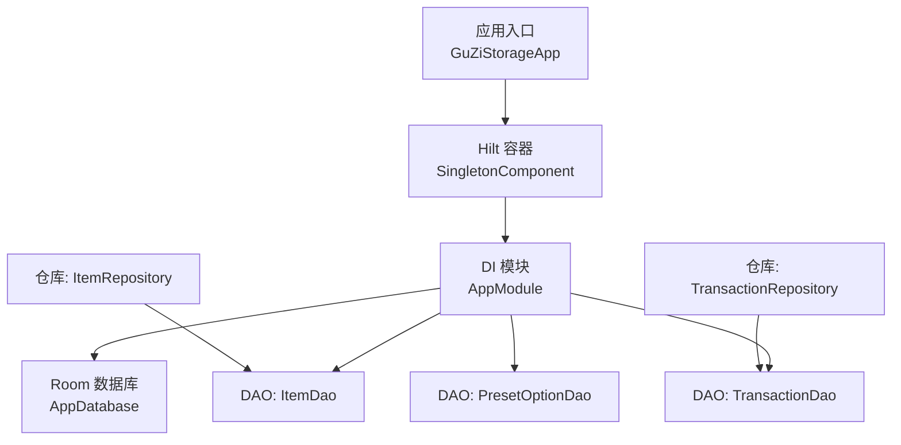
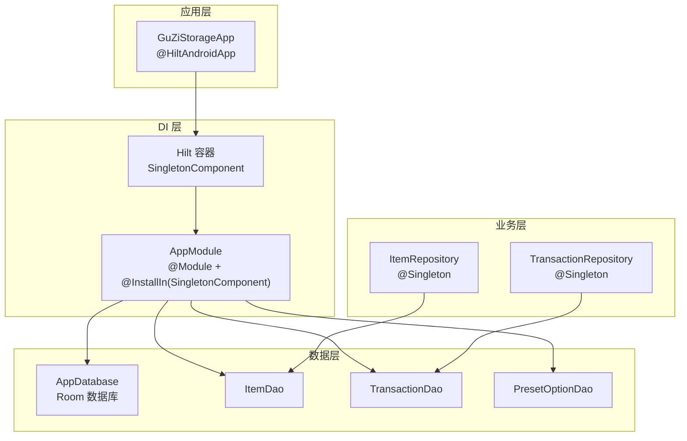
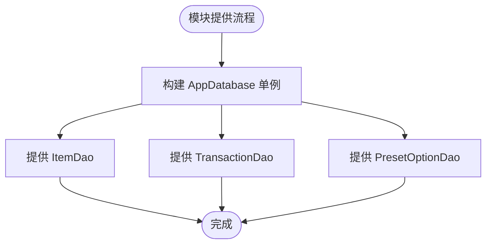
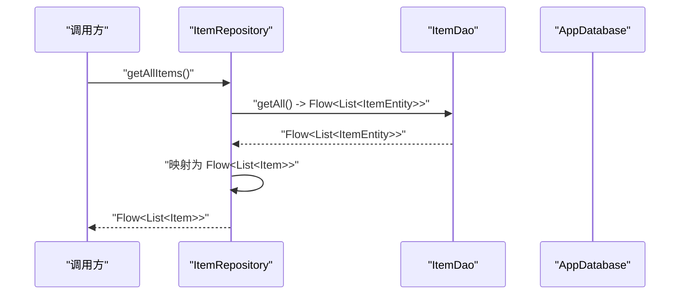
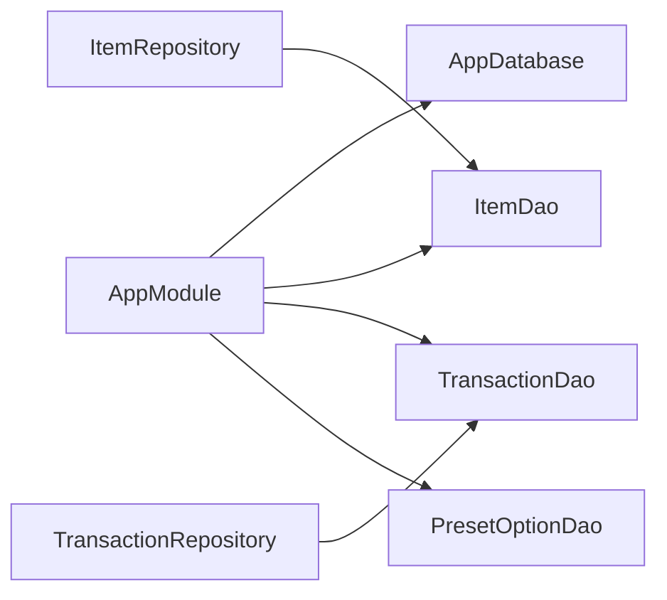

# 依赖注入配置

<cite>
**本文引用的文件**   
- [AppModule.kt](file://GuZiStorage/app/src/main/java/com/guzi/storage/di/AppModule.kt)
- [GuZiStorageApp.kt](file://GuZiStorage/app/src/main/java/com/guzi/storage/GuZiStorageApp.kt)
- [AppDatabase.kt](file://GuZiStorage/app/src/main/java/com/guzi/storage/data/local/AppDatabase.kt)
- [ItemRepository.kt](file://GuZiStorage/app/src/main/java/com/guzi/storage/data/repository/ItemRepository.kt)
- [TransactionRepository.kt](file://GuZiStorage/app/src/main/java/com/guzi/storage/data/repository/TransactionRepository.kt)
- [ItemDao.kt](file://GuZiStorage/app/src/main/java/com/guzi/storage/data/local/dao/ItemDao.kt)
- [TransactionDao.kt](file://GuZiStorage/app/src/main/java/com/guzi/storage/data/local/dao/TransactionDao.kt)
- [PresetOptionDao.kt](file://GuZiStorage/app/src/main/java/com/guzi/storage/data/local/dao/PresetOptionDao.kt)
</cite>

## 目录
1. [简介](#简介)
2. [项目结构](#项目结构)
3. [核心组件](#核心组件)
4. [架构总览](#架构总览)
5. [详细组件分析](#详细组件分析)
6. [依赖关系分析](#依赖关系分析)
7. [性能与生命周期](#性能与生命周期)
8. [测试指南](#测试指南)
9. [常见问题与排障](#常见问题与排障)
10. [结论](#结论)

## 简介
本文件面向“谷子收纳应用”的依赖注入（DI）配置，聚焦 Hilt 在 Android 工程中的落地实践。文档将系统阐述：
- Hilt 模块定义、组件绑定与作用域管理
- AppModule 中数据库与 DAO 的提供方式
- Repository 层如何通过构造器注入获取 DAO
- 依赖注入在测试中的应用策略（模拟对象与测试环境）
- DI 的优势与最佳实践（松耦合、可测试性、可维护性）
- 常见问题的定位与解决方案

## 项目结构
本项目采用分层组织：
- 应用入口与 Hilt 初始化位于 Application 类
- DI 模块集中于 di 包，负责提供数据库与 DAO
- data.local 包含 Room 数据库、DAO 与实体
- data.repository 封装数据访问逻辑并对外暴露 Flow
- domain.model 为领域模型，负责与 Entity 互转

图表来源
- [GuZiStorageApp.kt:1-11](file://GuZiStorage/app/src/main/java/com/guzi/storage/GuZiStorageApp.kt#L1-L11)
- [AppModule.kt:1-50](file://GuZiStorage/app/src/main/java/com/guzi/storage/di/AppModule.kt#L1-L50)
- [AppDatabase.kt:1-34](file://GuZiStorage/app/src/main/java/com/guzi/storage/data/local/AppDatabase.kt#L1-L34)
- [ItemRepository.kt:1-80](file://GuZiStorage/app/src/main/java/com/guzi/storage/data/repository/ItemRepository.kt#L1-L80)
- [TransactionRepository.kt:1-63](file://GuZiStorage/app/src/main/java/com/guzi/storage/data/repository/TransactionRepository.kt#L1-L63)
- [ItemDao.kt:1-90](file://GuZiStorage/app/src/main/java/com/guzi/storage/data/local/dao/ItemDao.kt#L1-L90)
- [TransactionDao.kt:1-49](file://GuZiStorage/app/src/main/java/com/guzi/storage/data/local/dao/TransactionDao.kt#L1-L49)
- [PresetOptionDao.kt:1-42](file://GuZiStorage/app/src/main/java/com/guzi/storage/data/local/dao/PresetOptionDao.kt#L1-L42)

章节来源
- [GuZiStorageApp.kt:1-11](file://GuZiStorage/app/src/main/java/com/guzi/storage/GuZiStorageApp.kt#L1-L11)
- [AppModule.kt:1-50](file://GuZiStorage/app/src/main/java/com/guzi/storage/di/AppModule.kt#L1-L50)
- [AppDatabase.kt:1-34](file://GuZiStorage/app/src/main/java/com/guzi/storage/data/local/AppDatabase.kt#L1-L34)

## 核心组件
- 应用入口与 Hilt 初始化
  - Application 类通过注解启用 Hilt，作为整个应用的 DI 根容器起点。
- DI 模块（AppModule）
  - 使用 @Module 与 @InstallIn(SingletonComponent::class) 声明全局作用域模块。
  - 提供单例级别的 AppDatabase 实例，并通过 @Provides 方法暴露各 DAO。
- 仓库层（Repositories）
  - ItemRepository 与 TransactionRepository 均标注 @Singleton，通过构造器注入对应 DAO。
  - 对外暴露 Flow 响应式接口，完成 Entity ↔ Domain Model 转换。

章节来源
- [GuZiStorageApp.kt:1-11](file://GuZiStorage/app/src/main/java/com/guzi/storage/GuZiStorageApp.kt#L1-L11)
- [AppModule.kt:1-50](file://GuZiStorage/app/src/main/java/com/guzi/storage/di/AppModule.kt#L1-L50)
- [ItemRepository.kt:1-80](file://GuZiStorage/app/src/main/java/com/guzi/storage/data/repository/ItemRepository.kt#L1-L80)
- [TransactionRepository.kt:1-63](file://GuZiStorage/app/src/main/java/com/guzi/storage/data/repository/TransactionRepository.kt#L1-L63)

## 架构总览
下图展示了从 Hilt 容器到数据库与仓库的依赖流向，以及仓库对 DAO 的注入关系。

图表来源
- [GuZiStorageApp.kt:1-11](file://GuZiStorage/app/src/main/java/com/guzi/storage/GuZiStorageApp.kt#L1-L11)
- [AppModule.kt:1-50](file://GuZiStorage/app/src/main/java/com/guzi/storage/di/AppModule.kt#L1-L50)
- [AppDatabase.kt:1-34](file://GuZiStorage/app/src/main/java/com/guzi/storage/data/local/AppDatabase.kt#L1-L34)
- [ItemRepository.kt:1-80](file://GuZiStorage/app/src/main/java/com/guzi/storage/data/repository/ItemRepository.kt#L1-L80)
- [TransactionRepository.kt:1-63](file://GuZiStorage/app/src/main/java/com/guzi/storage/data/repository/TransactionRepository.kt#L1-L63)
- [ItemDao.kt:1-90](file://GuZiStorage/app/src/main/java/com/guzi/storage/data/local/dao/ItemDao.kt#L1-L90)
- [TransactionDao.kt:1-49](file://GuZiStorage/app/src/main/java/com/guzi/storage/data/local/dao/TransactionDao.kt#L1-L49)
- [PresetOptionDao.kt:1-42](file://GuZiStorage/app/src/main/java/com/guzi/storage/data/local/dao/PresetOptionDao.kt#L1-L42)

## 详细组件分析

### Hilt 初始化与全局作用域
- 应用入口 GuZiStorageApp 使用注解标记，使 Hilt 在应用启动时生成并装配依赖图。
- AppModule 安装于 SingletonComponent，表示其提供的实例在整个应用生命周期内唯一。

章节来源
- [GuZiStorageApp.kt:1-11](file://GuZiStorage/app/src/main/java/com/guzi/storage/GuZiStorageApp.kt#L1-L11)
- [AppModule.kt:1-50](file://GuZiStorage/app/src/main/java/com/guzi/storage/di/AppModule.kt#L1-L50)

### 数据库与 DAO 的提供
- 模块提供单例 AppDatabase，使用上下文构建并开启破坏性迁移策略。
- 分别提供 ItemDao、TransactionDao、PresetOptionDao 三个 DAO 实例，供上层消费。

图表来源
- [AppModule.kt:1-50](file://GuZiStorage/app/src/main/java/com/guzi/storage/di/AppModule.kt#L1-L50)
- [AppDatabase.kt:1-34](file://GuZiStorage/app/src/main/java/com/guzi/storage/data/local/AppDatabase.kt#L1-L34)

章节来源
- [AppModule.kt:1-50](file://GuZiStorage/app/src/main/java/com/guzi/storage/di/AppModule.kt#L1-L50)
- [AppDatabase.kt:1-34](file://GuZiStorage/app/src/main/java/com/guzi/storage/data/local/AppDatabase.kt#L1-L34)

### 仓库层注入与职责
- ItemRepository 与 TransactionRepository 均为 @Singleton，通过构造器注入对应 DAO。
- 仓库负责：
  - 调用 DAO 执行 CRUD
  - 将 Entity 转换为领域模型
  - 以 Flow 形式向外暴露响应式数据流

图表来源
- [ItemRepository.kt:1-80](file://GuZiStorage/app/src/main/java/com/guzi/storage/data/repository/ItemRepository.kt#L1-L80)
- [ItemDao.kt:1-90](file://GuZiStorage/app/src/main/java/com/guzi/storage/data/local/dao/ItemDao.kt#L1-L90)
- [AppDatabase.kt:1-34](file://GuZiStorage/app/src/main/java/com/guzi/storage/data/local/AppDatabase.kt#L1-L34)

章节来源
- [ItemRepository.kt:1-80](file://GuZiStorage/app/src/main/java/com/guzi/storage/data/repository/ItemRepository.kt#L1-L80)
- [TransactionRepository.kt:1-63](file://GuZiStorage/app/src/main/java/com/guzi/storage/data/repository/TransactionRepository.kt#L1-L63)

### 作用域与生命周期管理
- 全局单例
  - AppModule 安装于 SingletonComponent，保证数据库与 DAO 的全局唯一性。
  - Repository 标注 @Singleton，确保跨 UI 层共享同一实例。
- 生命周期建议
  - 数据库与 DAO 适合全局单例；避免在短生命周期作用域重复创建。
  - 若未来引入网络或缓存服务，可按需选择 Activity/Fragment 级作用域。

章节来源
- [AppModule.kt:1-50](file://GuZiStorage/app/src/main/java/com/guzi/storage/di/AppModule.kt#L1-L50)
- [ItemRepository.kt:1-80](file://GuZiStorage/app/src/main/java/com/guzi/storage/data/repository/ItemRepository.kt#L1-L80)
- [TransactionRepository.kt:1-63](file://GuZiStorage/app/src/main/java/com/guzi/storage/data/repository/TransactionRepository.kt#L1-L63)

## 依赖关系分析
- 直接依赖
  - Repository → DAO（构造器注入）
  - AppModule → AppDatabase → DAO
- 间接依赖
  - 应用入口 → Hilt 容器 → 模块 → 数据库与 DAO → 仓库
- 潜在循环
  - 当前结构无循环依赖；Repository 仅依赖 DAO，未反向依赖模块或数据库。

图表来源
- [AppModule.kt:1-50](file://GuZiStorage/app/src/main/java/com/guzi/storage/di/AppModule.kt#L1-L50)
- [AppDatabase.kt:1-34](file://GuZiStorage/app/src/main/java/com/guzi/storage/data/local/AppDatabase.kt#L1-L34)
- [ItemRepository.kt:1-80](file://GuZiStorage/app/src/main/java/com/guzi/storage/data/repository/ItemRepository.kt#L1-L80)
- [TransactionRepository.kt:1-63](file://GuZiStorage/app/src/main/java/com/guzi/storage/data/repository/TransactionRepository.kt#L1-L63)
- [ItemDao.kt:1-90](file://GuZiStorage/app/src/main/java/com/guzi/storage/data/local/dao/ItemDao.kt#L1-L90)
- [TransactionDao.kt:1-49](file://GuZiStorage/app/src/main/java/com/guzi/storage/data/local/dao/TransactionDao.kt#L1-L49)
- [PresetOptionDao.kt:1-42](file://GuZiStorage/app/src/main/java/com/guzi/storage/data/local/dao/PresetOptionDao.kt#L1-L42)

章节来源
- [AppModule.kt:1-50](file://GuZiStorage/app/src/main/java/com/guzi/storage/di/AppModule.kt#L1-L50)
- [ItemRepository.kt:1-80](file://GuZiStorage/app/src/main/java/com/guzi/storage/data/repository/ItemRepository.kt#L1-L80)
- [TransactionRepository.kt:1-63](file://GuZiStorage/app/src/main/java/com/guzi/storage/data/repository/TransactionRepository.kt#L1-L63)

## 性能与生命周期
- 数据库连接复用
  - 通过单例 AppDatabase 避免频繁创建与销毁带来的开销。
- DAO 的单例化
  - DAO 由模块提供且被仓库持有，减少对象分配与锁竞争。
- 响应式查询
  - 使用 Flow 进行数据订阅，避免轮询与手动回调管理。
- 迁移策略
  - 开发期可使用破坏性迁移快速迭代；生产环境应配置正式迁移路径以避免数据丢失。

[本节为通用指导，不直接分析具体文件]

## 测试指南
- 单元测试（无 Android 环境）
  - 目标：验证仓库逻辑与领域模型转换。
  - 策略：
    - 使用 Mock 框架模拟 DAO 接口，返回预设的 Flow 或挂起函数结果。
    - 向仓库构造器注入模拟 DAO，断言输出是否符合预期。
- 仪器测试（Android 环境）
  - 目标：验证真实数据库行为与 Hilt 装配。
  - 策略：
    - 使用内存数据库替代持久化存储，避免磁盘 IO。
    - 通过 Hilt 的测试支持（如 @UninstallModules、@BindValue 等）替换模块实现，注入测试用 DAO 或数据库。
- 示例步骤（概念性说明）
  - 为仓库编写测试类，使用模拟 DAO 注入。
  - 在测试中触发仓库方法，收集 Flow 输出并断言。
  - 在仪器测试中，使用内存数据库与测试模块，验证端到端流程。

[本节为通用指导，不直接分析具体文件]

## 常见问题与排障
- 运行时找不到依赖
  - 检查是否已在 Application 上启用 Hilt。
  - 确认模块已正确安装至合适的组件作用域。
- 数据库版本不一致导致崩溃
  - 检查数据库版本与迁移配置；开发阶段可临时使用破坏性迁移，但需在生产环境配置正式迁移。
- DAO 注入失败
  - 确认模块提供了对应 DAO 的 @Provides 方法，且参数类型匹配。
- 单例作用域误用
  - 避免在短生命周期作用域中持有长生命周期对象引用，防止内存泄漏。

章节来源
- [GuZiStorageApp.kt:1-11](file://GuZiStorage/app/src/main/java/com/guzi/storage/GuZiStorageApp.kt#L1-L11)
- [AppModule.kt:1-50](file://GuZiStorage/app/src/main/java/com/guzi/storage/di/AppModule.kt#L1-L50)
- [AppDatabase.kt:1-34](file://GuZiStorage/app/src/main/java/com/guzi/storage/data/local/AppDatabase.kt#L1-L34)

## 结论
本项目通过 Hilt 实现了清晰、可维护的依赖注入体系：
- 使用模块化方式集中提供数据库与 DAO
- 通过作用域控制实例生命周期，提升性能与一致性
- 仓库层以构造器注入获得 DAO，便于测试与扩展
- 结合 Flow 提供响应式数据流，简化异步数据处理

建议在后续演进中：
- 按功能拆分更多模块，保持高内聚低耦合
- 完善生产环境的数据库迁移策略
- 持续补充单元测试与仪器测试，覆盖关键路径

[本节为总结性内容，不直接分析具体文件]