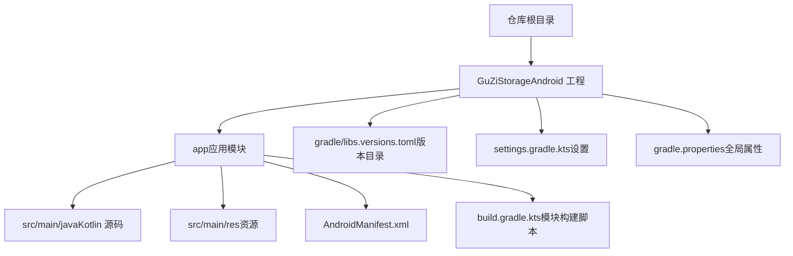
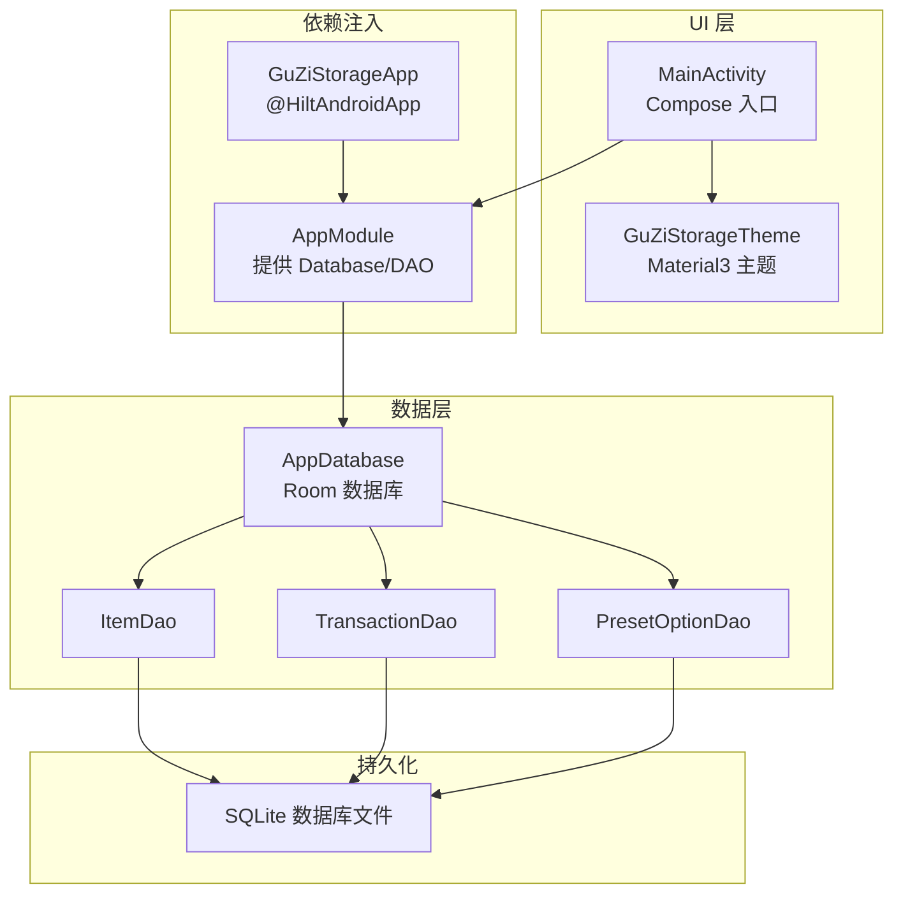
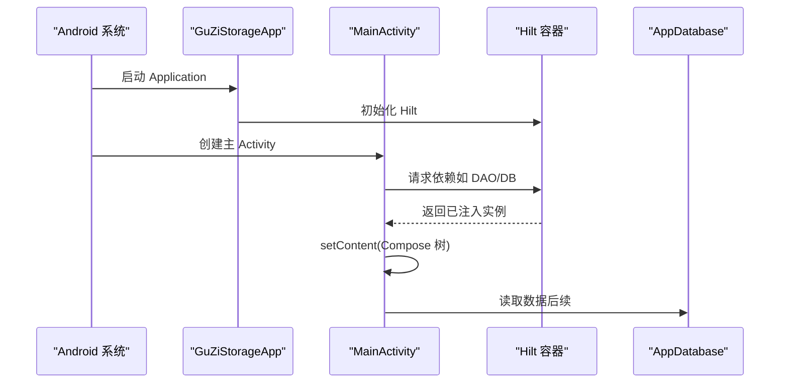
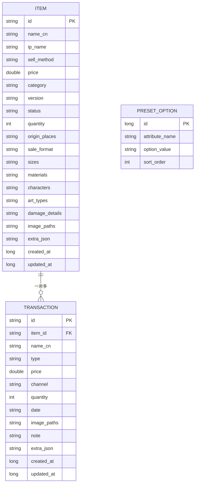
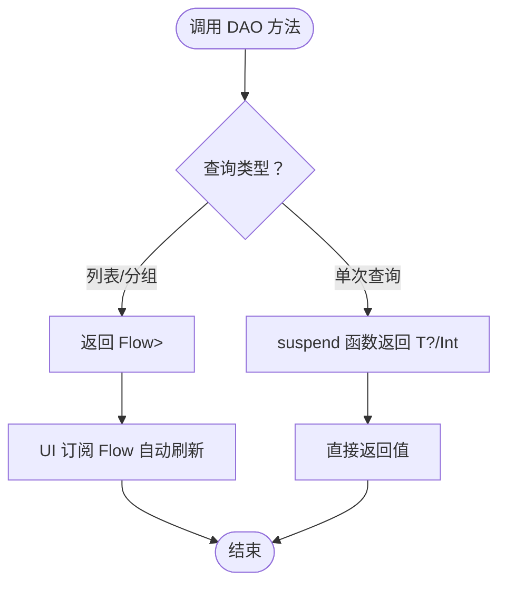
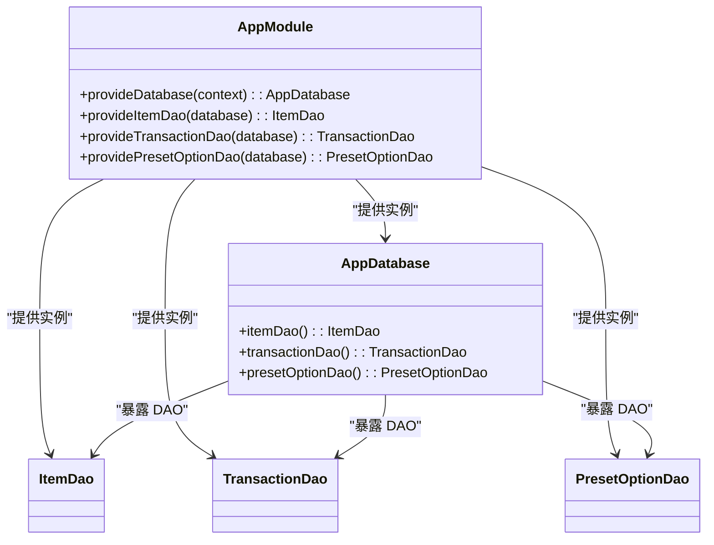

# 开发指南

<cite>
**本文引用的文件**   
- [基础prd.md](file://基础prd.md)
- [build.gradle.kts](file://GuZiStorage/build.gradle.kts)
- [app/build.gradle.kts](file://GuZiStorage/app/build.gradle.kts)
- [gradle/libs.versions.toml](file://GuZiStorage/gradle/libs.versions.toml)
- [settings.gradle.kts](file://GuZiStorage/settings.gradle.kts)
- [gradle.properties](file://GuZiStorage/gradle.properties)
- [AndroidManifest.xml](file://GuZiStorage/app/src/main/AndroidManifest.xml)
- [MainActivity.kt](file://GuZiStorage/app/src/main/java/com/guzi/storage/MainActivity.kt)
- [GuZiStorageApp.kt](file://GuZiStorage/app/src/main/java/com/guzi/storage/GuZiStorageApp.kt)
- [AppDatabase.kt](file://GuZiStorage/app/src/main/java/com/guzi/storage/data/local/AppDatabase.kt)
- [AppModule.kt](file://GuZiStorage/app/src/main/java/com/guzi/storage/di/AppModule.kt)
- [ItemEntity.kt](file://GuZiStorage/app/src/main/java/com/guzi/storage/data/local/entity/ItemEntity.kt)
- [TransactionEntity.kt](file://GuZiStorage/app/src/main/java/com/guzi/storage/data/local/entity/TransactionEntity.kt)
- [PresetOptionEntity.kt](file://GuZiStorage/app/src/main/java/com/guzi/storage/data/local/entity/PresetOptionEntity.kt)
- [ItemDao.kt](file://GuZiStorage/app/src/main/java/com/guzi/storage/data/local/dao/ItemDao.kt)
- [TransactionDao.kt](file://GuZiStorage/app/src/main/java/com/guzi/storage/data/local/dao/TransactionDao.kt)
- [PresetOptionDao.kt](file://GuZiStorage/app/src/main/java/com/guzi/storage/data/local/dao/PresetOptionDao.kt)
</cite>

## 目录
1. [简介](#简介)
2. [项目结构](#项目结构)
3. [核心组件](#核心组件)
4. [架构总览](#架构总览)
5. [详细组件分析](#详细组件分析)
6. [依赖与版本管理](#依赖与版本管理)
7. [构建与运行](#构建与运行)
8. [代码规范与命名约定](#代码规范与命名约定)
9. [调试与性能分析](#调试与性能分析)
10. [Git 工作流与版本策略](#git-工作流与版本策略)
11. [常见问题排查](#常见问题排查)
12. [结论](#结论)

## 简介
本指南面向“谷子收纳”Android 应用的开发者，覆盖从环境搭建、Gradle 配置、依赖与版本控制，到代码规范、调试技巧、Git 工作流以及问题排查的完整流程。应用基于 Kotlin + Compose + Room + Hilt 技术栈，采用本地 SQLite 存储，遵循隐私优先与可扩展性原则。

## 项目结构
仓库根目录包含产品需求文档与 Android 工程。Android 工程位于 GuZiStorage 下，采用单模块 app 的结构，使用 Gradle Version Catalog 集中管理依赖与插件版本。

图表来源
- [settings.gradle.kts:1-25](file://GuZiStorage/settings.gradle.kts#L1-L25)
- [gradle/libs.versions.toml:1-67](file://GuZiStorage/gradle/libs.versions.toml#L1-L67)
- [app/build.gradle.kts:1-97](file://GuZiStorage/app/build.gradle.kts#L1-L97)

章节来源
- [settings.gradle.kts:1-25](file://GuZiStorage/settings.gradle.kts#L1-L25)
- [gradle/libs.versions.toml:1-67](file://GuZiStorage/gradle/libs.versions.toml#L1-L67)
- [app/build.gradle.kts:1-97](file://GuZiStorage/app/build.gradle.kts#L1-L97)

## 核心组件
- 应用入口与主题
  - Application：用于初始化 Hilt。
  - Activity：Compose 入口，启用 Edge-to-Edge，挂载主题与 Scaffold。
- 数据层
  - Room 数据库定义与 DAO 接口。
  - 实体：物品、交易记录、预设选项。
- 依赖注入
  - Hilt 模块提供数据库与 DAO 实例。

章节来源
- [GuZiStorageApp.kt:1-11](file://GuZiStorage/app/src/main/java/com/guzi/storage/GuZiStorageApp.kt#L1-L11)
- [MainActivity.kt:1-55](file://GuZiStorage/app/src/main/java/com/guzi/storage/MainActivity.kt#L1-L55)
- [AppDatabase.kt:1-34](file://GuZiStorage/app/src/main/java/com/guzi/storage/data/local/AppDatabase.kt#L1-L34)
- [AppModule.kt:1-50](file://GuZiStorage/app/src/main/java/com/guzi/storage/di/AppModule.kt#L1-L50)
- [ItemEntity.kt:1-89](file://GuZiStorage/app/src/main/java/com/guzi/storage/data/local/entity/ItemEntity.kt#L1-L89)
- [TransactionEntity.kt:1-65](file://GuZiStorage/app/src/main/java/com/guzi/storage/data/local/entity/TransactionEntity.kt#L1-L65)
- [PresetOptionEntity.kt:1-37](file://GuZiStorage/app/src/main/java/com/guzi/storage/data/local/entity/PresetOptionEntity.kt#L1-L37)
- [ItemDao.kt:1-90](file://GuZiStorage/app/src/main/java/com/guzi/storage/data/local/dao/ItemDao.kt#L1-L90)
- [TransactionDao.kt:1-49](file://GuZiStorage/app/src/main/java/com/guzi/storage/data/local/dao/TransactionDao.kt#L1-L49)
- [PresetOptionDao.kt:1-42](file://GuZiStorage/app/src/main/java/com/guzi/storage/data/local/dao/PresetOptionDao.kt#L1-L42)

## 架构总览
应用采用分层架构：UI 层（Compose）→ 业务层（ViewModel/Repository，后续扩展）→ 数据层（Room + DAO）→ 持久化（SQLite）。Hilt 负责依赖注入，Room 负责数据访问与迁移。

图表来源
- [MainActivity.kt:1-55](file://GuZiStorage/app/src/main/java/com/guzi/storage/MainActivity.kt#L1-L55)
- [GuZiStorageApp.kt:1-11](file://GuZiStorage/app/src/main/java/com/guzi/storage/GuZiStorageApp.kt#L1-L11)
- [AppModule.kt:1-50](file://GuZiStorage/app/src/main/java/com/guzi/storage/di/AppModule.kt#L1-L50)
- [AppDatabase.kt:1-34](file://GuZiStorage/app/src/main/java/com/guzi/storage/data/local/AppDatabase.kt#L1-L34)
- [ItemDao.kt:1-90](file://GuZiStorage/app/src/main/java/com/guzi/storage/data/local/dao/ItemDao.kt#L1-L90)
- [TransactionDao.kt:1-49](file://GuZiStorage/app/src/main/java/com/guzi/storage/data/local/dao/TransactionDao.kt#L1-L49)
- [PresetOptionDao.kt:1-42](file://GuZiStorage/app/src/main/java/com/guzi/storage/data/local/dao/PresetOptionDao.kt#L1-L42)

## 详细组件分析

### 应用启动与 UI 入口
- Application 类标注 Hilt 注解，完成依赖注入框架初始化。
- MainActivity 作为 Compose 入口，启用 Edge-to-Edge，加载主题并渲染初始界面。

图表来源
- [GuZiStorageApp.kt:1-11](file://GuZiStorage/app/src/main/java/com/guzi/storage/GuZiStorageApp.kt#L1-L11)
- [MainActivity.kt:1-55](file://GuZiStorage/app/src/main/java/com/guzi/storage/MainActivity.kt#L1-L55)
- [AppModule.kt:1-50](file://GuZiStorage/app/src/main/java/com/guzi/storage/di/AppModule.kt#L1-L50)
- [AppDatabase.kt:1-34](file://GuZiStorage/app/src/main/java/com/guzi/storage/data/local/AppDatabase.kt#L1-L34)

章节来源
- [GuZiStorageApp.kt:1-11](file://GuZiStorage/app/src/main/java/com/guzi/storage/GuZiStorageApp.kt#L1-L11)
- [MainActivity.kt:1-55](file://GuZiStorage/app/src/main/java/com/guzi/storage/MainActivity.kt#L1-L55)

### 数据模型与关系
- 物品实体：包含基础字段、多选字段（管道符分隔）、扩展 JSON 字段与时间戳。
- 交易记录实体：通过外键关联物品，支持级联删除。
- 预设选项实体：按属性名与选项值唯一约束，便于下拉选择与自动补全。

图表来源
- [ItemEntity.kt:1-89](file://GuZiStorage/app/src/main/java/com/guzi/storage/data/local/entity/ItemEntity.kt#L1-L89)
- [TransactionEntity.kt:1-65](file://GuZiStorage/app/src/main/java/com/guzi/storage/data/local/entity/TransactionEntity.kt#L1-L65)
- [PresetOptionEntity.kt:1-37](file://GuZiStorage/app/src/main/java/com/guzi/storage/data/local/entity/PresetOptionEntity.kt#L1-L37)

章节来源
- [ItemEntity.kt:1-89](file://GuZiStorage/app/src/main/java/com/guzi/storage/data/local/entity/ItemEntity.kt#L1-L89)
- [TransactionEntity.kt:1-65](file://GuZiStorage/app/src/main/java/com/guzi/storage/data/local/entity/TransactionEntity.kt#L1-L65)
- [PresetOptionEntity.kt:1-37](file://GuZiStorage/app/src/main/java/com/guzi/storage/data/local/entity/PresetOptionEntity.kt#L1-L37)

### 数据访问层（DAO）
- 物品 DAO：提供分组查询、关键词搜索、角色筛选、批量插入与删除等能力，返回 Flow 以支持响应式更新。
- 交易 DAO：提供按物品 ID 查询、计数、CRUD 操作。
- 预设选项 DAO：提供按属性获取选项列表、去重属性名、增删操作。

图表来源
- [ItemDao.kt:1-90](file://GuZiStorage/app/src/main/java/com/guzi/storage/data/local/dao/ItemDao.kt#L1-L90)
- [TransactionDao.kt:1-49](file://GuZiStorage/app/src/main/java/com/guzi/storage/data/local/dao/TransactionDao.kt#L1-L49)
- [PresetOptionDao.kt:1-42](file://GuZiStorage/app/src/main/java/com/guzi/storage/data/local/dao/PresetOptionDao.kt#L1-L42)

章节来源
- [ItemDao.kt:1-90](file://GuZiStorage/app/src/main/java/com/guzi/storage/data/local/dao/ItemDao.kt#L1-L90)
- [TransactionDao.kt:1-49](file://GuZiStorage/app/src/main/java/com/guzi/storage/data/local/dao/TransactionDao.kt#L1-L49)
- [PresetOptionDao.kt:1-42](file://GuZiStorage/app/src/main/java/com/guzi/storage/data/local/dao/PresetOptionDao.kt#L1-L42)

### 依赖注入（Hilt）
- AppModule 在 SingletonComponent 中提供 AppDatabase 及 DAO 实例，使用 @Provides/@Singleton 保证全局单例。
- 数据库构建时启用破坏性迁移（仅开发阶段建议），生产需替换为正式 Migration。

图表来源
- [AppModule.kt:1-50](file://GuZiStorage/app/src/main/java/com/guzi/storage/di/AppModule.kt#L1-L50)
- [AppDatabase.kt:1-34](file://GuZiStorage/app/src/main/java/com/guzi/storage/data/local/AppDatabase.kt#L1-L34)

章节来源
- [AppModule.kt:1-50](file://GuZiStorage/app/src/main/java/com/guzi/storage/di/AppModule.kt#L1-L50)
- [AppDatabase.kt:1-34](file://GuZiStorage/app/src/main/java/com/guzi/storage/data/local/AppDatabase.kt#L1-L34)

## 依赖与版本管理
- 统一版本管理：通过 gradle/libs.versions.toml 集中声明 AGP、Kotlin、Compose BOM、Room、Hilt、Coil、Coroutines、KSP 等版本。
- 插件与依赖引用：顶层 build.gradle.kts 与 app/build.gradle.kts 使用 alias(libs.plugins.*) 和 libs.* 引用，避免散落的版本号。
- 仓库源与解析模式：settings.gradle.kts 配置 google/mavenCentral/gradlePluginPortal，并启用 FAIL_ON_PROJECT_REPOS 强制集中管理。
- 编译与 JVM 目标：Java/Kotlin 目标均为 17；Compose 启用；ProGuard 规则路径存在但默认关闭混淆。

章节来源
- [gradle/libs.versions.toml:1-67](file://GuZiStorage/gradle/libs.versions.toml#L1-L67)
- [build.gradle.kts:1-9](file://GuZiStorage/build.gradle.kts#L1-L9)
- [app/build.gradle.kts:1-97](file://GuZiStorage/app/build.gradle.kts#L1-L97)
- [settings.gradle.kts:1-25](file://GuZiStorage/settings.gradle.kts#L1-L25)
- [gradle.properties:1-5](file://GuZiStorage/gradle.properties#L1-L5)

## 构建与运行
- 最低 SDK 与目标 SDK：minSdk=26，targetSdk=34，compileSdk=34。
- 应用包名与入口：applicationId=com.guzi.storage；AndroidManifest 声明 MainActivity 为 LAUNCHER。
- Compose 与 Material3：启用 Compose 与 Material3 组件库。
- 测试依赖：Junit、Espresso、Compose Test 依赖已引入。

章节来源
- [app/build.gradle.kts:10-46](file://GuZiStorage/app/build.gradle.kts#L10-L46)
- [AndroidManifest.xml:1-24](file://GuZiStorage/app/src/main/AndroidManifest.xml#L1-L24)

## 代码规范与命名约定
- Kotlin 官方风格：gradle.properties 中 kotlin.code.style=official，IDE 应启用官方格式化。
- 包与类命名：
  - 包名小写点分：com.guzi.storage
  - 类名大驼峰：MainActivity、AppDatabase、ItemEntity
  - 方法与变量小驼峰：getItemsByIp、nameCn
- 常量与枚举：常量全大写加下划线；枚举名大驼峰。
- 注释与文档：关键类与方法保留 KDoc 注释，说明职责与边界条件。
- 数据库字段映射：使用 @ColumnInfo 明确列名，保持与 PRD 字段语义一致。
- 错误处理：DAO 层 suspend 函数抛出异常由上层捕获；UI 层展示友好提示。

章节来源
- [gradle.properties:1-5](file://GuZiStorage/gradle.properties#L1-L5)
- [ItemEntity.kt:1-89](file://GuZiStorage/app/src/main/java/com/guzi/storage/data/local/entity/ItemEntity.kt#L1-L89)
- [TransactionEntity.kt:1-65](file://GuZiStorage/app/src/main/java/com/guzi/storage/data/local/entity/TransactionEntity.kt#L1-L65)
- [PresetOptionEntity.kt:1-37](file://GuZiStorage/app/src/main/java/com/guzi/storage/data/local/entity/PresetOptionEntity.kt#L1-L37)

## 调试与性能分析
- 日志记录
  - 使用 Timber 或 Logcat 过滤 com.guzi.storage 包进行定位。
  - 对关键路径（DAO 调用、网络/IO）添加结构化日志，避免泄露敏感信息。
- 性能分析
  - CPU/内存：使用 Android Studio Profiler 分析热点与内存泄漏。
  - 数据库：使用 Room 的 SQL 日志与 Profile Queries 检查慢查询；确保索引合理（如 IP、状态、分类）。
  - UI 渲染：使用 Layout Inspector 与 Compose Preview 验证布局与重复重组。
- 崩溃与 ANR
  - 开启非传递 RClass 减少资源体积；release 构建可逐步开启混淆与资源压缩。
  - 监控主线程阻塞，避免在 IO 上执行耗时逻辑。

[本节为通用指导，不直接分析具体文件]

## Git 工作流与版本策略
- 分支模型
  - main：稳定发布分支
  - develop：集成开发分支
  - feature/*：功能分支
  - hotfix/*：紧急修复分支
- 提交规范
  - 使用约定式提交（feat/fix/docs/chore 等），附带简短描述与影响范围。
- 版本管理
  - 结合 app/build.gradle.kts 中的 versionCode/versionName 与标签 vX.Y.Z 对应。
  - 变更日志维护于独立文件或 Release Notes。
- 合并策略
  - Pull Request 评审通过后合并至 develop，再打 Tag 合并至 main。

[本节为通用指导，不直接分析具体文件]

## 常见问题排查
- 无法同步或下载依赖
  - 检查 settings.gradle.kts 仓库源是否可达；确认代理与镜像配置。
  - 清理 Gradle 缓存并重新同步。
- 编译失败（Kotlin/AGP 版本不匹配）
  - 核对 libs.versions.toml 中 Kotlin 与 KSP 版本一致性。
  - 确保 JDK 17 可用且 JAVA_HOME 正确。
- Room 编译错误
  - 确认 ksp 插件与 room-compiler 版本匹配；清理构建后重建。
- Hilt 注入失败
  - 检查 @HiltAndroidApp 与 @AndroidEntryPoint 是否正确标注；确认@Module 与 @InstallIn 配置。
- 数据库迁移问题
  - 当前使用 fallbackToDestructiveMigration，升级时需实现正式 Migration 以避免数据丢失。
- 图片加载异常
  - 检查 Coil 依赖与权限；确认图片路径有效。

章节来源
- [settings.gradle.kts:1-25](file://GuZiStorage/settings.gradle.kts#L1-L25)
- [gradle/libs.versions.toml:1-67](file://GuZiStorage/gradle/libs.versions.toml#L1-L67)
- [app/build.gradle.kts:1-97](file://GuZiStorage/app/build.gradle.kts#L1-L97)
- [AppModule.kt:1-50](file://GuZiStorage/app/src/main/java/com/guzi/storage/di/AppModule.kt#L1-L50)
- [AppDatabase.kt:1-34](file://GuZiStorage/app/src/main/java/com/guzi/storage/data/local/AppDatabase.kt#L1-L34)

## 结论
本项目以清晰的模块化结构与统一的版本管理为基础，结合 Room 与 Hilt 提供了可扩展的数据与依赖注入方案。遵循本文的开发环境与规范指引，可快速搭建本地开发环境、高效协作与持续交付。后续迭代建议在 release 构建中启用混淆与资源优化，并为数据库增加正式的迁移脚本，保障数据完整性与稳定性。