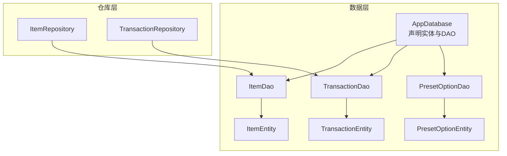
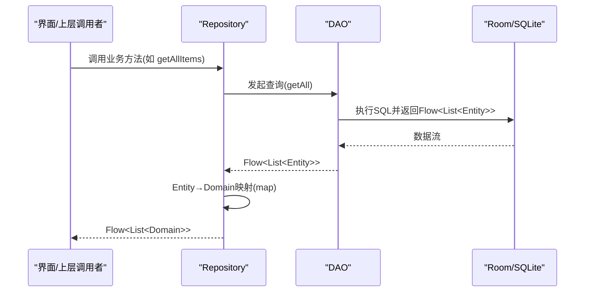
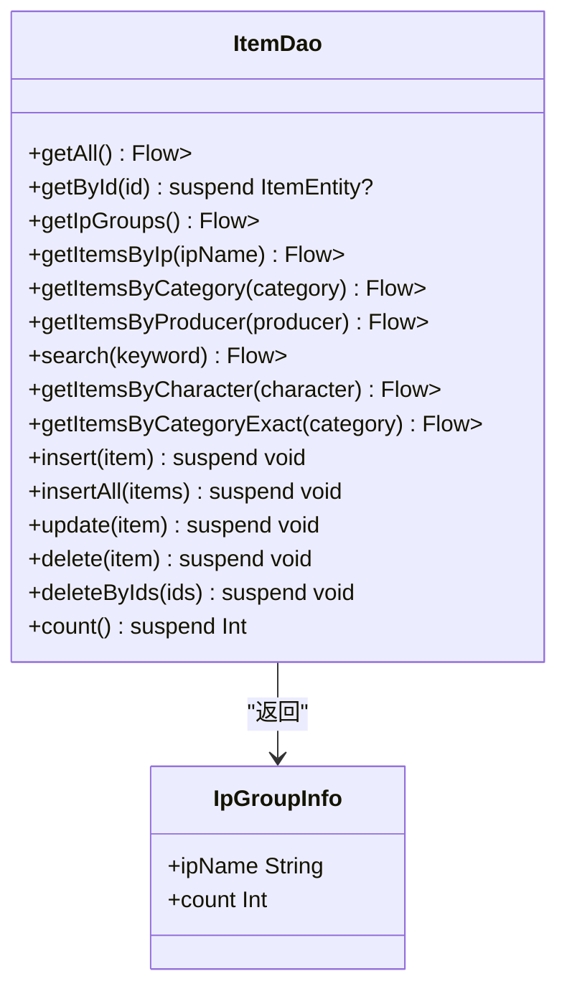
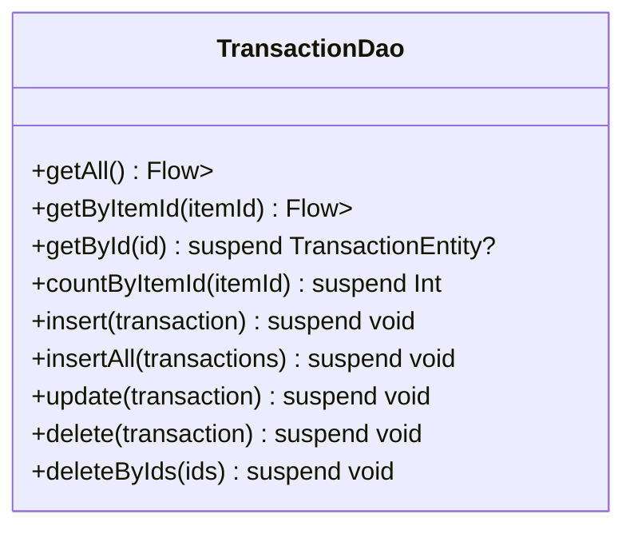
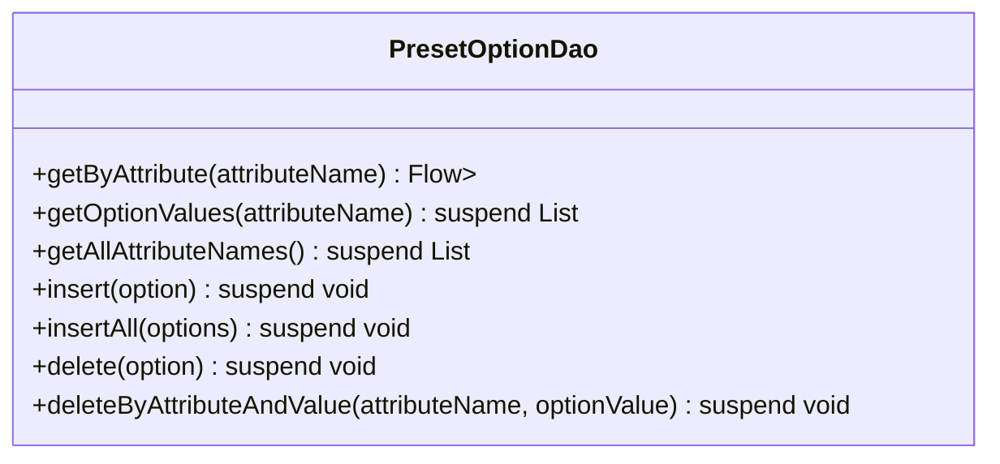
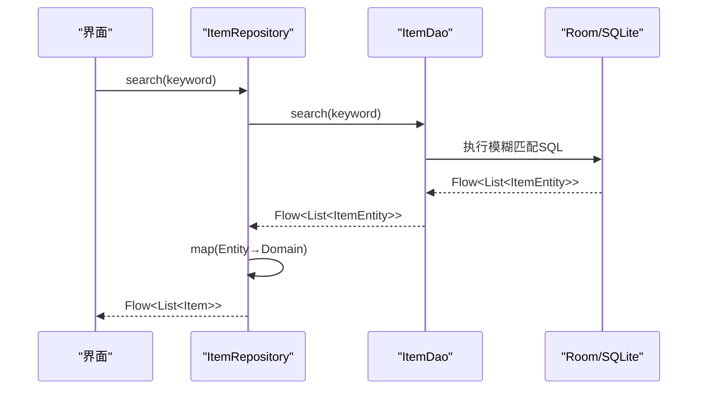
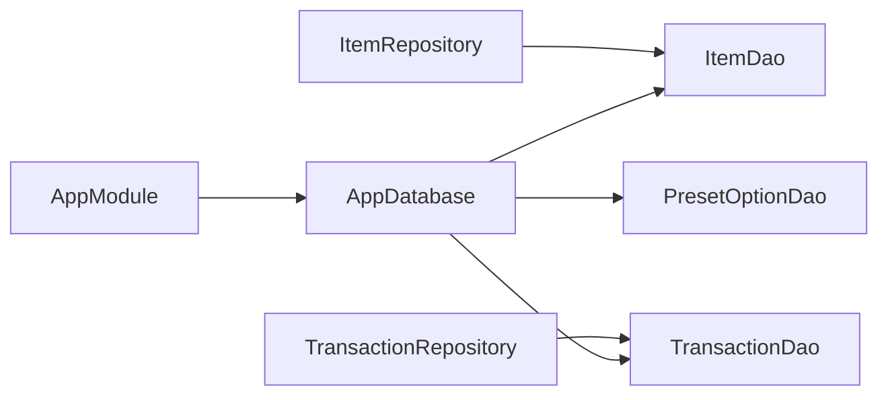

# DAO接口设计

<cite>
**本文引用的文件**   
- [ItemDao.kt](file://GuZiStorage/app/src/main/java/com/guzi/storage/data/local/dao/ItemDao.kt)
- [TransactionDao.kt](file://GuZiStorage/app/src/main/java/com/guzi/storage/data/local/dao/TransactionDao.kt)
- [PresetOptionDao.kt](file://GuZiStorage/app/src/main/java/com/guzi/storage/data/local/dao/PresetOptionDao.kt)
- [ItemEntity.kt](file://GuZiStorage/app/src/main/java/com/guzi/storage/data/local/entity/ItemEntity.kt)
- [TransactionEntity.kt](file://GuZiStorage/app/src/main/java/com/guzi/storage/data/local/entity/TransactionEntity.kt)
- [PresetOptionEntity.kt](file://GuZiStorage/app/src/main/java/com/guzi/storage/data/local/entity/PresetOptionEntity.kt)
- [AppDatabase.kt](file://GuZiStorage/app/src/main/java/com/guzi/storage/data/local/AppDatabase.kt)
- [AppModule.kt](file://GuZiStorage/app/src/main/java/com/guzi/storage/di/AppModule.kt)
- [ItemRepository.kt](file://GuZiStorage/app/src/main/java/com/guzi/storage/data/repository/ItemRepository.kt)
- [TransactionRepository.kt](file://GuZiStorage/app/src/main/java/com/guzi/storage/data/repository/TransactionRepository.kt)
</cite>

## 目录
1. [引言](#引言)
2. [项目结构](#项目结构)
3. [核心组件](#核心组件)
4. [架构总览](#架构总览)
5. [详细组件分析](#详细组件分析)
6. [依赖关系分析](#依赖关系分析)
7. [性能与索引优化](#性能与索引优化)
8. [扩展性与向后兼容](#扩展性与向后兼容)
9. [故障排查指南](#故障排查指南)
10. [结论](#结论)

## 引言
本文件面向谷子收纳应用的Room数据层，聚焦DAO接口的设计原则、最佳实践与实现细节。文档围绕三个核心DAO：ItemDao、TransactionDao、PresetOptionDao，系统阐述其职责边界、方法命名规范、参数传递方式、返回值类型选择（Flow与suspend函数）、Room注解使用要点，并给出可扩展的查询设计与向后兼容性策略。读者无需深入源码即可理解整体设计思路与实践建议。

## 项目结构
数据访问层采用“数据库 → DAO → Repository”的分层组织：
- AppDatabase声明实体与版本，并提供DAO获取入口
- 各DAO定义对表的CRUD与查询方法
- Repository封装领域模型与实体的转换，向上暴露统一API

图表来源
- [AppDatabase.kt:20-33](file://GuZiStorage/app/src/main/java/com/guzi/storage/data/local/AppDatabase.kt#L20-L33)
- [ItemDao.kt:15-89](file://GuZiStorage/app/src/main/java/com/guzi/storage/data/local/dao/ItemDao.kt#L15-L89)
- [TransactionDao.kt:15-48](file://GuZiStorage/app/src/main/java/com/guzi/storage/data/local/dao/TransactionDao.kt#L15-L48)
- [PresetOptionDao.kt:14-41](file://GuZiStorage/app/src/main/java/com/guzi/storage/data/local/dao/PresetOptionDao.kt#L14-L41)
- [ItemEntity.kt:16-88](file://GuZiStorage/app/src/main/java/com/guzi/storage/data/local/entity/ItemEntity.kt#L16-L88)
- [TransactionEntity.kt:14-64](file://GuZiStorage/app/src/main/java/com/guzi/storage/data/local/entity/TransactionEntity.kt#L14-L64)
- [PresetOptionEntity.kt:15-36](file://GuZiStorage/app/src/main/java/com/guzi/storage/data/local/entity/PresetOptionEntity.kt#L15-L36)
- [ItemRepository.kt:17-79](file://GuZiStorage/app/src/main/java/com/guzi/storage/data/repository/ItemRepository.kt#L17-L79)
- [TransactionRepository.kt:14-62](file://GuZiStorage/app/src/main/java/com/guzi/storage/data/repository/TransactionRepository.kt#L14-L62)

章节来源
- [AppDatabase.kt:20-33](file://GuZiStorage/app/src/main/java/com/guzi/storage/data/local/AppDatabase.kt#L20-L33)
- [AppModule.kt:23-48](file://GuZiStorage/app/src/main/java/com/guzi/storage/di/AppModule.kt#L23-L48)

## 核心组件
本节概述三个DAO的职责分工与设计模式：
- ItemDao：负责物品表的所有读写与复杂筛选（分组、模糊搜索、多条件过滤），返回响应式流或挂起函数结果
- TransactionDao：负责交易记录的读写与按物品维度的统计与查询
- PresetOptionDao：负责预设选项的增删查，提供属性值列表与去重属性名集合

设计要点：
- 查询类方法优先返回Flow<List<T>>以支持UI实时刷新；单条或少量聚合查询使用suspend函数
- 写入操作统一使用suspend函数，避免阻塞主线程
- 通过@Insert/@Update/@Delete/@Query等注解声明SQL语义，结合onConflict策略保证幂等性
- 在Repository层进行Entity↔Domain Model映射，DAO保持纯数据访问职责

章节来源
- [ItemDao.kt:15-89](file://GuZiStorage/app/src/main/java/com/guzi/storage/data/local/dao/ItemDao.kt#L15-L89)
- [TransactionDao.kt:15-48](file://GuZiStorage/app/src/main/java/com/guzi/storage/data/local/dao/TransactionDao.kt#L15-L48)
- [PresetOptionDao.kt:14-41](file://GuZiStorage/app/src/main/java/com/guzi/storage/data/local/dao/PresetOptionDao.kt#L14-L41)
- [ItemRepository.kt:23-79](file://GuZiStorage/app/src/main/java/com/guzi/storage/data/repository/ItemRepository.kt#L23-L79)
- [TransactionRepository.kt:20-62](file://GuZiStorage/app/src/main/java/com/guzi/storage/data/repository/TransactionRepository.kt#L20-L62)

## 架构总览
DAO作为数据访问抽象，被Repository注入并使用。Hilt模块提供数据库实例与DAO实例，确保生命周期与单例管理。

图表来源
- [ItemRepository.kt:23-45](file://GuZiStorage/app/src/main/java/com/guzi/storage/data/repository/ItemRepository.kt#L23-L45)
- [ItemDao.kt:20-56](file://GuZiStorage/app/src/main/java/com/guzi/storage/data/local/dao/ItemDao.kt#L20-L56)
- [AppModule.kt:23-48](file://GuZiStorage/app/src/main/java/com/guzi/storage/di/AppModule.kt#L23-L48)

## 详细组件分析

### ItemDao 分析与设计
职责：
- 全量与分页友好的排序查询（按更新时间倒序）
- 按IP、分类、生产者、角色等多维度筛选
- 关键词模糊搜索（中文名/IP名/英文名）
- IP分组统计（名称+数量）
- 基础CRUD与批量删除、计数

关键设计点：
- 查询方法返回Flow<List<ItemEntity>>，便于UI订阅实时更新
- 单条查询使用suspend返回可空类型，避免空指针
- 分组统计返回自定义data class，提升可读性与类型安全
- 模糊匹配使用LIKE拼接，注意性能与索引配合

图表来源
- [ItemDao.kt:15-89](file://GuZiStorage/app/src/main/java/com/guzi/storage/data/local/dao/ItemDao.kt#L15-L89)

章节来源
- [ItemDao.kt:15-89](file://GuZiStorage/app/src/main/java/com/guzi/storage/data/local/dao/ItemDao.kt#L15-L89)

### TransactionDao 分析与设计
职责：
- 交易记录的全量与按物品ID筛选
- 单条查询与按物品ID计数
- 基础CRUD与批量删除

关键设计点：
- 按created_at倒序展示最新交易
- countByItemId用于快速统计某物品的交易次数
- 外键关联ItemEntity，级联删除保证一致性

图表来源
- [TransactionDao.kt:15-48](file://GuZiStorage/app/src/main/java/com/guzi/storage/data/local/dao/TransactionDao.kt#L15-L48)

章节来源
- [TransactionDao.kt:15-48](file://GuZiStorage/app/src/main/java/com/guzi/storage/data/local/dao/TransactionDao.kt#L15-L48)

### PresetOptionDao 分析与设计
职责：
- 按属性名获取选项列表（有序）
- 仅返回选项值的轻量查询
- 获取所有不重复的属性名集合
- 插入时忽略冲突，删除支持按属性与值组合

关键设计点：
- 联合唯一约束保障同一属性下选项值不重复
- getOptionValues返回List<String>减少数据传输开销
- insertAll用于初始化预设选项

图表来源
- [PresetOptionDao.kt:14-41](file://GuZiStorage/app/src/main/java/com/guzi/storage/data/local/dao/PresetOptionDao.kt#L14-L41)

章节来源
- [PresetOptionDao.kt:14-41](file://GuZiStorage/app/src/main/java/com/guzi/storage/data/local/dao/PresetOptionDao.kt#L14-L41)

### 查询流程时序示例（以物品搜索为例）

图表来源
- [ItemRepository.kt:41-45](file://GuZiStorage/app/src/main/java/com/guzi/storage/data/repository/ItemRepository.kt#L41-L45)
- [ItemDao.kt:49-56](file://GuZiStorage/app/src/main/java/com/guzi/storage/data/local/dao/ItemDao.kt#L49-L56)

## 依赖关系分析
- AppDatabase集中声明实体与DAO，并通过抽象方法暴露DAO实例
- Hilt AppModule提供数据库与DAO的单例绑定
- Repository依赖DAO，完成Entity到Domain模型的映射与业务编排

图表来源
- [AppModule.kt:23-48](file://GuZiStorage/app/src/main/java/com/guzi/storage/di/AppModule.kt#L23-L48)
- [AppDatabase.kt:20-33](file://GuZiStorage/app/src/main/java/com/guzi/storage/data/local/AppDatabase.kt#L20-L33)
- [ItemRepository.kt:17-24](file://GuZiStorage/app/src/main/java/com/guzi/storage/data/repository/ItemRepository.kt#L17-L24)
- [TransactionRepository.kt:14-21](file://GuZiStorage/app/src/main/java/com/guzi/storage/data/repository/TransactionRepository.kt#L14-L21)

章节来源
- [AppModule.kt:23-48](file://GuZiStorage/app/src/main/java/com/guzi/storage/di/AppModule.kt#L23-L48)
- [AppDatabase.kt:20-33](file://GuZiStorage/app/src/main/java/com/guzi/storage/data/local/AppDatabase.kt#L20-L33)

## 性能与索引优化
- 常用筛选字段建立索引以提升查询性能：
  - items表：ip_name、status、category已建索引
  - transactions表：item_id已建索引
  - preset_options表：attribute_name与option_value联合唯一索引
- 模糊搜索使用LIKE拼接，建议在必要时为name_cn、ip_name、name_en等列添加索引，但需权衡写入成本
- 多选字段以管道符分隔存储，适合简单包含匹配；若未来需要更复杂的集合查询，考虑引入中间表

章节来源
- [ItemEntity.kt:16-22](file://GuZiStorage/app/src/main/java/com/guzi/storage/data/local/entity/ItemEntity.kt#L16-L22)
- [TransactionEntity.kt:14-26](file://GuZiStorage/app/src/main/java/com/guzi/storage/data/local/entity/TransactionEntity.kt#L14-L26)
- [PresetOptionEntity.kt:15-22](file://GuZiStorage/app/src/main/java/com/guzi/storage/data/local/entity/PresetOptionEntity.kt#L15-L22)

## 扩展性与向后兼容
- 新增查询方法的原则：
  - 明确输入参数与输出类型，尽量返回Flow以支持响应式更新
  - 复杂查询拆分为多个小方法，避免单一方法过于臃肿
  - 使用Room注解声明SQL，保持编译期校验
- 向后兼容策略：
  - 新增可选参数时使用默认值，避免破坏现有调用方
  - 对返回结构体（如IpGroupInfo）增加字段时，保持原有字段顺序与类型不变
  - 数据库升级时，遵循Room迁移策略；当前配置使用破坏性迁移，生产环境应替换为正式迁移脚本
- 推荐做法：
  - 在DAO中保留旧方法作为别名或委托到新实现，逐步淘汰
  - 对敏感字段变更（如列名）通过@ColumnInfo映射，屏蔽底层变化

章节来源
- [ItemDao.kt:29-35](file://GuZiStorage/app/src/main/java/com/guzi/storage/data/local/dao/ItemDao.kt#L29-L35)
- [AppDatabase.kt:26-27](file://GuZiStorage/app/src/main/java/com/guzi/storage/data/local/AppDatabase.kt#L26-L27)

## 故障排查指南
- 常见错误定位：
  - SQL语法错误：检查@Query中的SQL语句与参数占位符是否匹配
  - 空指针异常：确认返回的可空类型处理逻辑（如getById返回可空）
  - 性能问题：关注未命中索引的查询，评估是否需要新增索引
- 调试建议：
  - 在Repository层打印Entity到Domain的映射过程，确保字段对应正确
  - 使用Flow的日志观察数据更新频率与数据量大小
- 事务与并发：
  - 批量写入使用insertAll减少事务开销
  - 删除操作使用批量删除方法，避免多次往返数据库

章节来源
- [ItemRepository.kt:49-79](file://GuZiStorage/app/src/main/java/com/guzi/storage/data/repository/ItemRepository.kt#L49-L79)
- [TransactionRepository.kt:34-62](file://GuZiStorage/app/src/main/java/com/guzi/storage/data/repository/TransactionRepository.kt#L34-L62)

## 结论
本设计通过清晰的DAO分层与Room注解，实现了高内聚、低耦合的数据访问能力。ItemDao、TransactionDao、PresetOptionDao各司其职，配合Repository完成领域模型转换与业务编排。通过合理的索引与响应式返回类型，兼顾了性能与用户体验。后续扩展应遵循命名规范、参数与返回类型约定，并在数据库升级时采用正式的迁移策略，以确保系统的稳定性与可维护性。