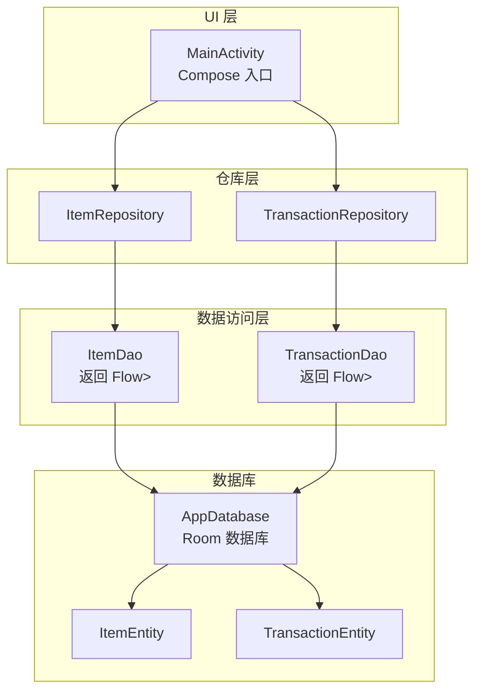
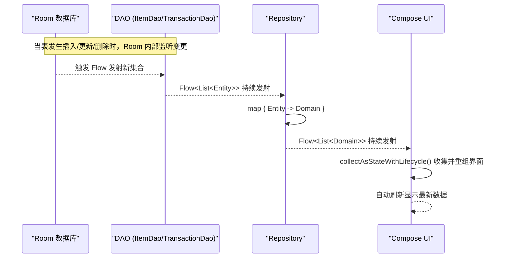
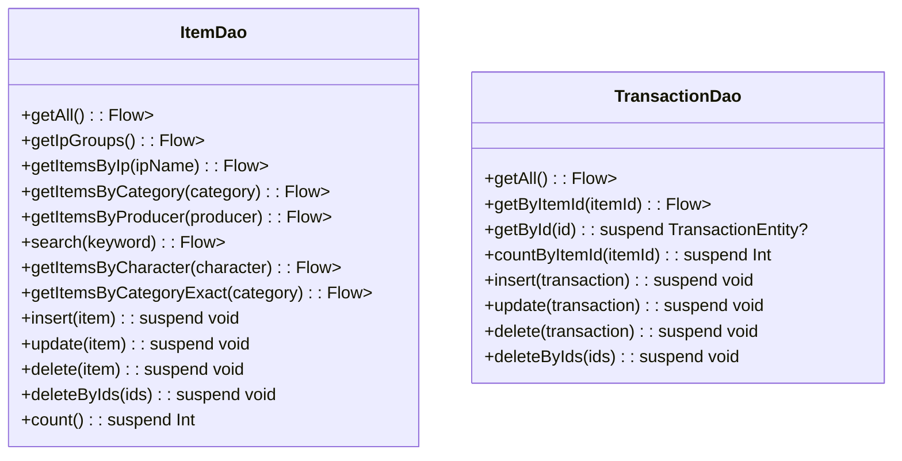
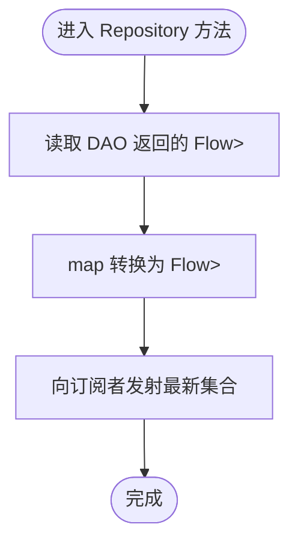
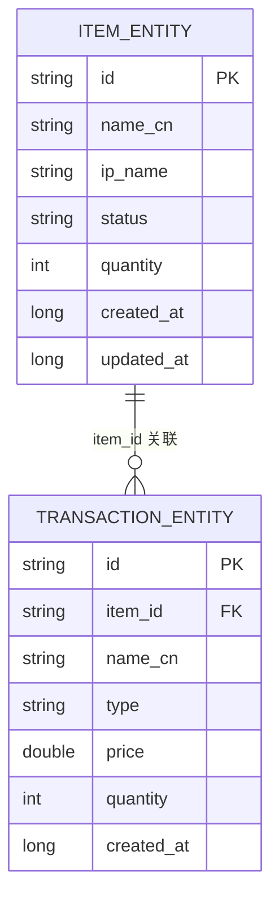
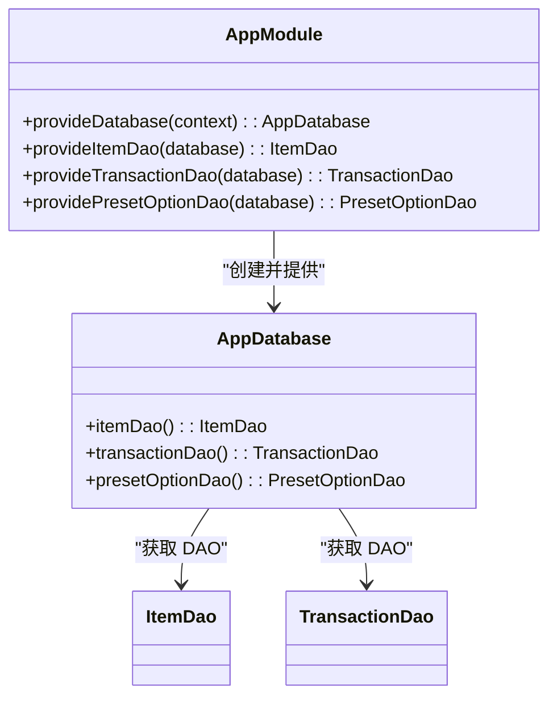
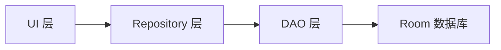

# 响应式数据流

<cite>
**本文引用的文件列表**
- [ItemDao.kt](file://GuZiStorage/app/src/main/java/com/guzi/storage/data/local/dao/ItemDao.kt)
- [TransactionDao.kt](file://GuZiStorage/app/src/main/java/com/guzi/storage/data/local/dao/TransactionDao.kt)
- [AppDatabase.kt](file://GuZiStorage/app/src/main/java/com/guzi/storage/data/local/AppDatabase.kt)
- [ItemRepository.kt](file://GuZiStorage/app/src/main/java/com/guzi/storage/data/repository/ItemRepository.kt)
- [TransactionRepository.kt](file://GuZiStorage/app/src/main/java/com/guzi/storage/data/repository/TransactionRepository.kt)
- [ItemEntity.kt](file://GuZiStorage/app/src/main/java/com/guzi/storage/data/local/entity/ItemEntity.kt)
- [Item.kt](file://GuZiStorage/app/src/main/java/com/guzi/storage/domain/model/Item.kt)
- [PipeListConverter.kt](file://GuZiStorage/app/src/main/java/com/guzi/storage/data/local/PipeListConverter.kt)
- [AppModule.kt](file://GuZiStorage/app/src/main/java/com/guzi/storage/di/AppModule.kt)
- [MainActivity.kt](file://GuZiStorage/app/src/main/java/com/guzi/storage/MainActivity.kt)
</cite>

## 目录
1. [引言](#引言)
2. [项目结构](#项目结构)
3. [核心组件](#核心组件)
4. [架构总览](#架构总览)
5. [详细组件分析](#详细组件分析)
6. [依赖关系分析](#依赖关系分析)
7. [性能考量](#性能考量)
8. [故障排查指南](#故障排查指南)
9. [结论](#结论)
10. [附录](#附录)

## 引言
本文件围绕谷子收纳应用中的响应式数据流展开，重点阐述 Kotlin Flow 在 Room 数据库查询中的应用与最佳实践。文档将解释：
- Flow 作为查询结果的响应式包装机制
- Flow 的冷流特性、背压处理与取消机制
- 实时数据更新原理（数据库变更监听与 UI 自动刷新）
- Flow 与其他协程操作符的集成（如 map、flatMap、combine 等）
- 性能优化建议与内存泄漏防护措施

## 项目结构
仓库采用分层架构：UI 层（Compose）、领域模型层、数据仓库层、DAO 层与数据库实体层。Flow 贯穿 DAO 到 Repository 再到 UI 的数据链路，实现“数据库变更 → 响应式数据流 → UI 自动刷新”的闭环。

图表来源
- [AppModule.kt:23-33](file://GuZiStorage/app/src/main/java/com/guzi/storage/di/AppModule.kt#L23-L33)
- [AppDatabase.kt:20-33](file://GuZiStorage/app/src/main/java/com/guzi/storage/data/local/AppDatabase.kt#L20-L33)
- [ItemDao.kt:15-56](file://GuZiStorage/app/src/main/java/com/guzi/storage/data/local/dao/ItemDao.kt#L15-L56)
- [TransactionDao.kt:15-31](file://GuZiStorage/app/src/main/java/com/guzi/storage/data/local/dao/TransactionDao.kt#L15-L31)
- [ItemRepository.kt:16-46](file://GuZiStorage/app/src/main/java/com/guzi/storage/data/repository/ItemRepository.kt#L16-L46)
- [TransactionRepository.kt:13-31](file://GuZiStorage/app/src/main/java/com/guzi/storage/data/repository/TransactionRepository.kt#L13-L31)
- [MainActivity.kt:21-36](file://GuZiStorage/app/src/main/java/com/guzi/storage/MainActivity.kt#L21-L36)

章节来源
- [AppModule.kt:19-49](file://GuZiStorage/app/src/main/java/com/guzi/storage/di/AppModule.kt#L19-L49)
- [AppDatabase.kt:12-33](file://GuZiStorage/app/src/main/java/com/guzi/storage/data/local/AppDatabase.kt#L12-L33)
- [ItemDao.kt:15-89](file://GuZiStorage/app/src/main/java/com/guzi/storage/data/local/dao/ItemDao.kt#L15-L89)
- [TransactionDao.kt:15-48](file://GuZiStorage/app/src/main/java/com/guzi/storage/data/local/dao/TransactionDao.kt#L15-L48)
- [ItemRepository.kt:16-79](file://GuZiStorage/app/src/main/java/com/guzi/storage/data/repository/ItemRepository.kt#L16-L79)
- [TransactionRepository.kt:13-62](file://GuZiStorage/app/src/main/java/com/guzi/storage/data/repository/TransactionRepository.kt#L13-L62)
- [MainActivity.kt:21-36](file://GuZiStorage/app/src/main/java/com/guzi/storage/MainActivity.kt#L21-L36)

## 核心组件
- DAO 层通过 @Query 注解直接返回 Flow<List<Entity>>，使查询结果成为响应式数据流。
- Repository 层对 DAO 返回的 Flow 进行类型转换（Entity ↔ Domain Model），并暴露给上层使用。
- 数据库由 Hilt 提供单例实例，保证全局共享与生命周期安全。

章节来源
- [ItemDao.kt:20-56](file://GuZiStorage/app/src/main/java/com/guzi/storage/data/local/dao/ItemDao.kt#L20-L56)
- [TransactionDao.kt:20-31](file://GuZiStorage/app/src/main/java/com/guzi/storage/data/local/dao/TransactionDao.kt#L20-L31)
- [ItemRepository.kt:23-46](file://GuZiStorage/app/src/main/java/com/guzi/storage/data/repository/ItemRepository.kt#L23-L46)
- [TransactionRepository.kt:20-31](file://GuZiStorage/app/src/main/java/com/guzi/storage/data/repository/TransactionRepository.kt#L20-L31)
- [AppModule.kt:23-48](file://GuZiStorage/app/src/main/java/com/guzi/storage/di/AppModule.kt#L23-L48)

## 架构总览
下图展示了从数据库变更到 UI 自动刷新的完整响应式数据流路径。

图表来源
- [ItemDao.kt:20-56](file://GuZiStorage/app/src/main/java/com/guzi/storage/data/local/dao/ItemDao.kt#L20-L56)
- [TransactionDao.kt:20-31](file://GuZiStorage/app/src/main/java/com/guzi/storage/data/local/dao/TransactionDao.kt#L20-L31)
- [ItemRepository.kt:23-46](file://GuZiStorage/app/src/main/java/com/guzi/storage/data/repository/ItemRepository.kt#L23-L46)
- [TransactionRepository.kt:20-31](file://GuZiStorage/app/src/main/java/com/guzi/storage/data/repository/TransactionRepository.kt#L20-L31)

## 详细组件分析

### DAO 层：Flow 作为查询结果的响应式包装
- 所有返回列表的查询方法均返回 Flow<List<Entity>>，例如 getAll、search、getItemsByIp 等。
- 写入方法为 suspend 函数，执行后触发对应表的变更，从而驱动 Flow 发射新数据。
- 复杂查询（分组统计、模糊匹配）同样以 Flow 形式暴露，便于组合与过滤。

图表来源
- [ItemDao.kt:15-89](file://GuZiStorage/app/src/main/java/com/guzi/storage/data/local/dao/ItemDao.kt#L15-L89)
- [TransactionDao.kt:15-48](file://GuZiStorage/app/src/main/java/com/guzi/storage/data/local/dao/TransactionDao.kt#L15-L48)

章节来源
- [ItemDao.kt:20-89](file://GuZiStorage/app/src/main/java/com/guzi/storage/data/local/dao/ItemDao.kt#L20-L89)
- [TransactionDao.kt:20-48](file://GuZiStorage/app/src/main/java/com/guzi/storage/data/local/dao/TransactionDao.kt#L20-L48)

### Repository 层：Flow 的类型转换与业务封装
- Repository 接收 DAO 的 Flow<List<Entity>>，通过 map 转换为 Flow<List<Domain>>，屏蔽底层存储细节。
- 写入操作为 suspend 函数，调用 DAO 的写入方法后，数据库变更会驱动上游 Flow 重新发射。

图表来源
- [ItemRepository.kt:23-46](file://GuZiStorage/app/src/main/java/com/guzi/storage/data/repository/ItemRepository.kt#L23-L46)
- [TransactionRepository.kt:20-31](file://GuZiStorage/app/src/main/java/com/guzi/storage/data/repository/TransactionRepository.kt#L20-L31)

章节来源
- [ItemRepository.kt:16-79](file://GuZiStorage/app/src/main/java/com/guzi/storage/data/repository/ItemRepository.kt#L16-L79)
- [TransactionRepository.kt:13-62](file://GuZiStorage/app/src/main/java/com/guzi/storage/data/repository/TransactionRepository.kt#L13-L62)

### 实体与领域模型：数据映射与扩展字段处理
- ItemEntity 定义持久化字段与索引；Item 定义领域模型，包含展示逻辑与转换方法。
- PipeListConverter 负责多选字段的管道符分隔字符串与 List<String> 之间的互转。

图表来源
- [ItemEntity.kt:16-88](file://GuZiStorage/app/src/main/java/com/guzi/storage/data/local/entity/ItemEntity.kt#L16-L88)
- [TransactionEntity.kt](file://GuZiStorage/app/src/main/java/com/guzi/storage/data/local/entity/TransactionEntity.kt)

章节来源
- [ItemEntity.kt:16-88](file://GuZiStorage/app/src/main/java/com/guzi/storage/data/local/entity/ItemEntity.kt#L16-L88)
- [Item.kt:11-105](file://GuZiStorage/app/src/main/java/com/guzi/storage/domain/model/Item.kt#L11-L105)
- [PipeListConverter.kt:9-25](file://GuZiStorage/app/src/main/java/com/guzi/storage/data/local/PipeListConverter.kt#L9-L25)

### 依赖注入与数据库初始化
- Hilt 模块提供 AppDatabase 单例，配置数据库名称与迁移策略。
- DAO 实例由数据库对象提供，确保一致的生命周期管理。

图表来源
- [AppModule.kt:23-48](file://GuZiStorage/app/src/main/java/com/guzi/storage/di/AppModule.kt#L23-L48)
- [AppDatabase.kt:29-33](file://GuZiStorage/app/src/main/java/com/guzi/storage/data/local/AppDatabase.kt#L29-L33)

章节来源
- [AppModule.kt:19-49](file://GuZiStorage/app/src/main/java/com/guzi/storage/di/AppModule.kt#L19-L49)
- [AppDatabase.kt:20-33](file://GuZiStorage/app/src/main/java/com/guzi/storage/data/local/AppDatabase.kt#L20-L33)

### UI 层与 Compose 集成要点
- MainActivity 作为 Compose 入口，后续可在页面中通过 collectAsStateWithLifecycle 收集 Repository 暴露的 Flow，实现自动刷新。
- 当前示例仅展示基础 Scaffold 与文本，实际数据绑定应在具体页面中实现。

章节来源
- [MainActivity.kt:21-36](file://GuZiStorage/app/src/main/java/com/guzi/storage/MainActivity.kt#L21-L36)

## 依赖关系分析
- DAO 依赖 Room 数据库，Repository 依赖 DAO，UI 依赖 Repository。
- 通过 Hilt 提供单例数据库，避免重复创建连接与资源泄露。
- Flow 在 DAO 层产生，Repository 层进行类型转换，最终被 UI 层收集。

图表来源
- [AppModule.kt:23-48](file://GuZiStorage/app/src/main/java/com/guzi/storage/di/AppModule.kt#L23-L48)
- [ItemRepository.kt:16-46](file://GuZiStorage/app/src/main/java/com/guzi/storage/data/repository/ItemRepository.kt#L16-L46)
- [TransactionRepository.kt:13-31](file://GuZiStorage/app/src/main/java/com/guzi/storage/data/repository/TransactionRepository.kt#L13-L31)
- [ItemDao.kt:15-56](file://GuZiStorage/app/src/main/java/com/guzi/storage/data/local/dao/ItemDao.kt#L15-L56)
- [TransactionDao.kt:15-31](file://GuZiStorage/app/src/main/java/com/guzi/storage/data/local/dao/TransactionDao.kt#L15-L31)

章节来源
- [AppModule.kt:19-49](file://GuZiStorage/app/src/main/java/com/guzi/storage/di/AppModule.kt#L19-L49)
- [ItemRepository.kt:16-79](file://GuZiStorage/app/src/main/java/com/guzi/storage/data/repository/ItemRepository.kt#L16-L79)
- [TransactionRepository.kt:13-62](file://GuZiStorage/app/src/main/java/com/guzi/storage/data/repository/TransactionRepository.kt#L13-L62)
- [ItemDao.kt:15-89](file://GuZiStorage/app/src/main/java/com/guzi/storage/data/local/dao/ItemDao.kt#L15-L89)
- [TransactionDao.kt:15-48](file://GuZiStorage/app/src/main/java/com/guzi/storage/data/local/dao/TransactionDao.kt#L15-L48)

## 性能考量
- 背压与缓冲
  - Flow 是冷流，默认无缓冲；若上游发射速率高于下游消费速率，可能引发背压。建议在关键路径使用 flowOn 切换调度器，或在必要时使用 buffer、conflate、collectLatest 等操作符控制并发与丢弃策略。
- 取消机制
  - Flow 支持结构化取消；在 Compose 中使用 collectAsStateWithLifecycle 可随生命周期自动取消，避免后台继续收集导致资源浪费。
- 数据库查询优化
  - 合理使用索引（如 IP、状态、分类）提升查询性能；分页加载大数据集，避免一次性加载过多记录。
- 类型转换开销
  - Repository 层的 map 转换应轻量高效，避免在热路径中进行昂贵计算或 I/O。
- 内存管理
  - 避免在 Flow 链路上持有 Activity/Fragment 引用；使用 ViewModel 或 Compose State 管理数据，确保生命周期正确。

[本节为通用指导，不直接分析具体文件]

## 故障排查指南
- 现象：UI 未随数据库变更刷新
  - 检查 DAO 是否返回 Flow 而非一次性结果；确认写入操作是否正确触发变更。
  - 确认 UI 侧是否使用 collectAsStateWithLifecycle 收集 Flow，并确保作用域与生命周期一致。
- 现象：卡顿或掉帧
  - 评估 map 转换复杂度；考虑使用 withContext 切换到 IO 线程；减少不必要的对象创建。
- 现象：内存泄漏
  - 检查是否在 Flow 闭包中捕获了 UI 组件引用；确保在合适的生命周期内收集与取消。
- 现象：数据不一致
  - 检查事务边界与写入顺序；确保相关表变更在同一事务内提交，避免中间态被观察到。

章节来源
- [ItemDao.kt:70-89](file://GuZiStorage/app/src/main/java/com/guzi/storage/data/local/dao/ItemDao.kt#L70-L89)
- [TransactionDao.kt:32-48](file://GuZiStorage/app/src/main/java/com/guzi/storage/data/local/dao/TransactionDao.kt#L32-L48)
- [MainActivity.kt:21-36](file://GuZiStorage/app/src/main/java/com/guzi/storage/MainActivity.kt#L21-L36)

## 结论
本项目通过 Room + Flow 构建了清晰的响应式数据流：DAO 层直接返回 Flow<List<Entity>>，Repository 层进行类型转换，UI 层通过 Compose 收集并自动刷新。该设计天然具备冷流、背压与取消能力，结合合理的索引与转换优化，可实现高性能的实时数据更新体验。

[本节为总结性内容，不直接分析具体文件]

## 附录

### Flow 冷流特性、背压与取消机制说明
- 冷流特性
  - Flow 在每次被收集时才会启动上游执行；同一 Flow 多个收集者各自独立运行，不会共享状态。
- 背压处理
  - 默认情况下，Flow 会在下游准备好时才发射下一个元素；如需吞吐优先，可使用 buffer；如需丢弃旧值，可使用 conflate 或 latestIn。
- 取消机制
  - Flow 遵循结构化并发；当收集作用域结束或被显式取消时，上游立即停止执行，释放资源。

[本节为概念性说明，不直接分析具体文件]

### 实时数据更新与 UI 自动刷新机制
- 数据库变更监听
  - Room 在表发生插入、更新、删除时，自动通知对应的 Flow 发射新集合。
- UI 自动刷新
  - Compose 中通过 collectAsStateWithLifecycle 收集 Flow，并在数据变化时重组界面，无需手动刷新。

章节来源
- [ItemDao.kt:20-56](file://GuZiStorage/app/src/main/java/com/guzi/storage/data/local/dao/ItemDao.kt#L20-L56)
- [TransactionDao.kt:20-31](file://GuZiStorage/app/src/main/java/com/guzi/storage/data/local/dao/TransactionDao.kt#L20-L31)
- [MainActivity.kt:21-36](file://GuZiStorage/app/src/main/java/com/guzi/storage/MainActivity.kt#L21-L36)

### Flow 与其他协程组件的集成
- map
  - 用于类型转换（Entity → Domain），已在 Repository 层广泛使用。
- flatMap
  - 适用于动态参数驱动的查询（如用户输入关键词后，根据关键词生成新的 Flow 查询）。
- combine
  - 适用于合并多个 Flow 的结果（如同时加载物品列表与交易统计，再组合展示）。
- flowOn
  - 用于切换执行上下文（如将数据库查询切换到 IO 线程）。

章节来源
- [ItemRepository.kt:23-46](file://GuZiStorage/app/src/main/java/com/guzi/storage/data/repository/ItemRepository.kt#L23-L46)
- [TransactionRepository.kt:20-31](file://GuZiStorage/app/src/main/java/com/guzi/storage/data/repository/TransactionRepository.kt#L20-L31)