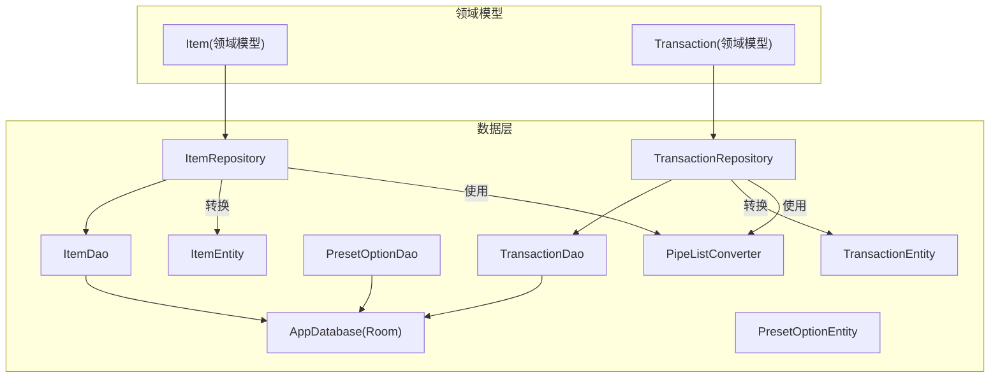
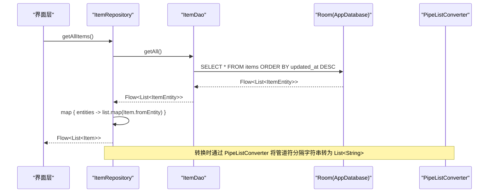
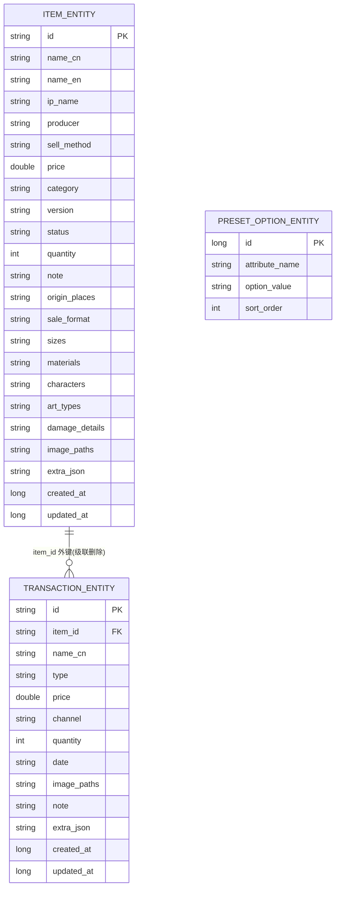
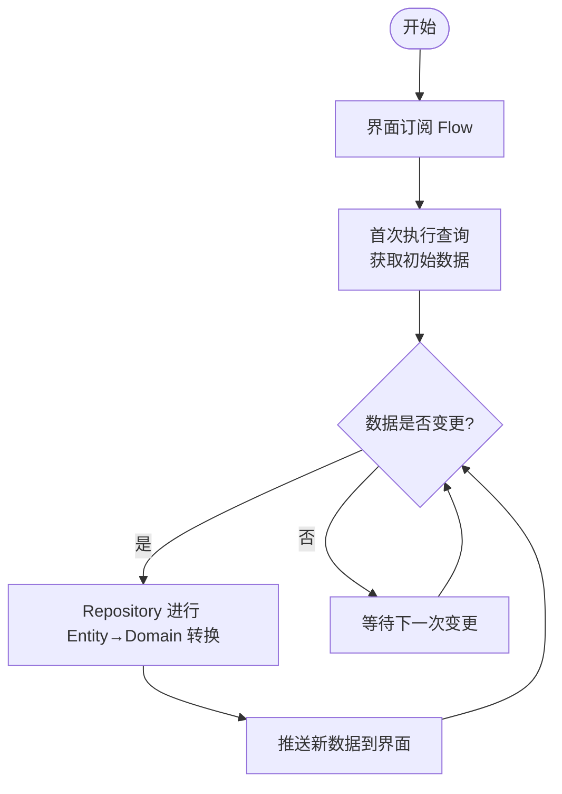
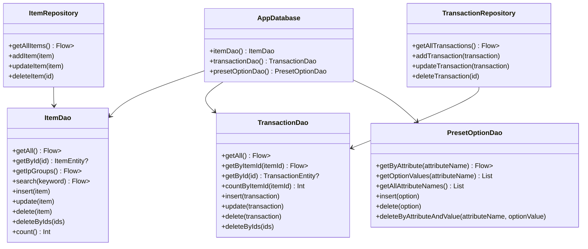

# 数据层实现

<cite>
**本文引用的文件**   
- [ItemDao.kt](file://GuZiStorage/app/src/main/java/com/guzi/storage/data/local/dao/ItemDao.kt)
- [TransactionDao.kt](file://GuZiStorage/app/src/main/java/com/guzi/storage/data/local/dao/TransactionDao.kt)
- [PresetOptionDao.kt](file://GuZiStorage/app/src/main/java/com/guzi/storage/data/local/dao/PresetOptionDao.kt)
- [AppDatabase.kt](file://GuZiStorage/app/src/main/java/com/guzi/storage/data/local/AppDatabase.kt)
- [ItemEntity.kt](file://GuZiStorage/app/src/main/java/com/guzi/storage/data/local/entity/ItemEntity.kt)
- [TransactionEntity.kt](file://GuZiStorage/app/src/main/java/com/guzi/storage/data/local/entity/TransactionEntity.kt)
- [PresetOptionEntity.kt](file://GuZiStorage/app/src/main/java/com/guzi/storage/data/local/entity/PresetOptionEntity.kt)
- [PipeListConverter.kt](file://GuZiStorage/app/src/main/java/com/guzi/storage/data/local/PipeListConverter.kt)
- [ItemRepository.kt](file://GuZiStorage/app/src/main/java/com/guzi/storage/data/repository/ItemRepository.kt)
- [TransactionRepository.kt](file://GuZiStorage/app/src/main/java/com/guzi/storage/data/repository/TransactionRepository.kt)
- [Item.kt](file://GuZiStorage/app/src/main/java/com/guzi/storage/domain/model/Item.kt)
- [Transaction.kt](file://GuZiStorage/app/src/main/java/com/guzi/storage/domain/model/Transaction.kt)
- [AppModule.kt](file://GuZiStorage/app/src/main/java/com/guzi/storage/di/AppModule.kt)
</cite>

## 目录
1. [简介](#简介)
2. [项目结构](#项目结构)
3. [核心组件](#核心组件)
4. [架构总览](#架构总览)
5. [详细组件分析](#详细组件分析)
6. [依赖关系分析](#依赖关系分析)
7. [性能与优化](#性能与优化)
8. [故障排查指南](#故障排查指南)
9. [结论](#结论)
10. [附录](#附录)

## 简介
本文件聚焦谷子收纳应用的数据层实现，围绕 Room 数据库、DAO 接口设计模式、响应式数据流（Flow）、事务与聚合查询、数据验证与业务规则封装、错误处理与异常恢复机制，以及最佳实践与性能优化建议展开。目标读者包括需要理解数据访问层设计与实现的开发者与维护者。

## 项目结构
数据层采用分层组织：
- 实体层（Entity）：Room 表映射，定义字段、索引、外键等约束
- DAO 层：声明式 SQL 与 Flow 响应式查询
- Repository 层：封装 Entity ↔ Domain Model 转换，暴露统一 API
- DI 模块：提供 AppDatabase 与 DAO 实例

图表来源
- [AppDatabase.kt:1-34](file://GuZiStorage/app/src/main/java/com/guzi/storage/data/local/AppDatabase.kt#L1-L34)
- [ItemDao.kt:1-90](file://GuZiStorage/app/src/main/java/com/guzi/storage/data/local/dao/ItemDao.kt#L1-L90)
- [TransactionDao.kt:1-49](file://GuZiStorage/app/src/main/java/com/guzi/storage/data/local/dao/TransactionDao.kt#L1-L49)
- [PresetOptionDao.kt:1-42](file://GuZiStorage/app/src/main/java/com/guzi/storage/data/local/dao/PresetOptionDao.kt#L1-L42)
- [ItemRepository.kt:1-80](file://GuZiStorage/app/src/main/java/com/guzi/storage/data/repository/ItemRepository.kt#L1-L80)
- [TransactionRepository.kt:1-63](file://GuZiStorage/app/src/main/java/com/guzi/storage/data/repository/TransactionRepository.kt#L1-L63)
- [Item.kt:1-106](file://GuZiStorage/app/src/main/java/com/guzi/storage/domain/model/Item.kt#L1-L106)
- [Transaction.kt:1-68](file://GuZiStorage/app/src/main/java/com/guzi/storage/domain/model/Transaction.kt#L1-L68)
- [PipeListConverter.kt:1-26](file://GuZiStorage/app/src/main/java/com/guzi/storage/data/local/PipeListConverter.kt#L1-L26)

章节来源
- [AppDatabase.kt:1-34](file://GuZiStorage/app/src/main/java/com/guzi/storage/data/local/AppDatabase.kt#L1-L34)
- [AppModule.kt:1-50](file://GuZiStorage/app/src/main/java/com/guzi/storage/di/AppModule.kt#L1-L50)

## 核心组件
- DAO 接口：ItemDao、TransactionDao、PresetOptionDao 分别负责物品、交易记录、预设选项的增删改查与复杂查询
- 实体类：ItemEntity、TransactionEntity、PresetOptionEntity 描述持久化结构与约束
- 转换器：PipeListConverter 用于多选字段的字符串与列表互转
- 仓库：ItemRepository、TransactionRepository 封装 CRUD 与领域模型转换，对外暴露 Flow 响应式数据流
- DI 模块：AppModule 提供 AppDatabase 与 DAO 单例

章节来源
- [ItemDao.kt:1-90](file://GuZiStorage/app/src/main/java/com/guzi/storage/data/local/dao/ItemDao.kt#L1-L90)
- [TransactionDao.kt:1-49](file://GuZiStorage/app/src/main/java/com/guzi/storage/data/local/dao/TransactionDao.kt#L1-L49)
- [PresetOptionDao.kt:1-42](file://GuZiStorage/app/src/main/java/com/guzi/storage/data/local/dao/PresetOptionDao.kt#L1-L42)
- [ItemEntity.kt:1-89](file://GuZiStorage/app/src/main/java/com/guzi/storage/data/local/entity/ItemEntity.kt#L1-L89)
- [TransactionEntity.kt:1-65](file://GuZiStorage/app/src/main/java/com/guzi/storage/data/local/entity/TransactionEntity.kt#L1-L65)
- [PresetOptionEntity.kt:1-37](file://GuZiStorage/app/src/main/java/com/guzi/storage/data/local/entity/PresetOptionEntity.kt#L1-L37)
- [PipeListConverter.kt:1-26](file://GuZiStorage/app/src/main/java/com/guzi/storage/data/local/PipeListConverter.kt#L1-L26)
- [ItemRepository.kt:1-80](file://GuZiStorage/app/src/main/java/com/guzi/storage/data/repository/ItemRepository.kt#L1-L80)
- [TransactionRepository.kt:1-63](file://GuZiStorage/app/src/main/java/com/guzi/storage/data/repository/TransactionRepository.kt#L1-L63)
- [AppModule.kt:1-50](file://GuZiStorage/app/src/main/java/com/guzi/storage/di/AppModule.kt#L1-L50)

## 架构总览
数据访问链路遵循“UI → Repository → DAO → Room”的分层模式。Repository 负责领域模型与实体的双向转换，并统一暴露 Flow 以支持实时数据更新。

图表来源
- [ItemRepository.kt:23-24](file://GuZiStorage/app/src/main/java/com/guzi/storage/data/repository/ItemRepository.kt#L23-L24)
- [ItemDao.kt:20-21](file://GuZiStorage/app/src/main/java/com/guzi/storage/data/local/dao/ItemDao.kt#L20-L21)
- [Item.kt:80-103](file://GuZiStorage/app/src/main/java/com/guzi/storage/domain/model/Item.kt#L80-L103)
- [PipeListConverter.kt:17-24](file://GuZiStorage/app/src/main/java/com/guzi/storage/data/local/PipeListConverter.kt#L17-L24)

## 详细组件分析

### DAO 接口设计模式
- 声明式注解：使用 @Query、@Insert、@Update、@Delete、@OnConflictStrategy 等注解表达 SQL 与冲突策略
- 响应式查询：返回 Flow<List<T>> 的查询方法自动监听表变化，触发 UI 实时更新
- 复合查询与聚合：支持分组统计、模糊匹配、多条件筛选等
- 批量操作：提供 insertAll、deleteByIds 等方法提升写入效率

章节来源
- [ItemDao.kt:1-90](file://GuZiStorage/app/src/main/java/com/guzi/storage/data/local/dao/ItemDao.kt#L1-L90)
- [TransactionDao.kt:1-49](file://GuZiStorage/app/src/main/java/com/guzi/storage/data/local/dao/TransactionDao.kt#L1-L49)
- [PresetOptionDao.kt:1-42](file://GuZiStorage/app/src/main/java/com/guzi/storage/data/local/dao/PresetOptionDao.kt#L1-L42)

#### ItemDao 关键能力
- 全量排序查询：按更新时间倒序获取所有物品
- 精确查询：按 ID 获取单个物品
- 分组统计：按 IP 名称分组计数，返回 IpGroupInfo 列表
- 分类/生产者/角色/关键词搜索：支持模糊匹配与精确匹配
- 批量删除与计数：支持按 ID 列表删除与总数统计

章节来源
- [ItemDao.kt:20-21](file://GuZiStorage/app/src/main/java/com/guzi/storage/data/local/dao/ItemDao.kt#L20-L21)
- [ItemDao.kt:23-24](file://GuZiStorage/app/src/main/java/com/guzi/storage/data/local/dao/ItemDao.kt#L23-L24)
- [ItemDao.kt:34-35](file://GuZiStorage/app/src/main/java/com/guzi/storage/data/local/dao/ItemDao.kt#L34-L35)
- [ItemDao.kt:37-44](file://GuZiStorage/app/src/main/java/com/guzi/storage/data/local/dao/ItemDao.kt#L37-L44)
- [ItemDao.kt:49-56](file://GuZiStorage/app/src/main/java/com/guzi/storage/data/local/dao/ItemDao.kt#L49-L56)
- [ItemDao.kt:61-62](file://GuZiStorage/app/src/main/java/com/guzi/storage/data/local/dao/ItemDao.kt#L61-L62)
- [ItemDao.kt:67-68](file://GuZiStorage/app/src/main/java/com/guzi/storage/data/local/dao/ItemDao.kt#L67-L68)
- [ItemDao.kt:84-88](file://GuZiStorage/app/src/main/java/com/guzi/storage/data/local/dao/ItemDao.kt#L84-L88)

#### TransactionDao 关键能力
- 全量与按物品查询：按创建时间倒序获取交易记录
- 计数：按物品 ID 统计交易数量
- 标准 CRUD：插入、更新、删除、批量删除

章节来源
- [TransactionDao.kt:20-21](file://GuZiStorage/app/src/main/java/com/guzi/storage/data/local/dao/TransactionDao.kt#L20-L21)
- [TransactionDao.kt:23-24](file://GuZiStorage/app/src/main/java/com/guzi/storage/data/local/dao/TransactionDao.kt#L23-L24)
- [TransactionDao.kt:26-27](file://GuZiStorage/app/src/main/java/com/guzi/storage/data/local/dao/TransactionDao.kt#L26-L27)
- [TransactionDao.kt:29-30](file://GuZiStorage/app/src/main/java/com/guzi/storage/data/local/dao/TransactionDao.kt#L29-L30)
- [TransactionDao.kt:46-47](file://GuZiStorage/app/src/main/java/com/guzi/storage/data/local/dao/TransactionDao.kt#L46-L47)

#### PresetOptionDao 关键能力
- 按属性获取选项：支持排序与去重
- 获取选项值列表与全部属性名：便于下拉选择与动态表单
- 插入与删除：忽略冲突插入，支持按属性与值删除

章节来源
- [PresetOptionDao.kt:19-20](file://GuZiStorage/app/src/main/java/com/guzi/storage/data/local/dao/PresetOptionDao.kt#L19-L20)
- [PresetOptionDao.kt:22-23](file://GuZiStorage/app/src/main/java/com/guzi/storage/data/local/dao/PresetOptionDao.kt#L22-L23)
- [PresetOptionDao.kt:25-26](file://GuZiStorage/app/src/main/java/com/guzi/storage/data/local/dao/PresetOptionDao.kt#L25-L26)
- [PresetOptionDao.kt:39-40](file://GuZiStorage/app/src/main/java/com/guzi/storage/data/local/dao/PresetOptionDao.kt#L39-L40)

### 实体与约束
- ItemEntity：包含基础信息、多选字段（管道符分隔存储）、扩展 JSON 字段与时间戳；对 ip_name、status、category 建立索引以提升查询性能
- TransactionEntity：通过外键关联 ItemEntity，级联删除；对 item_id 建立索引；包含类型、渠道、数量、日期、图片路径、备注与扩展字段
- PresetOptionEntity：联合唯一索引确保同一属性下的选项值不重复；支持排序顺序

图表来源
- [ItemEntity.kt:16-22](file://GuZiStorage/app/src/main/java/com/guzi/storage/data/local/entity/ItemEntity.kt#L16-L22)
- [TransactionEntity.kt:14-26](file://GuZiStorage/app/src/main/java/com/guzi/storage/data/local/entity/TransactionEntity.kt#L14-L26)
- [PresetOptionEntity.kt:15-22](file://GuZiStorage/app/src/main/java/com/guzi/storage/data/local/entity/PresetOptionEntity.kt#L15-L22)

章节来源
- [ItemEntity.kt:1-89](file://GuZiStorage/app/src/main/java/com/guzi/storage/data/local/entity/ItemEntity.kt#L1-L89)
- [TransactionEntity.kt:1-65](file://GuZiStorage/app/src/main/java/com/guzi/storage/data/local/entity/TransactionEntity.kt#L1-L65)
- [PresetOptionEntity.kt:1-37](file://GuZiStorage/app/src/main/java/com/guzi/storage/data/local/entity/PresetOptionEntity.kt#L1-L37)

### 响应式数据流与实时更新
- DAO 返回 Flow<List<T>> 的查询在底层监听表变更，当数据发生变化时自动推送新结果
- Repository 使用 map 将 Entity 转换为领域模型，保持上层仅依赖领域模型
- 典型流程：界面订阅 Flow → 首次加载数据 → 后续数据变更自动刷新 UI

图表来源
- [ItemRepository.kt:23-24](file://GuZiStorage/app/src/main/java/com/guzi/storage/data/repository/ItemRepository.kt#L23-L24)
- [ItemDao.kt:20-21](file://GuZiStorage/app/src/main/java/com/guzi/storage/data/local/dao/ItemDao.kt#L20-L21)

章节来源
- [ItemRepository.kt:23-45](file://GuZiStorage/app/src/main/java/com/guzi/storage/data/repository/ItemRepository.kt#L23-L45)
- [TransactionRepository.kt:20-27](file://GuZiStorage/app/src/main/java/com/guzi/storage/data/repository/TransactionRepository.kt#L20-L27)

### 数据验证与业务规则封装
- 领域模型内置显示逻辑：例如 Item.displayName 根据状态与伤情详情生成展示文本
- 枚举校验：TransactionType 提供 fromValue 回退默认值，避免非法字符串导致崩溃
- 多选字段转换：PipeListConverter 保证空字符串与空列表的一致性转换
- 仓库层时间戳管理：新增/更新时统一设置 createdAt/updatedAt，确保一致性

章节来源
- [Item.kt:40-45](file://GuZiStorage/app/src/main/java/com/guzi/storage/domain/model/Item.kt#L40-L45)
- [Transaction.kt:59-66](file://GuZiStorage/app/src/main/java/com/guzi/storage/domain/model/Transaction.kt#L59-L66)
- [PipeListConverter.kt:17-24](file://GuZiStorage/app/src/main/java/com/guzi/storage/data/local/PipeListConverter.kt#L17-L24)
- [ItemRepository.kt:49-66](file://GuZiStorage/app/src/main/java/com/guzi/storage/data/repository/ItemRepository.kt#L49-L66)
- [TransactionRepository.kt:34-51](file://GuZiStorage/app/src/main/java/com/guzi/storage/data/repository/TransactionRepository.kt#L34-L51)

### 事务处理与复杂查询
- 事务处理：当前代码未显式使用 Room 事务注解或协程事务块。若需跨表原子性操作（如同时写入物品与交易记录），建议在 Repository 层使用协程事务包裹多个 DAO 调用，以保证一致性
- 复杂查询：
  - 分组统计：ItemDao.getIpGroups 使用 GROUP BY 与 COUNT 统计各 IP 的物品数量
  - 模糊搜索：ItemDao.search 支持中文名、IP 名、英文名模糊匹配
  - 多条件筛选：按类别、生产者、角色等进行过滤
- 聚合函数：除 COUNT 外，可扩展 SUM、AVG 等用于价格统计（需在 DAO 中新增相应查询）

章节来源
- [ItemDao.kt:34-35](file://GuZiStorage/app/src/main/java/com/guzi/storage/data/local/dao/ItemDao.kt#L34-L35)
- [ItemDao.kt:49-56](file://GuZiStorage/app/src/main/java/com/guzi/storage/data/local/dao/ItemDao.kt#L49-L56)
- [TransactionDao.kt:29-30](file://GuZiStorage/app/src/main/java/com/guzi/storage/data/local/dao/TransactionDao.kt#L29-L30)

### 错误处理与异常恢复机制
- 冲突策略：
  - ItemDao/TransactionDao 使用 REPLACE 策略，覆盖已有记录
  - PresetOptionDao 使用 IGNORE 策略，避免重复插入
- 外键与级联：TransactionEntity 通过外键与 ItemEntity 关联，删除物品时级联删除相关交易记录
- 迁移策略：AppModule 配置 fallbackToDestructiveMigration，开发阶段简化迁移，生产环境应提供正式迁移脚本
- 建议增强：
  - 在 Repository 层捕获 DAO 抛出的异常并进行日志记录与用户提示
  - 针对网络同步或导入场景，增加重试与补偿逻辑

章节来源
- [ItemDao.kt:72-76](file://GuZiStorage/app/src/main/java/com/guzi/storage/data/local/dao/ItemDao.kt#L72-L76)
- [TransactionDao.kt:34-38](file://GuZiStorage/app/src/main/java/com/guzi/storage/data/local/dao/TransactionDao.kt#L34-L38)
- [PresetOptionDao.kt:30-34](file://GuZiStorage/app/src/main/java/com/guzi/storage/data/local/dao/PresetOptionDao.kt#L30-L34)
- [TransactionEntity.kt:16-22](file://GuZiStorage/app/src/main/java/com/guzi/storage/data/local/entity/TransactionEntity.kt#L16-L22)
- [AppModule.kt:25-33](file://GuZiStorage/app/src/main/java/com/guzi/storage/di/AppModule.kt#L25-L33)

## 依赖关系分析

图表来源
- [AppDatabase.kt:29-32](file://GuZiStorage/app/src/main/java/com/guzi/storage/data/local/AppDatabase.kt#L29-L32)
- [ItemDao.kt:15-88](file://GuZiStorage/app/src/main/java/com/guzi/storage/data/local/dao/ItemDao.kt#L15-L88)
- [TransactionDao.kt:15-47](file://GuZiStorage/app/src/main/java/com/guzi/storage/data/local/dao/TransactionDao.kt#L15-L47)
- [PresetOptionDao.kt:14-41](file://GuZiStorage/app/src/main/java/com/guzi/storage/data/local/dao/PresetOptionDao.kt#L14-L41)
- [ItemRepository.kt:16-79](file://GuZiStorage/app/src/main/java/com/guzi/storage/data/repository/ItemRepository.kt#L16-L79)
- [TransactionRepository.kt:13-62](file://GuZiStorage/app/src/main/java/com/guzi/storage/data/repository/TransactionRepository.kt#L13-L62)

章节来源
- [AppModule.kt:23-48](file://GuZiStorage/app/src/main/java/com/guzi/storage/di/AppModule.kt#L23-L48)

## 性能与优化
- 索引优化：
  - 为常用查询列建立索引：ip_name、status、category、item_id
  - 组合索引可进一步提升多条件查询性能（如按 ip_name 与 category 组合）
- 查询优化：
  - 使用精确匹配优先于模糊匹配，必要时限制 LIKE 前缀以减少扫描范围
  - 分页与限制返回条数，避免一次性加载大量数据
  - 使用投影查询只返回必要字段，减少内存占用
- 缓存策略：
  - 利用 Flow 的背压与缓存特性，结合 Repository 层的轻量缓存（如 LruCache）减少重复计算
  - 对于静态或低频变化的预设选项，可在应用启动时预加载并缓存
- 写入优化：
  - 批量插入/删除减少事务开销
  - 合理设置 onConflict 策略，避免不必要的替换与重建
- 并发与线程：
  - DAO 的 suspend 方法应在合适的协程作用域调用，避免阻塞主线程
  - 对耗时聚合查询考虑后台线程执行

[本节为通用指导，无需特定文件引用]

## 故障排查指南
- 数据不一致：
  - 检查外键约束与级联删除是否正确生效
  - 确认事务边界是否覆盖所有相关写入
- 查询缓慢：
  - 检查是否存在缺失索引或索引失效
  - 评估 LIKE 模糊匹配的性能影响，考虑全文检索方案
- 重复数据：
  - 核对 PresetOptionEntity 的联合唯一索引是否生效
  - 调整插入冲突策略为 IGNORE 或 UPDATE
- 迁移问题：
  - 开发阶段使用破坏性迁移快速迭代，生产环境需提供版本迁移脚本
- 日志与监控：
  - 在 Repository 层添加异常捕获与日志输出，定位失败点

章节来源
- [TransactionEntity.kt:16-22](file://GuZiStorage/app/src/main/java/com/guzi/storage/data/local/entity/TransactionEntity.kt#L16-L22)
- [PresetOptionEntity.kt:17-22](file://GuZiStorage/app/src/main/java/com/guzi/storage/data/local/entity/PresetOptionEntity.kt#L17-L22)
- [AppModule.kt:25-33](file://GuZiStorage/app/src/main/java/com/guzi/storage/di/AppModule.kt#L25-L33)

## 结论
该数据层基于 Room 与 DAO 注解实现了清晰的分层架构，配合 Flow 提供了响应式数据更新能力。通过合理的索引与冲突策略，保证了基本性能与数据完整性。未来可在事务处理、异常恢复、查询优化与缓存策略方面进一步增强，以满足更复杂的业务需求与更高的性能要求。

[本节为总结，无需特定文件引用]

## 附录
- 领域模型与实体转换示例路径：
  - Item.fromEntity / Item.toEntity
  - Transaction.fromEntity / Transaction.toEntity
- 多选字段转换工具：
  - PipeListConverter.toList / PipeListConverter.fromList

章节来源
- [Item.kt:80-103](file://GuZiStorage/app/src/main/java/com/guzi/storage/domain/model/Item.kt#L80-L103)
- [Transaction.kt:38-52](file://GuZiStorage/app/src/main/java/com/guzi/storage/domain/model/Transaction.kt#L38-L52)
- [PipeListConverter.kt:17-24](file://GuZiStorage/app/src/main/java/com/guzi/storage/data/local/PipeListConverter.kt#L17-L24)