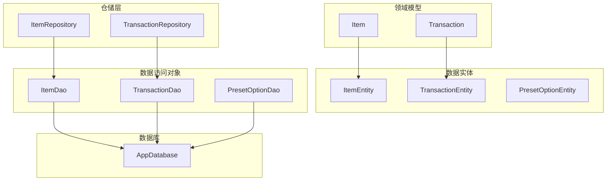
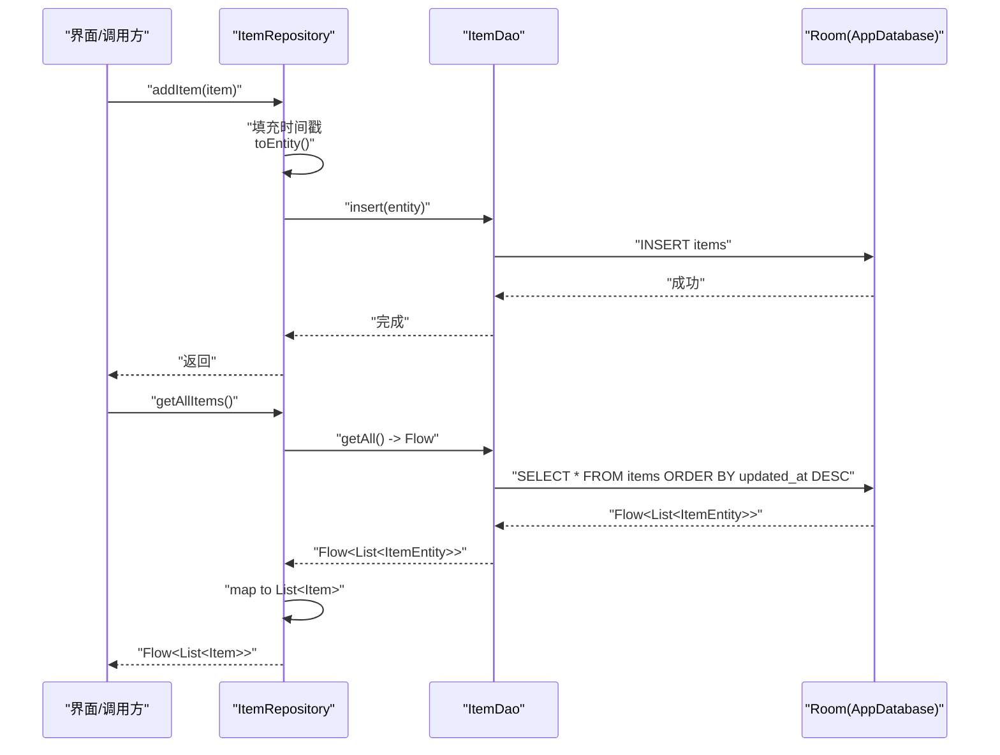
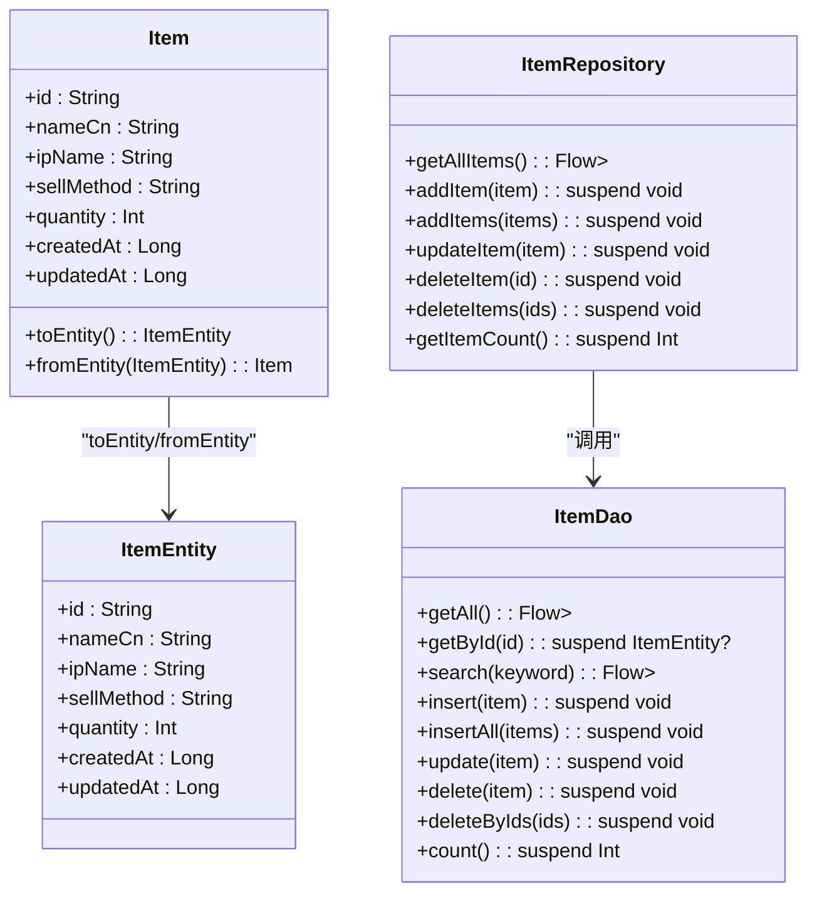
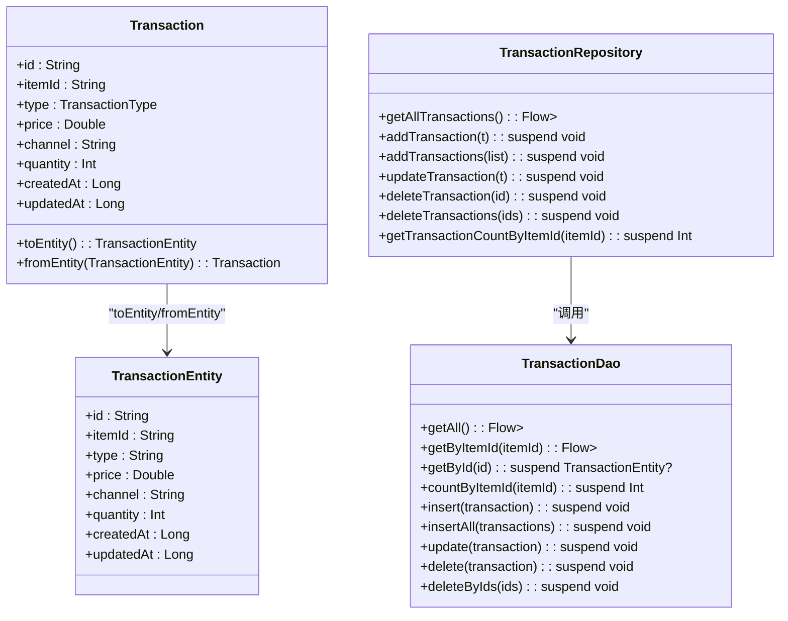
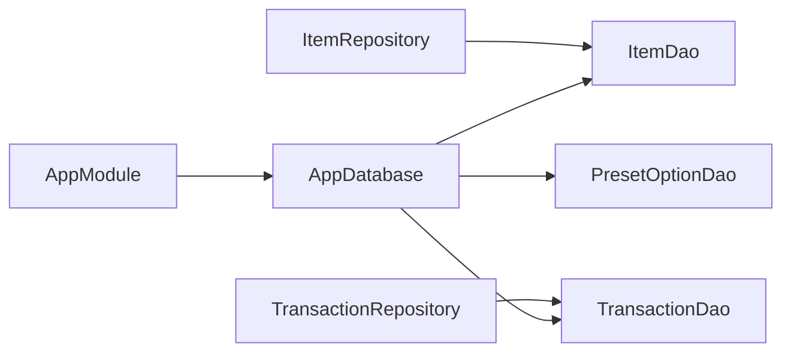
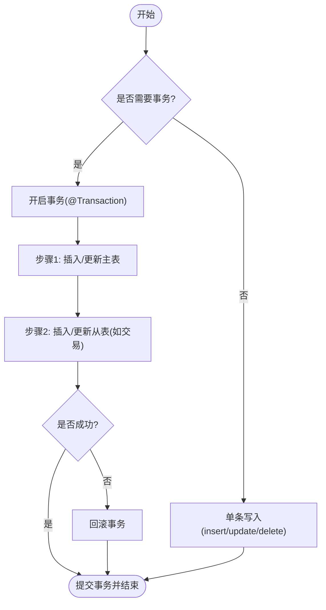

# 数据访问模式

<cite>
**本文引用的文件**   
- [AppDatabase.kt](file://GuZiStorage/app/src/main/java/com/guzi/storage/data/local/AppDatabase.kt)
- [ItemDao.kt](file://GuZiStorage/app/src/main/java/com/guzi/storage/data/local/dao/ItemDao.kt)
- [TransactionDao.kt](file://GuZiStorage/app/src/main/java/com/guzi/storage/data/local/dao/TransactionDao.kt)
- [PresetOptionDao.kt](file://GuZiStorage/app/src/main/java/com/guzi/storage/data/local/dao/PresetOptionDao.kt)
- [ItemEntity.kt](file://GuZiStorage/app/src/main/java/com/guzi/storage/data/local/entity/ItemEntity.kt)
- [TransactionEntity.kt](file://GuZiStorage/app/src/main/java/com/guzi/storage/data/local/entity/TransactionEntity.kt)
- [PresetOptionEntity.kt](file://GuZiStorage/app/src/main/java/com/guzi/storage/data/local/entity/PresetOptionEntity.kt)
- [ItemRepository.kt](file://GuZiStorage/app/src/main/java/com/guzi/storage/data/repository/ItemRepository.kt)
- [TransactionRepository.kt](file://GuZiStorage/app/src/main/java/com/guzi/storage/data/repository/TransactionRepository.kt)
- [Item.kt](file://GuZiStorage/app/src/main/java/com/guzi/storage/domain/model/Item.kt)
- [Transaction.kt](file://GuZiStorage/app/src/main/java/com/guzi/storage/domain/model/Transaction.kt)
- [PipeListConverter.kt](file://GuZiStorage/app/src/main/java/com/guzi/storage/data/local/PipeListConverter.kt)
- [AppModule.kt](file://GuZiStorage/app/src/main/java/com/guzi/storage/di/AppModule.kt)
</cite>

## 目录
1. [简介](#简介)
2. [项目结构](#项目结构)
3. [核心组件](#核心组件)
4. [架构总览](#架构总览)
5. [详细组件分析](#详细组件分析)
6. [依赖关系分析](#依赖关系分析)
7. [性能与并发](#性能与并发)
8. [缓存策略与内存管理](#缓存策略与内存管理)
9. [数据一致性保证](#数据一致性保证)
10. [事务处理与批量操作](#事务处理与批量操作)
11. [测试策略与调试技巧](#测试策略与调试技巧)
12. [结论](#结论)

## 简介
本文件面向谷子收纳应用的数据访问层，系统化阐述基于 Room + DAO + Repository 的 CRUD 标准实现模式，覆盖插入、更新、删除的事务边界与并发控制；说明批量操作的实现方法与性能优化；解释数据一致性与约束机制（外键、唯一性、索引）；并给出数据访问层的缓存策略、内存管理与调试建议。文档以代码仓库中的实际实现为依据，提供可视化图示与可追溯来源。

## 项目结构
数据访问层采用分层设计：
- 领域模型层：Item、Transaction 等纯业务对象
- 数据实体层：Room Entity（ItemEntity、TransactionEntity、PresetOptionEntity）
- 数据访问对象层：DAO（ItemDao、TransactionDao、PresetOptionDao）
- 仓储层：Repository（ItemRepository、TransactionRepository），负责领域模型与实体的转换
- 数据库配置：AppDatabase、DI 模块（AppModule）

图表来源
- [AppDatabase.kt:1-34](file://GuZiStorage/app/src/main/java/com/guzi/storage/data/local/AppDatabase.kt#L1-L34)
- [ItemDao.kt:1-90](file://GuZiStorage/app/src/main/java/com/guzi/storage/data/local/dao/ItemDao.kt#L1-L90)
- [TransactionDao.kt:1-49](file://GuZiStorage/app/src/main/java/com/guzi/storage/data/local/dao/TransactionDao.kt#L1-L49)
- [PresetOptionDao.kt:1-42](file://GuZiStorage/app/src/main/java/com/guzi/storage/data/local/dao/PresetOptionDao.kt#L1-L42)
- [ItemRepository.kt:1-80](file://GuZiStorage/app/src/main/java/com/guzi/storage/data/repository/ItemRepository.kt#L1-L80)
- [TransactionRepository.kt:1-63](file://GuZiStorage/app/src/main/java/com/guzi/storage/data/repository/TransactionRepository.kt#L1-L63)

章节来源
- [AppDatabase.kt:1-34](file://GuZiStorage/app/src/main/java/com/guzi/storage/data/local/AppDatabase.kt#L1-L34)
- [AppModule.kt:1-50](file://GuZiStorage/app/src/main/java/com/guzi/storage/di/AppModule.kt#L1-L50)

## 核心组件
- 数据库入口：AppDatabase 声明实体集合与版本，暴露 DAO 实例
- DAO 接口：定义查询（Flow/suspend）、写入（Insert/Update/Delete）及批量方法
- 实体类：定义表结构、索引、外键、列映射
- 仓储层：封装 CRUD，统一时间戳填充、类型转换、对外暴露 Flow
- DI 模块：通过 Hilt 提供单例数据库与 DAO

章节来源
- [AppDatabase.kt:12-33](file://GuZiStorage/app/src/main/java/com/guzi/storage/data/local/AppDatabase.kt#L12-L33)
- [ItemDao.kt:15-89](file://GuZiStorage/app/src/main/java/com/guzi/storage/data/local/dao/ItemDao.kt#L15-L89)
- [TransactionDao.kt:15-48](file://GuZiStorage/app/src/main/java/com/guzi/storage/data/local/dao/TransactionDao.kt#L15-L48)
- [PresetOptionDao.kt:14-41](file://GuZiStorage/app/src/main/java/com/guzi/storage/data/local/dao/PresetOptionDao.kt#L14-L41)
- [ItemRepository.kt:16-79](file://GuZiStorage/app/src/main/java/com/guzi/storage/data/repository/ItemRepository.kt#L16-L79)
- [TransactionRepository.kt:13-62](file://GuZiStorage/app/src/main/java/com/guzi/storage/data/repository/TransactionRepository.kt#L13-L62)
- [AppModule.kt:23-48](file://GuZiStorage/app/src/main/java/com/guzi/storage/di/AppModule.kt#L23-L48)

## 架构总览
数据访问流程遵循“领域模型 ↔ 仓储层 ↔ DAO ↔ Room”的标准路径。仓储层负责：
- 将领域模型转换为实体（含多选字段序列化）
- 统一设置创建/更新时间戳
- 对外暴露响应式数据流（Flow）

图表来源
- [ItemRepository.kt:49-67](file://GuZiStorage/app/src/main/java/com/guzi/storage/data/repository/ItemRepository.kt#L49-L67)
- [ItemDao.kt:20-24](file://GuZiStorage/app/src/main/java/com/guzi/storage/data/local/dao/ItemDao.kt#L20-L24)
- [AppDatabase.kt:29-32](file://GuZiStorage/app/src/main/java/com/guzi/storage/data/local/AppDatabase.kt#L29-L32)

## 详细组件分析

### 物品数据访问（Item）
- 实体设计：主键为字符串 id；常用查询字段建立索引（ip_name、status、category）；多选字段以管道符分隔存储；extra_json 预留扩展；包含 created_at/updated_at 时间戳
- DAO 能力：
  - 查询：全量列表、按 id 获取、IP 分组统计、按 IP/分类/生产者筛选、关键词模糊搜索、角色筛选、精确分类筛选
  - 写入：单条插入、批量插入、更新、删除、按 ID 批量删除、计数
  - 并发：查询返回 Flow 自动响应变化；写入使用 suspend 函数在协程中执行
- 仓储层：
  - 统一填充时间戳
  - 领域模型与实体互转（多选字段通过 PipeListConverter 序列化为管道符分隔字符串）
  - 对外暴露 Flow 列表与 suspend 单条操作

图表来源
- [Item.kt:10-104](file://GuZiStorage/app/src/main/java/com/guzi/storage/domain/model/Item.kt#L10-L104)
- [ItemEntity.kt:16-88](file://GuZiStorage/app/src/main/java/com/guzi/storage/data/local/entity/ItemEntity.kt#L16-L88)
- [ItemDao.kt:15-89](file://GuZiStorage/app/src/main/java/com/guzi/storage/data/local/dao/ItemDao.kt#L15-L89)
- [ItemRepository.kt:16-79](file://GuZiStorage/app/src/main/java/com/guzi/storage/data/repository/ItemRepository.kt#L16-L79)

章节来源
- [ItemEntity.kt:16-88](file://GuZiStorage/app/src/main/java/com/guzi/storage/data/local/entity/ItemEntity.kt#L16-L88)
- [ItemDao.kt:15-89](file://GuZiStorage/app/src/main/java/com/guzi/storage/data/local/dao/ItemDao.kt#L15-L89)
- [ItemRepository.kt:16-79](file://GuZiStorage/app/src/main/java/com/guzi/storage/data/repository/ItemRepository.kt#L16-L79)
- [Item.kt:10-104](file://GuZiStorage/app/src/main/java/com/guzi/storage/domain/model/Item.kt#L10-L104)
- [PipeListConverter.kt:9-25](file://GuZiStorage/app/src/main/java/com/guzi/storage/data/local/PipeListConverter.kt#L9-L25)

### 交易记录数据访问（Transaction）
- 实体设计：主键为字符串 id；通过外键关联 ItemEntity.id，onDelete=CASCADE；对 item_id 建索引；包含 created_at/updated_at
- DAO 能力：
  - 查询：全量列表、按 itemId 获取、按 id 获取、按 itemId 计数
  - 写入：单条插入、批量插入、更新、删除、按 ID 批量删除
- 仓储层：
  - 统一填充时间戳
  - 领域模型与实体互转（图片路径等多选字段同样通过 PipeListConverter 序列化）

图表来源
- [Transaction.kt:9-67](file://GuZiStorage/app/src/main/java/com/guzi/storage/domain/model/Transaction.kt#L9-L67)
- [TransactionEntity.kt:14-64](file://GuZiStorage/app/src/main/java/com/guzi/storage/data/local/entity/TransactionEntity.kt#L14-L64)
- [TransactionDao.kt:15-48](file://GuZiStorage/app/src/main/java/com/guzi/storage/data/local/dao/TransactionDao.kt#L15-L48)
- [TransactionRepository.kt:13-62](file://GuZiStorage/app/src/main/java/com/guzi/storage/data/repository/TransactionRepository.kt#L13-L62)

章节来源
- [TransactionEntity.kt:14-64](file://GuZiStorage/app/src/main/java/com/guzi/storage/data/local/entity/TransactionEntity.kt#L14-L64)
- [TransactionDao.kt:15-48](file://GuZiStorage/app/src/main/java/com/guzi/storage/data/local/dao/TransactionDao.kt#L15-L48)
- [TransactionRepository.kt:13-62](file://GuZiStorage/app/src/main/java/com/guzi/storage/data/repository/TransactionRepository.kt#L13-L62)
- [Transaction.kt:9-67](file://GuZiStorage/app/src/main/java/com/guzi/storage/domain/model/Transaction.kt#L9-L67)

### 预设选项数据访问（PresetOption）
- 实体设计：自增主键；联合唯一索引（attribute_name, option_value）确保同一属性下选项值不重复
- DAO 能力：
  - 查询：按属性名获取列表、获取选项值列表、获取所有属性名
  - 写入：插入（忽略冲突）、批量插入、删除、按属性名和选项值删除

章节来源
- [PresetOptionEntity.kt:15-36](file://GuZiStorage/app/src/main/java/com/guzi/storage/data/local/entity/PresetOptionEntity.kt#L15-L36)
- [PresetOptionDao.kt:14-41](file://GuZiStorage/app/src/main/java/com/guzi/storage/data/local/dao/PresetOptionDao.kt#L14-L41)

## 依赖关系分析
- 依赖注入：Hilt 提供单例 AppDatabase，DAO 由数据库实例解析
- 仓储依赖 DAO，领域模型与实体互转逻辑集中在领域模型与转换器中
- 无循环依赖，职责清晰

图表来源
- [AppModule.kt:23-48](file://GuZiStorage/app/src/main/java/com/guzi/storage/di/AppModule.kt#L23-L48)
- [AppDatabase.kt:29-32](file://GuZiStorage/app/src/main/java/com/guzi/storage/data/local/AppDatabase.kt#L29-L32)

章节来源
- [AppModule.kt:1-50](file://GuZiStorage/app/src/main/java/com/guzi/storage/di/AppModule.kt#L1-L50)

## 性能与并发
- 查询响应式：DAO 查询返回 Flow，Room 内部维护游标与变更通知，避免手动轮询
- 索引优化：
  - items 表：ip_name、status、category 建立索引，提升筛选与排序性能
  - transactions 表：item_id 建立索引，加速按物品维度的交易查询
- 批量写入：
  - insertAll/deleteByIds 减少事务切换与网络往返（本地场景为一次 SQL 调用）
- 并发安全：
  - DAO 的 suspend 方法在协程中执行，Room 内部保证线程安全
  - Flow 订阅者在不同调度器上接收数据，注意背压与合并策略

章节来源
- [ItemEntity.kt:18-22](file://GuZiStorage/app/src/main/java/com/guzi/storage/data/local/entity/ItemEntity.kt#L18-L22)
- [TransactionEntity.kt:24-26](file://GuZiStorage/app/src/main/java/com/guzi/storage/data/local/entity/TransactionEntity.kt#L24-L26)
- [ItemDao.kt:72-85](file://GuZiStorage/app/src/main/java/com/guzi/storage/data/local/dao/ItemDao.kt#L72-L85)
- [TransactionDao.kt:34-47](file://GuZiStorage/app/src/main/java/com/guzi/storage/data/local/dao/TransactionDao.kt#L34-L47)

## 缓存策略与内存管理
- 当前未实现显式二级缓存（如内存缓存或磁盘缓存）。数据读取直接走 Room，适合移动端本地数据规模
- 如需引入缓存：
  - 热点数据（如预设选项）可在 Repository 层增加内存缓存（ConcurrentHashMap/LruCache），配合失效策略
  - 大列表分页加载，避免一次性加载全部数据
- 内存管理建议：
  - 合理使用 Flow 生命周期，避免长时间持有引用导致泄漏
  - 对大图路径列表进行懒加载，不在内存中常驻大对象

[本节为通用指导，不直接分析具体文件]

## 数据一致性保证
- 外键约束：transactions.item_id 引用 items.id，onDelete=CASCADE，删除物品时级联删除其交易记录
- 唯一性约束：preset_options 的 (attribute_name, option_value) 联合唯一索引，防止重复选项值
- 索引：items 与 transactions 的关键查询字段已建索引，保障查询性能与一致性
- 业务规则验证：
  - 多选字段通过 PipeListConverter 统一序列化，避免不一致格式
  - 时间戳由仓储层统一设置，保证审计字段一致性

章节来源
- [TransactionEntity.kt:16-26](file://GuZiStorage/app/src/main/java/com/guzi/storage/data/local/entity/TransactionEntity.kt#L16-L26)
- [PresetOptionEntity.kt:17-22](file://GuZiStorage/app/src/main/java/com/guzi/storage/data/local/entity/PresetOptionEntity.kt#L17-L22)
- [ItemEntity.kt:18-22](file://GuZiStorage/app/src/main/java/com/guzi/storage/data/local/entity/ItemEntity.kt#L18-L22)
- [PipeListConverter.kt:9-25](file://GuZiStorage/app/src/main/java/com/guzi/storage/data/local/PipeListConverter.kt#L9-L25)
- [ItemRepository.kt:49-67](file://GuZiStorage/app/src/main/java/com/guzi/storage/data/repository/ItemRepository.kt#L49-L67)
- [TransactionRepository.kt:34-52](file://GuZiStorage/app/src/main/java/com/guzi/storage/data/repository/TransactionRepository.kt#L34-L52)

## 事务处理与批量操作
- 事务边界：
  - 当前仓储层未显式包裹多步写操作的事务。若需跨表原子性（例如先插入物品再插入多条交易），应在 Repository 层使用 @Transactional 或 Room 的 @Transaction 注解包裹多个 DAO 调用
  - 示例建议：在需要事务的方法中，依次调用 insert(item)、insertAll(transactions)，并在异常时回滚
- 批量操作：
  - 批量插入：insertAll 用于 Items 与 Transactions，减少多次插入开销
  - 批量删除：deleteByIds 支持按 ID 列表删除，适用于多选删除场景
- 并发控制：
  - 读写分离：Flow 读与 suspend 写天然隔离
  - 冲突策略：Insert 使用 REPLACE 或 IGNORE（根据业务选择），避免重复写入导致异常

[此图为概念流程图，不直接映射到具体源码文件]

章节来源
- [ItemDao.kt:72-85](file://GuZiStorage/app/src/main/java/com/guzi/storage/data/local/dao/ItemDao.kt#L72-L85)
- [TransactionDao.kt:34-47](file://GuZiStorage/app/src/main/java/com/guzi/storage/data/local/dao/TransactionDao.kt#L34-L47)

## 测试策略与调试技巧
- 单元测试：
  - 使用 in-memory Room 数据库进行测试，验证 DAO 的查询与写入行为
  - 针对 Flow 查询，使用测试协程收集结果断言
- 集成测试：
  - 模拟完整流程：仓储层调用 DAO，断言领域模型转换正确、时间戳填充正确
- 调试技巧：
  - 启用 Room 日志输出，查看生成的 SQL 语句
  - 检查索引使用情况，确认查询性能
  - 对于并发问题，使用协程调度器与超时控制定位阻塞点

[本节为通用指导，不直接分析具体文件]

## 结论
本项目数据访问层采用清晰的 Room + DAO + Repository 分层，结合 Flow 响应式查询与 suspend 写入，具备良好的可读性与可维护性。通过索引、批量操作与外键/唯一性约束，保障了查询性能与数据一致性。未来可在仓储层引入显式事务与可选的二级缓存，进一步提升复杂业务的一致性与性能表现。