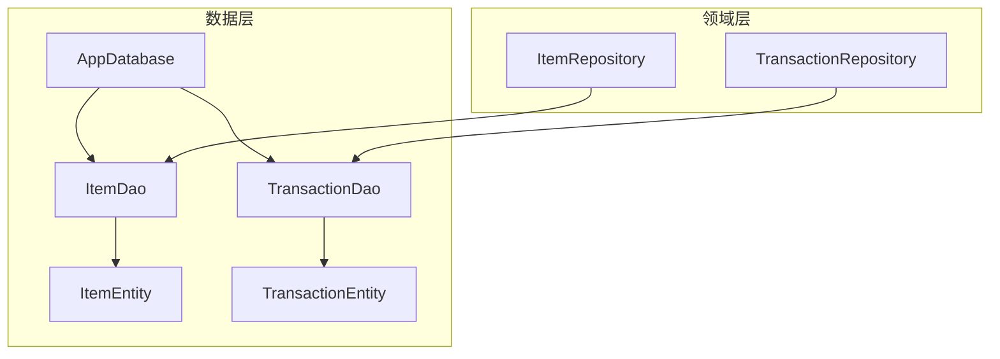
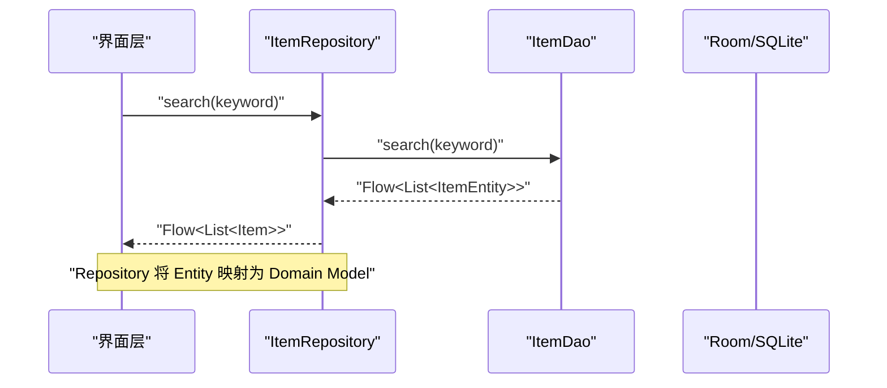
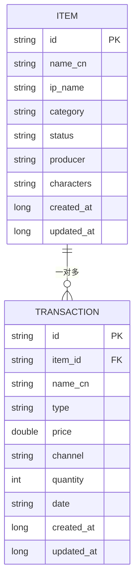
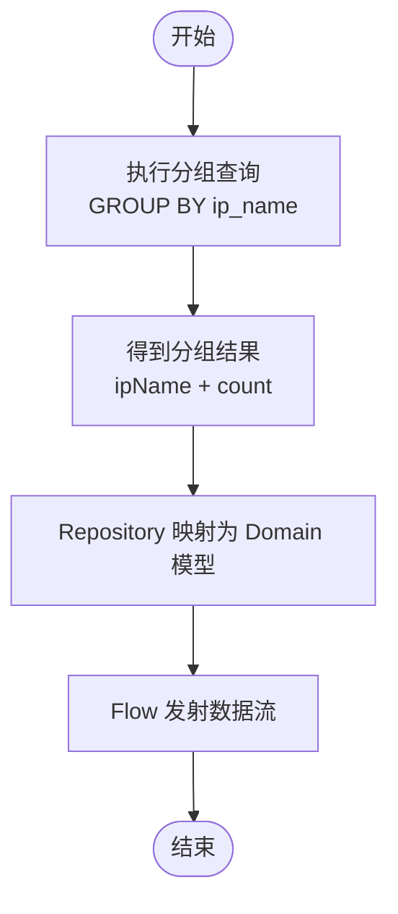
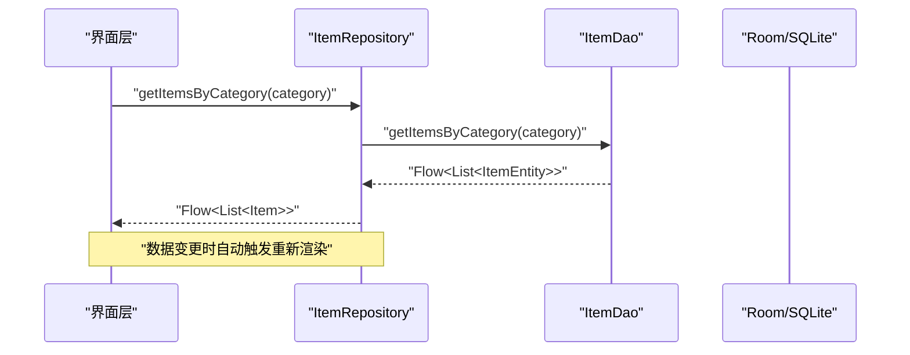
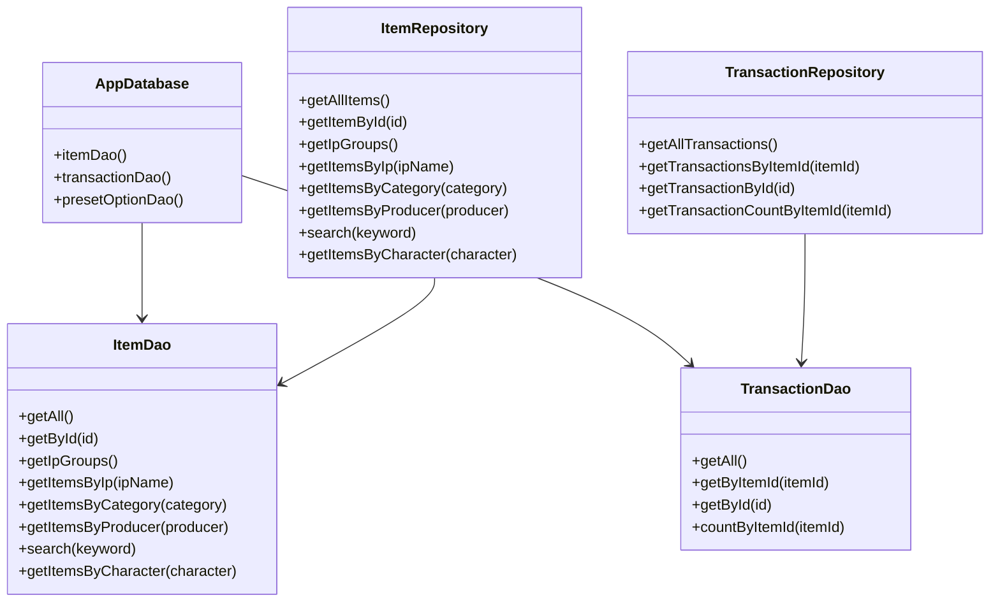

# 查询操作实现

<cite>
**本文引用的文件**   
- [ItemDao.kt](file://GuZiStorage/app/src/main/java/com/guzi/storage/data/local/dao/ItemDao.kt)
- [TransactionDao.kt](file://GuZiStorage/app/src/main/java/com/guzi/storage/data/local/dao/TransactionDao.kt)
- [ItemEntity.kt](file://GuZiStorage/app/src/main/java/com/guzi/storage/data/local/entity/ItemEntity.kt)
- [TransactionEntity.kt](file://GuZiStorage/app/src/main/java/com/guzi/storage/data/local/entity/TransactionEntity.kt)
- [AppDatabase.kt](file://GuZiStorage/app/src/main/java/com/guzi/storage/data/local/AppDatabase.kt)
- [ItemRepository.kt](file://GuZiStorage/app/src/main/java/com/guzi/storage/data/repository/ItemRepository.kt)
- [TransactionRepository.kt](file://GuZiStorage/app/src/main/java/com/guzi/storage/data/repository/TransactionRepository.kt)
- [基础prd.md](file://基础prd.md)
</cite>

## 目录
1. [简介](#简介)
2. [项目结构](#项目结构)
3. [核心组件](#核心组件)
4. [架构总览](#架构总览)
5. [详细组件分析](#详细组件分析)
6. [依赖关系分析](#依赖关系分析)
7. [性能考虑](#性能考虑)
8. [故障排查指南](#故障排查指南)
9. [结论](#结论)
10. [附录](#附录)

## 简介
本文件聚焦“谷子收纳应用”的查询操作实现，围绕 Room DAO 层与 Repository 层展开，系统梳理基本查询、条件查询、分组统计、模糊搜索等 SQL 查询的实现方式，并给出复杂查询构建方法（如 IP 分组统计、多字段模糊匹配、精确分类筛选）、响应式 Flow 的使用场景与优势、索引与查询计划优化建议、以及错误处理与异常应对方案。文档同时结合产品需求说明查询能力如何支撑分组展示、搜索与详情联动等业务目标。

## 项目结构
本项目采用分层数据访问架构：
- 实体层 Entity：定义表结构与索引
- 数据访问对象 DAO：声明 SQL 查询与返回类型（支持 Flow）
- 仓库层 Repository：封装 DAO 调用，负责 Entity ↔ Domain Model 转换，对外暴露 Flow
- 数据库入口 AppDatabase：注册实体与 DAO

图表来源
- [AppDatabase.kt:1-34](file://GuZiStorage/app/src/main/java/com/guzi/storage/data/local/AppDatabase.kt#L1-L34)
- [ItemDao.kt:1-90](file://GuZiStorage/app/src/main/java/com/guzi/storage/data/local/dao/ItemDao.kt#L1-L90)
- [TransactionDao.kt:1-49](file://GuZiStorage/app/src/main/java/com/guzi/storage/data/local/dao/TransactionDao.kt#L1-L49)
- [ItemEntity.kt:1-89](file://GuZiStorage/app/src/main/java/com/guzi/storage/data/local/entity/ItemEntity.kt#L1-L89)
- [TransactionEntity.kt:1-65](file://GuZiStorage/app/src/main/java/com/guzi/storage/data/local/entity/TransactionEntity.kt#L1-L65)

章节来源
- [AppDatabase.kt:1-34](file://GuZiStorage/app/src/main/java/com/guzi/storage/data/local/AppDatabase.kt#L1-L34)

## 核心组件
- ItemDao：提供物品表的增删改查与多种查询（按 IP、种类、出品商、角色、关键词搜索、IP 分组统计），全部查询均返回 Flow<List<T>>，便于 UI 实时刷新。
- TransactionDao：提供交易记录的增删改查，支持按 item_id 查询与计数。
- ItemRepository / TransactionRepository：对 DAO 进行包装，完成 Entity 到 Domain Model 的转换，统一暴露 Flow 接口给上层使用。

章节来源
- [ItemDao.kt:1-90](file://GuZiStorage/app/src/main/java/com/guzi/storage/data/local/dao/ItemDao.kt#L1-L90)
- [TransactionDao.kt:1-49](file://GuZiStorage/app/src/main/java/com/guzi/storage/data/local/dao/TransactionDao.kt#L1-L49)
- [ItemRepository.kt:1-80](file://GuZiStorage/app/src/main/java/com/guzi/storage/data/repository/ItemRepository.kt#L1-L80)
- [TransactionRepository.kt:1-63](file://GuZiStorage/app/src/main/java/com/guzi/storage/data/repository/TransactionRepository.kt#L1-L63)

## 架构总览
下图展示了从 Repository 到 DAO 再到数据库实体的调用链，以及 Flow 在查询链路中的传递路径。

图表来源
- [ItemRepository.kt:41-42](file://GuZiStorage/app/src/main/java/com/guzi/storage/data/repository/ItemRepository.kt#L41-L42)
- [ItemDao.kt:49-56](file://GuZiStorage/app/src/main/java/com/guzi/storage/data/local/dao/ItemDao.kt#L49-L56)

## 详细组件分析

### 数据模型与索引设计
- ItemEntity
  - 主键 id
  - 常用检索字段：name_cn、ip_name、category、status、producer、characters 等
  - 多选字段以管道符分隔存储（如 characters、art_types、sizes 等）
  - 索引：ip_name、status、category
- TransactionEntity
  - 主键 id
  - 外键 item_id 关联 ItemEntity，级联删除
  - 索引：item_id

图表来源
- [ItemEntity.kt:16-23](file://GuZiStorage/app/src/main/java/com/guzi/storage/data/local/entity/ItemEntity.kt#L16-L23)
- [TransactionEntity.kt:14-27](file://GuZiStorage/app/src/main/java/com/guzi/storage/data/local/entity/TransactionEntity.kt#L14-L27)

章节来源
- [ItemEntity.kt:1-89](file://GuZiStorage/app/src/main/java/com/guzi/storage/data/local/entity/ItemEntity.kt#L1-89)
- [TransactionEntity.kt:1-65](file://GuZiStorage/app/src/main/java/com/guzi/storage/data/local/entity/TransactionEntity.kt#L1-65)

### 基本查询
- 获取所有物品（按更新时间倒序）
  - 返回 Flow<List<ItemEntity>>，用于列表实时刷新
- 根据 ID 获取单个物品
  - suspend 函数，适合一次性读取
- 获取所有交易记录（按创建时间倒序）
- 根据 item_id 获取交易记录
- 根据 ID 获取单条交易记录
- 统计某物品的交易数量

章节来源
- [ItemDao.kt:20-24](file://GuZiStorage/app/src/main/java/com/guzi/storage/data/local/dao/ItemDao.kt#L20-L24)
- [TransactionDao.kt:20-30](file://GuZiStorage/app/src/main/java/com/guzi/storage/data/local/dao/TransactionDao.kt#L20-L30)

### 条件查询与精确筛选
- 按 IP 名筛选
- 按种类筛选（精确匹配）
- 按出品商筛选
- 按角色筛选（characters 列包含匹配）

说明：
- 精确筛选使用等值比较，利于命中索引（如 category、ip_name）。
- 角色筛选通过 LIKE 模糊匹配管道符分隔值，注意无法命中常规 B-Tree 索引。

章节来源
- [ItemDao.kt:37-44](file://GuZiStorage/app/src/main/java/com/guzi/storage/data/local/dao/ItemDao.kt#L37-L44)
- [ItemDao.kt:61-62](file://GuZiStorage/app/src/main/java/com/guzi/storage/data/local/dao/ItemDao.kt#L61-L62)

### 模糊搜索与多字段匹配
- 关键词搜索：在中文名、IP 名、英文名三列中进行 LIKE 模糊匹配
- 多字段模糊匹配策略：
  - 当前实现使用 OR 连接多个 LIKE 条件
  - 如需提升性能，可考虑：
    - 使用全文检索（FTS）虚拟表（需迁移）
    - 或引入搜索引擎库（如 Lucene/Solr）做离线索引
- 角色筛选：characters 列包含匹配，适用于“中|日”这类分隔值

章节来源
- [ItemDao.kt:49-56](file://GuZiStorage/app/src/main/java/com/guzi/storage/data/local/dao/ItemDao.kt#L49-L56)
- [ItemDao.kt:61-62](file://GuZiStorage/app/src/main/java/com/guzi/storage/data/local/dao/ItemDao.kt#L61-L62)

### 分组查询与聚合统计
- IP 分组统计：按 ip_name 分组并统计数量，返回 IpGroupInfo 列表
- 用途：支撑默认按 IP 分组的网格展示

图表来源
- [ItemDao.kt:29-35](file://GuZiStorage/app/src/main/java/com/guzi/storage/data/local/dao/ItemDao.kt#L29-L35)
- [ItemRepository.kt:29-30](file://GuZiStorage/app/src/main/java/com/guzi/storage/data/repository/ItemRepository.kt#L29-L30)

章节来源
- [ItemDao.kt:29-35](file://GuZiStorage/app/src/main/java/com/guzi/storage/data/local/dao/ItemDao.kt#L29-L35)

### 响应式查询与 Flow 使用
- DAO 层查询大多返回 Flow<List<T>>，当底层数据变化时自动向订阅者推送新结果
- Repository 层通过 map 将 Entity 转换为 Domain Model，保持 UI 层只依赖领域模型
- 典型使用场景：
  - 列表页监听数据变化，实时更新
  - 搜索框输入即时过滤
  - 分组页面动态更新分组标题与条目数

图表来源
- [ItemRepository.kt:35-36](file://GuZiStorage/app/src/main/java/com/guzi/storage/data/repository/ItemRepository.kt#L35-L36)
- [ItemDao.kt:40-41](file://GuZiStorage/app/src/main/java/com/guzi/storage/data/local/dao/ItemDao.kt#L40-L41)

章节来源
- [ItemRepository.kt:23-45](file://GuZiStorage/app/src/main/java/com/guzi/storage/data/repository/ItemRepository.kt#L23-L45)
- [ItemDao.kt:20-44](file://GuZiStorage/app/src/main/java/com/guzi/storage/data/local/dao/ItemDao.kt#L20-L44)

### 复杂查询构建方法
- IP 分组统计
  - 使用 GROUP BY 与 COUNT(*) 聚合，返回结构化结果 IpGroupInfo
- 多字段模糊匹配
  - 使用 LIKE 与 OR 组合，覆盖 name_cn、ip_name、name_en
  - 若未来需要更高效的全文检索，可考虑 FTS 扩展
- 精确分类筛选
  - 使用等值比较，配合 category 索引提升性能
- 角色筛选
  - 基于 characters 列的 LIKE 包含匹配，适合“中|日”分隔值

章节来源
- [ItemDao.kt:34-35](file://GuZiStorage/app/src/main/java/com/guzi/storage/data/local/dao/ItemDao.kt#L34-L35)
- [ItemDao.kt:49-56](file://GuZiStorage/app/src/main/java/com/guzi/storage/data/local/dao/ItemDao.kt#L49-L56)
- [ItemDao.kt:61-62](file://GuZiStorage/app/src/main/java/com/guzi/storage/data/local/dao/ItemDao.kt#L61-L62)

### 事务与级联删除
- 删除物品时，由于外键设置 CASCADE，关联的交易记录会被自动删除
- 仓库层 deleteItem 先加载实体再删除，确保存在性校验

章节来源
- [TransactionEntity.kt:16-22](file://GuZiStorage/app/src/main/java/com/guzi/storage/data/local/entity/TransactionEntity.kt#L16-L22)
- [ItemRepository.kt:69-72](file://GuZiStorage/app/src/main/java/com/guzi/storage/data/repository/ItemRepository.kt#L69-L72)

## 依赖关系分析
- AppDatabase 注册三个实体与对应 DAO
- ItemRepository 依赖 ItemDao，完成 Entity → Domain 转换
- TransactionRepository 依赖 TransactionDao，完成 Entity → Domain 转换
- DAO 直接操作 SQLite，Room 生成具体实现

图表来源
- [AppDatabase.kt:29-32](file://GuZiStorage/app/src/main/java/com/guzi/storage/data/local/AppDatabase.kt#L29-L32)
- [ItemDao.kt:15-68](file://GuZiStorage/app/src/main/java/com/guzi/storage/data/local/dao/ItemDao.kt#L15-L68)
- [TransactionDao.kt:15-30](file://GuZiStorage/app/src/main/java/com/guzi/storage/data/local/dao/TransactionDao.kt#L15-L30)
- [ItemRepository.kt:17-45](file://GuZiStorage/app/src/main/java/com/guzi/storage/data/repository/ItemRepository.kt#L17-L45)
- [TransactionRepository.kt:14-30](file://GuZiStorage/app/src/main/java/com/guzi/storage/data/repository/TransactionRepository.kt#L14-L30)

章节来源
- [AppDatabase.kt:1-34](file://GuZiStorage/app/src/main/java/com/guzi/storage/data/local/AppDatabase.kt#L1-L34)

## 性能考虑
- 索引使用
  - items 表已对 ip_name、status、category 建立索引，有助于等值查询与分组排序
  - transactions 表对 item_id 建立索引，加速按物品查询交易记录
- 查询计划分析
  - 建议在开发阶段使用 EXPLAIN QUERY PLAN 验证是否命中索引
  - 对于 LIKE '%keyword%' 前缀通配符，通常无法命中 B-Tree 索引；可考虑：
    - 使用前缀匹配（如 'keyword%'）
    - 引入 FTS 全文检索
- 避免 N+1 查询问题
  - 列表展示尽量使用单次查询返回所需字段，避免在循环中逐条查询
  - 分组统计使用 GROUP BY 与 COUNT 聚合，减少多次查询
- 分页与限制
  - 大数据量下建议使用 LIMIT/OFFSET 或游标分页
- 批量写入
  - insertAll 批量插入可减少事务开销

章节来源
- [ItemEntity.kt:18-22](file://GuZiStorage/app/src/main/java/com/guzi/storage/data/local/entity/ItemEntity.kt#L18-L22)
- [TransactionEntity.kt:24-26](file://GuZiStorage/app/src/main/java/com/guzi/storage/data/local/entity/TransactionEntity.kt#L24-L26)
- [ItemDao.kt:75-76](file://GuZiStorage/app/src/main/java/com/guzi/storage/data/local/dao/ItemDao.kt#L75-L76)

## 故障排查指南
- 常见异常
  - 空指针：DAO getById 返回 null 时，Repository 应安全处理
  - 参数为空：LIKE 查询传入空字符串可能导致全表扫描，应在调用前校验
  - 数据类型不匹配：价格、数量等数值字段需保证类型正确
- 日志与调试
  - 在 Repository 层添加 try/catch 捕获异常并记录上下文信息
  - 使用 Room 的日志输出定位慢查询
- 回滚与一致性
  - 批量导入时，遇到错误行跳过并记录报告，整体事务保持一致性
- 参考 PRD 要求
  - 导入失败需明确报错行数，便于用户修正后重试

章节来源
- [基础prd.md:153-163](file://基础prd.md#L153-L163)

## 结论
本项目的查询实现以 Room DAO 为核心，结合 Repository 层的响应式 Flow 与领域模型转换，提供了高效、可扩展的数据访问能力。通过合理的索引设计与聚合查询，满足了分组展示、模糊搜索与精确筛选等关键业务需求。后续可在全文检索、分页与查询计划优化方面进一步演进，以提升大规模数据下的性能与体验。

## 附录
- 相关功能点对照
  - 分组与列表展示：IP 分组统计、按种类/出品商筛选
  - 搜索功能：多字段模糊匹配、角色筛选
  - 详情联动：按 item_id 查询交易记录

章节来源
- [基础prd.md:181-205](file://基础prd.md#L181-L205)