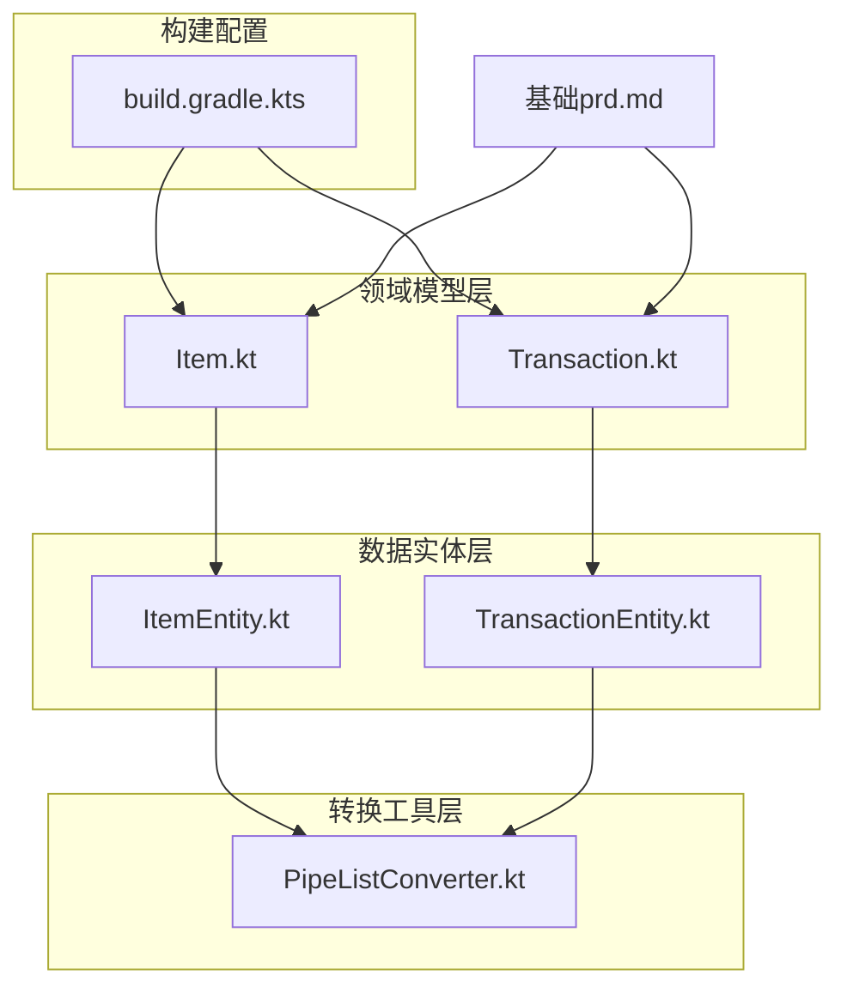
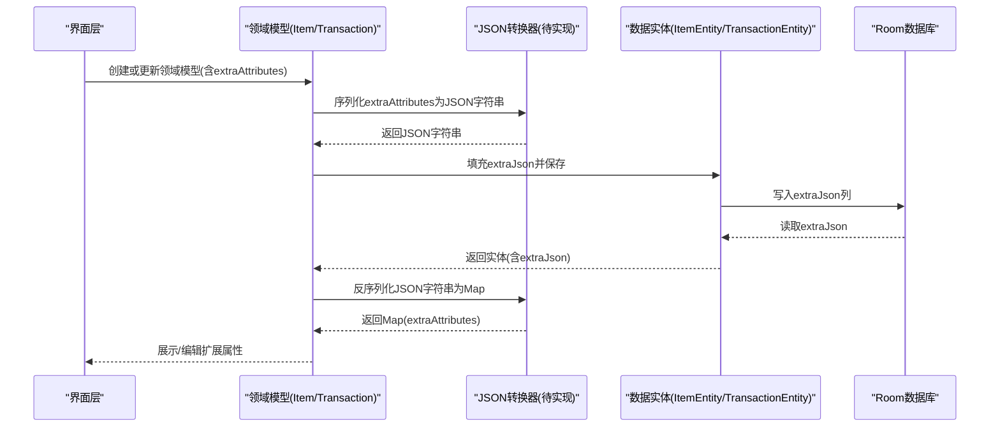
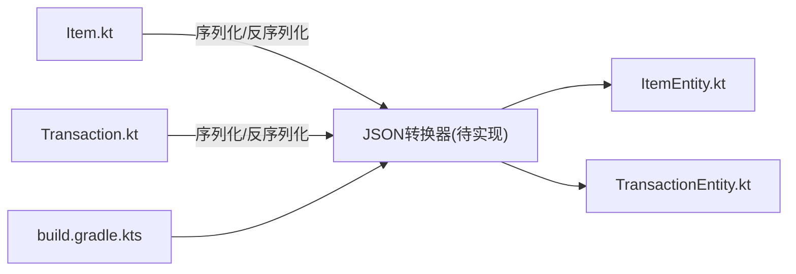
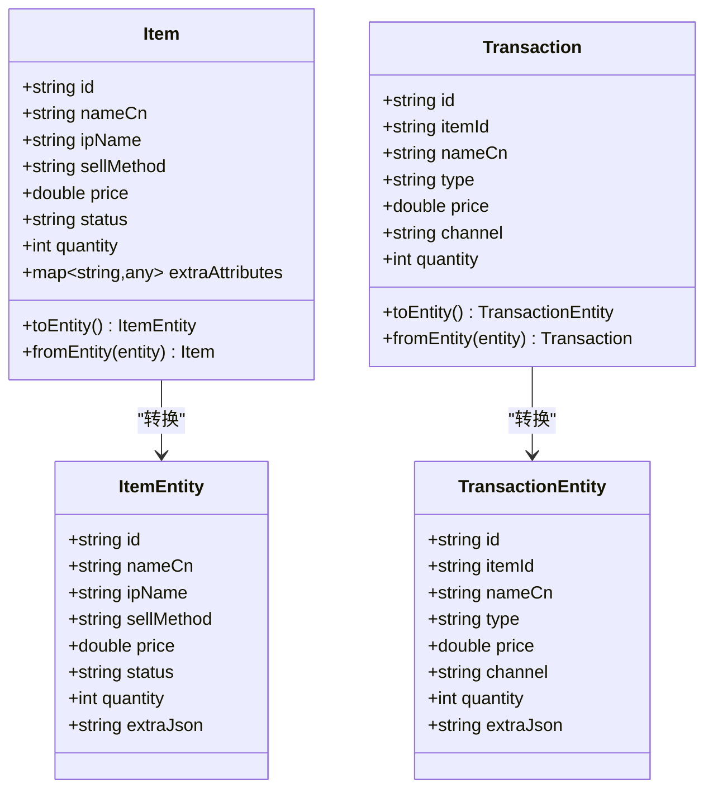
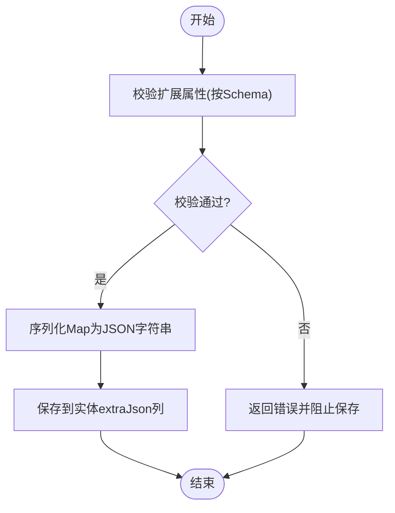

# JSON扩展机制

<cite>
**本文引用的文件列表**
- [基础prd.md](file://基础prd.md)
- [ItemEntity.kt](file://GuZiStorage/app/src/main/java/com/guzi/storage/data/local/entity/ItemEntity.kt)
- [TransactionEntity.kt](file://GuZiStorage/app/src/main/java/com/guzi/storage/data/local/entity/TransactionEntity.kt)
- [Item.kt](file://GuZiStorage/app/src/main/java/com/guzi/storage/domain/model/Item.kt)
- [Transaction.kt](file://GuZiStorage/app/src/main/java/com/guzi/storage/domain/model/Transaction.kt)
- [PipeListConverter.kt](file://GuZiStorage/app/src/main/java/com/guzi/storage/data/local/PipeListConverter.kt)
- [build.gradle.kts](file://GuZiStorage/app/build.gradle.kts)
</cite>

## 目录
1. [引言](#引言)
2. [项目结构](#项目结构)
3. [核心组件](#核心组件)
4. [架构总览](#架构总览)
5. [详细组件分析](#详细组件分析)
6. [依赖关系分析](#依赖关系分析)
7. [性能考量](#性能考量)
8. [故障排查指南](#故障排查指南)
9. [结论](#结论)
10. [附录](#附录)

## 引言
本设计文档围绕“谷子收纳”应用的JSON扩展机制展开，重点说明extraJson字段的设计思路与实现原理，解释如何通过JSON格式支持动态属性扩展；阐述JSON数据的序列化与反序列化过程（含Gson/Moshi使用建议）；提供JSON Schema定义与字段验证规则；给出具体JSON数据结构示例与业务场景；说明如何添加新扩展字段而不影响现有功能；并提供JSON数据的备份与迁移策略。

## 项目结构
仓库采用分层架构：领域模型层、数据实体层、转换工具层以及构建配置。当前代码已为扩展预留了extraJson字段，并在领域模型中定义了extraAttributes用于承载Map型扩展属性。

图表来源
- [Item.kt:1-106](file://GuZiStorage/app/src/main/java/com/guzi/storage/domain/model/Item.kt#L1-L106)
- [Transaction.kt:1-68](file://GuZiStorage/app/src/main/java/com/guzi/storage/domain/model/Transaction.kt#L1-L68)
- [ItemEntity.kt:1-89](file://GuZiStorage/app/src/main/java/com/guzi/storage/data/local/entity/ItemEntity.kt#L1-L89)
- [TransactionEntity.kt:1-65](file://GuZiStorage/app/src/main/java/com/guzi/storage/data/local/entity/TransactionEntity.kt#L1-L65)
- [PipeListConverter.kt:1-26](file://GuZiStorage/app/src/main/java/com/guzi/storage/data/local/PipeListConverter.kt#L1-L26)
- [build.gradle.kts:1-97](file://GuZiStorage/app/build.gradle.kts#L1-L97)
- [基础prd.md:102-124](file://基础prd.md#L102-L124)

章节来源
- [基础prd.md:102-124](file://基础prd.md#L102-L124)
- [ItemEntity.kt:1-89](file://GuZiStorage/app/src/main/java/com/guzi/storage/data/local/entity/ItemEntity.kt#L1-L89)
- [TransactionEntity.kt:1-65](file://GuZiStorage/app/src/main/java/com/guzi/storage/data/local/entity/TransactionEntity.kt#L1-L65)
- [Item.kt:1-106](file://GuZiStorage/app/src/main/java/com/guzi/storage/domain/model/Item.kt#L1-L106)
- [Transaction.kt:1-68](file://GuZiStorage/app/src/main/java/com/guzi/storage/domain/model/Transaction.kt#L1-L68)
- [PipeListConverter.kt:1-26](file://GuZiStorage/app/src/main/java/com/guzi/storage/data/local/PipeListConverter.kt#L1-L26)
- [build.gradle.kts:1-97](file://GuZiStorage/app/build.gradle.kts#L1-L97)

## 核心组件
- 物品领域模型Item：包含extraAttributes字段，用于承载Map<String, Any>的扩展属性。
- 物品实体ItemEntity：包含extraJson列，默认值为空对象字符串，用于持久化扩展属性。
- 交易记录领域模型Transaction：当前未包含扩展属性字段，但实体层预留了extraJson列。
- 交易记录实体TransactionEntity：包含extraJson列，默认值为空对象字符串。
- 管道符转换器PipeListConverter：用于多选字段的序列化和反序列化，体现“存储层以String表示集合”的模式，可作为JSON扩展的参考范式。

章节来源
- [Item.kt:1-106](file://GuZiStorage/app/src/main/java/com/guzi/storage/domain/model/Item.kt#L1-L106)
- [ItemEntity.kt:1-89](file://GuZiStorage/app/src/main/java/com/guzi/storage/data/local/entity/ItemEntity.kt#L1-L89)
- [Transaction.kt:1-68](file://GuZiStorage/app/src/main/java/com/guzi/storage/domain/model/Transaction.kt#L1-L68)
- [TransactionEntity.kt:1-65](file://GuZiStorage/app/src/main/java/com/guzi/storage/data/local/entity/TransactionEntity.kt#L1-L65)
- [PipeListConverter.kt:1-26](file://GuZiStorage/app/src/main/java/com/guzi/storage/data/local/PipeListConverter.kt#L1-L26)

## 架构总览
JSON扩展机制贯穿领域模型与数据实体之间，通过统一的序列化/反序列化流程将Map型扩展属性转换为JSON字符串进行持久化，读取时再还原为Map供业务使用。

图表来源
- [Item.kt:1-106](file://GuZiStorage/app/src/main/java/com/guzi/storage/domain/model/Item.kt#L1-L106)
- [Transaction.kt:1-68](file://GuZiStorage/app/src/main/java/com/guzi/storage/domain/model/Transaction.kt#L1-L68)
- [ItemEntity.kt:1-89](file://GuZiStorage/app/src/main/java/com/guzi/storage/data/local/entity/ItemEntity.kt#L1-L89)
- [TransactionEntity.kt:1-65](file://GuZiStorage/app/src/main/java/com/guzi/storage/data/local/entity/TransactionEntity.kt#L1-L65)

## 详细组件分析

### 扩展字段设计与现状
- 实体层已在ItemEntity与TransactionEntity中预留extraJson列，默认值为空对象字符串，满足未来扩展需求。
- 领域模型Item已定义extraAttributes字段（Map<String, Any>），用于在业务层表达扩展属性；但当前toEntity/fromEntity转换尚未处理该字段，需补充序列化/反序列化逻辑。
- 领域模型Transaction暂未定义扩展属性字段，可在后续版本按需增加。

章节来源
- [ItemEntity.kt:78-81](file://GuZiStorage/app/src/main/java/com/guzi/storage/data/local/entity/ItemEntity.kt#L78-L81)
- [TransactionEntity.kt:55-58](file://GuZiStorage/app/src/main/java/com/guzi/storage/data/local/entity/TransactionEntity.kt#L55-L58)
- [Item.kt:32-34](file://GuZiStorage/app/src/main/java/com/guzi/storage/domain/model/Item.kt#L32-L34)
- [Item.kt:50-74](file://GuZiStorage/app/src/main/java/com/guzi/storage/domain/model/Item.kt#L50-L74)
- [Item.kt:80-104](file://GuZiStorage/app/src/main/java/com/guzi/storage/domain/model/Item.kt#L80-L104)

### JSON序列化与反序列化实现方案
建议在领域模型与实体之间引入统一的JSON转换器，负责Map与JSON字符串之间的互转。可基于以下两种方案之一：
- Gson方案：使用GsonBuilder配置Lenient模式与类型适配器，确保兼容旧数据与宽松解析。
- Moshi方案：使用Moshi.Builder配合Kotlin适配与自定义Adapter，提升类型安全与性能。

关键职责：
- 序列化：将Map<String, Any>转为JSON字符串，空Map转为空对象字符串，避免null值导致异常。
- 反序列化：将JSON字符串解析为Map<String, Any>，对非法JSON进行容错处理，返回空Map或默认值。
- 兼容性：保留对历史空字符串或空对象的兼容，确保升级平滑。

注意：当前仓库未集成Gson或Moshi依赖，需在构建脚本中添加相应依赖后再实现转换器。

章节来源
- [build.gradle.kts:48-92](file://GuZiStorage/app/build.gradle.kts#L48-L92)

### JSON Schema定义与字段验证规则
为保障扩展属性的稳定性与一致性，建议为Item与Transaction分别维护JSON Schema，并在序列化前进行校验。Schema应覆盖：
- 顶层结构：对象类型，键名白名单，必填/可选标记。
- 值类型约束：字符串、数值、布尔、数组、嵌套对象等。
- 枚举约束：如状态、渠道等字段限定取值范围。
- 长度与格式：如日期格式、URL格式、图片路径格式等。
- 命名空间隔离：不同模块的扩展字段使用前缀区分，避免冲突。

验证流程：
- 写入前：根据Schema校验扩展属性，失败则拒绝保存并提示错误原因。
- 读取后：对未知字段进行忽略或降级处理，保证向前兼容。

章节来源
- [基础prd.md:102-124](file://基础prd.md#L102-L124)

### 具体JSON数据结构示例与业务场景
以下为常见业务场景下的扩展属性示例（仅示意，实际以Schema为准）：
- 物品扩展属性示例
  - 新增“入手年份”、“再版次数”、“收藏等级”等字段。
  - 示例结构要点：
    - 顶层为对象。
    - 各字段具备明确类型与可选性。
    - 数组字段用于多值属性（如尺寸、材质）。
- 交易记录扩展属性示例
  - 新增“汇率”、“运费”、“税费”等字段。
  - 示例结构要点：
    - 数值字段需限制精度与范围。
    - 渠道相关字段遵循枚举约束。

章节来源
- [基础prd.md:112-121](file://基础prd.md#L112-L121)

### 如何添加新的扩展字段而不影响现有功能
步骤建议：
- 定义Schema：为新字段编写Schema片段，明确类型、是否必填、默认值与校验规则。
- 更新转换器：在序列化/反序列化逻辑中支持新字段，保持对旧数据的兼容。
- 更新领域模型：如需在业务层直接访问，可在Item或Transaction中增加对应字段，并在toEntity/fromEntity中映射到extraAttributes。
- 更新UI与导入导出：在表单、模板与导入导出逻辑中支持新字段。
- 数据库迁移：若涉及实体列变更，编写Migration脚本，为旧数据补充默认值或空对象。
- 测试覆盖：为新增字段编写单元测试与集成测试，覆盖边界与异常场景。

章节来源
- [基础prd.md:102-124](file://基础prd.md#L102-L124)

### 备份与迁移策略
- 备份策略：
  - 定期导出完整数据（包括extraJson内容），以JSON文件或SQLite备份形式保存。
  - 导出文件需包含元数据（版本号、导出时间、Schema版本），便于恢复与校验。
- 迁移策略：
  - 每次迭代新增字段时，通过数据库迁移脚本为旧数据补充默认值或空对象。
  - 对extraJson进行向后兼容处理：读取时忽略未知字段，写入时保留未知字段。
  - 提供数据修复工具：扫描并修复损坏或不合法的JSON字符串。

章节来源
- [基础prd.md:102-124](file://基础prd.md#L102-L124)

## 依赖关系分析
当前仓库未集成Gson或Moshi，需要在构建脚本中添加依赖后再实现JSON转换器。同时，Room作为持久化层，通过实体类映射extraJson列，无需额外TypeConverter即可存储字符串。

图表来源
- [Item.kt:1-106](file://GuZiStorage/app/src/main/java/com/guzi/storage/domain/model/Item.kt#L1-L106)
- [Transaction.kt:1-68](file://GuZiStorage/app/src/main/java/com/guzi/storage/domain/model/Transaction.kt#L1-L68)
- [ItemEntity.kt:1-89](file://GuZiStorage/app/src/main/java/com/guzi/storage/data/local/entity/ItemEntity.kt#L1-L89)
- [TransactionEntity.kt:1-65](file://GuZiStorage/app/src/main/java/com/guzi/storage/data/local/entity/TransactionEntity.kt#L1-L65)
- [build.gradle.kts:48-92](file://GuZiStorage/app/build.gradle.kts#L48-L92)

章节来源
- [build.gradle.kts:48-92](file://GuZiStorage/app/build.gradle.kts#L48-L92)

## 性能考量
- JSON体积控制：避免在扩展属性中存储大对象或冗余数据，必要时拆分至独立表或外部文件。
- 读写优化：批量操作时缓存JSON转换器实例，减少重复初始化开销。
- 索引与查询：对高频查询字段建立索引，扩展属性不直接参与复杂SQL查询，优先在应用层过滤。
- 容错与降级：对非法JSON进行快速失败与降级处理，避免阻塞主流程。

[本节为通用指导，不涉及具体文件分析]

## 故障排查指南
常见问题与定位方法：
- extraJson为空或解析失败：检查转换器实现与Schema校验逻辑，确认输入是否为合法JSON字符串。
- 新增字段不生效：确认Schema、转换器、领域模型映射与UI/导入导出均已更新。
- 数据迁移问题：检查Migration脚本是否正确为旧数据补充默认值或空对象。
- 性能问题：评估JSON大小与解析频率，考虑缓存与异步处理。

章节来源
- [基础prd.md:102-124](file://基础prd.md#L102-L124)

## 结论
通过在实体层预留extraJson字段并在领域模型中定义extraAttributes，系统已具备JSON扩展的基础能力。下一步需完成JSON转换器实现、Schema定义与校验、UI与导入导出适配，以及备份与迁移策略落地，以确保扩展属性的稳定、安全与可演进。

[本节为总结，不涉及具体文件分析]

## 附录

### 类图（领域模型与实体）

图表来源
- [Item.kt:1-106](file://GuZiStorage/app/src/main/java/com/guzi/storage/domain/model/Item.kt#L1-L106)
- [ItemEntity.kt:1-89](file://GuZiStorage/app/src/main/java/com/guzi/storage/data/local/entity/ItemEntity.kt#L1-L89)
- [Transaction.kt:1-68](file://GuZiStorage/app/src/main/java/com/guzi/storage/domain/model/Transaction.kt#L1-L68)
- [TransactionEntity.kt:1-65](file://GuZiStorage/app/src/main/java/com/guzi/storage/data/local/entity/TransactionEntity.kt#L1-L65)

### 流程图（JSON扩展写入流程）

图表来源
- [Item.kt:50-74](file://GuZiStorage/app/src/main/java/com/guzi/storage/domain/model/Item.kt#L50-L74)
- [ItemEntity.kt:78-81](file://GuZiStorage/app/src/main/java/com/guzi/storage/data/local/entity/ItemEntity.kt#L78-L81)