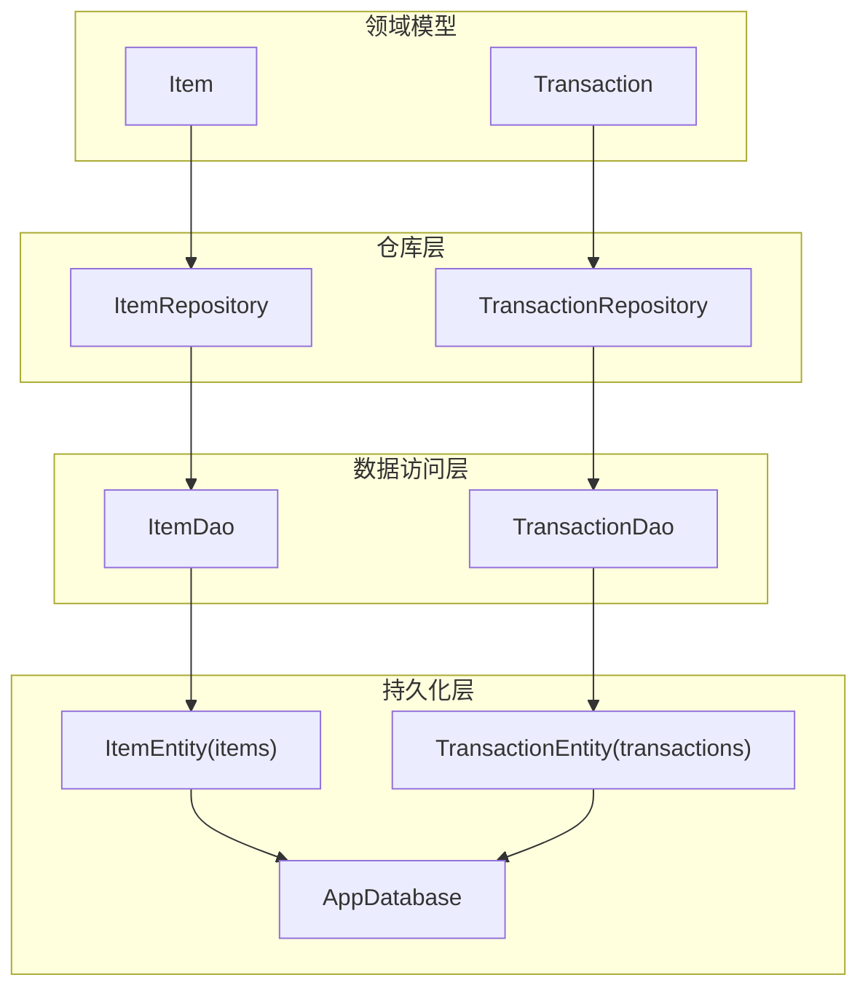
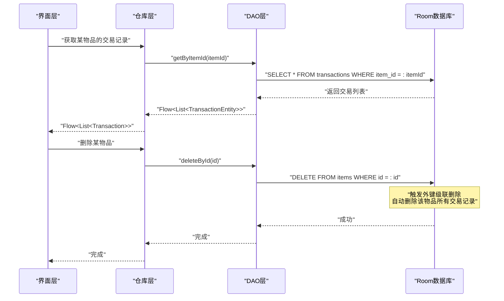
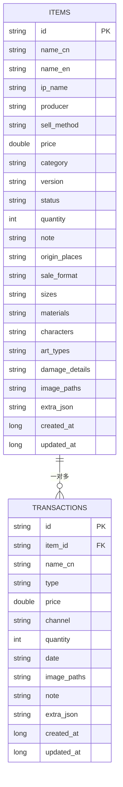
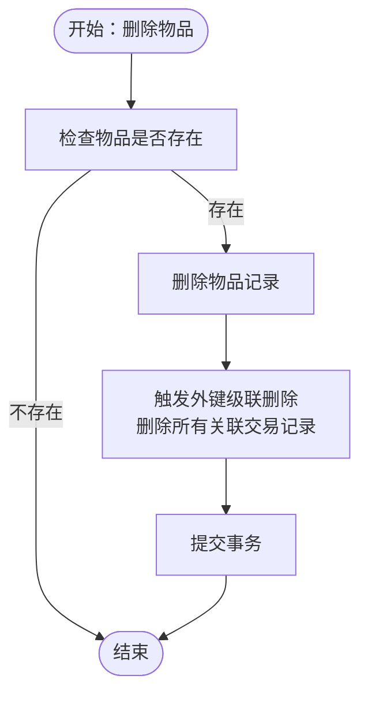
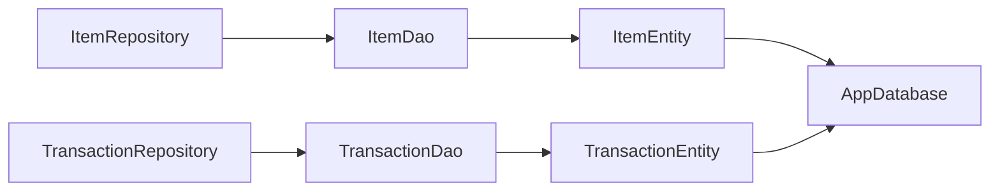

# 关系映射设计

<cite>
**本文引用的文件**   
- [AppDatabase.kt](file://GuZiStorage/app/src/main/java/com/guzi/storage/data/local/AppDatabase.kt)
- [ItemEntity.kt](file://GuZiStorage/app/src/main/java/com/guzi/storage/data/local/entity/ItemEntity.kt)
- [TransactionEntity.kt](file://GuZiStorage/app/src/main/java/com/guzi/storage/data/local/entity/TransactionEntity.kt)
- [ItemDao.kt](file://GuZiStorage/app/src/main/java/com/guzi/storage/data/local/dao/ItemDao.kt)
- [TransactionDao.kt](file://GuZiStorage/app/src/main/java/com/guzi/storage/data/local/dao/TransactionDao.kt)
- [ItemRepository.kt](file://GuZiStorage/app/src/main/java/com/guzi/storage/data/repository/ItemRepository.kt)
- [TransactionRepository.kt](file://GuZiStorage/app/src/main/java/com/guzi/storage/data/repository/TransactionRepository.kt)
- [Item.kt](file://GuZiStorage/app/src/main/java/com/guzi/storage/domain/model/Item.kt)
- [Transaction.kt](file://GuZiStorage/app/src/main/java/com/guzi/storage/domain/model/Transaction.kt)
</cite>

## 目录
1. [简介](#简介)
2. [项目结构](#项目结构)
3. [核心组件](#核心组件)
4. [架构总览](#架构总览)
5. [详细组件分析](#详细组件分析)
6. [依赖分析](#依赖分析)
7. [性能考虑](#性能考虑)
8. [故障排查指南](#故障排查指南)
9. [结论](#结论)
10. [附录](#附录)

## 简介
本设计文档聚焦于谷子收纳应用中的数据库关系映射，重点阐述物品与交易记录之间的一对多关联关系、外键连接方式、@ForeignKey 注解的使用与级联操作配置、引用完整性约束、关系查询的 SQL 示例与 Room 查询方法，并提供 ER 图与实际使用场景。同时说明删除级联策略与数据一致性保证方案。

## 项目结构
本项目采用分层架构：领域模型（domain）→ 仓库层（repository）→ 数据访问对象（DAO）→ 实体（entity）→ Room 数据库（database）。关系映射定义在实体层，通过 DAO 暴露查询接口，由仓库层封装业务逻辑并对外提供 Flow 响应式数据流。

图表来源
- [AppDatabase.kt:1-34](file://GuZiStorage/app/src/main/java/com/guzi/storage/data/local/AppDatabase.kt#L1-L34)
- [ItemEntity.kt:1-89](file://GuZiStorage/app/src/main/java/com/guzi/storage/data/local/entity/ItemEntity.kt#L1-L89)
- [TransactionEntity.kt:1-65](file://GuZiStorage/app/src/main/java/com/guzi/storage/data/local/entity/TransactionEntity.kt#L1-L65)
- [ItemDao.kt:1-90](file://GuZiStorage/app/src/main/java/com/guzi/storage/data/local/dao/ItemDao.kt#L1-L90)
- [TransactionDao.kt:1-49](file://GuZiStorage/app/src/main/java/com/guzi/storage/data/local/dao/TransactionDao.kt#L1-L49)
- [ItemRepository.kt:1-80](file://GuZiStorage/app/src/main/java/com/guzi/storage/data/repository/ItemRepository.kt#L1-L80)
- [TransactionRepository.kt:1-63](file://GuZiStorage/app/src/main/java/com/guzi/storage/data/repository/TransactionRepository.kt#L1-L63)

章节来源
- [AppDatabase.kt:1-34](file://GuZiStorage/app/src/main/java/com/guzi/storage/data/local/AppDatabase.kt#L1-L34)

## 核心组件
- 实体层
  - 物品实体：定义 items 表结构与索引，包含主键 id 及常用查询字段。
  - 交易实体：定义 transactions 表结构，通过外键 item_id 引用 items.id，并配置级联删除。
- 数据访问层
  - ItemDao：提供物品的增删改查与分组、筛选、搜索等查询。
  - TransactionDao：提供交易的增删改查，以及按物品 ID 查询交易记录的接口。
- 仓库层
  - ItemRepository：封装物品 CRUD，负责领域模型与实体的转换。
  - TransactionRepository：封装交易 CRUD，提供按物品维度统计与查询。
- 领域模型
  - Item：业务层使用的物品数据结构，提供与 Entity 的双向转换。
  - Transaction：业务层使用的交易数据结构，提供与 Entity 的双向转换。

章节来源
- [ItemEntity.kt:1-89](file://GuZiStorage/app/src/main/java/com/guzi/storage/data/local/entity/ItemEntity.kt#L1-L89)
- [TransactionEntity.kt:1-65](file://GuZiStorage/app/src/main/java/com/guzi/storage/data/local/entity/TransactionEntity.kt#L1-L65)
- [ItemDao.kt:1-90](file://GuZiStorage/app/src/main/java/com/guzi/storage/data/local/dao/ItemDao.kt#L1-L90)
- [TransactionDao.kt:1-49](file://GuZiStorage/app/src/main/java/com/guzi/storage/data/local/dao/TransactionDao.kt#L1-L49)
- [ItemRepository.kt:1-80](file://GuZiStorage/app/src/main/java/com/guzi/storage/data/repository/ItemRepository.kt#L1-L80)
- [TransactionRepository.kt:1-63](file://GuZiStorage/app/src/main/java/com/guzi/storage/data/repository/TransactionRepository.kt#L1-L63)
- [Item.kt:1-106](file://GuZiStorage/app/src/main/java/com/guzi/storage/domain/model/Item.kt#L1-L106)
- [Transaction.kt:1-68](file://GuZiStorage/app/src/main/java/com/guzi/storage/domain/model/Transaction.kt#L1-L68)

## 架构总览
下图展示了从 UI 到数据库的关系调用链，突出一对多关系的查询路径与级联删除行为。

图表来源
- [TransactionDao.kt:20-30](file://GuZiStorage/app/src/main/java/com/guzi/storage/data/local/dao/TransactionDao.kt#L20-L30)
- [TransactionRepository.kt:23-30](file://GuZiStorage/app/src/main/java/com/guzi/storage/data/repository/TransactionRepository.kt#L23-L30)
- [ItemRepository.kt:69-76](file://GuZiStorage/app/src/main/java/com/guzi/storage/data/repository/ItemRepository.kt#L69-L76)
- [TransactionEntity.kt:14-27](file://GuZiStorage/app/src/main/java/com/guzi/storage/data/local/entity/TransactionEntity.kt#L14-L27)

## 详细组件分析

### 实体与关系映射
- 一对多关系
  - 一个物品（items）可以有多条交易记录（transactions），通过 transactions.item_id 外键指向 items.id。
- 外键与级联
  - 交易实体通过 @ForeignKey 声明对物品实体的外键约束，并设置 onDelete = CASCADE，确保删除物品时自动删除其所有交易记录。
- 索引优化
  - items 表对 ip_name、status、category 建立索引以提升筛选与分组查询性能。
  - transactions 表对 item_id 建立索引以加速按物品维度的交易查询。

图表来源
- [ItemEntity.kt:16-23](file://GuZiStorage/app/src/main/java/com/guzi/storage/data/local/entity/ItemEntity.kt#L16-L23)
- [TransactionEntity.kt:14-27](file://GuZiStorage/app/src/main/java/com/guzi/storage/data/local/entity/TransactionEntity.kt#L14-L27)

章节来源
- [ItemEntity.kt:16-23](file://GuZiStorage/app/src/main/java/com/guzi/storage/data/local/entity/ItemEntity.kt#L16-L23)
- [TransactionEntity.kt:14-27](file://GuZiStorage/app/src/main/java/com/guzi/storage/data/local/entity/TransactionEntity.kt#L14-L27)

### @ForeignKey 注解与级联操作
- 外键定义
  - 在交易实体中通过 foreignKeys 数组声明外键，指定父实体为物品实体，父列为 items.id，子列为 transactions.item_id。
- 级联删除
  - 配置 onDelete = CASCADE，当物品被删除时，数据库会自动删除与其关联的所有交易记录，避免孤儿记录。
- 索引支持
  - 为 item_id 列创建索引，提升按物品查询交易的性能。

章节来源
- [TransactionEntity.kt:14-27](file://GuZiStorage/app/src/main/java/com/guzi/storage/data/local/entity/TransactionEntity.kt#L14-L27)

### 引用完整性约束
- 外键约束
  - transactions.item_id 必须存在于 items.id，否则插入或更新会失败，保证数据一致性。
- 删除保护
  - 由于配置了级联删除，删除物品时会同步清理其交易记录；若未配置级联，则需手动处理或删除顺序以避免违反外键约束。
- 事务性
  - Room 在执行写入操作时默认在事务中运行，确保多个写操作的原子性与一致性。

章节来源
- [TransactionEntity.kt:14-27](file://GuZiStorage/app/src/main/java/com/guzi/storage/data/local/entity/TransactionEntity.kt#L14-L27)

### 关系查询：SQL 与 Room 方法
- 基础查询
  - 获取所有交易记录：SELECT * FROM transactions ORDER BY created_at DESC
  - 按物品 ID 获取交易记录：SELECT * FROM transactions WHERE item_id = :itemId ORDER BY created_at DESC
  - 获取单个交易记录：SELECT * FROM transactions WHERE id = :id
  - 统计某物品的交易数量：SELECT COUNT(*) FROM transactions WHERE item_id = :itemId
- 对应 Room 方法
  - getAll(): Flow<List<TransactionEntity>>
  - getByItemId(itemId: String): Flow<List<TransactionEntity>>
  - getById(id: String): suspend fun TransactionEntity?
  - countByItemId(itemId: String): suspend fun Int

章节来源
- [TransactionDao.kt:20-30](file://GuZiStorage/app/src/main/java/com/guzi/storage/data/local/dao/TransactionDao.kt#L20-L30)

### 删除级联流程与数据一致性
- 删除物品时的级联流程
  - 调用仓库层的删除方法 → DAO 执行删除语句 → 数据库触发外键级联删除 → 自动删除该物品所有交易记录。
- 一致性保障
  - 外键约束防止无效 item_id 的交易记录存在。
  - 级联删除避免孤儿记录。
  - 事务性写入保证批量操作的原子性。

图表来源
- [ItemRepository.kt:69-76](file://GuZiStorage/app/src/main/java/com/guzi/storage/data/repository/ItemRepository.kt#L69-L76)
- [TransactionEntity.kt:14-27](file://GuZiStorage/app/src/main/java/com/guzi/storage/data/local/entity/TransactionEntity.kt#L14-L27)

章节来源
- [ItemRepository.kt:69-76](file://GuZiStorage/app/src/main/java/com/guzi/storage/data/repository/ItemRepository.kt#L69-L76)
- [TransactionEntity.kt:14-27](file://GuZiStorage/app/src/main/java/com/guzi/storage/data/local/entity/TransactionEntity.kt#L14-L27)

### 实际使用场景
- 场景一：查看某物品的全部交易历史
  - 通过交易仓库按 itemId 查询，返回 Flow<List<Transaction>>，界面可实时展示交易流水。
- 场景二：新增交易记录
  - 在保存交易前校验物品存在（外键约束会在数据库层保证），写入后自动与物品关联。
- 场景三：删除物品及其交易
  - 删除物品后，级联删除自动清理其交易记录，无需额外代码处理。

章节来源
- [TransactionRepository.kt:23-30](file://GuZiStorage/app/src/main/java/com/guzi/storage/data/repository/TransactionRepository.kt#L23-L30)
- [TransactionRepository.kt:34-46](file://GuZiStorage/app/src/main/java/com/guzi/storage/data/repository/TransactionRepository.kt#L34-L46)
- [ItemRepository.kt:69-76](file://GuZiStorage/app/src/main/java/com/guzi/storage/data/repository/ItemRepository.kt#L69-L76)

## 依赖分析
- 组件耦合
  - 仓库层依赖 DAO，DAO 依赖实体，实体通过 @Database 注册到 Room。
  - 领域模型与实体通过仓库层进行转换，保持关注点分离。
- 直接依赖
  - ItemRepository 依赖 ItemDao。
  - TransactionRepository 依赖 TransactionDao。
  - DAO 依赖对应的实体类。
- 外部依赖
  - Room 框架提供数据库抽象与编译期 SQL 校验。
  - Coroutines Flow 用于响应式数据流。

图表来源
- [ItemRepository.kt:1-80](file://GuZiStorage/app/src/main/java/com/guzi/storage/data/repository/ItemRepository.kt#L1-L80)
- [TransactionRepository.kt:1-63](file://GuZiStorage/app/src/main/java/com/guzi/storage/data/repository/TransactionRepository.kt#L1-L63)
- [ItemDao.kt:1-90](file://GuZiStorage/app/src/main/java/com/guzi/storage/data/local/dao/ItemDao.kt#L1-L90)
- [TransactionDao.kt:1-49](file://GuZiStorage/app/src/main/java/com/guzi/storage/data/local/dao/TransactionDao.kt#L1-L49)
- [ItemEntity.kt:1-89](file://GuZiStorage/app/src/main/java/com/guzi/storage/data/local/entity/ItemEntity.kt#L1-L89)
- [TransactionEntity.kt:1-65](file://GuZiStorage/app/src/main/java/com/guzi/storage/data/local/entity/TransactionEntity.kt#L1-L65)
- [AppDatabase.kt:1-34](file://GuZiStorage/app/src/main/java/com/guzi/storage/data/local/AppDatabase.kt#L1-L34)

章节来源
- [ItemRepository.kt:1-80](file://GuZiStorage/app/src/main/java/com/guzi/storage/data/repository/ItemRepository.kt#L1-L80)
- [TransactionRepository.kt:1-63](file://GuZiStorage/app/src/main/java/com/guzi/storage/data/repository/TransactionRepository.kt#L1-L63)
- [ItemDao.kt:1-90](file://GuZiStorage/app/src/main/java/com/guzi/storage/data/local/dao/ItemDao.kt#L1-L90)
- [TransactionDao.kt:1-49](file://GuZiStorage/app/src/main/java/com/guzi/storage/data/local/dao/TransactionDao.kt#L1-L49)
- [ItemEntity.kt:1-89](file://GuZiStorage/app/src/main/java/com/guzi/storage/data/local/entity/ItemEntity.kt#L1-L89)
- [TransactionEntity.kt:1-65](file://GuZiStorage/app/src/main/java/com/guzi/storage/data/local/entity/TransactionEntity.kt#L1-L65)
- [AppDatabase.kt:1-34](file://GuZiStorage/app/src/main/java/com/guzi/storage/data/local/AppDatabase.kt#L1-L34)

## 性能考虑
- 索引策略
  - items 表对 ip_name、status、category 建立索引，提高筛选与分组查询效率。
  - transactions 表对 item_id 建立索引，提升按物品维度查询交易的性能。
- 查询优化
  - 使用 Flow 实现响应式查询，减少不必要的重复请求。
  - 合理分页与过滤条件，避免一次性加载大量数据。
- 写入优化
  - 批量插入时使用 insertAll，减少事务开销。
  - 更新时仅修改必要字段，降低锁竞争。

[本节为通用性能建议，不直接分析具体文件]

## 故障排查指南
- 外键约束错误
  - 现象：插入交易时报外键约束失败。
  - 原因：transactions.item_id 对应的物品不存在。
  - 解决：先确保物品存在，或在业务层做前置校验。
- 级联删除未生效
  - 现象：删除物品后仍有交易记录残留。
  - 原因：未正确配置 onDelete = CASCADE。
  - 解决：检查交易实体的外键配置是否正确。
- 查询性能问题
  - 现象：按物品查询交易缓慢。
  - 原因：缺少 item_id 索引或查询条件不当。
  - 解决：确认索引存在，优化查询条件与分页策略。

章节来源
- [TransactionEntity.kt:14-27](file://GuZiStorage/app/src/main/java/com/guzi/storage/data/local/entity/TransactionEntity.kt#L14-L27)
- [TransactionDao.kt:20-30](file://GuZiStorage/app/src/main/java/com/guzi/storage/data/local/dao/TransactionDao.kt#L20-L30)

## 结论
本设计通过外键与级联删除实现了物品与交易记录之间清晰的一对多关系，结合索引与事务性写入保证了数据一致性与查询性能。仓库层与领域模型的解耦使得业务逻辑更易于维护与扩展。建议在后续迭代中继续完善索引策略与查询优化，并根据业务需求引入更多关系查询能力。

[本节为总结性内容，不直接分析具体文件]

## 附录
- 关键 SQL 示例
  - 获取所有交易：SELECT * FROM transactions ORDER BY created_at DESC
  - 按物品查询交易：SELECT * FROM transactions WHERE item_id = ? ORDER BY created_at DESC
  - 统计某物品交易数：SELECT COUNT(*) FROM transactions WHERE item_id = ?
- 对应 Room 方法
  - getAll()
  - getByItemId(itemId)
  - countByItemId(itemId)

章节来源
- [TransactionDao.kt:20-30](file://GuZiStorage/app/src/main/java/com/guzi/storage/data/local/dao/TransactionDao.kt#L20-L30)