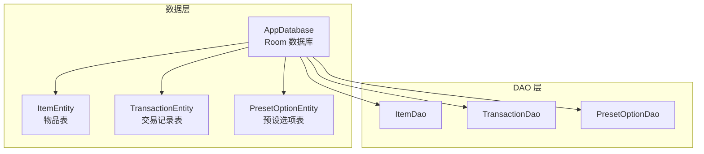
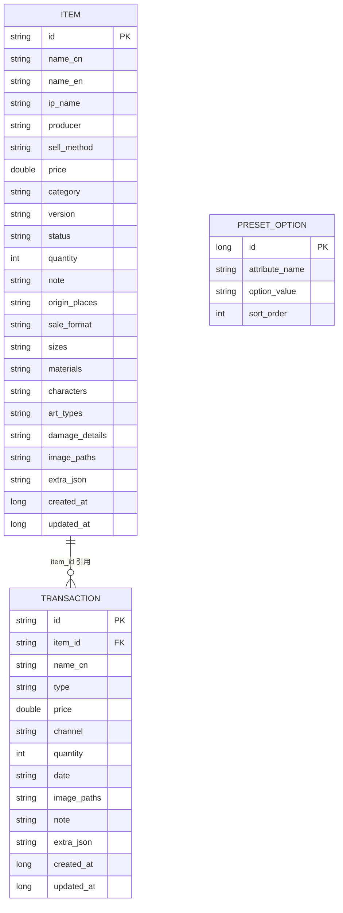
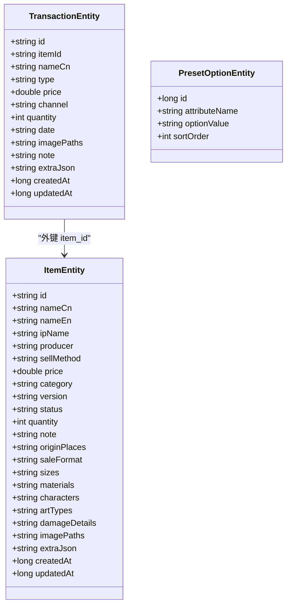

# 实体模型设计

<cite>
**本文引用的文件**
- [ItemEntity.kt](file://GuZiStorage/app/src/main/java/com/guzi/storage/data/local/entity/ItemEntity.kt)
- [TransactionEntity.kt](file://GuZiStorage/app/src/main/java/com/guzi/storage/data/local/entity/TransactionEntity.kt)
- [PresetOptionEntity.kt](file://GuZiStorage/app/src/main/java/com/guzi/storage/data/local/entity/PresetOptionEntity.kt)
- [AppDatabase.kt](file://GuZiStorage/app/src/main/java/com/guzi/storage/data/local/AppDatabase.kt)
- [基础prd.md](file://基础prd.md)
</cite>

## 目录
1. [引言](#引言)
2. [项目结构](#项目结构)
3. [核心组件](#核心组件)
4. [架构总览](#架构总览)
5. [详细组件分析](#详细组件分析)
6. [依赖关系分析](#依赖关系分析)
7. [性能考虑](#性能考虑)
8. [故障排查指南](#故障排查指南)
9. [结论](#结论)
10. [附录](#附录)

## 引言
本设计文档聚焦于谷子收纳应用的本地数据层实体模型，围绕三个核心实体：物品 ItemEntity、交易记录 TransactionEntity、预设选项 PresetOptionEntity。文档将深入解释字段定义、数据类型与约束条件，阐述业务含义（如物品基本信息、交易时间戳与金额、预设选项配置结构），并说明 Room 注解的使用方式（@PrimaryKey、@ColumnInfo、@Index、@ForeignKey 等）。同时提供字段验证规则建议、数据类型选择依据与性能考量，帮助读者快速理解并正确扩展该数据模型。

## 项目结构
应用采用分层架构，数据层通过 Room 管理 SQLite 数据库，实体类位于 data/local/entity 包中，DAO 接口位于 data/local/dao 包中，数据库入口为 AppDatabase。

图表来源
- [AppDatabase.kt:20-33](file://GuZiStorage/app/src/main/java/com/guzi/storage/data/local/AppDatabase.kt#L20-L33)
- [ItemEntity.kt:16-23](file://GuZiStorage/app/src/main/java/com/guzi/storage/data/local/entity/ItemEntity.kt#L16-L23)
- [TransactionEntity.kt:14-27](file://GuZiStorage/app/src/main/java/com/guzi/storage/data/local/entity/TransactionEntity.kt#L14-L27)
- [PresetOptionEntity.kt:15-23](file://GuZiStorage/app/src/main/java/com/guzi/storage/data/local/entity/PresetOptionEntity.kt#L15-L23)

章节来源
- [AppDatabase.kt:1-34](file://GuZiStorage/app/src/main/java/com/guzi/storage/data/local/AppDatabase.kt#L1-L34)

## 核心组件
本节概述三个实体的职责与相互关系：
- ItemEntity：存储谷子/周边物品的基本信息，包含单值字段、多选字段（以管道符分隔）、扩展 JSON 字段以及创建/更新时间戳。
- TransactionEntity：记录物品的购入/卖出明细，通过外键关联到 ItemEntity，支持级联删除。
- PresetOptionEntity：维护各属性的可选值集合，用于下拉选择与自动补全，保证同一属性下选项唯一。

章节来源
- [ItemEntity.kt:8-88](file://GuZiStorage/app/src/main/java/com/guzi/storage/data/local/entity/ItemEntity.kt#L8-L88)
- [TransactionEntity.kt:9-64](file://GuZiStorage/app/src/main/java/com/guzi/storage/data/local/entity/TransactionEntity.kt#L9-L64)
- [PresetOptionEntity.kt:7-36](file://GuZiStorage/app/src/main/java/com/guzi/storage/data/local/entity/PresetOptionEntity.kt#L7-L36)

## 架构总览
从数据库视角看，三张表的关系如下：
- items 表为主数据表，transactions 表通过 item_id 外键引用 items.id，onDelete=CASCADE。
- preset_options 表独立存在，attribute_name + option_value 联合唯一，用于限定或推荐各字段的取值。

图表来源
- [ItemEntity.kt:16-88](file://GuZiStorage/app/src/main/java/com/guzi/storage/data/local/entity/ItemEntity.kt#L16-L88)
- [TransactionEntity.kt:14-64](file://GuZiStorage/app/src/main/java/com/guzi/storage/data/local/entity/TransactionEntity.kt#L14-L64)
- [PresetOptionEntity.kt:15-36](file://GuZiStorage/app/src/main/java/com/guzi/storage/data/local/entity/PresetOptionEntity.kt#L15-L36)

## 详细组件分析

### 实体一：ItemEntity（物品）
- 表名：items
- 主键：id（字符串类型）
- 索引：ip_name、status、category
- 字段分类与业务含义
  - 基础信息（单值）
    - nameCn：中文名称，必填；用于展示与检索。
    - nameEn：日文/英文名称，可选；便于多语言检索。
    - ipName：IP 名，必填；分组与搜索的核心维度。
    - producer：出品商，可选；可配合预设选项使用。
    - sellMethod：售卖方式，必填；如“纯盲、可抱盒盲抽、单领、赠品”。
    - price：价格，可选；参考或购入价。
    - category：种类，可选；如“漫画、吧唧、亚克力挂件”等。
    - version：版本，可选；初贩/再贩等。
    - status：状态，默认“无伤”；有伤需具体标注，影响列表显示与数量统计。
    - quantity：数量，默认 1；无伤与有伤分别计数。
    - note：备注，可选。
  - 多选字段（管道符分隔存储）
    - originPlaces：出品地，如“中|日”。
    - saleFormat：发售形式，如“通贩|场贩|赠品|应募|抽选”。
    - sizes：尺寸，如“单行本|A4杂志|58mm圆”。
    - materials：材质，如“纸|马口铁|塑料|亚克力|橡胶|陶瓷”。
    - characters：相关角色，如“高木涉|佐藤美和子”。
    - artTypes：柄图种类，如“原画|TV正比|公式服|qqr”。
    - damageDetails：伤情详情，当 status 非“无伤”时填写。
    - imagePaths：图片路径，多张图片以管道符分隔。
  - 扩展与时间戳
    - extraJson：未来新增属性的 JSON 扩展位，默认空对象。
    - createdAt/updatedAt：创建/更新时间戳，毫秒时间。

- Room 注解与约束
  - @Entity(tableName = "items", indices = [...])：定义表名与查询索引。
  - @PrimaryKey：id 作为主键。
  - @ColumnInfo(name = "...")：映射列名，保持可读性与一致性。
  - 索引策略：对高频筛选/分组字段建立索引（ip_name、status、category）。

- 字段验证规则建议
  - 必填校验：nameCn、ipName、sellMethod 必须非空。
  - 枚举/预设校验：producer、category、version、status、originPlaces、saleFormat、sizes、materials、characters、artTypes 等优先从 PresetOptionEntity 获取候选值；若允许自由输入，则进行长度与字符集限制。
  - 数值校验：price ≥ 0；quantity ≥ 1。
  - 多选格式：所有多选字段均以管道符分隔，禁止重复项（可在写入前去重）。
  - 状态联动：当 status ≠ “无伤”，damageDetails 必填；列表展示时根据 status 决定是否附加“（伤）”后缀。
  - 时间戳：createdAt/updatedAt 在插入/更新时由系统设置。

- 数据类型选择依据与性能考虑
  - 文本字段统一使用 String，利于模糊匹配与展示。
  - 多选字段采用管道符分隔的 String，避免额外关联表带来的 JOIN 开销，适合轻量场景；注意在查询时使用 LIKE 模糊匹配，必要时结合索引优化。
  - 金额使用 Double，便于计算；如需更高精度可考虑 BigDecimal 并通过 TypeConverter 转换，但当前实现以 Double 满足需求。
  - 时间戳使用 Long（毫秒），便于排序与范围查询。
  - 扩展字段 extraJson 预留灵活性，后续可按需迁移至结构化字段或 JSON 函数查询。

章节来源
- [ItemEntity.kt:16-88](file://GuZiStorage/app/src/main/java/com/guzi/storage/data/local/entity/ItemEntity.kt#L16-L88)
- [基础prd.md:40-73](file://基础prd.md#L40-L73)

### 实体二：TransactionEntity（交易记录）
- 表名：transactions
- 主键：id（字符串类型）
- 外键：item_id → items.id，onDelete=CASCADE
- 索引：item_id
- 字段分类与业务含义
  - 关联与冗余
    - itemId：关联物品 ID。
    - nameCn：冗余存储物品中文名，便于历史展示无需 JOIN。
  - 交易信息
    - type：交易类型，“购入”或“卖出”。
    - price：交易金额。
    - channel：渠道，如“拼团、直播间、咸鱼、骏河屋、线下摆摊、线下寄售、煤炉”。
    - quantity：交易数量，默认 1。
    - date：交易年月，格式“YYYY-MM”，可选。
    - imagePaths：凭证或实物图片路径，多张以管道符分隔。
    - note：备注，可选。
  - 扩展与时间戳
    - extraJson：未来扩展字段，默认空对象。
    - createdAt/updatedAt：创建/更新时间戳。

- Room 注解与约束
  - @Entity(tableName = "transactions", foreignKeys = [...], indices = [...])：定义外键与索引。
  - @PrimaryKey：id 作为主键。
  - @ColumnInfo(name = "...")：映射列名。
  - 外键行为：删除物品时级联删除其交易记录，保障数据完整性。

- 字段验证规则建议
  - 必填校验：itemId、type、price、channel 必须非空。
  - 枚举/预设校验：type 仅允许“购入/卖出”；channel 优先从 PresetOptionEntity 获取候选值。
  - 数值校验：price ≥ 0；quantity ≥ 1。
  - 日期格式：date 遵循“YYYY-MM”正则校验。
  - 多选格式：imagePaths 以管道符分隔，禁止重复项。
  - 时间戳：createdAt/updatedAt 在插入/更新时由系统设置。

- 数据类型选择依据与性能考虑
  - 金额使用 Double，便于统计与报表。
  - 日期使用 String（YYYY-MM），简化解析与展示；如需精确到日可使用 Long 时间戳，但 PRD 示例为年月格式。
  - 外键索引 item_id 提升按物品查询交易的性能。
  - 冗余 nameCn 减少 JOIN 成本，提高列表渲染效率。

章节来源
- [TransactionEntity.kt:14-64](file://GuZiStorage/app/src/main/java/com/guzi/storage/data/local/entity/TransactionEntity.kt#L14-L64)
- [基础prd.md:76-92](file://基础prd.md#L76-L92)

### 实体三：PresetOptionEntity（预设选项）
- 表名：preset_options
- 主键：id（自增长整型）
- 唯一约束：attribute_name + option_value 联合唯一
- 索引：(attribute_name, option_value) 唯一索引
- 字段分类与业务含义
  - attributeName：属性标识，如“ip_name”、“channel”、“category”等。
  - optionValue：选项值，如“名侦探柯南”、“咸鱼”等。
  - sortOrder：排序权重，控制下拉列表顺序。

- Room 注解与约束
  - @Entity(tableName = "preset_options", indices = [...])：定义唯一索引。
  - @PrimaryKey(autoGenerate = true)：自增主键。
  - @ColumnInfo(name = "...")：映射列名。

- 字段验证规则建议
  - attributeName 与 optionValue 组合唯一，写入时需忽略冲突（IGNORE）。
  - optionValue 非空且长度合理，避免空值污染选项库。
  - sortOrder 为非负整数，确保稳定排序。

- 数据类型选择依据与性能考虑
  - 使用自增 Long 主键，避免业务 ID 冲突。
  - 联合唯一索引保证选项不重复，提升查询与写入一致性。
  - 通过 attribute_name 过滤，快速获取某属性的候选值，降低 UI 交互延迟。

章节来源
- [PresetOptionEntity.kt:15-36](file://GuZiStorage/app/src/main/java/com/guzi/storage/data/local/entity/PresetOptionEntity.kt#L15-L36)

## 依赖关系分析
- 实体间依赖
  - TransactionEntity 依赖 ItemEntity（外键 item_id → items.id）。
  - ItemEntity 与 PresetOptionEntity 通过业务逻辑耦合（下拉选项来源于 PresetOptionEntity）。
- 数据库注册
  - AppDatabase 声明 entities 列表，包含三个实体，并导出 schema。
- DAO 访问模式
  - ItemDao、TransactionDao、PresetOptionDao 提供 Flow 流式查询与协程 suspend 方法，支持异步响应与实时刷新。

图表来源
- [ItemEntity.kt:24-88](file://GuZiStorage/app/src/main/java/com/guzi/storage/data/local/entity/ItemEntity.kt#L24-L88)
- [TransactionEntity.kt:28-64](file://GuZiStorage/app/src/main/java/com/guzi/storage/data/local/entity/TransactionEntity.kt#L28-L64)
- [PresetOptionEntity.kt:24-36](file://GuZiStorage/app/src/main/java/com/guzi/storage/data/local/entity/PresetOptionEntity.kt#L24-L36)

章节来源
- [AppDatabase.kt:20-33](file://GuZiStorage/app/src/main/java/com/guzi/storage/data/local/AppDatabase.kt#L20-L33)

## 性能考虑
- 索引策略
  - items.ip_name、items.status、items.category 建立索引，加速分组与筛选。
  - transactions.item_id 建立索引，提升按物品查询交易的性能。
  - preset_options(attribute_name, option_value) 唯一索引，保证选项唯一与高效检索。
- 查询优化
  - 使用 Flow 返回流式结果，UI 可实时响应数据变化。
  - 模糊搜索使用 LIKE 拼接，建议在常用字段上建立索引或考虑全文检索（FTS）扩展。
- 数据冗余
  - transactions.nameCn 冗余存储，减少 JOIN，提高列表渲染速度。
- 存储格式
  - 多选字段以管道符分隔，避免多表关联，适合轻量场景；注意写入前去重与规范化。
- 时间戳
  - 使用毫秒时间戳，便于排序与范围查询；注意跨时区与设备时间同步问题。

[本节为通用性能指导，不直接分析具体文件]

## 故障排查指南
- 外键约束异常
  - 现象：删除物品时报外键冲突。
  - 原因：未启用级联删除或未正确设置 onDelete=CASCADE。
  - 处理：确认 TransactionEntity 的外键配置与 AppDatabase 的版本迁移。
- 唯一约束冲突
  - 现象：插入预设选项失败。
  - 原因：attribute_name + option_value 已存在。
  - 处理：使用 IGNORE 策略或先检查是否存在，再进行插入。
- 多选字段格式错误
  - 现象：查询不到预期结果。
  - 原因：管道符分隔不规范或包含重复项。
  - 处理：写入前进行规范化（去重、去除空白），查询时使用 LIKE 匹配。
- 金额精度问题
  - 现象：累计金额出现浮点误差。
  - 原因：Double 精度限制。
  - 处理：如需高精度，改用 BigDecimal 并通过 TypeConverter 持久化。
- 时间戳异常
  - 现象：排序或筛选不正确。
  - 原因：设备时间不一致或时区差异。
  - 处理：统一使用 UTC 时间戳并在 UI 层转换为本地时间。

章节来源
- [TransactionEntity.kt:14-27](file://GuZiStorage/app/src/main/java/com/guzi/storage/data/local/entity/TransactionEntity.kt#L14-L27)
- [PresetOptionEntity.kt:15-23](file://GuZiStorage/app/src/main/java/com/guzi/storage/data/local/entity/PresetOptionEntity.kt#L15-L23)

## 结论
本设计文档围绕 ItemEntity、TransactionEntity、PresetOptionEntity 三个核心实体，明确了字段定义、数据类型与约束条件，阐述了业务含义与 Room 注解的使用方式。通过合理的索引与冗余策略，兼顾了查询性能与数据一致性。建议在实际开发中严格实施字段验证规则，并结合 PRD 中的状态与数量管理要求，确保用户体验与数据质量。

[本节为总结性内容，不直接分析具体文件]

## 附录
- 字段验证规则汇总
  - ItemEntity
    - 必填：nameCn、ipName、sellMethod
    - 数值：price ≥ 0；quantity ≥ 1
    - 多选：管道符分隔，去重
    - 状态联动：status ≠ “无伤” 时 damageDetails 必填
  - TransactionEntity
    - 必填：itemId、type、price、channel
    - 数值：price ≥ 0；quantity ≥ 1
    - 日期：date 符合“YYYY-MM”
    - 多选：imagePaths 管道符分隔，去重
  - PresetOptionEntity
    - 唯一：attribute_name + option_value
    - 非空：optionValue 非空
    - 排序：sortOrder ≥ 0

章节来源
- [ItemEntity.kt:24-88](file://GuZiStorage/app/src/main/java/com/guzi/storage/data/local/entity/ItemEntity.kt#L24-L88)
- [TransactionEntity.kt:28-64](file://GuZiStorage/app/src/main/java/com/guzi/storage/data/local/entity/TransactionEntity.kt#L28-L64)
- [PresetOptionEntity.kt:24-36](file://GuZiStorage/app/src/main/java/com/guzi/storage/data/local/entity/PresetOptionEntity.kt#L24-L36)
- [基础prd.md:40-92](file://基础prd.md#L40-L92)