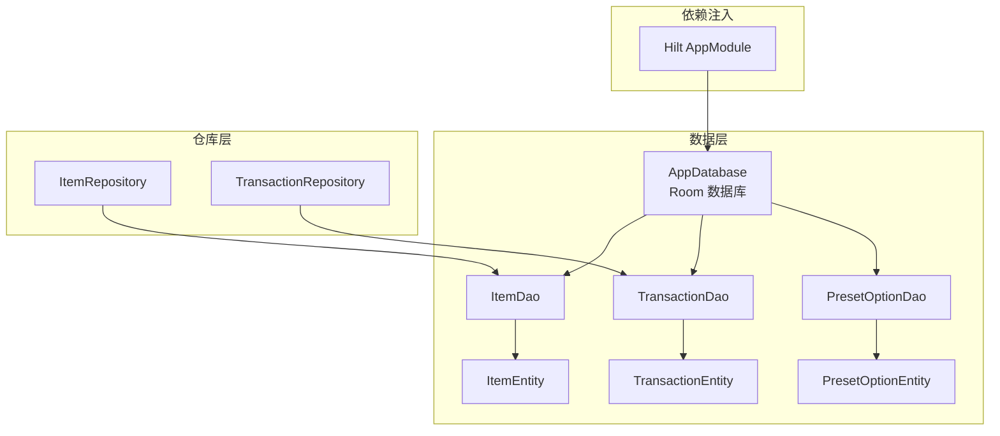
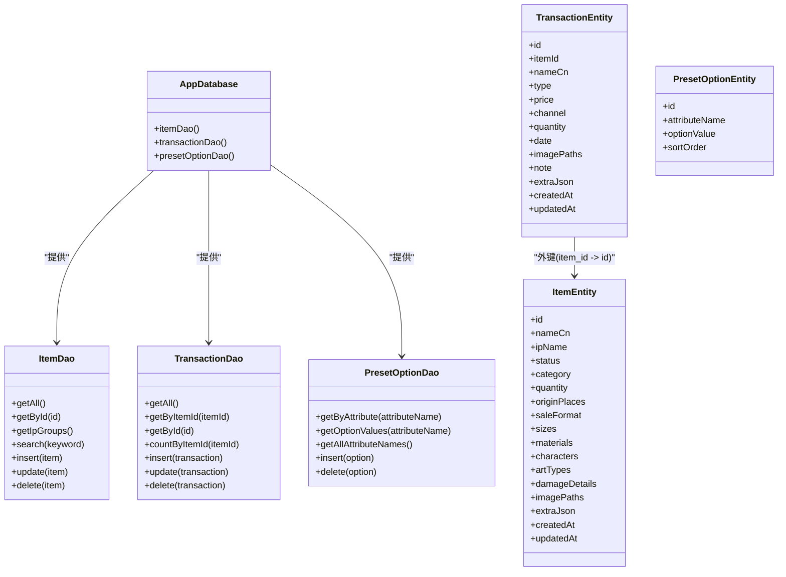
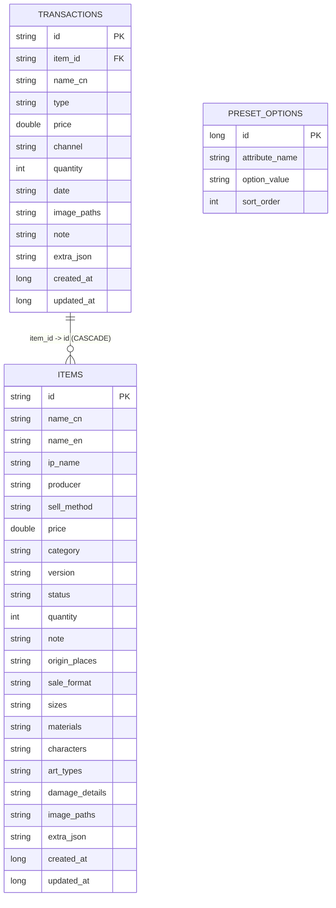
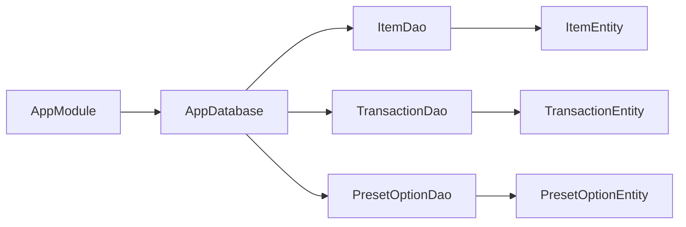

# 数据库Schema设计

<cite>
**本文引用的文件**   
- [AppDatabase.kt](file://GuZiStorage/app/src/main/java/com/guzi/storage/data/local/AppDatabase.kt)
- [ItemEntity.kt](file://GuZiStorage/app/src/main/java/com/guzi/storage/data/local/entity/ItemEntity.kt)
- [TransactionEntity.kt](file://GuZiStorage/app/src/main/java/com/guzi/storage/data/local/entity/TransactionEntity.kt)
- [PresetOptionEntity.kt](file://GuZiStorage/app/src/main/java/com/guzi/storage/data/local/entity/PresetOptionEntity.kt)
- [ItemDao.kt](file://GuZiStorage/app/src/main/java/com/guzi/storage/data/local/dao/ItemDao.kt)
- [TransactionDao.kt](file://GuZiStorage/app/src/main/java/com/guzi/storage/data/local/dao/TransactionDao.kt)
- [PresetOptionDao.kt](file://GuZiStorage/app/src/main/java/com/guzi/storage/data/local/dao/PresetOptionDao.kt)
- [PipeListConverter.kt](file://GuZiStorage/app/src/main/java/com/guzi/storage/data/local/PipeListConverter.kt)
- [AppModule.kt](file://GuZiStorage/app/src/main/java/com/guzi/storage/di/AppModule.kt)
</cite>

## 目录
1. [简介](#简介)
2. [项目结构](#项目结构)
3. [核心组件](#核心组件)
4. [架构总览](#架构总览)
5. [详细组件分析](#详细组件分析)
6. [依赖关系分析](#依赖关系分析)
7. [性能考虑](#性能考虑)
8. [故障排查指南](#故障排查指南)
9. [结论](#结论)
10. [附录](#附录)

## 简介
本文件为“谷子收纳应用”的本地数据库 Schema 设计文档，聚焦于 Room 数据库的整体设计与实现。内容涵盖：
- AppDatabase 的配置与初始化流程
- @Database 注解参数说明（entities、version、exportSchema）
- 数据库版本管理与迁移策略
- 完整 Schema 图（表结构与字段关系）
- 索引策略与查询优化建议
- 数据库初始化脚本与迁移方案
- 连接管理与线程安全注意事项
- 性能监控与调试方法

## 项目结构
本项目采用分层数据访问模式：
- 实体层（Entity）：定义 Room 表映射与约束
- DAO 层（Dao）：定义 SQL 查询与操作接口
- 仓库层（Repository）：封装业务逻辑与领域模型转换
- DI 模块（AppModule）：提供数据库实例与 DAO 注入

图表来源
- [AppDatabase.kt:1-34](file://GuZiStorage/app/src/main/java/com/guzi/storage/data/local/AppDatabase.kt#L1-L34)
- [ItemEntity.kt:1-89](file://GuZiStorage/app/src/main/java/com/guzi/storage/data/local/entity/ItemEntity.kt#L1-L89)
- [TransactionEntity.kt:1-65](file://GuZiStorage/app/src/main/java/com/guzi/storage/data/local/entity/TransactionEntity.kt#L1-L65)
- [PresetOptionEntity.kt:1-37](file://GuZiStorage/app/src/main/java/com/guzi/storage/data/local/entity/PresetOptionEntity.kt#L1-L37)
- [ItemDao.kt:1-90](file://GuZiStorage/app/src/main/java/com/guzi/storage/data/local/dao/ItemDao.kt#L1-L90)
- [TransactionDao.kt:1-49](file://GuZiStorage/app/src/main/java/com/guzi/storage/data/local/dao/TransactionDao.kt#L1-L49)
- [PresetOptionDao.kt:1-42](file://GuZiStorage/app/src/main/java/com/guzi/storage/data/local/dao/PresetOptionDao.kt#L1-L42)
- [AppModule.kt:1-50](file://GuZiStorage/app/src/main/java/com/guzi/storage/di/AppModule.kt#L1-L50)

章节来源
- [AppDatabase.kt:1-34](file://GuZiStorage/app/src/main/java/com/guzi/storage/data/local/AppDatabase.kt#L1-L34)
- [AppModule.kt:1-50](file://GuZiStorage/app/src/main/java/com/guzi/storage/di/AppModule.kt#L1-L50)

## 核心组件
- AppDatabase：Room 数据库入口，声明实体集合、版本号与导出配置，并提供 DAO 访问器。
- Entity 层：
  - ItemEntity：物品主表，包含基础信息、多选字段（管道符分隔）、扩展 JSON 与时间戳。
  - TransactionEntity：交易记录表，通过外键关联 ItemEntity，级联删除。
  - PresetOptionEntity：预设选项表，维护属性可选值及排序。
- DAO 层：
  - ItemDao：物品的增删改查、分组统计、关键词搜索、角色筛选等。
  - TransactionDao：交易的增删改查与按物品计数。
  - PresetOptionDao：预设选项的增删查。
- 工具类：
  - PipeListConverter：将 List<String> 与管道符分隔字符串互转，用于多选字段存储。
- 依赖注入：
  - AppModule：使用 Hilt 提供单例数据库与 DAO 实例，并配置破坏性迁移。

章节来源
- [AppDatabase.kt:1-34](file://GuZiStorage/app/src/main/java/com/guzi/storage/data/local/AppDatabase.kt#L1-L34)
- [ItemEntity.kt:1-89](file://GuZiStorage/app/src/main/java/com/guzi/storage/data/local/entity/ItemEntity.kt#L1-L89)
- [TransactionEntity.kt:1-65](file://GuZiStorage/app/src/main/java/com/guzi/storage/data/local/entity/TransactionEntity.kt#L1-L65)
- [PresetOptionEntity.kt:1-37](file://GuZiStorage/app/src/main/java/com/guzi/storage/data/local/entity/PresetOptionEntity.kt#L1-L37)
- [ItemDao.kt:1-90](file://GuZiStorage/app/src/main/java/com/guzi/storage/data/local/dao/ItemDao.kt#L1-L90)
- [TransactionDao.kt:1-49](file://GuZiStorage/app/src/main/java/com/guzi/storage/data/local/dao/TransactionDao.kt#L1-L49)
- [PresetOptionDao.kt:1-42](file://GuZiStorage/app/src/main/java/com/guzi/storage/data/local/dao/PresetOptionDao.kt#L1-L42)
- [PipeListConverter.kt:1-26](file://GuZiStorage/app/src/main/java/com/guzi/storage/data/local/PipeListConverter.kt#L1-L26)
- [AppModule.kt:1-50](file://GuZiStorage/app/src/main/java/com/guzi/storage/di/AppModule.kt#L1-L50)

## 架构总览
下图展示了从依赖注入到数据库访问的调用链，以及实体间的外键关系。

图表来源
- [AppDatabase.kt:1-34](file://GuZiStorage/app/src/main/java/com/guzi/storage/data/local/AppDatabase.kt#L1-L34)
- [ItemDao.kt:1-90](file://GuZiStorage/app/src/main/java/com/guzi/storage/data/local/dao/ItemDao.kt#L1-L90)
- [TransactionDao.kt:1-49](file://GuZiStorage/app/src/main/java/com/guzi/storage/data/local/dao/TransactionDao.kt#L1-L49)
- [PresetOptionDao.kt:1-42](file://GuZiStorage/app/src/main/java/com/guzi/storage/data/local/dao/PresetOptionDao.kt#L1-L42)
- [ItemEntity.kt:1-89](file://GuZiStorage/app/src/main/java/com/guzi/storage/data/local/entity/ItemEntity.kt#L1-L89)
- [TransactionEntity.kt:1-65](file://GuZiStorage/app/src/main/java/com/guzi/storage/data/local/entity/TransactionEntity.kt#L1-L65)
- [PresetOptionEntity.kt:1-37](file://GuZiStorage/app/src/main/java/com/guzi/storage/data/local/entity/PresetOptionEntity.kt#L1-L37)

## 详细组件分析

### AppDatabase 配置与初始化
- @Database 注解参数
  - entities：声明参与数据库构建的实体类集合，包括 ItemEntity、TransactionEntity、PresetOptionEntity。
  - version：当前数据库版本号为 1，表示初始版本。
  - exportSchema：开启 schema 导出，便于后续生成迁移脚本与校验。
- 初始化过程
  - 通过 Hilt 的 AppModule 使用 Room.databaseBuilder 创建单例数据库实例，指定数据库文件名。
  - 配置 fallbackToDestructiveMigration：当检测到版本不匹配时执行破坏性迁移（重建表），适用于开发阶段或可接受数据丢失的场景。
- 线程安全
  - Room 默认保证线程安全；DAO 返回 Flow 支持响应式更新，避免手动同步。

章节来源
- [AppDatabase.kt:1-34](file://GuZiStorage/app/src/main/java/com/guzi/storage/data/local/AppDatabase.kt#L1-L34)
- [AppModule.kt:1-50](file://GuZiStorage/app/src/main/java/com/guzi/storage/di/AppModule.kt#L1-L50)

### 实体与表结构
- items 表（ItemEntity）
  - 主键：id（String）
  - 基础字段：name_cn、name_en、ip_name、producer、sell_method、price、category、version、status、quantity、note
  - 多选字段（管道符分隔）：origin_places、sale_format、sizes、materials、characters、art_types、damage_details、image_paths
  - 扩展字段：extra_json（JSON 字符串）
  - 时间戳：created_at、updated_at
  - 索引：ip_name、status、category
- transactions 表（TransactionEntity）
  - 主键：id（String）
  - 外键：item_id 引用 items.id，onDelete=CASCADE
  - 字段：name_cn、type、price、channel、quantity、date、image_paths、note、extra_json、created_at、updated_at
  - 索引：item_id
- preset_options 表（PresetOptionEntity）
  - 主键：id（自增 Long）
  - 字段：attribute_name、option_value、sort_order
  - 唯一联合索引：(attribute_name, option_value)

图表来源
- [ItemEntity.kt:1-89](file://GuZiStorage/app/src/main/java/com/guzi/storage/data/local/entity/ItemEntity.kt#L1-L89)
- [TransactionEntity.kt:1-65](file://GuZiStorage/app/src/main/java/com/guzi/storage/data/local/entity/TransactionEntity.kt#L1-L65)
- [PresetOptionEntity.kt:1-37](file://GuZiStorage/app/src/main/java/com/guzi/storage/data/local/entity/PresetOptionEntity.kt#L1-L37)

章节来源
- [ItemEntity.kt:1-89](file://GuZiStorage/app/src/main/java/com/guzi/storage/data/local/entity/ItemEntity.kt#L1-L89)
- [TransactionEntity.kt:1-65](file://GuZiStorage/app/src/main/java/com/guzi/storage/data/local/entity/TransactionEntity.kt#L1-L65)
- [PresetOptionEntity.kt:1-37](file://GuZiStorage/app/src/main/java/com/guzi/storage/data/local/entity/PresetOptionEntity.kt#L1-L37)

### DAO 与查询语义
- ItemDao
  - 列表与分页：getAll 按 updated_at 倒序；可按 IP、分类、生产者、角色进行筛选。
  - 搜索：对中文名、IP名、英文名进行模糊匹配。
  - 分组统计：按 ip_name 分组计数。
  - 写入：插入、批量插入、更新、删除、批量删除、计数。
- TransactionDao
  - 列表与过滤：getAll 按 created_at 倒序；按 item_id 获取交易历史。
  - 写入：插入、批量插入、更新、删除、批量删除。
- PresetOptionDao
  - 查询：按属性获取选项列表、获取所有属性名、获取选项值列表。
  - 写入：插入、批量插入、删除。

章节来源
- [ItemDao.kt:1-90](file://GuZiStorage/app/src/main/java/com/guzi/storage/data/local/dao/ItemDao.kt#L1-L90)
- [TransactionDao.kt:1-49](file://GuZiStorage/app/src/main/java/com/guzi/storage/data/local/dao/TransactionDao.kt#L1-L49)
- [PresetOptionDao.kt:1-42](file://GuZiStorage/app/src/main/java/com/guzi/storage/data/local/dao/PresetOptionDao.kt#L1-L42)

### 多选字段与转换器
- 多选字段以管道符分隔存储（如 "中|日"），在 Entity 中以 String 类型保存。
- PipeListConverter 提供 List<String> 与管道符分隔字符串之间的转换，确保空列表与空字符串的正确处理。

章节来源
- [PipeListConverter.kt:1-26](file://GuZiStorage/app/src/main/java/com/guzi/storage/data/local/PipeListConverter.kt#L1-L26)

### 版本管理与迁移策略
- 当前版本：version = 1（初始版本）。
- 迁移策略：
  - 开发期：fallbackToDestructiveMigration 允许破坏性迁移，简化迭代。
  - 生产期：应启用显式 Migration，基于 exportSchema=true 生成的 schema 文件编写增量迁移脚本，确保数据无损升级。
- 建议：
  - 每次变更实体结构后，递增 version 并添加对应 Migration。
  - 使用 Room 的 schema 导出产物作为迁移依据，避免手工错误。

章节来源
- [AppDatabase.kt:1-34](file://GuZiStorage/app/src/main/java/com/guzi/storage/data/local/AppDatabase.kt#L1-L34)
- [AppModule.kt:1-50](file://GuZiStorage/app/src/main/java/com/guzi/storage/di/AppModule.kt#L1-L50)

### 数据库初始化脚本与迁移示例
- 初始化脚本（基于当前 Schema）
  - 创建 items 表，包含主键、多列与索引。
  - 创建 transactions 表，包含外键与索引。
  - 创建 preset_options 表，包含唯一联合索引。
- 迁移示例（概念性步骤）
  - 新增字段：ALTER TABLE ... ADD COLUMN ... DEFAULT ...
  - 新建表：CREATE TABLE ... 并填充数据（如需）
  - 重命名列：先复制新列、迁移数据、删除旧列（SQLite 限制）
  - 注意：所有迁移需保持幂等与回滚友好，并在测试环境验证。

[本节为概念性说明，未直接分析具体文件]

### 连接管理与线程安全
- 连接管理
  - 通过 Hilt 提供单例 AppDatabase，避免重复创建连接。
  - 数据库文件名固定为 guzi_storage.db。
- 线程安全
  - Room 内部保证线程安全；DAO 返回 Flow 可在协程中安全订阅。
  - 避免在主线程执行耗时写操作；使用 suspend 函数与协程调度。

章节来源
- [AppModule.kt:1-50](file://GuZiStorage/app/src/main/java/com/guzi/storage/di/AppModule.kt#L1-L50)
- [ItemDao.kt:1-90](file://GuZiStorage/app/src/main/java/com/guzi/storage/data/local/dao/ItemDao.kt#L1-L90)
- [TransactionDao.kt:1-49](file://GuZiStorage/app/src/main/java/com/guzi/storage/data/local/dao/TransactionDao.kt#L1-L49)

### 性能监控与调试方法
- 启用 SQLite 日志
  - 在构建阶段设置 .enableSqlLogging()，输出 SQL 语句与执行计划，便于定位慢查询。
- 使用 EXPLAIN QUERY PLAN
  - 针对复杂查询（尤其是 LIKE 模糊匹配）检查是否命中索引。
- 监控 Flow 背压与并发
  - 观察 UI 侧订阅频率与数量，避免过多并发导致频繁 IO。
- 基准测试
  - 使用 Room 提供的基准测试框架评估插入、更新、查询的性能表现。

[本节为通用指导，未直接分析具体文件]

## 依赖关系分析
- 组件耦合
  - AppDatabase 仅暴露 DAO 访问器，低耦合高内聚。
  - DAO 与 Entity 一一对应，职责清晰。
  - Repository 封装领域模型转换，屏蔽底层细节。
- 外部依赖
  - Room 与 Hilt 提供数据库与依赖注入能力。
  - kotlinx.coroutines.flow 提供响应式数据流。

图表来源
- [AppModule.kt:1-50](file://GuZiStorage/app/src/main/java/com/guzi/storage/di/AppModule.kt#L1-L50)
- [AppDatabase.kt:1-34](file://GuZiStorage/app/src/main/java/com/guzi/storage/data/local/AppDatabase.kt#L1-L34)
- [ItemDao.kt:1-90](file://GuZiStorage/app/src/main/java/com/guzi/storage/data/local/dao/ItemDao.kt#L1-L90)
- [TransactionDao.kt:1-49](file://GuZiStorage/app/src/main/java/com/guzi/storage/data/local/dao/TransactionDao.kt#L1-L49)
- [PresetOptionDao.kt:1-42](file://GuZiStorage/app/src/main/java/com/guzi/storage/data/local/dao/PresetOptionDao.kt#L1-L42)
- [ItemEntity.kt:1-89](file://GuZiStorage/app/src/main/java/com/guzi/storage/data/local/entity/ItemEntity.kt#L1-L89)
- [TransactionEntity.kt:1-65](file://GuZiStorage/app/src/main/java/com/guzi/storage/data/local/entity/TransactionEntity.kt#L1-L65)
- [PresetOptionEntity.kt:1-37](file://GuZiStorage/app/src/main/java/com/guzi/storage/data/local/entity/PresetOptionEntity.kt#L1-L37)

章节来源
- [AppModule.kt:1-50](file://GuZiStorage/app/src/main/java/com/guzi/storage/di/AppModule.kt#L1-L50)
- [AppDatabase.kt:1-34](file://GuZiStorage/app/src/main/java/com/guzi/storage/data/local/AppDatabase.kt#L1-L34)

## 性能考虑
- 索引策略
  - items.ip_name、items.status、items.category 已建立索引，利于分组与筛选。
  - transactions.item_id 建立索引，加速按物品查询交易历史。
  - preset_options.attribute_name + option_value 唯一联合索引，保障选项唯一性与快速检索。
- 查询优化建议
  - 模糊搜索（LIKE '%keyword%'）无法有效利用前缀索引，建议在高频搜索字段上考虑全文索引或引入轻量搜索引擎（如 SQLite FTS5）。
  - 对大结果集使用分页（LIMIT/OFFSET）减少内存占用。
  - 避免在 WHERE 中对表达式或函数包裹字段，防止索引失效。
- 写入优化
  - 批量插入优先使用 insertAll，减少事务开销。
  - 合理设置 onConflict 策略（REPLACE/IGNORE），避免不必要的冲突处理。
- 存储格式
  - 多选字段使用管道符分隔字符串，适合简单场景；若需高效按元素筛选，建议拆分为独立关联表以提升查询性能。

[本节为通用指导，未直接分析具体文件]

## 故障排查指南
- 常见错误
  - 版本不一致：检查 @Database.version 与现有 schema 是否一致，必要时添加 Migration。
  - 外键约束失败：确认外键字段存在且类型匹配，必要时调整 onDelete 策略。
  - 唯一约束冲突：preset_options 的联合唯一索引可能导致插入失败，需去重或忽略冲突。
- 调试手段
  - 启用 SQL 日志，查看实际执行的 SQL 与执行计划。
  - 使用 Room 的单元测试与基准测试覆盖关键路径。
  - 在崩溃或异常堆栈中关注 Room 相关提示，定位问题表或字段。

章节来源
- [AppDatabase.kt:1-34](file://GuZiStorage/app/src/main/java/com/guzi/storage/data/local/AppDatabase.kt#L1-L34)
- [PresetOptionEntity.kt:1-37](file://GuZiStorage/app/src/main/java/com/guzi/storage/data/local/entity/PresetOptionEntity.kt#L1-L37)
- [TransactionEntity.kt:1-65](file://GuZiStorage/app/src/main/java/com/guzi/storage/data/local/entity/TransactionEntity.kt#L1-L65)

## 结论
本设计以 Room 为核心，结合 Hilt 完成数据库与 DAO 的依赖注入，提供了清晰的实体与索引策略，满足谷子收纳应用的基础数据管理需求。当前采用破坏性迁移策略，适合开发阶段快速迭代；在生产环境中应逐步完善显式迁移与性能优化措施，确保数据完整性与查询效率。

[本节为总结性内容，未直接分析具体文件]

## 附录
- 术语
  - Entity：Room 实体，映射数据库表。
  - DAO：数据访问对象，定义 SQL 操作接口。
  - Repository：仓库层，封装业务逻辑与领域模型转换。
  - Flow：Kotlin 协程中的响应式数据流。
- 参考
  - Room 官方文档：https://developer.android.com/training/data-storage/room
  - SQLite 官方文档：https://www.sqlite.org/docs.html

[本节为补充信息，未直接分析具体文件]