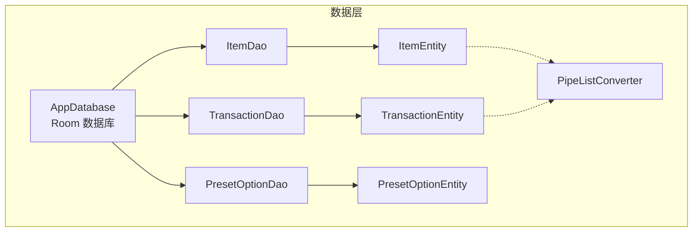
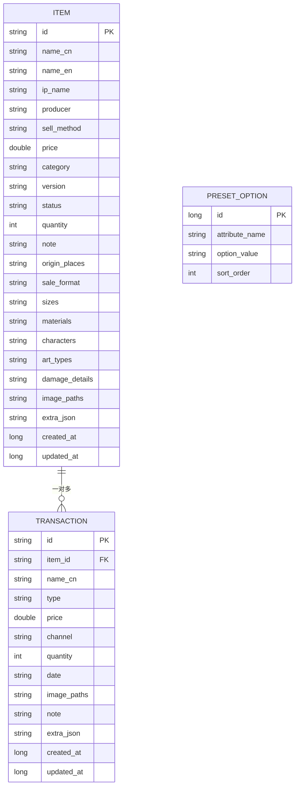
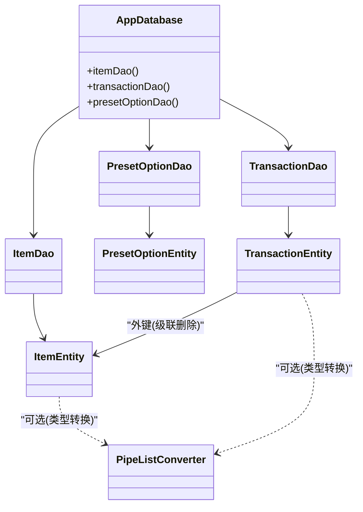

# 数据库设计

<cite>
**本文引用的文件**   
- [AppDatabase.kt](file://GuZiStorage/app/src/main/java/com/guzi/storage/data/local/AppDatabase.kt)
- [ItemEntity.kt](file://GuZiStorage/app/src/main/java/com/guzi/storage/data/local/entity/ItemEntity.kt)
- [TransactionEntity.kt](file://GuZiStorage/app/src/main/java/com/guzi/storage/data/local/entity/TransactionEntity.kt)
- [PresetOptionEntity.kt](file://GuZiStorage/app/src/main/java/com/guzi/storage/data/local/entity/PresetOptionEntity.kt)
- [PipeListConverter.kt](file://GuZiStorage/app/src/main/java/com/guzi/storage/data/local/PipeListConverter.kt)
- [ItemDao.kt](file://GuZiStorage/app/src/main/java/com/guzi/storage/data/local/dao/ItemDao.kt)
- [TransactionDao.kt](file://GuZiStorage/app/src/main/java/com/guzi/storage/data/local/dao/TransactionDao.kt)
- [PresetOptionDao.kt](file://GuZiStorage/app/src/main/java/com/guzi/storage/data/local/dao/PresetOptionDao.kt)
</cite>

## 目录
1. [简介](#简介)
2. [项目结构](#项目结构)
3. [核心组件](#核心组件)
4. [架构总览](#架构总览)
5. [详细组件分析](#详细组件分析)
6. [依赖关系分析](#依赖关系分析)
7. [性能与索引策略](#性能与索引策略)
8. [数据迁移与版本兼容](#数据迁移与版本兼容)
9. [故障排查指南](#故障排查指南)
10. [结论](#结论)

## 简介
本文件为“谷子收纳应用”的数据库设计文档，聚焦于 Room 数据库的实体设计与关系映射、JSON 扩展字段的设计思路、自定义转换器 PipeListConverter 的实现原理与使用方式，并提供 Schema 图、索引策略、性能优化建议以及数据迁移与版本兼容性方案。目标读者包括后端/移动端开发者、测试工程师与产品技术负责人。

## 项目结构
本项目采用分层组织：
- data.local.entity：Room 实体定义（items、transactions、preset_options）
- data.local.dao：数据访问接口（CRUD 与查询）
- data.local：数据库入口与类型转换工具
- domain.model：领域模型（与实体分离，便于业务层解耦）
- di：依赖注入配置（提供数据库实例）
- ui：界面相关

图表来源
- [AppDatabase.kt:20-33](file://GuZiStorage/app/src/main/java/com/guzi/storage/data/local/AppDatabase.kt#L20-L33)
- [ItemDao.kt:15-90](file://GuZiStorage/app/src/main/java/com/guzi/storage/data/local/dao/ItemDao.kt#L15-L90)
- [TransactionDao.kt:15-49](file://GuZiStorage/app/src/main/java/com/guzi/storage/data/local/dao/TransactionDao.kt#L15-L49)
- [PresetOptionDao.kt:15-42](file://GuZiStorage/app/src/main/java/com/guzi/storage/data/local/dao/PresetOptionDao.kt#L15-L42)
- [ItemEntity.kt:16-88](file://GuZiStorage/app/src/main/java/com/guzi/storage/data/local/entity/ItemEntity.kt#L16-L88)
- [TransactionEntity.kt:14-64](file://GuZiStorage/app/src/main/java/com/guzi/storage/data/local/entity/TransactionEntity.kt#L14-L64)
- [PresetOptionEntity.kt:15-36](file://GuZiStorage/app/src/main/java/com/guzi/storage/data/local/entity/PresetOptionEntity.kt#L15-L36)
- [PipeListConverter.kt:9-25](file://GuZiStorage/app/src/main/java/com/guzi/storage/data/local/PipeListConverter.kt#L9-L25)

章节来源
- [AppDatabase.kt:12-33](file://GuZiStorage/app/src/main/java/com/guzi/storage/data/local/AppDatabase.kt#L12-L33)

## 核心组件
- AppDatabase：Room 数据库入口，声明实体集合、版本号与导出 Schema。
- ItemEntity：物品主表，包含基础信息、多选字段（管道符分隔）、扩展 JSON 与时间戳。
- TransactionEntity：交易记录表，通过外键关联 ItemEntity，支持级联删除。
- PresetOptionEntity：预设选项表，维护各属性的可选值，具备联合唯一约束。
- PipeListConverter：将 List<String> 与管道符分隔字符串进行双向转换，用于多选字段。
- DAO 层：ItemDao、TransactionDao、PresetOptionDao 提供异步 Flow 与协程 API。

章节来源
- [AppDatabase.kt:20-33](file://GuZiStorage/app/src/main/java/com/guzi/storage/data/local/AppDatabase.kt#L20-L33)
- [ItemEntity.kt:16-88](file://GuZiStorage/app/src/main/java/com/guzi/storage/data/local/entity/ItemEntity.kt#L16-L88)
- [TransactionEntity.kt:14-64](file://GuZiStorage/app/src/main/java/com/guzi/storage/data/local/entity/TransactionEntity.kt#L14-L64)
- [PresetOptionEntity.kt:15-36](file://GuZiStorage/app/src/main/java/com/guzi/storage/data/local/entity/PresetOptionEntity.kt#L15-L36)
- [PipeListConverter.kt:9-25](file://GuZiStorage/app/src/main/java/com/guzi/storage/data/local/PipeListConverter.kt#L9-L25)
- [ItemDao.kt:15-90](file://GuZiStorage/app/src/main/java/com/guzi/storage/data/local/dao/ItemDao.kt#L15-L90)
- [TransactionDao.kt:15-49](file://GuZiStorage/app/src/main/java/com/guzi/storage/data/local/dao/TransactionDao.kt#L15-L49)
- [PresetOptionDao.kt:15-42](file://GuZiStorage/app/src/main/java/com/guzi/storage/data/local/dao/PresetOptionDao.kt#L15-L42)

## 架构总览
下图展示数据库实体之间的关系与关键约束：
- 一对多：一个物品对应多条交易记录（TransactionEntity.item_id → ItemEntity.id），删除物品时级联删除其交易记录。
- 独立维度：PresetOptionEntity 作为字典表，不直接参与强外键约束，但被 UI 和写入逻辑引用以提供下拉选项。

图表来源
- [ItemEntity.kt:16-88](file://GuZiStorage/app/src/main/java/com/guzi/storage/data/local/entity/ItemEntity.kt#L16-L88)
- [TransactionEntity.kt:14-64](file://GuZiStorage/app/src/main/java/com/guzi/storage/data/local/entity/TransactionEntity.kt#L14-L64)
- [PresetOptionEntity.kt:15-36](file://GuZiStorage/app/src/main/java/com/guzi/storage/data/local/entity/PresetOptionEntity.kt#L15-L36)

## 详细组件分析

### 实体：ItemEntity（物品表）
- 表名：items
- 主键：id（String）
- 基础字段：nameCn、nameEn、ipName、producer、sellMethod、price、category、version、status、quantity、note
- 多选字段（存储为管道符分隔字符串）：originPlaces、saleFormat、sizes、materials、characters、artTypes、damageDetails、imagePaths
- 扩展字段：extraJson（JSON 字符串，默认空对象）
- 时间戳：createdAt、updatedAt（毫秒时间戳）
- 索引：对 ip_name、status、category 建立索引以提升筛选与分组查询性能

字段说明要点
- 多选字段统一以管道符分隔存储，便于在 SQLite 中使用 LIKE 模糊匹配；也可结合 PipeListConverter 在应用层转换为 List<String>。
- extraJson 用于未来新增属性，避免频繁变更表结构。

章节来源
- [ItemEntity.kt:16-88](file://GuZiStorage/app/src/main/java/com/guzi/storage/data/local/entity/ItemEntity.kt#L16-L88)
- [ItemDao.kt:20-68](file://GuZiStorage/app/src/main/java/com/guzi/storage/data/local/dao/ItemDao.kt#L20-L68)

### 实体：TransactionEntity（交易记录表）
- 表名：transactions
- 主键：id（String）
- 外键：item_id 引用 items.id，onDelete=CASCADE（删除物品时级联删除其交易记录）
- 字段：itemId、nameCn、type（购入/卖出）、price、channel、quantity、date（YYYY-MM 格式）、imagePaths、note、extraJson、createdAt、updatedAt
- 索引：对 item_id 建立索引，加速按物品查询交易历史

关系说明
- 与 ItemEntity 为一对多关系：一个物品可有多条交易记录。
- 级联删除确保数据一致性，避免孤儿记录。

章节来源
- [TransactionEntity.kt:14-64](file://GuZiStorage/app/src/main/java/com/guzi/storage/data/local/entity/TransactionEntity.kt#L14-L64)
- [TransactionDao.kt:20-48](file://GuZiStorage/app/src/main/java/com/guzi/storage/data/local/dao/TransactionDao.kt#L20-L48)

### 实体：PresetOptionEntity（预设选项表）
- 表名：preset_options
- 主键：id（自增 Long）
- 字段：attributeName（属性标识）、optionValue（选项值）、sortOrder（排序权重）
- 约束：对 attributeName + optionValue 建立联合唯一索引，保证同一属性下选项值不重复

用途
- 为 UI 提供下拉选项（如 IP 名称、渠道、分类等）。
- 与业务实体无强外键约束，保持灵活性与可扩展性。

章节来源
- [PresetOptionEntity.kt:15-36](file://GuZiStorage/app/src/main/java/com/guzi/storage/data/local/entity/PresetOptionEntity.kt#L15-L36)
- [PresetOptionDao.kt:19-41](file://GuZiStorage/app/src/main/java/com/guzi/storage/data/local/dao/PresetOptionDao.kt#L19-L41)

### 自定义转换器：PipeListConverter
- 作用：在 Entity 的 String 列与领域模型的 List<String> 之间进行双向转换。
- 规则：
  - fromList：将列表用管道符连接为空串或元素串。
  - toList：将空串转为空列表，否则按管道符拆分。
- 适用场景：多选字段（如角色、尺寸、材质等）在存储层以字符串形式保存，在应用层以列表形式处理。

注意
- 当前实体中多选字段仍为 String 类型，如需直接使用 List<String> 字段，需在 @TypeConverter 注解处注册该转换器并在实体字段上标注。
- 若后续引入复杂 JSON 列表，可考虑改用 Gson/Moshi 的 TypeConverter。

章节来源
- [PipeListConverter.kt:9-25](file://GuZiStorage/app/src/main/java/com/guzi/storage/data/local/PipeListConverter.kt#L9-L25)

### DAO 层概览
- ItemDao：提供全量获取、按 ID/IP/类别/制作人筛选、关键词搜索、按角色模糊匹配、计数等接口，返回 Flow<List<T>> 实现响应式更新。
- TransactionDao：提供全量获取、按物品 ID 查询、计数、CRUD 操作。
- PresetOptionDao：提供按属性获取选项、获取所有属性名、插入/删除选项等接口。

章节来源
- [ItemDao.kt:15-90](file://GuZiStorage/app/src/main/java/com/guzi/storage/data/local/dao/ItemDao.kt#L15-L90)
- [TransactionDao.kt:15-49](file://GuZiStorage/app/src/main/java/com/guzi/storage/data/local/dao/TransactionDao.kt#L15-L49)
- [PresetOptionDao.kt:15-42](file://GuZiStorage/app/src/main/java/com/guzi/storage/data/local/dao/PresetOptionDao.kt#L15-L42)

## 依赖关系分析
- AppDatabase 聚合三个实体与三个 DAO。
- TransactionEntity 通过外键依赖 ItemEntity。
- DAO 仅依赖各自实体，遵循单一职责。
- PipeListConverter 为纯函数工具，无外部依赖。

图表来源
- [AppDatabase.kt:20-33](file://GuZiStorage/app/src/main/java/com/guzi/storage/data/local/AppDatabase.kt#L20-L33)
- [ItemEntity.kt:16-88](file://GuZiStorage/app/src/main/java/com/guzi/storage/data/local/entity/ItemEntity.kt#L16-L88)
- [TransactionEntity.kt:14-64](file://GuZiStorage/app/src/main/java/com/guzi/storage/data/local/entity/TransactionEntity.kt#L14-L64)
- [PresetOptionEntity.kt:15-36](file://GuZiStorage/app/src/main/java/com/guzi/storage/data/local/entity/PresetOptionEntity.kt#L15-L36)
- [ItemDao.kt:15-90](file://GuZiStorage/app/src/main/java/com/guzi/storage/data/local/dao/ItemDao.kt#L15-L90)
- [TransactionDao.kt:15-49](file://GuZiStorage/app/src/main/java/com/guzi/storage/data/local/dao/TransactionDao.kt#L15-L49)
- [PresetOptionDao.kt:15-42](file://GuZiStorage/app/src/main/java/com/guzi/storage/data/local/dao/PresetOptionDao.kt#L15-L42)
- [PipeListConverter.kt:9-25](file://GuZiStorage/app/src/main/java/com/guzi/storage/data/local/PipeListConverter.kt#L9-L25)

## 性能与索引策略
- 已有索引
  - items.ip_name、items.status、items.category：提升按 IP、状态、分类筛选与分组的性能。
  - transactions.item_id：加速按物品查询交易历史。
  - preset_options(attribute_name, option_value) 联合唯一索引：保障选项唯一并加速按属性检索。
- 建议补充索引（根据实际查询模式评估）
  - items.name_cn、items.ip_name、items.name_en：若高频进行前缀/模糊搜索，可考虑单独索引或全文索引（SQLite FTS）。
  - transactions.date：若按月统计交易趋势，建议添加索引。
  - transactions.channel、transactions.type：若按渠道/类型聚合，建议添加索引。
- 查询优化建议
  - 避免 SELECT *，按需选择字段以减少 IO。
  - 使用 Flow 订阅减少轮询开销。
  - 批量插入/更新时使用事务包裹，降低磁盘同步次数。
  - 对大文本字段（如 note、extraJson）谨慎参与 WHERE 条件，必要时拆分子表或使用 JSON 函数（SQLite 3.38+）。

章节来源
- [ItemEntity.kt:16-23](file://GuZiStorage/app/src/main/java/com/guzi/storage/data/local/entity/ItemEntity.kt#L16-L23)
- [TransactionEntity.kt:14-27](file://GuZiStorage/app/src/main/java/com/guzi/storage/data/local/entity/TransactionEntity.kt#L14-L27)
- [PresetOptionEntity.kt:15-22](file://GuZiStorage/app/src/main/java/com/guzi/storage/data/local/entity/PresetOptionEntity.kt#L15-L22)
- [ItemDao.kt:20-68](file://GuZiStorage/app/src/main/java/com/guzi/storage/data/local/dao/ItemDao.kt#L20-L68)
- [TransactionDao.kt:20-30](file://GuZiStorage/app/src/main/java/com/guzi/storage/data/local/dao/TransactionDao.kt#L20-L30)

## 数据迁移与版本兼容
- 当前版本：AppDatabase 版本为 1，已启用 exportSchema=true，便于生成并校验 schema 文件。
- 迁移策略
  - 增量迁移：当新增列或索引时，升级版本号并通过 Migration 脚本执行 ALTER TABLE/CREATE INDEX 等操作。
  - 破坏性变更：若需重命名列或删除列，建议使用 fallbackToDestructiveMigration（开发阶段）或编写完整重建脚本（生产环境）。
  - 数据回填：对于新增的多选字段或 extraJson 默认值，可在迁移后执行 UPDATE 语句进行回填。
- 兼容性建议
  - 向下兼容：保留旧列至少一个版本周期，逐步淘汰。
  - extraJson 演进：优先通过 extraJson 新增字段，避免频繁 DDL。
  - 预置选项初始化：在首次启动或迁移完成后，插入默认选项集。

章节来源
- [AppDatabase.kt:20-28](file://GuZiStorage/app/src/main/java/com/guzi/storage/data/local/AppDatabase.kt#L20-L28)

## 故障排查指南
- 外键约束异常
  - 现象：删除物品时报外键冲突。
  - 原因：未正确设置 onDelete=CASCADE 或未清理子表。
  - 解决：确认 TransactionEntity 的外键与级联删除配置。
- 多选字段查询不准确
  - 现象：LIKE 匹配出现误匹配（如 “日” 匹配到 “日本”）。
  - 原因：管道符分隔字符串未加边界控制。
  - 解决：在 SQL 中增加前后管道符拼接匹配，或在应用层预处理。
- 性能退化
  - 现象：列表加载缓慢。
  - 排查：检查是否缺少必要索引、是否存在 N+1 查询、是否使用了低效的 LIKE 全表扫描。
- 选项重复
  - 现象：插入相同 attribute_name + option_value 失败或重复。
  - 解决：利用联合唯一索引保护，插入前做存在性判断。

章节来源
- [TransactionEntity.kt:14-27](file://GuZiStorage/app/src/main/java/com/guzi/storage/data/local/entity/TransactionEntity.kt#L14-L27)
- [ItemDao.kt:49-62](file://GuZiStorage/app/src/main/java/com/guzi/storage/data/local/dao/ItemDao.kt#L49-L62)
- [PresetOptionDao.kt:30-41](file://GuZiStorage/app/src/main/java/com/guzi/storage/data/local/dao/PresetOptionDao.kt#L30-L41)

## 结论
本设计通过清晰的实体划分、合理的外键与索引策略，以及灵活的 extraJson 扩展机制，兼顾了功能完整性与演进能力。PipeListConverter 为多选字段提供了简洁的类型转换方案。建议在后续迭代中持续完善索引覆盖、引入全文检索与更完善的迁移脚本，以支撑更大规模的数据与更复杂的查询需求。