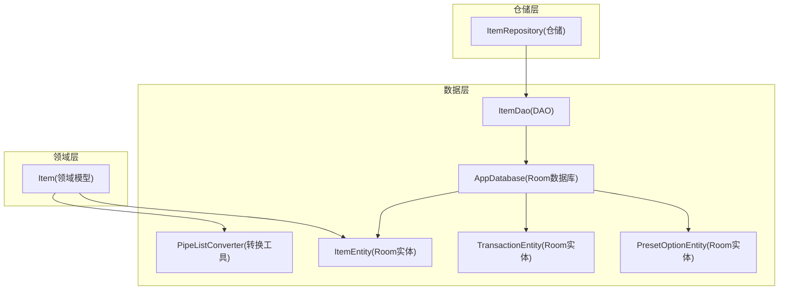
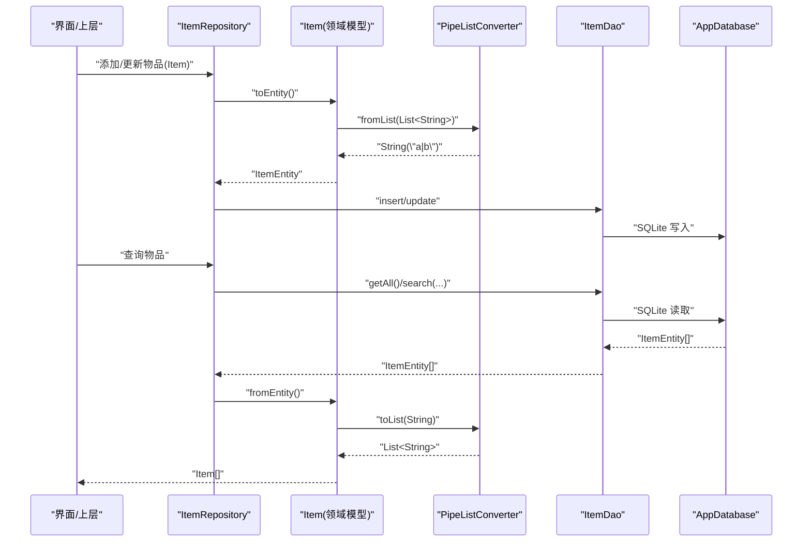
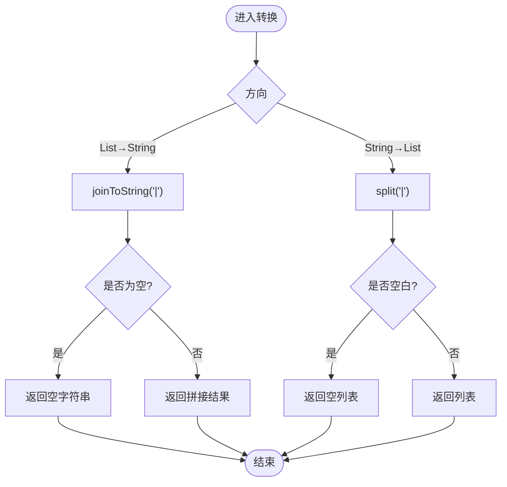
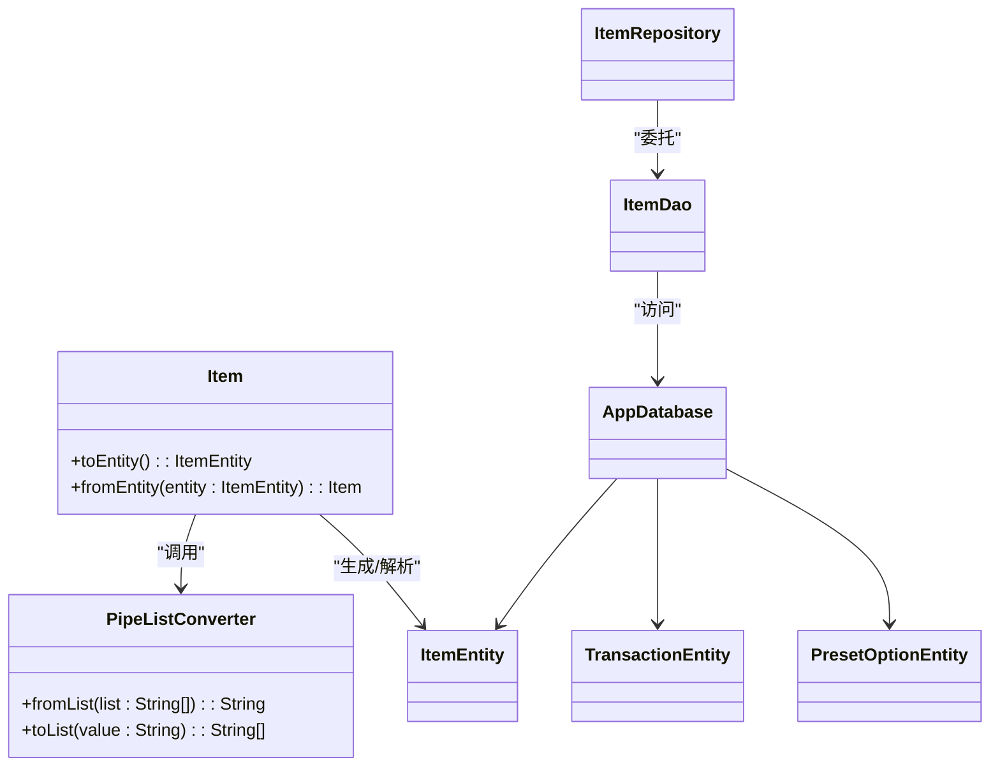

# 自定义转换器

<cite>
**本文引用的文件列表**
- [PipeListConverter.kt](file://GuZiStorage/app/src/main/java/com/guzi/storage/data/local/PipeListConverter.kt)
- [ItemEntity.kt](file://GuZiStorage/app/src/main/java/com/guzi/storage/data/local/entity/ItemEntity.kt)
- [TransactionEntity.kt](file://GuZiStorage/app/src/main/java/com/guzi/storage/data/local/entity/TransactionEntity.kt)
- [PresetOptionEntity.kt](file://GuZiStorage/app/src/main/java/com/guzi/storage/data/local/entity/PresetOptionEntity.kt)
- [AppDatabase.kt](file://GuZiStorage/app/src/main/java/com/guzi/storage/data/local/AppDatabase.kt)
- [ItemDao.kt](file://GuZiStorage/app/src/main/java/com/guzi/storage/data/local/dao/ItemDao.kt)
- [ItemRepository.kt](file://GuZiStorage/app/src/main/java/com/guzi/storage/data/repository/ItemRepository.kt)
- [Item.kt](file://GuZiStorage/app/src/main/java/com/guzi/storage/domain/model/Item.kt)
- [基础prd.md](file://基础prd.md)
</cite>

## 目录
1. [引言](#引言)
2. [项目结构](#项目结构)
3. [核心组件](#核心组件)
4. [架构总览](#架构总览)
5. [详细组件分析](#详细组件分析)
6. [依赖关系分析](#依赖关系分析)
7. [性能考量](#性能考量)
8. [故障排查指南](#故障排查指南)
9. [结论](#结论)
10. [附录](#附录)

## 引言
本文件面向“谷子收纳应用”的自定义数据转换机制，重点围绕如何将 Kotlin 集合类型与 SQLite 可存储字符串进行双向转换。当前仓库采用“领域模型 + Room Entity + 手动转换工具对象”的方式实现：在领域层使用 List<String> 表达多选字段，在持久化层以管道符分隔的 String 存储；转换逻辑集中在一个轻量工具对象中，由领域模型显式调用完成互转。

需要特别说明的是：当前代码未使用 Room 的 @TypeConverter 注解，而是通过领域模型的 toEntity/fromEntity 方法配合 PipeListConverter 完成转换。文档将同时给出基于 @TypeConverter 的标准做法与最佳实践，以便后续演进或迁移。

## 项目结构
本项目采用分层架构：
- 领域层（domain）：定义业务模型 Item，包含多选字段为 List<String>，并提供 toEntity/fromEntity 转换方法。
- 数据层（data.local）：Room 实体、DAO、数据库配置以及转换工具对象。
- 仓储层（data.repository）：封装 DAO 调用并负责领域模型与实体的映射。
- 基础设施（di）：Hilt 提供数据库实例。

图表来源
- [Item.kt:1-106](file://GuZiStorage/app/src/main/java/com/guzi/storage/domain/model/Item.kt#L1-L106)
- [PipeListConverter.kt:1-26](file://GuZiStorage/app/src/main/java/com/guzi/storage/data/local/PipeListConverter.kt#L1-L26)
- [ItemEntity.kt:1-89](file://GuZiStorage/app/src/main/java/com/guzi/storage/data/local/entity/ItemEntity.kt#L1-L89)
- [TransactionEntity.kt:1-65](file://GuZiStorage/app/src/main/java/com/guzi/storage/data/local/entity/TransactionEntity.kt#L1-L65)
- [PresetOptionEntity.kt:1-37](file://GuZiStorage/app/src/main/java/com/guzi/storage/data/local/entity/PresetOptionEntity.kt#L1-L37)
- [AppDatabase.kt:1-34](file://GuZiStorage/app/src/main/java/com/guzi/storage/data/local/AppDatabase.kt#L1-L34)
- [ItemDao.kt:1-90](file://GuZiStorage/app/src/main/java/com/guzi/storage/data/local/dao/ItemDao.kt#L1-L90)
- [ItemRepository.kt:1-80](file://GuZiStorage/app/src/main/java/com/guzi/storage/data/repository/ItemRepository.kt#L1-L80)

章节来源
- [Item.kt:1-106](file://GuZiStorage/app/src/main/java/com/guzi/storage/domain/model/Item.kt#L1-L106)
- [PipeListConverter.kt:1-26](file://GuZiStorage/app/src/main/java/com/guzi/storage/data/local/PipeListConverter.kt#L1-L26)
- [ItemEntity.kt:1-89](file://GuZiStorage/app/src/main/java/com/guzi/storage/data/local/entity/ItemEntity.kt#L1-L89)
- [TransactionEntity.kt:1-65](file://GuZiStorage/app/src/main/java/com/guzi/storage/data/local/entity/TransactionEntity.kt#L1-L65)
- [PresetOptionEntity.kt:1-37](file://GuZiStorage/app/src/main/java/com/guzi/storage/data/local/entity/PresetOptionEntity.kt#L1-L37)
- [AppDatabase.kt:1-34](file://GuZiStorage/app/src/main/java/com/guzi/storage/data/local/AppDatabase.kt#L1-L34)
- [ItemDao.kt:1-90](file://GuZiStorage/app/src/main/java/com/guzi/storage/data/local/dao/ItemDao.kt#L1-L90)
- [ItemRepository.kt:1-80](file://GuZiStorage/app/src/main/java/com/guzi/storage/data/repository/ItemRepository.kt#L1-L80)

## 核心组件
- 管道符分隔列表转换工具：用于在 List<String> 与 “|” 分隔的 String 之间进行双向转换。
- 领域模型 Item：以 List<String> 表示多选字段，并通过 toEntity/fromEntity 调用转换工具完成与 Entity 的互转。
- Room 实体：ItemEntity、TransactionEntity、PresetOptionEntity 均以 String 存储多选字段（如 characters、imagePaths 等）。
- 仓储 ItemRepository：封装 DAO 调用，并在返回前将 Entity 转换为领域模型。

章节来源
- [PipeListConverter.kt:1-26](file://GuZiStorage/app/src/main/java/com/guzi/storage/data/local/PipeListConverter.kt#L1-L26)
- [Item.kt:1-106](file://GuZiStorage/app/src/main/java/com/guzi/storage/domain/model/Item.kt#L1-L106)
- [ItemEntity.kt:1-89](file://GuZiStorage/app/src/main/java/com/guzi/storage/data/local/entity/ItemEntity.kt#L1-L89)
- [TransactionEntity.kt:1-65](file://GuZiStorage/app/src/main/java/com/guzi/storage/data/local/entity/TransactionEntity.kt#L1-L65)
- [PresetOptionEntity.kt:1-37](file://GuZiStorage/app/src/main/java/com/guzi/storage/data/local/entity/PresetOptionEntity.kt#L1-L37)
- [ItemRepository.kt:1-80](file://GuZiStorage/app/src/main/java/com/guzi/storage/data/repository/ItemRepository.kt#L1-L80)

## 架构总览
下图展示了从领域模型到数据库写入与读取的关键流程，突出显示转换工具的使用位置。

图表来源
- [ItemRepository.kt:1-80](file://GuZiStorage/app/src/main/java/com/guzi/storage/data/repository/ItemRepository.kt#L1-L80)
- [Item.kt:1-106](file://GuZiStorage/app/src/main/java/com/guzi/storage/domain/model/Item.kt#L1-L106)
- [PipeListConverter.kt:1-26](file://GuZiStorage/app/src/main/java/com/guzi/storage/data/local/PipeListConverter.kt#L1-L26)
- [ItemDao.kt:1-90](file://GuZiStorage/app/src/main/java/com/guzi/storage/data/local/dao/ItemDao.kt#L1-L90)
- [AppDatabase.kt:1-34](file://GuZiStorage/app/src/main/java/com/guzi/storage/data/local/AppDatabase.kt#L1-L34)

## 详细组件分析

### PipeListConverter 实现原理
- 设计目标：在领域模型（List<String>）与 Room 实体（String）之间进行高效、稳定的双向转换。
- 存储格式：使用管道符 “|” 作为分隔符，例如 ["中","日"] ↔ "中|日"。
- 空值处理：
  - fromList：空列表转为空字符串，便于统一存储与查询。
  - toList：空字符串或空白字符串转为空列表，避免空指针与无意义数据。
- 复杂度：
  - fromList：O(n)，n 为列表元素个数。
  - toList：O(m)，m 为字符串长度。
- 可扩展性：如需更换分隔符或增加转义策略，可在单一对象内集中修改，降低耦合。

章节来源
- [PipeListConverter.kt:1-26](file://GuZiStorage/app/src/main/java/com/guzi/storage/data/local/PipeListConverter.kt#L1-L26)

#### 转换流程图

图表来源
- [PipeListConverter.kt:1-26](file://GuZiStorage/app/src/main/java/com/guzi/storage/data/local/PipeListConverter.kt#L1-L26)

### 在领域模型中的使用方式
- Item 领域模型的多选字段均为 List<String>，在 toEntity() 中调用 PipeListConverter.fromList 将其转为 Entity 的 String 字段；在 fromEntity() 中调用 PipeListConverter.toList 将 Entity 的 String 字段还原为 List<String>。
- 这种模式将“类型转换”的职责明确放在领域层，保持 Entity 简单且易于被 Room 直接映射。

章节来源
- [Item.kt:1-106](file://GuZiStorage/app/src/main/java/com/guzi/storage/domain/model/Item.kt#L1-L106)

### 在实体层的数据存储形态
- ItemEntity 的多选字段（如 originPlaces、saleFormat、sizes、materials、characters、artTypes、damageDetails、imagePaths）均以 String 形式存储，默认值为空字符串。
- TransactionEntity 的 imagePaths 同样以 String 存储，遵循相同约定。
- PresetOptionEntity 不涉及多选字段，仅作为预设选项表存在。

章节来源
- [ItemEntity.kt:1-89](file://GuZiStorage/app/src/main/java/com/guzi/storage/data/local/entity/ItemEntity.kt#L1-L89)
- [TransactionEntity.kt:1-65](file://GuZiStorage/app/src/main/java/com/guzi/storage/data/local/entity/TransactionEntity.kt#L1-L65)
- [PresetOptionEntity.kt:1-37](file://GuZiStorage/app/src/main/java/com/guzi/storage/data/local/entity/PresetOptionEntity.kt#L1-L37)

### 在 DAO 层的查询与筛选
- 针对多选字段的模糊匹配，DAO 使用 LIKE 对字符串列进行子串匹配。例如按角色筛选时，对 characters 列进行 LIKE 匹配。
- 注意：该方式适用于小数据集；当数据量增大时，建议引入独立的多值关联表以提升查询性能与准确性。

章节来源
- [ItemDao.kt:1-90](file://GuZiStorage/app/src/main/java/com/guzi/storage/data/local/dao/ItemDao.kt#L1-L90)

### 在仓储层的集成
- ItemRepository 对外暴露 Flow<List<Item>> 等响应式接口，内部通过 map 将 Entity 列表转换为领域模型列表，确保上层始终操作领域模型。

章节来源
- [ItemRepository.kt:1-80](file://GuZiStorage/app/src/main/java/com/guzi/storage/data/repository/ItemRepository.kt#L1-L80)

### 关于 @TypeConverter 与 @Ignore 注解的使用说明
- 现状：当前仓库未使用 @TypeConverter 和 @Ignore 注解，而是通过领域模型显式调用转换工具完成互转。
- 标准用法（供参考与未来迁移）：
  - 在 Room 数据库中声明一个转换器类，使用 @TypeConverter 标注静态方法，分别实现 List<String> ↔ String 的双向转换。
  - 在 @Database 注解中使用 converters = [YourConverter::class] 注册转换器，使 Room 自动在 Entity 字段与数据库列之间进行转换。
  - 若实体中存在不需要持久化的字段，可使用 @ColumnInfo 结合 @Ignore 忽略该字段。
- 优势：
  - 将转换逻辑下沉至数据层，领域模型更简洁。
  - 减少样板代码，提升一致性。
- 风险与建议：
  - 需保证转换方法的幂等性与健壮性，避免脏数据导致崩溃。
  - 对于复杂数据结构，考虑 JSON 序列化或专用转换器。

[本节为概念性说明，不直接分析具体文件，故不提供章节来源]

## 依赖关系分析
- 低耦合：PipeListConverter 为纯函数式工具对象，无外部依赖，易于测试与替换。
- 职责清晰：领域模型负责业务语义与转换编排，Entity 专注持久化结构，DAO 专注 SQL 访问。
- 潜在扩展点：
  - 若未来引入更多复杂类型（如 Map、自定义对象），可新增对应转换器或改用 JSON 字段。
  - 若多选字段查询需求增强，可考虑引入多值关联表替代字符串分隔方案。

图表来源
- [PipeListConverter.kt:1-26](file://GuZiStorage/app/src/main/java/com/guzi/storage/data/local/PipeListConverter.kt#L1-L26)
- [Item.kt:1-106](file://GuZiStorage/app/src/main/java/com/guzi/storage/domain/model/Item.kt#L1-L106)
- [ItemEntity.kt:1-89](file://GuZiStorage/app/src/main/java/com/guzi/storage/data/local/entity/ItemEntity.kt#L1-L89)
- [TransactionEntity.kt:1-65](file://GuZiStorage/app/src/main/java/com/guzi/storage/data/local/entity/TransactionEntity.kt#L1-L65)
- [PresetOptionEntity.kt:1-37](file://GuZiStorage/app/src/main/java/com/guzi/storage/data/local/entity/PresetOptionEntity.kt#L1-L37)
- [AppDatabase.kt:1-34](file://GuZiStorage/app/src/main/java/com/guzi/storage/data/local/AppDatabase.kt#L1-L34)
- [ItemDao.kt:1-90](file://GuZiStorage/app/src/main/java/com/guzi/storage/data/local/dao/ItemDao.kt#L1-L90)
- [ItemRepository.kt:1-80](file://GuZiStorage/app/src/main/java/com/guzi/storage/data/repository/ItemRepository.kt#L1-L80)

## 性能考量
- 时间复杂度：
  - fromList/toList 均为线性复杂度，适合中等规模多选字段。
- 空间复杂度：
  - 转换过程产生临时字符串与列表，内存开销与字段大小成正比。
- 查询性能：
  - 当前使用 LIKE 子串匹配，数据量大时可能退化为全表扫描。建议：
    - 对高频筛选字段建立索引（但 LIKE '%...%' 无法有效利用索引）。
    - 将多选字段拆分为独立的多值关联表，支持精确匹配与索引优化。
- 批量操作：
  - 使用 insertAll 批量插入可减少事务开销。
- 序列化选择：
  - 若未来需要更复杂的结构，考虑 JSON 字段（Room 支持）或专用转换器，权衡可读性与性能。

[本节提供通用指导，不直接分析具体文件]

## 故障排查指南
- 常见问题
  - 空字符串与空列表不一致：确保 toList 对空/空白字符串返回空列表，避免上层出现空指针。
  - 分隔符冲突：若多选值本身包含 “|”，会导致解析错误。建议在输入阶段做校验或引入转义规则。
  - 查询误匹配：LIKE 子串匹配可能导致误命中，应结合边界条件或改为精确匹配。
- 定位步骤
  - 检查领域模型 toEntity/fromEntity 是否正确调用转换工具。
  - 验证 DAO 查询语句是否对多选字段使用了合适的匹配策略。
  - 确认仓储层是否在返回前完成了正确的类型转换。
- 日志与断点
  - 在转换工具的关键分支处添加日志，记录输入输出，快速定位异常数据。
  - 在 DAO 层打印生成的 SQL，辅助排查 LIKE 匹配问题。

章节来源
- [Item.kt:1-106](file://GuZiStorage/app/src/main/java/com/guzi/storage/domain/model/Item.kt#L1-L106)
- [ItemDao.kt:1-90](file://GuZiStorage/app/src/main/java/com/guzi/storage/data/local/dao/ItemDao.kt#L1-L90)
- [ItemRepository.kt:1-80](file://GuZiStorage/app/src/main/java/com/guzi/storage/data/repository/ItemRepository.kt#L1-L80)

## 结论
当前仓库采用“领域模型 + 转换工具对象”的方式实现了 List<String> 与 SQLite 字符串的双向转换，具备清晰的职责划分与良好的可维护性。若未来需要进一步简化样板代码或统一转换入口，可考虑引入 Room 的 @TypeConverter 机制，并在 @Database 中注册转换器。同时，随着数据量增长，建议评估将多选字段拆分为多值关联表，以提升查询性能与准确性。

[本节为总结性内容，不直接分析具体文件]

## 附录

### 与其他实体中使用自定义转换器的方法
- 若需要在其他实体中使用相同的转换逻辑，推荐两种路径：
  - 复用现有转换工具：在领域模型中继续调用 PipeListConverter 完成转换。
  - 迁移到 @TypeConverter：在转换器类中实现 List<String> ↔ String 的方法，并在 @Database 中注册，从而在 Entity 字段上自动生效。
- 若实体中存在无需持久化的字段，可使用 @Ignore 注解忽略该字段，避免编译期报错。

[本节为概念性说明，不直接分析具体文件]

### 调试与测试建议
- 单元测试
  - 对 PipeListConverter 的 fromList 与 toList 编写覆盖用例，包括空列表、空字符串、含分隔符的值、空白字符串等边界情况。
  - 对 Item.toEntity/fromEntity 编写端到端用例，验证所有多选字段均正确转换。
- 集成测试
  - 通过 Room In-Memory Database 执行真实读写，验证 DAO 查询与转换链路的正确性。
- 性能测试
  - 构造大数据集，对比 LIKE 子串匹配与多值表的查询耗时，评估是否需要重构。

[本节为通用指导，不直接分析具体文件]