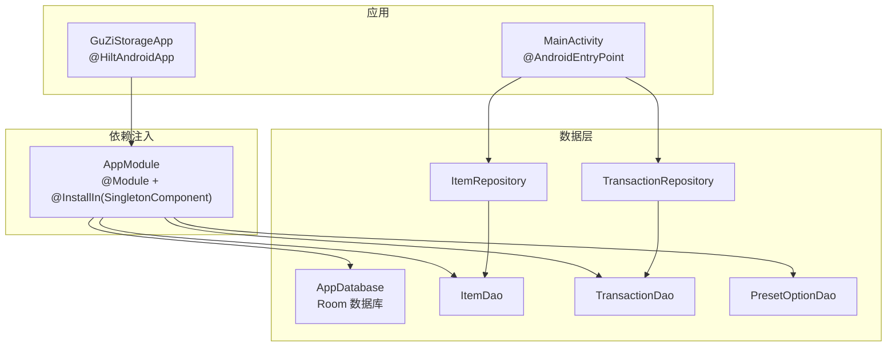
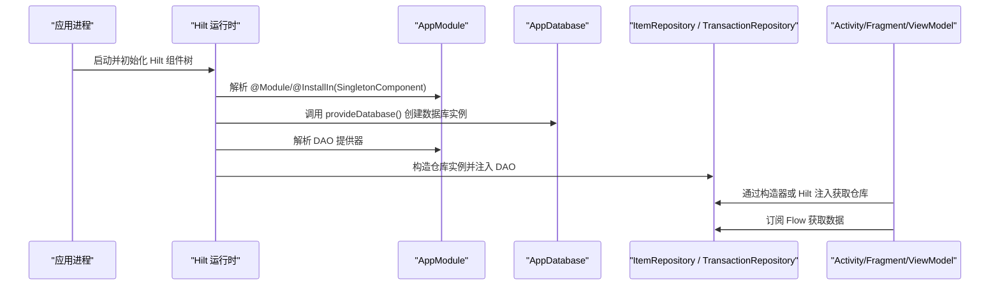
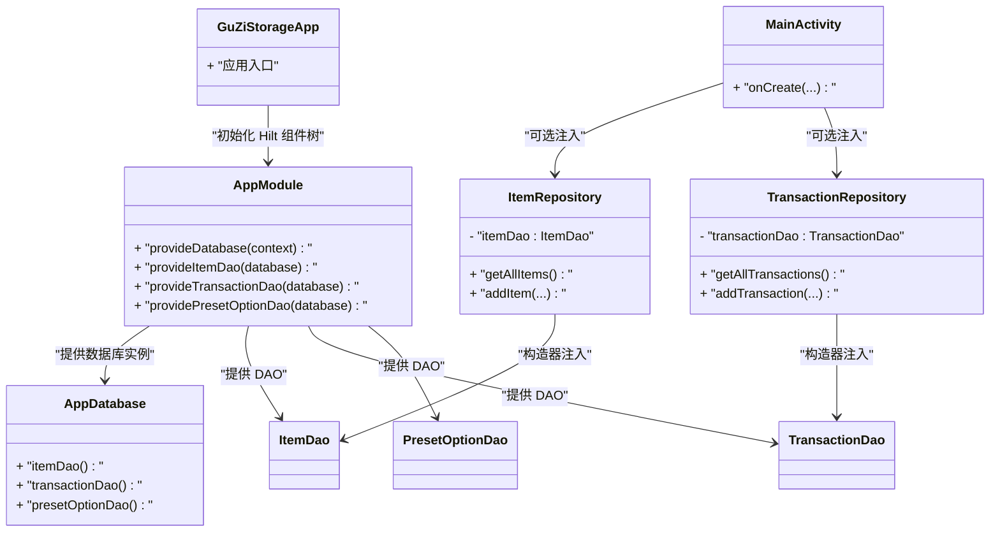

# 依赖注入配置

<cite>
**本文引用的文件**   
- [AppModule.kt](file://GuZiStorage/app/src/main/java/com/guzi/storage/di/AppModule.kt)
- [GuZiStorageApp.kt](file://GuZiStorage/app/src/main/java/com/guzi/storage/GuZiStorageApp.kt)
- [MainActivity.kt](file://GuZiStorage/app/src/main/java/com/guzi/storage/MainActivity.kt)
- [AppDatabase.kt](file://GuZiStorage/app/src/main/java/com/guzi/storage/data/local/AppDatabase.kt)
- [ItemDao.kt](file://GuZiStorage/app/src/main/java/com/guzi/storage/data/local/dao/ItemDao.kt)
- [TransactionDao.kt](file://GuZiStorage/app/src/main/java/com/guzi/storage/data/local/dao/TransactionDao.kt)
- [PresetOptionDao.kt](file://GuZiStorage/app/src/main/java/com/guzi/storage/data/local/dao/PresetOptionDao.kt)
- [ItemRepository.kt](file://GuZiStorage/app/src/main/java/com/guzi/storage/data/repository/ItemRepository.kt)
- [TransactionRepository.kt](file://GuZiStorage/app/src/main/java/com/guzi/storage/data/repository/TransactionRepository.kt)
- [app/build.gradle.kts](file://GuZiStorage/app/build.gradle.kts)
</cite>

## 目录
1. [简介](#简介)
2. [项目结构](#项目结构)
3. [核心组件](#核心组件)
4. [架构总览](#架构总览)
5. [详细组件分析](#详细组件分析)
6. [依赖关系分析](#依赖关系分析)
7. [性能与生命周期考量](#性能与生命周期考量)
8. [故障排查指南](#故障排查指南)
9. [结论](#结论)
10. [附录：使用示例与最佳实践](#附录使用示例与最佳实践)

## 简介
本文件面向“谷子收纳应用”的依赖注入（DI）配置，聚焦于 Hilt 在 Android 工程中的落地方式。文档将系统阐述：
- Hilt 初始化与组件绑定（@HiltAndroidApp、@InstallIn、SingletonComponent）
- AppModule 中 @Provides 方法如何提供数据库与 DAO 实例
- Repository 层如何通过构造器注入获取 DAO
- DI 在项目中的作用与优势（解耦、可测试性、生命周期管理）
- 在 Activity、Fragment、ViewModel 中的注入用法与注意事项
- 依赖关系图与注入流程说明
- 为初学者提供概念解释，为有经验的开发者提供高级技巧与最佳实践

## 项目结构
本项目采用分层组织：
- di 包：集中定义 Hilt 模块与提供器（AppModule）
- data.local：Room 数据库、DAO、实体与类型转换
- data.repository：领域数据仓库，封装 DAO 并暴露 Flow
- ui.theme：主题相关
- 入口：Application 与 MainActivity

图表来源
- [GuZiStorageApp.kt:1-11](file://GuZiStorage/app/src/main/java/com/guzi/storage/GuZiStorageApp.kt#L1-L11)
- [AppModule.kt:1-50](file://GuZiStorage/app/src/main/java/com/guzi/storage/di/AppModule.kt#L1-L50)
- [AppDatabase.kt:1-34](file://GuZiStorage/app/src/main/java/com/guzi/storage/data/local/AppDatabase.kt#L1-L34)
- [ItemDao.kt:1-90](file://GuZiStorage/app/src/main/java/com/guzi/storage/data/local/dao/ItemDao.kt#L1-L90)
- [TransactionDao.kt:1-49](file://GuZiStorage/app/src/main/java/com/guzi/storage/data/local/dao/TransactionDao.kt#L1-L49)
- [PresetOptionDao.kt:1-42](file://GuZiStorage/app/src/main/java/com/guzi/storage/data/local/dao/PresetOptionDao.kt#L1-L42)
- [ItemRepository.kt:1-80](file://GuZiStorage/app/src/main/java/com/guzi/storage/data/repository/ItemRepository.kt#L1-L80)
- [TransactionRepository.kt:1-63](file://GuZiStorage/app/src/main/java/com/guzi/storage/data/repository/TransactionRepository.kt#L1-L63)

章节来源
- [GuZiStorageApp.kt:1-11](file://GuZiStorage/app/src/main/java/com/guzi/storage/GuZiStorageApp.kt#L1-L11)
- [AppModule.kt:1-50](file://GuZiStorage/app/src/main/java/com/guzi/storage/di/AppModule.kt#L1-L50)
- [AppDatabase.kt:1-34](file://GuZiStorage/app/src/main/java/com/guzi/storage/data/local/AppDatabase.kt#L1-L34)
- [ItemDao.kt:1-90](file://GuZiStorage/app/src/main/java/com/guzi/storage/data/local/dao/ItemDao.kt#L1-L90)
- [TransactionDao.kt:1-49](file://GuZiStorage/app/src/main/java/com/guzi/storage/data/local/dao/TransactionDao.kt#L1-L49)
- [PresetOptionDao.kt:1-42](file://GuZiStorage/app/src/main/java/com/guzi/storage/data/local/dao/PresetOptionDao.kt#L1-L42)
- [ItemRepository.kt:1-80](file://GuZiStorage/app/src/main/java/com/guzi/storage/data/repository/ItemRepository.kt#L1-L80)
- [TransactionRepository.kt:1-63](file://GuZiStorage/app/src/main/java/com/guzi/storage/data/repository/TransactionRepository.kt#L1-L63)

## 核心组件
- 应用级 Hilt 初始化：通过 Application 类上的注解启用 Hilt 代码生成与组件树构建。
- 单例组件绑定：模块通过安装到单例组件，确保数据库与 DAO 等重资源在整个应用生命周期内唯一实例化。
- 数据提供器：在模块中以函数形式提供数据库与 DAO 实例，供其他组件按需注入。
- 仓库层：以构造器注入 DAO，统一对外暴露响应式接口（Flow），屏蔽底层实现细节。

章节来源
- [GuZiStorageApp.kt:1-11](file://GuZiStorage/app/src/main/java/com/guzi/storage/GuZiStorageApp.kt#L1-L11)
- [AppModule.kt:1-50](file://GuZiStorage/app/src/main/java/com/guzi/storage/di/AppModule.kt#L1-L50)
- [ItemRepository.kt:1-80](file://GuZiStorage/app/src/main/java/com/guzi/storage/data/repository/ItemRepository.kt#L1-L80)
- [TransactionRepository.kt:1-63](file://GuZiStorage/app/src/main/java/com/guzi/storage/data/repository/TransactionRepository.kt#L1-L63)

## 架构总览
下图展示了从应用启动到 UI 层获取数据的整体依赖注入流程。

图表来源
- [GuZiStorageApp.kt:1-11](file://GuZiStorage/app/src/main/java/com/guzi/storage/GuZiStorageApp.kt#L1-L11)
- [AppModule.kt:1-50](file://GuZiStorage/app/src/main/java/com/guzi/storage/di/AppModule.kt#L1-L50)
- [AppDatabase.kt:1-34](file://GuZiStorage/app/src/main/java/com/guzi/storage/data/local/AppDatabase.kt#L1-L34)
- [ItemRepository.kt:1-80](file://GuZiStorage/app/src/main/java/com/guzi/storage/data/repository/ItemRepository.kt#L1-L80)
- [TransactionRepository.kt:1-63](file://GuZiStorage/app/src/main/java/com/guzi/storage/data/repository/TransactionRepository.kt#L1-L63)

## 详细组件分析

### Hilt 初始化与组件绑定
- 应用入口类标注了应用级注解，用于触发 Hilt 的代码生成和组件树构建。
- 模块通过安装到单例组件，使提供的对象具备与应用同生命周期的单例语义。

章节来源
- [GuZiStorageApp.kt:1-11](file://GuZiStorage/app/src/main/java/com/guzi/storage/GuZiStorageApp.kt#L1-L11)
- [AppModule.kt:1-50](file://GuZiStorage/app/src/main/java/com/guzi/storage/di/AppModule.kt#L1-L50)

### 模块与提供器（AppModule）
- 模块声明了数据库与三个 DAO 的提供方法。
- 数据库提供器接收应用上下文，构建 Room 数据库实例，并设置迁移策略。
- DAO 提供器直接从数据库实例获取对应 DAO，避免重复创建。

章节来源
- [AppModule.kt:1-50](file://GuZiStorage/app/src/main/java/com/guzi/storage/di/AppModule.kt#L1-L50)
- [AppDatabase.kt:1-34](file://GuZiStorage/app/src/main/java/com/guzi/storage/data/local/AppDatabase.kt#L1-L34)

### 数据访问层（DAO）
- 物品 DAO：提供列表查询、分组统计、多条件筛选、关键词搜索、批量写入与计数等能力。
- 交易记录 DAO：提供按物品维度查询、计数、增删改查等能力。
- 预设选项 DAO：提供属性值列表、属性名去重、插入/删除等操作。

章节来源
- [ItemDao.kt:1-90](file://GuZiStorage/app/src/main/java/com/guzi/storage/data/local/dao/ItemDao.kt#L1-L90)
- [TransactionDao.kt:1-49](file://GuZiStorage/app/src/main/java/com/guzi/storage/data/local/dao/TransactionDao.kt#L1-L49)
- [PresetOptionDao.kt:1-42](file://GuZiStorage/app/src/main/java/com/guzi/storage/data/local/dao/PresetOptionDao.kt#L1-L42)

### 仓库层（Repository）
- 物品仓库：封装对 ItemDao 的调用，负责 Entity 与领域模型之间的转换，并以 Flow 暴露响应式数据流。
- 交易仓库：封装对 TransactionDao 的调用，同样进行模型转换并以 Flow 暴露数据。

章节来源
- [ItemRepository.kt:1-80](file://GuZiStorage/app/src/main/java/com/guzi/storage/data/repository/ItemRepository.kt#L1-L80)
- [TransactionRepository.kt:1-63](file://GuZiStorage/app/src/main/java/com/guzi/storage/data/repository/TransactionRepository.kt#L1-L63)

### UI 层与注入点
- 主界面 Activity 已标注为可注入入口，可在其中通过构造器或框架扩展注入所需依赖。
- 当前示例未直接展示注入使用，但已具备完整的注入基础设施。

章节来源
- [MainActivity.kt:1-55](file://GuZiStorage/app/src/main/java/com/guzi/storage/MainActivity.kt#L1-L55)

## 依赖关系分析
下图展示了关键类的依赖关系与注入方向。

图表来源
- [GuZiStorageApp.kt:1-11](file://GuZiStorage/app/src/main/java/com/guzi/storage/GuZiStorageApp.kt#L1-L11)
- [AppModule.kt:1-50](file://GuZiStorage/app/src/main/java/com/guzi/storage/di/AppModule.kt#L1-L50)
- [AppDatabase.kt:1-34](file://GuZiStorage/app/src/main/java/com/guzi/storage/data/local/AppDatabase.kt#L1-L34)
- [ItemDao.kt:1-90](file://GuZiStorage/app/src/main/java/com/guzi/storage/data/local/dao/ItemDao.kt#L1-L90)
- [TransactionDao.kt:1-49](file://GuZiStorage/app/src/main/java/com/guzi/storage/data/local/dao/TransactionDao.kt#L1-L49)
- [PresetOptionDao.kt:1-42](file://GuZiStorage/app/src/main/java/com/guzi/storage/data/local/dao/PresetOptionDao.kt#L1-L42)
- [ItemRepository.kt:1-80](file://GuZiStorage/app/src/main/java/com/guzi/storage/data/repository/ItemRepository.kt#L1-L80)
- [TransactionRepository.kt:1-63](file://GuZiStorage/app/src/main/java/com/guzi/storage/data/repository/TransactionRepository.kt#L1-L63)
- [MainActivity.kt:1-55](file://GuZiStorage/app/src/main/java/com/guzi/storage/MainActivity.kt#L1-L55)

## 性能与生命周期考量
- 单例组件与长生命周期对象
  - 数据库与 DAO 通常适合置于单例组件中，避免频繁创建带来的开销。
  - 注意：若持有 Context，应使用应用级上下文以避免内存泄漏。
- 响应式数据流
  - 仓库层以 Flow 暴露数据，UI 侧订阅即可自动更新，减少手动状态同步成本。
- 迁移策略
  - 开发阶段可使用破坏性迁移快速迭代；生产环境建议配置正式迁移脚本以保证数据安全。
- 构建与编译
  - 确保启用必要的插件与注解处理器，避免运行期找不到生成的代码。

章节来源
- [AppModule.kt:1-50](file://GuZiStorage/app/src/main/java/com/guzi/storage/di/AppModule.kt#L1-L50)
- [app/build.gradle.kts:1-97](file://GuZiStorage/app/build.gradle.kts#L1-L97)

## 故障排查指南
- 无法注入或运行时报错
  - 检查是否已在 Application 上启用 Hilt 初始化。
  - 确认模块是否正确安装到目标组件（如单例组件）。
  - 确认被注入类是否具备可注入构造器（例如使用构造器注入标记）。
- 数据库相关问题
  - 检查数据库版本与迁移策略是否与现有数据兼容。
  - 确认 DAO 方法与 SQL 语句一致，参数命名匹配。
- 构建问题
  - 确认已启用 KSP/KAPT 及 Hilt 插件，清理并重新构建。

章节来源
- [GuZiStorageApp.kt:1-11](file://GuZiStorage/app/src/main/java/com/guzi/storage/GuZiStorageApp.kt#L1-L11)
- [AppModule.kt:1-50](file://GuZiStorage/app/src/main/java/com/guzi/storage/di/AppModule.kt#L1-L50)
- [app/build.gradle.kts:1-97](file://GuZiStorage/app/build.gradle.kts#L1-L97)

## 结论
本项目通过 Hilt 实现了清晰的分层依赖注入：应用入口启用 Hilt，模块提供数据库与 DAO，仓库层通过构造器注入 DAO 并暴露 Flow，UI 层按需注入仓库。该方案有效降低了耦合度、提升了可测试性与可维护性，并为后续扩展提供了稳定的基础。

## 附录：使用示例与最佳实践

### 依赖注入概念（初学者）
- 什么是依赖注入
  - 由外部容器负责创建对象及其依赖，并在需要时注入到使用者中，从而避免在业务代码中手动 new 依赖。
- 为什么需要 DI
  - 解耦：组件之间通过接口或抽象依赖，便于替换实现。
  - 可测试性：可用 Mock 替代真实依赖，编写单元测试与集成测试更简单。
  - 生命周期管理：不同作用域的对象由容器统一管理，避免泄漏与重复创建。

### 在 Activity 中使用注入
- 步骤要点
  - 在 Activity 上标注可注入入口注解。
  - 通过构造器或框架扩展注入所需依赖（如仓库）。
  - 在合适的生命周期回调中订阅数据流并更新 UI。
- 参考位置
  - [MainActivity.kt:1-55](file://GuZiStorage/app/src/main/java/com/guzi/storage/MainActivity.kt#L1-L55)

### 在 Fragment 中使用注入
- 步骤要点
  - 在 Fragment 上标注可注入入口注解。
  - 通过构造器或框架扩展注入依赖。
  - 在 onViewCreated 或 Compose 中订阅数据流。
- 参考位置
  - 无具体文件引用（通用实践）

### 在 ViewModel 中使用注入
- 步骤要点
  - 在 ViewModel 上使用可注入构造器。
  - 通过 Hilt ViewModel 扩展获取实例，以便注入依赖。
  - 在 ViewModel 中发起数据请求并暴露给 UI。
- 参考位置
  - 无具体文件引用（通用实践）

### 高级配置技巧与最佳实践
- 作用域选择
  - 数据库、网络客户端、全局配置等适合单例作用域。
  - 页面级临时对象建议使用短生命周期作用域。
- 提供器设计
  - 提供器函数尽量纯函数化，避免副作用；复杂对象拆分多个小模块。
  - 对第三方库的包装类放在独立模块，便于替换与测试。
- 可测试性
  - 使用测试模块覆盖生产提供器，注入 Mock 或内存数据库。
  - 针对 Repository 编写单元测试，验证数据转换与边界条件。
- 迁移与兼容性
  - 生产环境务必配置正式迁移脚本，避免破坏性迁移导致用户数据丢失。
- 构建优化
  - 合理启用增量编译与缓存，减少构建时间。
  - 保持注解处理器与 Kotlin 版本兼容。

章节来源
- [AppModule.kt:1-50](file://GuZiStorage/app/src/main/java/com/guzi/storage/di/AppModule.kt#L1-L50)
- [ItemRepository.kt:1-80](file://GuZiStorage/app/src/main/java/com/guzi/storage/data/repository/ItemRepository.kt#L1-L80)
- [TransactionRepository.kt:1-63](file://GuZiStorage/app/src/main/java/com/guzi/storage/data/repository/TransactionRepository.kt#L1-L63)
- [app/build.gradle.kts:1-97](file://GuZiStorage/app/build.gradle.kts#L1-L97)