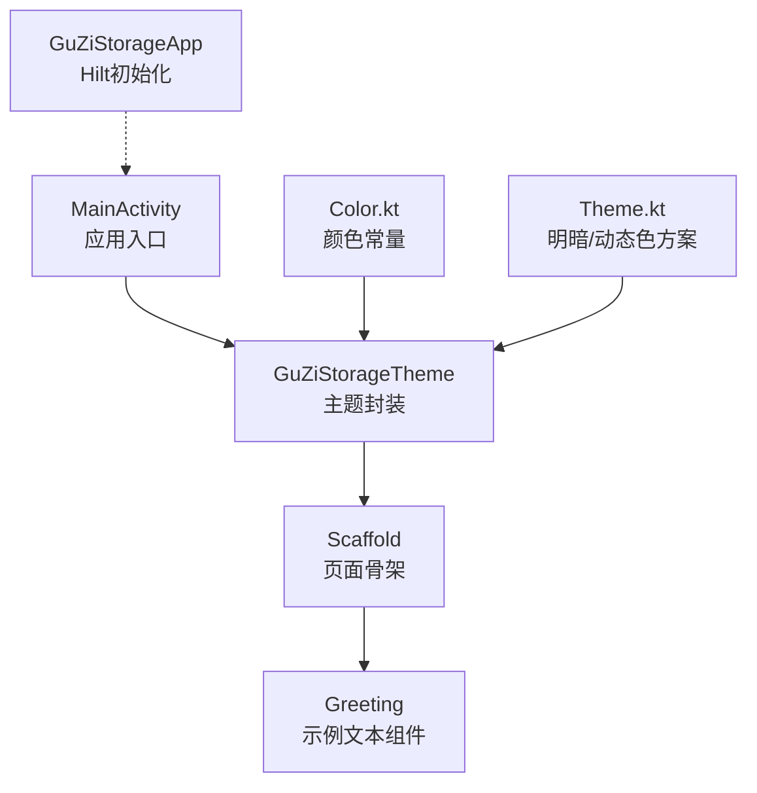
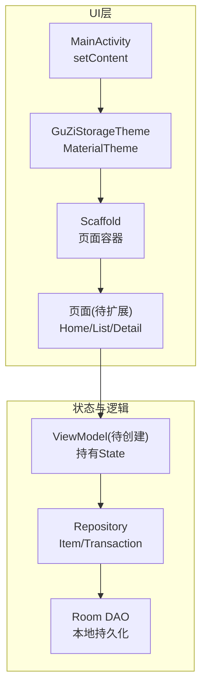
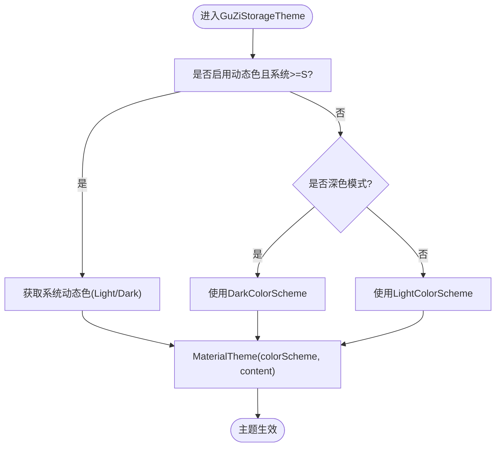
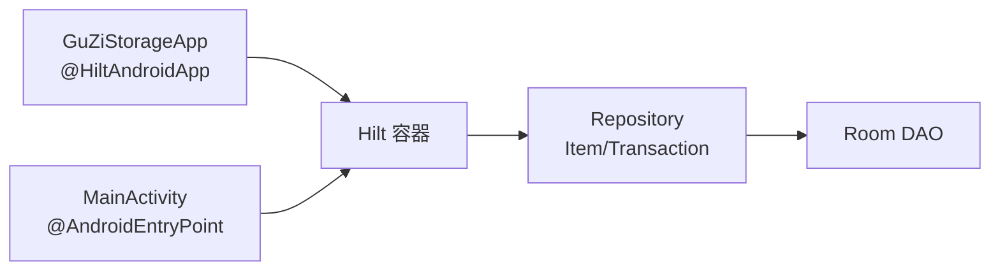

# UI层实现

<cite>
**本文引用的文件**   
- [MainActivity.kt](file://GuZiStorage/app/src/main/java/com/guzi/storage/MainActivity.kt)
- [Theme.kt](file://GuZiStorage/app/src/main/java/com/guzi/storage/ui/theme/Theme.kt)
- [Color.kt](file://GuZiStorage/app/src/main/java/com/guzi/storage/ui/theme/Color.kt)
- [GuZiStorageApp.kt](file://GuZiStorage/app/src/main/java/com/guzi/storage/GuZiStorageApp.kt)
- [build.gradle.kts](file://GuZiStorage/app/build.gradle.kts)
- [libs.versions.toml](file://GuZiStorage/gradle/libs.versions.toml)
- [ItemRepository.kt](file://GuZiStorage/app/src/main/java/com/guzi/storage/data/repository/ItemRepository.kt)
- [TransactionRepository.kt](file://GuZiStorage/app/src/main/java/com/guzi/storage/data/repository/TransactionRepository.kt)
- [Item.kt](file://GuZiStorage/app/src/main/java/com/guzi/storage/domain/model/Item.kt)
- [Transaction.kt](file://GuZiStorage/app/src/main/java/com/guzi/storage/domain/model/Transaction.kt)
</cite>

## 目录
1. [简介](#简介)
2. [项目结构](#项目结构)
3. [核心组件](#核心组件)
4. [架构总览](#架构总览)
5. [详细组件分析](#详细组件分析)
6. [依赖关系分析](#依赖关系分析)
7. [性能考虑](#性能考虑)
8. [故障排查指南](#故障排查指南)
9. [结论](#结论)
10. [附录](#附录)

## 简介
本文件聚焦“谷子收纳应用”的UI层实现，围绕Jetpack Compose界面组织、主题系统（Material Design 3）、状态管理、导航机制与用户交互处理展开。当前仓库已具备Compose基础能力与Material 3主题配置，并引入了Navigation Compose与Hilt依赖注入，为后续构建多页面、响应式界面奠定基础。文档将结合现有代码给出可落地的扩展建议与最佳实践，帮助团队在保持UI简洁性与可维护性的同时，快速迭代业务功能。

## 项目结构
UI相关代码集中在以下位置：
- 入口Activity与顶层布局：MainActivity.kt
- 主题与颜色定义：ui/theme/Theme.kt、ui/theme/Color.kt
- 应用初始化（Hilt）：GuZiStorageApp.kt
- 依赖与版本：app/build.gradle.kts、gradle/libs.versions.toml
- 数据与领域模型（供UI消费）：data/repository/*、domain/model/*

图表来源
- [MainActivity.kt:23-36](file://GuZiStorage/app/src/main/java/com/guzi/storage/MainActivity.kt#L23-L36)
- [Theme.kt:31-50](file://GuZiStorage/app/src/main/java/com/guzi/storage/ui/theme/Theme.kt#L31-L50)
- [Color.kt:14-21](file://GuZiStorage/app/src/main/java/com/guzi/storage/ui/theme/Color.kt#L14-L21)
- [GuZiStorageApp.kt:9-10](file://GuZiStorage/app/src/main/java/com/guzi/storage/GuZiStorageApp.kt#L9-L10)

章节来源
- [MainActivity.kt:1-55](file://GuZiStorage/app/src/main/java/com/guzi/storage/MainActivity.kt#L1-L55)
- [Theme.kt:1-51](file://GuZiStorage/app/src/main/java/com/guzi/storage/ui/theme/Theme.kt#L1-L51)
- [Color.kt:1-21](file://GuZiStorage/app/src/main/java/com/guzi/storage/ui/theme/Color.kt#L1-L21)
- [GuZiStorageApp.kt:1-11](file://GuZiStorage/app/src/main/java/com/guzi/storage/GuZiStorageApp.kt#L1-L11)

## 核心组件
- MainActivity
  - 作为应用入口，启用边缘到边缘显示，设置Compose内容根节点，包裹主题与Scaffold，并在其中渲染示例页面组件。
- GuZiStorageTheme
  - 封装Material 3主题，支持系统深色模式与Android 12+的动态色彩；根据条件选择Light/Dark或动态色方案，并通过MaterialTheme提供全局样式上下文。
- Color.kt
  - 集中定义Material 3语义化颜色（primary、secondary、tertiary、background、surface等），便于统一视觉风格。
- GuZiStorageApp
  - 应用级Application类，使用Hilt注解完成依赖注入框架初始化，为后续UI层注入ViewModel/Repository提供基础。

章节来源
- [MainActivity.kt:21-36](file://GuZiStorage/app/src/main/java/com/guzi/storage/MainActivity.kt#L21-L36)
- [Theme.kt:31-50](file://GuZiStorage/app/src/main/java/com/guzi/storage/ui/theme/Theme.kt#L31-L50)
- [Color.kt:14-21](file://GuZiStorage/app/src/main/java/com/guzi/storage/ui/theme/Color.kt#L14-L21)
- [GuZiStorageApp.kt:9-10](file://GuZiStorage/app/src/main/java/com/guzi/storage/GuZiStorageApp.kt#L9-L10)

## 架构总览
UI层采用典型的“单Activity + Compose多页面”模式。当前仅有一个首页占位，后续通过Navigation Compose进行路由管理。主题由GuZiStorageTheme统一管理，所有页面共享同一套Material 3配色与排版。数据访问通过Repository暴露Flow，UI侧以State持有数据，遵循单向数据流原则。

图表来源
- [MainActivity.kt:23-36](file://GuZiStorage/app/src/main/java/com/guzi/storage/MainActivity.kt#L23-L36)
- [Theme.kt:31-50](file://GuZiStorage/app/src/main/java/com/guzi/storage/ui/theme/Theme.kt#L31-L50)
- [ItemRepository.kt:16-46](file://GuZiStorage/app/src/main/java/com/guzi/storage/data/repository/ItemRepository.kt#L16-L46)
- [TransactionRepository.kt:13-31](file://GuZiStorage/app/src/main/java/com/guzi/storage/data/repository/TransactionRepository.kt#L13-L31)

## 详细组件分析

### 主页面与布局组织（MainActivity）
- 职责
  - 启动应用后设置Edge-to-Edge显示，挂载Compose根节点。
  - 包裹GuZiStorageTheme，确保全局主题生效。
  - 使用Scaffold作为页面骨架，预留顶部栏、底部栏、浮动按钮等区域。
  - 当前渲染示例组件Greeting用于验证主题与排版。
- 可扩展点
  - 在Scaffold内部替换为NavHost，接入Navigation Compose，实现多页面跳转。
  - 引入ViewModel持有页面状态，从Repository订阅Flow更新UI。

章节来源
- [MainActivity.kt:23-36](file://GuZiStorage/app/src/main/java/com/guzi/storage/MainActivity.kt#L23-L36)
- [MainActivity.kt:39-46](file://GuZiStorage/app/src/main/java/com/guzi/storage/MainActivity.kt#L39-L46)

### 主题系统（Theme.kt 与 Color.kt）
- 设计要点
  - 支持系统深色模式与Android 12+动态色彩，优先使用动态色，回退到静态Light/Dark方案。
  - 通过MaterialTheme.colorScheme与typography对外暴露，组件直接使用语义化属性。
  - Color.kt集中定义Primary/Secondary/Tertiary/Background/Surface/Error等关键色值，保证品牌一致性。
- 定制方法
  - 新增自定义颜色：在Color.kt中追加语义化变量，并在Theme.kt的Light/Dark方案中引用。
  - 字体与排版：可在Theme.kt中扩展MaterialTheme.typography，定义标题、正文、标签等样式。
  - 组件样式：基于MaterialTheme.colorScheme与typography组合，避免硬编码颜色与字号。

图表来源
- [Theme.kt:31-50](file://GuZiStorage/app/src/main/java/com/guzi/storage/ui/theme/Theme.kt#L31-L50)
- [Theme.kt:13-29](file://GuZiStorage/app/src/main/java/com/guzi/storage/ui/theme/Theme.kt#L13-L29)
- [Color.kt:14-21](file://GuZiStorage/app/src/main/java/com/guzi/storage/ui/theme/Color.kt#L14-L21)

章节来源
- [Theme.kt:1-51](file://GuZiStorage/app/src/main/java/com/guzi/storage/ui/theme/Theme.kt#L1-L51)
- [Color.kt:1-21](file://GuZiStorage/app/src/main/java/com/guzi/storage/ui/theme/Color.kt#L1-L21)

### 状态管理与数据流（面向UI的建议）
- 现状
  - Repository已暴露Flow<List<Item>>与Flow<List<Transaction>>，适合在UI层以State收集。
  - 领域模型Item/Transaction包含toEntity/fromEntity转换，便于与数据库交互。
- 推荐做法
  - 在页面级ViewModel中持有State（如items: StateFlow<List<Item>>），在init中订阅Repository的Flow。
  - UI侧使用collectAsStateWithLifecycle或rememberCoroutineScope配合Flow.collect，确保生命周期安全。
  - 对输入字段使用mutableStateOf/remember，减少不必要的重组。
  - 列表展示使用LazyColumn，结合key与stable key提升性能。

章节来源
- [ItemRepository.kt:23-46](file://GuZiStorage/app/src/main/java/com/guzi/storage/data/repository/ItemRepository.kt#L23-L46)
- [TransactionRepository.kt:20-31](file://GuZiStorage/app/src/main/java/com/guzi/storage/data/repository/TransactionRepository.kt#L20-L31)
- [Item.kt:50-74](file://GuZiStorage/app/src/main/java/com/guzi/storage/domain/model/Item.kt#L50-L74)
- [Transaction.kt:23-36](file://GuZiStorage/app/src/main/java/com/guzi/storage/domain/model/Transaction.kt#L23-L36)

### 导航机制（基于Navigation Compose）
- 依赖
  - build.gradle.kts与libs.versions.toml已引入androidx.navigation.compose与hilt-navigation-compose，满足多页面导航需求。
- 建议流程
  - 在MainActivity中用NavHost替代当前单一页面，定义Route枚举与Destination。
  - 使用rememberNavController管理导航栈，结合Hilt注入ViewModel。
  - 在页面间传递参数时，尽量使用类型安全的Route对象或Bundle。

章节来源
- [build.gradle.kts:65-66](file://GuZiStorage/app/build.gradle.kts#L65-L66)
- [libs.versions.toml:34-35](file://GuZiStorage/gradle/libs.versions.toml#L34-L35)

### 用户交互处理（输入与反馈）
- 输入
  - 使用TextField/OutlinedTextField绑定remember的字符串状态，监听onValueChange更新状态。
  - 对搜索场景，使用防抖（debounce）优化查询频率，结合Repository.search接口。
- 反馈
  - 使用Snackbar/Dialog提示操作结果，错误信息通过Material 3的色调与图标传达。
  - 长耗时操作使用CircularProgressIndicator或Shimmer占位，避免阻塞UI线程。

[本节为通用实践说明，不直接分析具体文件]

### UI组件复用模式与最佳实践
- 组件拆分
  - 将复杂页面拆分为小函数（如ItemCard、SearchBar、FilterChipGroup），每个函数只负责单一职责。
- 样式复用
  - 通过MaterialTheme.typography与colorScheme统一样式，避免重复定义。
  - 自定义组件接受Modifier与样式参数，提高可组合性。
- 状态提升
  - 将状态提升到父组件或ViewModel，子组件仅接收不可变数据与回调，降低耦合。
- 预览与测试
  - 使用@Preview覆盖不同主题与屏幕尺寸，确保组件在不同状态下表现一致。

[本节为通用实践说明，不直接分析具体文件]

## 依赖关系分析
- 编译期依赖
  - Compose BOM、Material3、Navigation Compose、Hilt、Room、Coil、Coroutines均已声明。
- 运行时依赖
  - Hilt在Application层初始化，Activity通过@AndroidEntryPoint注入依赖。
  - Repository通过Hilt注入到ViewModel（待创建），UI层通过ViewModel访问数据。

图表来源
- [GuZiStorageApp.kt:9-10](file://GuZiStorage/app/src/main/java/com/guzi/storage/GuZiStorageApp.kt#L9-L10)
- [MainActivity.kt:21-22](file://GuZiStorage/app/src/main/java/com/guzi/storage/MainActivity.kt#L21-L22)
- [ItemRepository.kt:16-19](file://GuZiStorage/app/src/main/java/com/guzi/storage/data/repository/ItemRepository.kt#L16-L19)
- [TransactionRepository.kt:13-16](file://GuZiStorage/app/src/main/java/com/guzi/storage/data/repository/TransactionRepository.kt#L13-L16)

章节来源
- [build.gradle.kts:48-92](file://GuZiStorage/app/build.gradle.kts#L48-L92)
- [libs.versions.toml:24-51](file://GuZiStorage/gradle/libs.versions.toml#L24-L51)

## 性能考虑
- 主题与排版
  - 使用MaterialTheme提供的语义化样式，避免在组件内重复计算样式。
- 列表渲染
  - 使用LazyColumn/Row，并为每项设置稳定key，减少重组范围。
- 状态更新
  - 使用remember与state hoisting，避免在重组中创建新对象导致重绘。
- 网络与图片
  - 使用Coil加载图片，开启缓存与占位图，避免主线程阻塞。
- 数据流
  - 在ViewModel中对Flow进行map/filter等操作，减少UI层的计算开销。

[本节为通用指导，不直接分析具体文件]

## 故障排查指南
- 主题未生效
  - 检查是否在setContent最外层包裹GuZiStorageTheme，并确保MaterialTheme.colorScheme被组件正确引用。
- 动态色异常
  - 确认设备系统版本与动态色开关；若不支持，应回退到静态Light/Dark方案。
- 导航无效
  - 检查NavHost是否正确注册所有Destination，以及rememberNavController是否在同一作用域内复用。
- 状态不更新
  - 确认Flow收集是否处于正确的生命周期范围内，避免在重组中重复订阅。
- 依赖注入失败
  - 确认Application类已添加@HiltAndroidApp，Activity/Fragment/Composable使用@AndroidEntryPoint或@Inject。

章节来源
- [MainActivity.kt:23-36](file://GuZiStorage/app/src/main/java/com/guzi/storage/MainActivity.kt#L23-L36)
- [Theme.kt:31-50](file://GuZiStorage/app/src/main/java/com/guzi/storage/ui/theme/Theme.kt#L31-L50)
- [GuZiStorageApp.kt:9-10](file://GuZiStorage/app/src/main/java/com/guzi/storage/GuZiStorageApp.kt#L9-L10)

## 结论
当前UI层已具备清晰的入口与主题体系，并集成了Navigation Compose与Hilt依赖注入，为后续多页面与响应式界面打下良好基础。建议在下一步工作中：
- 在MainActivity中引入NavHost，规划页面路由与参数传递。
- 创建页面级ViewModel，持有State并订阅Repository的Flow。
- 完善Material 3主题细节（字体、组件样式），统一视觉规范。
- 建立组件库与预览用例，提升开发效率与可维护性。

[本节为总结性内容，不直接分析具体文件]

## 附录
- 关键依赖清单（节选）
  - Compose平台与Material3：androidx.compose.bom、androidx.compose.material3
  - Navigation：androidx.navigation.compose
  - Hilt：hilt-android、androidx.hilt.navigation.compose
  - Room：androidx.room.runtime、ksp
  - Coil：coil.compose
  - Coroutines：kotlinx.coroutines.android

章节来源
- [build.gradle.kts:48-92](file://GuZiStorage/app/build.gradle.kts#L48-L92)
- [libs.versions.toml:24-51](file://GuZiStorage/gradle/libs.versions.toml#L24-L51)