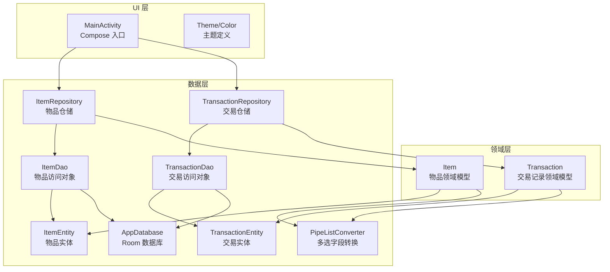
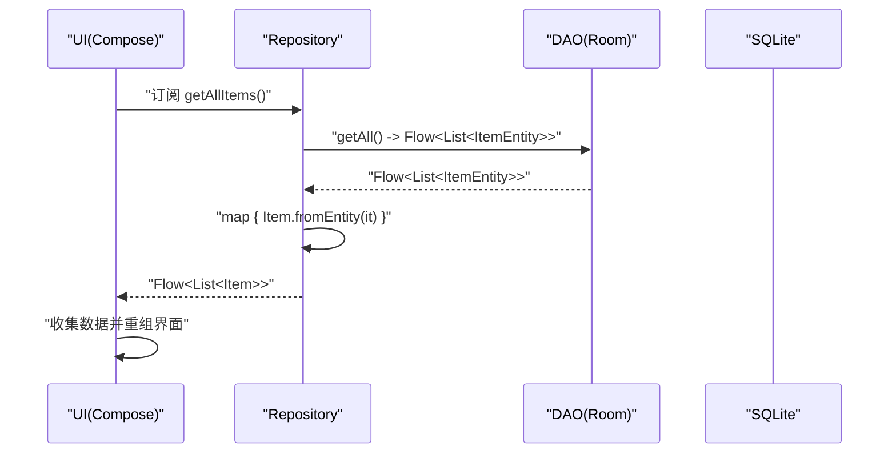
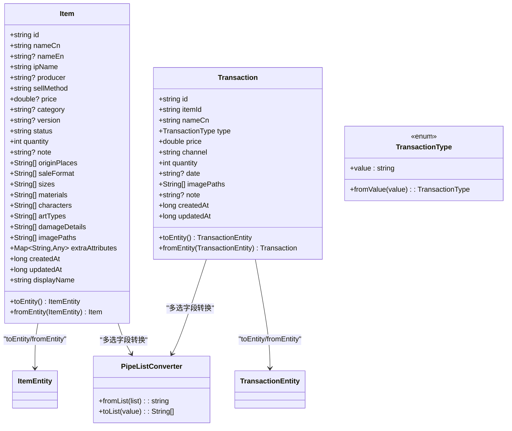
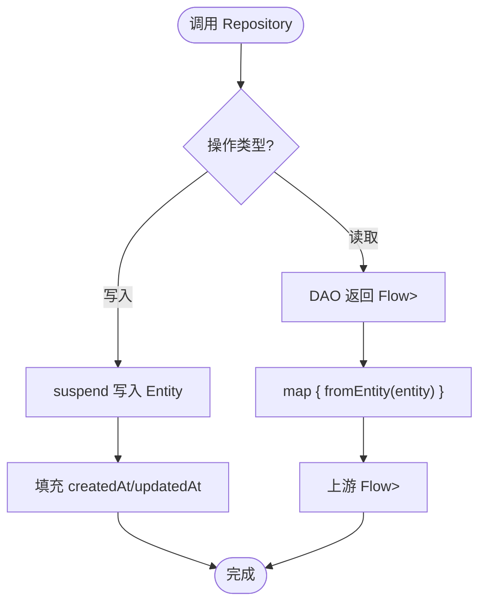
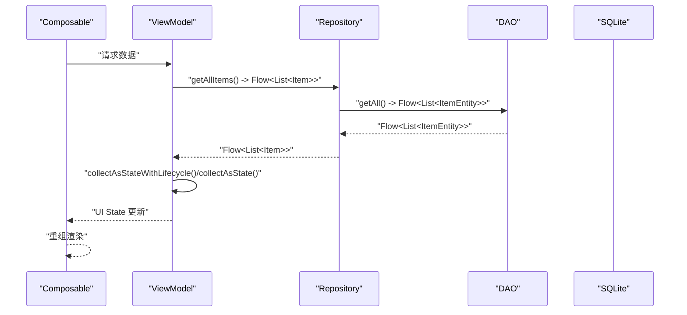
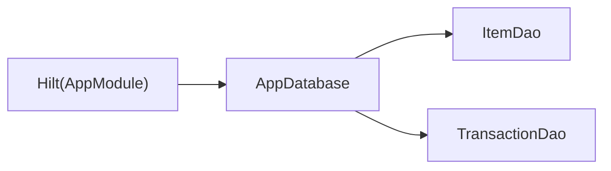
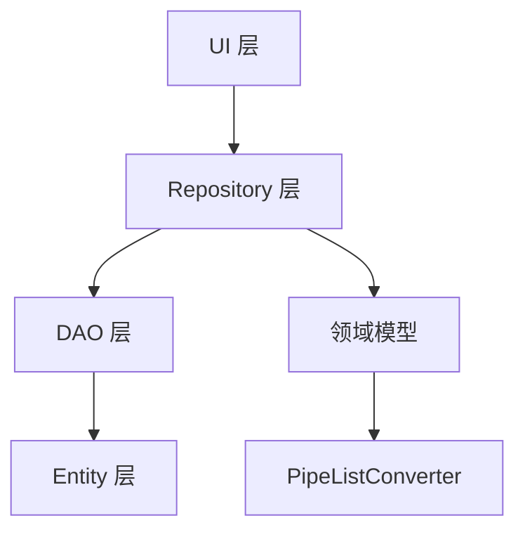

# 分层架构详解

<cite>
**本文引用的文件**
- [MainActivity.kt](file://GuZiStorage/app/src/main/java/com/guzi/storage/MainActivity.kt)
- [GuziStorageApp.kt](file://GuZiStorage/app/src/main/java/com/guzi/storage/GuziStorageApp.kt)
- [AppModule.kt](file://GuZiStorage/app/src/main/java/com/guzi/storage/di/AppModule.kt)
- [AppDatabase.kt](file://GuZiStorage/app/src/main/java/com/guzi/storage/data/local/AppDatabase.kt)
- [ItemDao.kt](file://GuZiStorage/app/src/main/java/com/guzi/storage/data/local/dao/ItemDao.kt)
- [TransactionDao.kt](file://GuZiStorage/app/src/main/java/com/guzi/storage/data/local/dao/TransactionDao.kt)
- [ItemEntity.kt](file://GuZiStorage/app/src/main/java/com/guzi/storage/data/local/entity/ItemEntity.kt)
- [TransactionEntity.kt](file://GuZiStorage/app/src/main/java/com/guzi/storage/data/local/entity/TransactionEntity.kt)
- [PipeListConverter.kt](file://GuZiStorage/app/src/main/java/com/guzi/storage/data/local/PipeListConverter.kt)
- [ItemRepository.kt](file://GuZiStorage/app/src/main/java/com/guzi/storage/data/repository/ItemRepository.kt)
- [TransactionRepository.kt](file://GuZiStorage/app/src/main/java/com/guzi/storage/data/repository/TransactionRepository.kt)
- [Item.kt](file://GuZiStorage/app/src/main/java/com/guzi/storage/domain/model/Item.kt)
- [Transaction.kt](file://GuZiStorage/app/src/main/java/com/guzi/storage/domain/model/Transaction.kt)
</cite>

## 目录
1. [简介](#简介)
2. [项目结构](#项目结构)
3. [核心组件](#核心组件)
4. [架构总览](#架构总览)
5. [详细组件分析](#详细组件分析)
6. [依赖关系分析](#依赖关系分析)
7. [性能考量](#性能考量)
8. [故障排查指南](#故障排查指南)
9. [结论](#结论)
10. [附录](#附录)

## 简介
本文件面向“谷子收纳”Android 应用的分层架构，围绕 UI 层（Jetpack Compose）、领域层（业务模型）、数据层（Repository 与 DAO）进行系统化说明。重点阐述：
- 各层职责与边界
- Domain Model 设计原则与转换策略
- Repository 模式实现与 Flow 响应式数据流
- UI 状态管理与异步操作处理
- 层间通信机制、错误处理与可测试性保障
- 层次依赖图与关键交互流程图

## 项目结构
当前仓库采用清晰的分层组织方式：
- UI 层：基于 Jetpack Compose 的界面入口与主题
- 领域层：纯 Kotlin 的数据类与枚举，承载业务语义
- 数据层：Room 数据库、DAO、Entity、Repository 以及类型转换器
- DI 模块：Hilt 提供数据库与 DAO 实例

图表来源
- [MainActivity.kt:1-55](file://GuZiStorage/app/src/main/java/com/guzi/storage/MainActivity.kt#L1-L55)
- [ItemRepository.kt:1-80](file://GuZiStorage/app/src/main/java/com/guzi/storage/data/repository/ItemRepository.kt#L1-L80)
- [TransactionRepository.kt:1-63](file://GuZiStorage/app/src/main/java/com/guzi/storage/data/repository/TransactionRepository.kt#L1-L63)
- [ItemDao.kt:1-90](file://GuZiStorage/app/src/main/java/com/guzi/storage/data/local/dao/ItemDao.kt#L1-L90)
- [TransactionDao.kt:1-49](file://GuZiStorage/app/src/main/java/com/guzi/storage/data/local/dao/TransactionDao.kt#L1-L49)
- [ItemEntity.kt:1-89](file://GuZiStorage/app/src/main/java/com/guzi/storage/data/local/entity/ItemEntity.kt#L1-L89)
- [TransactionEntity.kt:1-65](file://GuZiStorage/app/src/main/java/com/guzi/storage/data/local/entity/TransactionEntity.kt#L1-L65)
- [PipeListConverter.kt:1-26](file://GuZiStorage/app/src/main/java/com/guzi/storage/data/local/PipeListConverter.kt#L1-L26)
- [AppDatabase.kt:1-34](file://GuZiStorage/app/src/main/java/com/guzi/storage/data/local/AppDatabase.kt#L1-L34)

章节来源
- [MainActivity.kt:1-55](file://GuZiStorage/app/src/main/java/com/guzi/storage/MainActivity.kt#L1-L55)
- [AppDatabase.kt:1-34](file://GuZiStorage/app/src/main/java/com/guzi/storage/data/local/AppDatabase.kt#L1-L34)

## 核心组件
- 领域模型
  - Item：物品领域模型，包含显示名称计算、与 Entity 的双向转换逻辑
  - Transaction：交易记录领域模型，含类型枚举与双向转换
- 数据访问
  - ItemDao / TransactionDao：Room DAO，暴露 Flow 与 suspend 函数
  - ItemEntity / TransactionEntity：Room 表映射实体
  - PipeListConverter：管道符分隔字符串与 List<String> 互转工具
- 仓储层
  - ItemRepository / TransactionRepository：封装 CRUD，统一做 Entity ↔ Domain 转换，对外暴露 Flow
- 依赖注入
  - AppModule：通过 Hilt 提供 AppDatabase 与各 DAO 单例
- UI 入口
  - MainActivity：Compose 应用入口，使用 Material Theme 与 Scaffold

章节来源
- [Item.kt:1-106](file://GuZiStorage/app/src/main/java/com/guzi/storage/domain/model/Item.kt#L1-L106)
- [Transaction.kt:1-68](file://GuZiStorage/app/src/main/java/com/guzi/storage/domain/model/Transaction.kt#L1-L68)
- [ItemRepository.kt:1-80](file://GuZiStorage/app/src/main/java/com/guzi/storage/data/repository/ItemRepository.kt#L1-L80)
- [TransactionRepository.kt:1-63](file://GuZiStorage/app/src/main/java/com/guzi/storage/data/repository/TransactionRepository.kt#L1-L63)
- [ItemDao.kt:1-90](file://GuZiStorage/app/src/main/java/com/guzi/storage/data/local/dao/ItemDao.kt#L1-L90)
- [TransactionDao.kt:1-49](file://GuZiStorage/app/src/main/java/com/guzi/storage/data/local/dao/TransactionDao.kt#L1-L49)
- [ItemEntity.kt:1-89](file://GuZiStorage/app/src/main/java/com/guzi/storage/data/local/entity/ItemEntity.kt#L1-L89)
- [TransactionEntity.kt:1-65](file://GuZiStorage/app/src/main/java/com/guzi/storage/data/local/entity/TransactionEntity.kt#L1-L65)
- [PipeListConverter.kt:1-26](file://GuZiStorage/app/src/main/java/com/guzi/storage/data/local/PipeListConverter.kt#L1-L26)
- [AppModule.kt:1-50](file://GuZiStorage/app/src/main/java/com/guzi/storage/di/AppModule.kt#L1-L50)
- [MainActivity.kt:1-55](file://GuZiStorage/app/src/main/java/com/guzi/storage/MainActivity.kt#L1-L55)

## 架构总览
整体遵循“UI → Repository → DAO → Room”的分层结构，领域模型位于中间层，承担业务语义与数据转换职责。数据以 Flow 形式向上游推送，UI 侧订阅并驱动重组。

图表来源
- [ItemRepository.kt:23-24](file://GuZiStorage/app/src/main/java/com/guzi/storage/data/repository/ItemRepository.kt#L23-L24)
- [ItemDao.kt:20-21](file://GuZiStorage/app/src/main/java/com/guzi/storage/data/local/dao/ItemDao.kt#L20-L21)
- [Item.kt:80-103](file://GuZiStorage/app/src/main/java/com/guzi/storage/domain/model/Item.kt#L80-L103)

## 详细组件分析

### 领域层：Domain Model 设计与转换
- 设计原则
  - 不可变数据类：便于组合与线程安全
  - 显式转换方法：toEntity/fromEntity 集中处理持久化格式与领域格式的映射
  - 业务属性派生：如 displayName 根据 status 与 damageDetails 动态生成
  - 多选字段统一通过 PipeListConverter 在 List<String> 与 "|" 分隔字符串之间转换
- 复杂度
  - 转换均为线性遍历与拼接，时间复杂度 O(n)，空间复杂度 O(n)
- 可测试性
  - 纯函数式转换易于单元测试覆盖边界情况（空列表、空字符串等）

图表来源
- [Item.kt:11-104](file://GuZiStorage/app/src/main/java/com/guzi/storage/domain/model/Item.kt#L11-L104)
- [Transaction.kt:9-67](file://GuZiStorage/app/src/main/java/com/guzi/storage/domain/model/Transaction.kt#L9-L67)
- [ItemEntity.kt:16-88](file://GuZiStorage/app/src/main/java/com/guzi/storage/data/local/entity/ItemEntity.kt#L16-L88)
- [TransactionEntity.kt:14-64](file://GuZiStorage/app/src/main/java/com/guzi/storage/data/local/entity/TransactionEntity.kt#L14-L64)
- [PipeListConverter.kt:9-25](file://GuZiStorage/app/src/main/java/com/guzi/storage/data/local/PipeListConverter.kt#L9-L25)

章节来源
- [Item.kt:1-106](file://GuZiStorage/app/src/main/java/com/guzi/storage/domain/model/Item.kt#L1-L106)
- [Transaction.kt:1-68](file://GuZiStorage/app/src/main/java/com/guzi/storage/domain/model/Transaction.kt#L1-L68)
- [PipeListConverter.kt:1-26](file://GuZiStorage/app/src/main/java/com/guzi/storage/data/local/PipeListConverter.kt#L1-L26)

### 数据层：Repository 与 DAO 的职责分离
- DAO 层
  - 仅负责 SQL 查询与写入，返回 Flow<List<Entity>> 或 suspend 结果
  - 索引优化：对常用查询列建立索引以提升检索性能
- Repository 层
  - 统一封装 CRUD，屏蔽 DAO 细节
  - 负责 Entity ↔ Domain 转换，对外暴露 Flow<List<Domain>>
  - 写入时自动填充时间戳，保证审计字段一致性
- 数据转换
  - 多选字段通过 PipeListConverter 完成 List<String> 与 "|" 分隔字符串互转
  - 领域模型持有业务语义，Entity 专注持久化

图表来源
- [ItemRepository.kt:23-42](file://GuZiStorage/app/src/main/java/com/guzi/storage/data/repository/ItemRepository.kt#L23-L42)
- [ItemRepository.kt:49-76](file://GuZiStorage/app/src/main/java/com/guzi/storage/data/repository/ItemRepository.kt#L49-L76)
- [TransactionRepository.kt:20-61](file://GuZiStorage/app/src/main/java/com/guzi/storage/data/repository/TransactionRepository.kt#L20-L61)
- [ItemDao.kt:20-88](file://GuZiStorage/app/src/main/java/com/guzi/storage/data/local/dao/ItemDao.kt#L20-L88)
- [TransactionDao.kt:20-47](file://GuZiStorage/app/src/main/java/com/guzi/storage/data/local/dao/TransactionDao.kt#L20-L47)

章节来源
- [ItemRepository.kt:1-80](file://GuZiStorage/app/src/main/java/com/guzi/storage/data/repository/ItemRepository.kt#L1-L80)
- [TransactionRepository.kt:1-63](file://GuZiStorage/app/src/main/java/com/guzi/storage/data/repository/TransactionRepository.kt#L1-L63)
- [ItemDao.kt:1-90](file://GuZiStorage/app/src/main/java/com/guzi/storage/data/local/dao/ItemDao.kt#L1-L90)
- [TransactionDao.kt:1-49](file://GuZiStorage/app/src/main/java/com/guzi/storage/data/local/dao/TransactionDao.kt#L1-L49)

### UI 层：Compose 入口与状态管理建议
- 当前入口
  - MainActivity 作为 Compose 入口，设置主题与基础布局
- 状态管理建议
  - 使用 StateFlow/SharedFlow 接收 Repository 的 Flow
  - 在 ViewModel 中收集数据并转换为 UI State，避免在 Composable 中直接执行业务逻辑
  - 将加载态、错误态、成功态明确拆分，提升可测试性与可读性

图表来源
- [MainActivity.kt:22-36](file://GuZiStorage/app/src/main/java/com/guzi/storage/MainActivity.kt#L22-L36)
- [ItemRepository.kt:23-24](file://GuZiStorage/app/src/main/java/com/guzi/storage/data/repository/ItemRepository.kt#L23-L24)
- [ItemDao.kt:20-21](file://GuZiStorage/app/src/main/java/com/guzi/storage/data/local/dao/ItemDao.kt#L20-L21)

章节来源
- [MainActivity.kt:1-55](file://GuZiStorage/app/src/main/java/com/guzi/storage/MainActivity.kt#L1-L55)

### 依赖注入与数据库配置
- Hilt 模块
  - 提供 AppDatabase 单例，配置 destructive migration
  - 提供 ItemDao、TransactionDao 等 DAO 实例
- Room 数据库
  - 声明 entities 与版本，导出 schema
  - 抽象出 DAO 获取方法

图表来源
- [AppModule.kt:23-48](file://GuZiStorage/app/src/main/java/com/guzi/storage/di/AppModule.kt#L23-L48)
- [AppDatabase.kt:20-33](file://GuZiStorage/app/src/main/java/com/guzi/storage/data/local/AppDatabase.kt#L20-L33)

章节来源
- [AppModule.kt:1-50](file://GuZiStorage/app/src/main/java/com/guzi/storage/di/AppModule.kt#L1-L50)
- [AppDatabase.kt:1-34](file://GuZiStorage/app/src/main/java/com/guzi/storage/data/local/AppDatabase.kt#L1-L34)

## 依赖关系分析
- 单向依赖
  - UI 依赖 Repository；Repository 依赖 DAO；DAO 依赖 Entity 与 Database
  - 领域模型不依赖数据层注解，但提供 toEntity/fromEntity 进行映射
- 耦合度与内聚性
  - Repository 内聚了转换与时间戳填充逻辑，降低上层复杂度
  - DAO 仅关注 SQL 与 Flow 暴露，保持高内聚低耦合
- 外部依赖
  - Room、Hilt、Kotlin Coroutines/Flow

图表来源
- [ItemRepository.kt:1-80](file://GuZiStorage/app/src/main/java/com/guzi/storage/data/repository/ItemRepository.kt#L1-L80)
- [TransactionRepository.kt:1-63](file://GuZiStorage/app/src/main/java/com/guzi/storage/data/repository/TransactionRepository.kt#L1-L63)
- [ItemDao.kt:1-90](file://GuZiStorage/app/src/main/java/com/guzi/storage/data/local/dao/ItemDao.kt#L1-L90)
- [TransactionDao.kt:1-49](file://GuZiStorage/app/src/main/java/com/guzi/storage/data/local/dao/TransactionDao.kt#L1-L49)
- [Item.kt:1-106](file://GuZiStorage/app/src/main/java/com/guzi/storage/domain/model/Item.kt#L1-L106)
- [Transaction.kt:1-68](file://GuZiStorage/app/src/main/java/com/guzi/storage/domain/model/Transaction.kt#L1-L68)
- [PipeListConverter.kt:1-26](file://GuZiStorage/app/src/main/java/com/guzi/storage/data/local/PipeListConverter.kt#L1-L26)

章节来源
- [ItemRepository.kt:1-80](file://GuZiStorage/app/src/main/java/com/guzi/storage/data/repository/ItemRepository.kt#L1-L80)
- [TransactionRepository.kt:1-63](file://GuZiStorage/app/src/main/java/com/guzi/storage/data/repository/TransactionRepository.kt#L1-L63)
- [ItemDao.kt:1-90](file://GuZiStorage/app/src/main/java/com/guzi/storage/data/local/dao/ItemDao.kt#L1-L90)
- [TransactionDao.kt:1-49](file://GuZiStorage/app/src/main/java/com/guzi/storage/data/local/dao/TransactionDao.kt#L1-L49)
- [Item.kt:1-106](file://GuZiStorage/app/src/main/java/com/guzi/storage/domain/model/Item.kt#L1-L106)
- [Transaction.kt:1-68](file://GuZiStorage/app/src/main/java/com/guzi/storage/domain/model/Transaction.kt#L1-L68)
- [PipeListConverter.kt:1-26](file://GuZiStorage/app/src/main/java/com/guzi/storage/data/local/PipeListConverter.kt#L1-L26)

## 性能考量
- 查询优化
  - 为高频查询列建立索引（如 ip_name、status、category、item_id），减少全表扫描
- 响应式数据流
  - 使用 Flow 避免重复查询，仅在数据变化时触发重组
- 批量写入
  - insertAll 用于批量导入，减少事务开销
- 存储格式
  - 多选字段以 "|" 分隔字符串存储，避免额外关联表带来的 JOIN 成本

[本节为通用指导，无需列出具体文件来源]

## 故障排查指南
- 常见问题定位
  - 列表不刷新：检查 Repository 是否返回 Flow，UI 是否正确 collect
  - 搜索无结果：确认 DAO 模糊匹配条件与输入参数
  - 删除未级联：确认外键约束与 onDelete=CASCADE 配置
- 日志与断点
  - 在 Repository 的 map 前后添加日志，验证转换是否生效
  - 在 DAO 的 Query 执行前后打点，观察耗时与异常堆栈

章节来源
- [TransactionEntity.kt:14-27](file://GuZiStorage/app/src/main/java/com/guzi/storage/data/local/entity/TransactionEntity.kt#L14-L27)
- [ItemRepository.kt:23-42](file://GuZiStorage/app/src/main/java/com/guzi/storage/data/repository/ItemRepository.kt#L23-L42)
- [ItemDao.kt:49-56](file://GuZiStorage/app/src/main/java/com/guzi/storage/data/local/dao/ItemDao.kt#L49-L56)

## 结论
该应用采用清晰的三层架构，领域模型聚焦业务语义，Repository 统一数据访问与转换，DAO 专注 SQL 与 Flow 暴露。通过 Hilt 注入与 Room 数据库，实现了良好的解耦与可测试性。后续可在 UI 层引入 ViewModel 与 StateFlow，完善错误处理与加载态展示，进一步提升用户体验与健壮性。

[本节为总结性内容，无需列出具体文件来源]

## 附录
- 术语
  - IP：作品/系列名
  - 柄图：周边上的图案/设计
  - 通贩/场贩/应募：常见发售渠道与方式

[本节为概念性内容，无需列出具体文件来源]