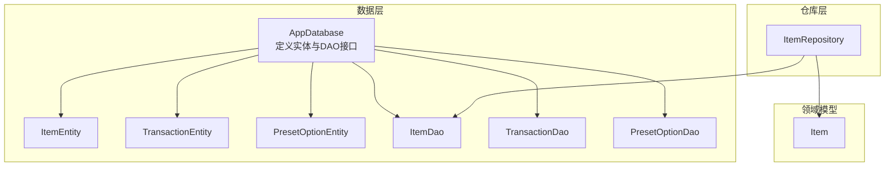
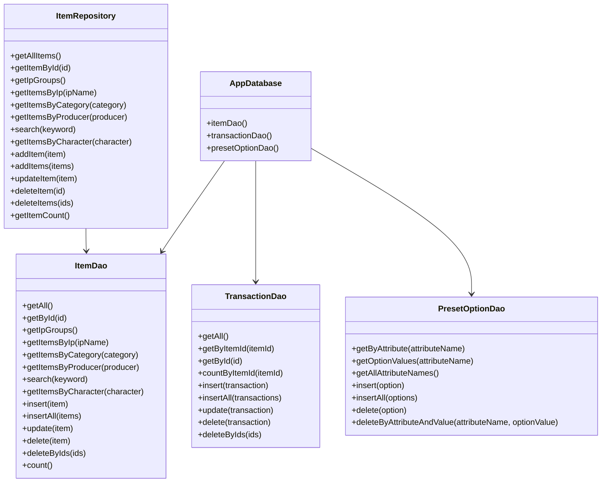
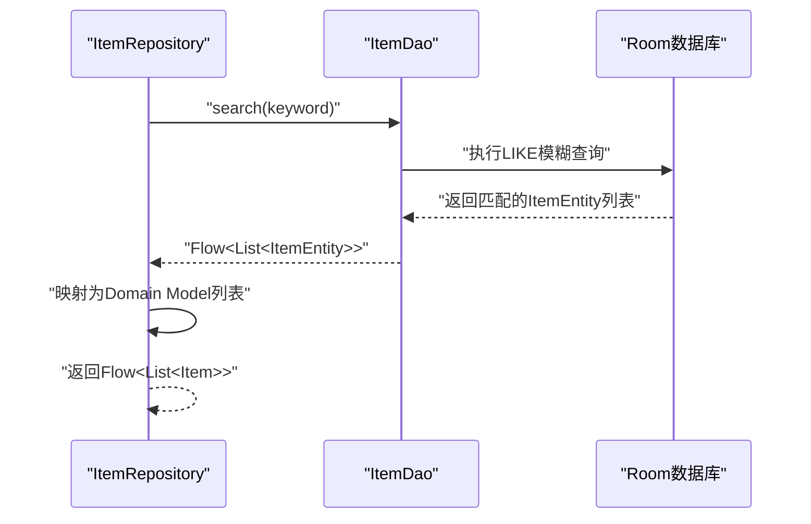
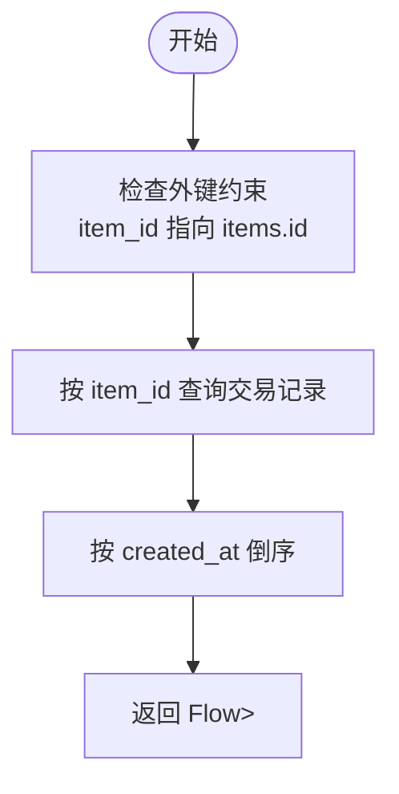
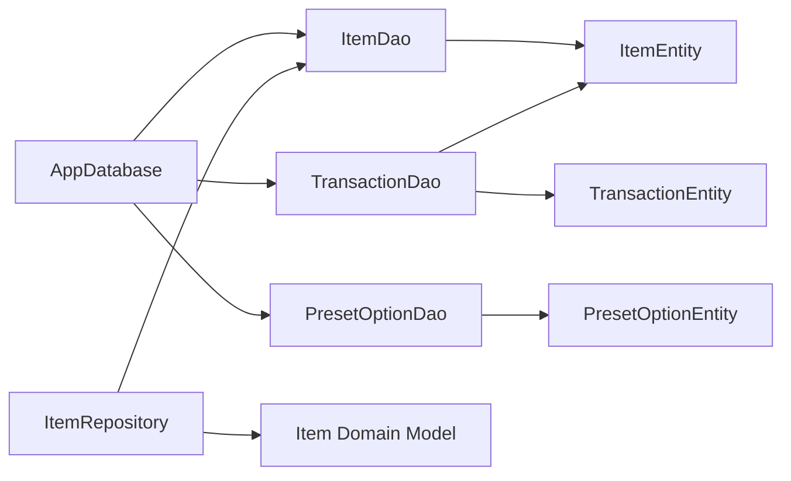

# DAO接口设计

<cite>
**本文档引用的文件**
- [ItemDao.kt](file://GuZiStorage/app/src/main/java/com/guzi/storage/data/local/dao/ItemDao.kt)
- [PresetOptionDao.kt](file://GuZiStorage/app/src/main/java/com/guzi/storage/data/local/dao/PresetOptionDao.kt)
- [TransactionDao.kt](file://GuZiStorage/app/src/main/java/com/guzi/storage/data/local/dao/TransactionDao.kt)
- [ItemEntity.kt](file://GuZiStorage/app/src/main/java/com/guzi/storage/data/local/entity/ItemEntity.kt)
- [TransactionEntity.kt](file://GuZiStorage/app/src/main/java/com/guzi/storage/data/local/entity/TransactionEntity.kt)
- [PresetOptionEntity.kt](file://GuZiStorage/app/src/main/java/com/guzi/storage/data/local/entity/PresetOptionEntity.kt)
- [AppDatabase.kt](file://GuZiStorage/app/src/main/java/com/guzi/storage/data/local/AppDatabase.kt)
- [ItemRepository.kt](file://GuZiStorage/app/src/main/java/com/guzi/storage/data/repository/ItemRepository.kt)
- [Item.kt](file://GuZiStorage/app/src/main/java/com/guzi/storage/domain/model/Item.kt)
</cite>

## 目录
1. [简介](#简介)
2. [项目结构](#项目结构)
3. [核心组件](#核心组件)
4. [架构总览](#架构总览)
5. [详细组件分析](#详细组件分析)
6. [依赖关系分析](#依赖关系分析)
7. [性能考虑](#性能考虑)
8. [故障排查指南](#故障排查指南)
9. [结论](#结论)

## 简介
本文件聚焦于谷子收纳应用的Room DAO接口设计，系统阐述@Dao注解的使用方式、CRUD操作的定义规范、复杂查询的实现策略，以及针对ItemDao的高级查询方法（如分组统计、全文搜索与多条件筛选）。同时给出@Query注解的SQL编写规范、参数绑定与结果映射要点，并结合实际代码路径提供复杂关联查询与索引优化的最佳实践，帮助开发者构建高性能、可维护的本地数据库层。

## 项目结构
本项目采用基于功能域的分层组织：
- data/local：Room数据库相关（实体、DAO、数据库类）
- data/repository：仓库层，封装DAO并进行Domain Model转换
- domain/model：业务模型，与数据库实体进行双向转换
- ui/theme、MainActivity等：UI层，不涉及DAO细节

图表来源
- [AppDatabase.kt:20-33](file://GuZiStorage/app/src/main/java/com/guzi/storage/data/local/AppDatabase.kt#L20-L33)
- [ItemDao.kt:15-89](file://GuZiStorage/app/src/main/java/com/guzi/storage/data/local/dao/ItemDao.kt#L15-L89)
- [TransactionDao.kt:15-48](file://GuZiStorage/app/src/main/java/com/guzi/storage/data/local/dao/TransactionDao.kt#L15-L48)
- [PresetOptionDao.kt:14-41](file://GuZiStorage/app/src/main/java/com/guzi/storage/data/local/dao/PresetOptionDao.kt#L14-L41)
- [ItemRepository.kt:16-79](file://GuZiStorage/app/src/main/java/com/guzi/storage/data/repository/ItemRepository.kt#L16-L79)

章节来源
- [AppDatabase.kt:12-33](file://GuZiStorage/app/src/main/java/com/guzi/storage/data/local/AppDatabase.kt#L12-L33)

## 核心组件
- ItemDao：负责物品表的查询与写入，包含分组统计、按IP/分类/厂商/角色筛选、关键词搜索等高级查询。
- TransactionDao：负责交易记录表的查询与写入，支持按物品主键关联查询。
- PresetOptionDao：负责预设选项表的查询与写入，提供属性名与选项值的管理能力。
- AppDatabase：集中声明实体与DAO接口，统一版本管理与导出配置。
- ItemRepository：对DAO进行封装，完成Entity与Domain Model之间的转换，对外暴露响应式数据流。

章节来源
- [ItemDao.kt:15-89](file://GuZiStorage/app/src/main/java/com/guzi/storage/data/local/dao/ItemDao.kt#L15-L89)
- [TransactionDao.kt:15-48](file://GuZiStorage/app/src/main/java/com/guzi/storage/data/local/dao/TransactionDao.kt#L15-L48)
- [PresetOptionDao.kt:14-41](file://GuZiStorage/app/src/main/java/com/guzi/storage/data/local/dao/PresetOptionDao.kt#L14-L41)
- [AppDatabase.kt:20-33](file://GuZiStorage/app/src/main/java/com/guzi/storage/data/local/AppDatabase.kt#L20-L33)
- [ItemRepository.kt:16-79](file://GuZiStorage/app/src/main/java/com/guzi/storage/data/repository/ItemRepository.kt#L16-L79)

## 架构总览
DAO层位于数据层，向上被仓库层调用；仓库层负责数据转换与响应式封装；领域模型面向业务逻辑。数据库通过外键建立物品与交易记录的关联，支持级联删除。

图表来源
- [AppDatabase.kt:29-32](file://GuZiStorage/app/src/main/java/com/guzi/storage/data/local/AppDatabase.kt#L29-L32)
- [ItemDao.kt:20-88](file://GuZiStorage/app/src/main/java/com/guzi/storage/data/local/dao/ItemDao.kt#L20-L88)
- [TransactionDao.kt:20-47](file://GuZiStorage/app/src/main/java/com/guzi/storage/data/local/dao/TransactionDao.kt#L20-L47)
- [PresetOptionDao.kt:19-40](file://GuZiStorage/app/src/main/java/com/guzi/storage/data/local/dao/PresetOptionDao.kt#L19-L40)
- [ItemRepository.kt:23-78](file://GuZiStorage/app/src/main/java/com/guzi/storage/data/repository/ItemRepository.kt#L23-L78)

## 详细组件分析

### ItemDao：高级查询与复杂查询实现
- 分组查询：getIpGroups()返回IP名称与数量的分组统计，使用AS别名映射到IpGroupInfo数据类，便于UI直接消费。
- 全文搜索：search()对中文名、IP名、英文名进行模糊匹配，使用LIKE与通配符拼接，排序依据更新时间倒序。
- 多条件筛选：按IP、分类、厂商、角色（管道符分隔字段）进行精确或模糊匹配，均按更新时间倒序。
- 写入与删除：支持单条/批量插入、更新、删除，以及按ID列表批量删除；提供计数查询。

图表来源
- [ItemRepository.kt:41-42](file://GuZiStorage/app/src/main/java/com/guzi/storage/data/repository/ItemRepository.kt#L41-L42)
- [ItemDao.kt:49-56](file://GuZiStorage/app/src/main/java/com/guzi/storage/data/local/dao/ItemDao.kt#L49-L56)

章节来源
- [ItemDao.kt:20-88](file://GuZiStorage/app/src/main/java/com/guzi/storage/data/local/dao/ItemDao.kt#L20-L88)
- [ItemRepository.kt:29-45](file://GuZiStorage/app/src/main/java/com/guzi/storage/data/repository/ItemRepository.kt#L29-L45)

### TransactionDao：关联查询与外键约束
- 外键关联：TransactionEntity通过item_id外键指向ItemEntity，删除物品时自动级联删除交易记录，保证数据一致性。
- 关联查询：按物品ID查询交易记录，支持按创建时间倒序排列；提供按ID查询与计数查询。
- 写入与删除：支持单条/批量插入、更新、删除，以及按ID列表批量删除。

图表来源
- [TransactionEntity.kt:14-26](file://GuZiStorage/app/src/main/java/com/guzi/storage/data/local/entity/TransactionEntity.kt#L14-L26)
- [TransactionDao.kt:23-30](file://GuZiStorage/app/src/main/java/com/guzi/storage/data/local/dao/TransactionDao.kt#L23-L30)

章节来源
- [TransactionDao.kt:15-48](file://GuZiStorage/app/src/main/java/com/guzi/storage/data/local/dao/TransactionDao.kt#L15-L48)
- [TransactionEntity.kt:14-26](file://GuZiStorage/app/src/main/java/com/guzi/storage/data/local/entity/TransactionEntity.kt#L14-L26)

### PresetOptionDao：预设选项管理
- 属性维度：按attributeName分组获取选项值，支持排序与去重。
- 选项值查询：获取某一属性的所有选项值集合。
- 写入与删除：支持单条/批量插入（冲突策略为忽略），删除指定属性值或整条记录。

章节来源
- [PresetOptionDao.kt:14-41](file://GuZiStorage/app/src/main/java/com/guzi/storage/data/local/dao/PresetOptionDao.kt#L14-L41)
- [PresetOptionEntity.kt:15-22](file://GuZiStorage/app/src/main/java/com/guzi/storage/data/local/entity/PresetOptionEntity.kt#L15-L22)

### AppDatabase：实体与DAO装配
- 统一声明：集中注册ItemEntity、TransactionEntity、PresetOptionEntity三张表。
- DAO接口：暴露三个DAO供仓库层调用。
- 版本管理：当前版本为1，支持导出Schema。

章节来源
- [AppDatabase.kt:20-33](file://GuZiStorage/app/src/main/java/com/guzi/storage/data/local/AppDatabase.kt#L20-L33)

### ItemRepository：响应式封装与模型转换
- 响应式数据流：将DAO返回的Flow<List<Entity>>映射为Flow<List<DomainModel>>。
- 模型转换：提供fromEntity与toEntity方法，完成多选字段的管道符分隔与列表互转。
- 业务操作：封装新增、更新、删除、批量删除与计数等常用操作。

章节来源
- [ItemRepository.kt:16-79](file://GuZiStorage/app/src/main/java/com/guzi/storage/data/repository/ItemRepository.kt#L16-L79)
- [Item.kt:50-104](file://GuZiStorage/app/src/main/java/com/guzi/storage/domain/model/Item.kt#L50-L104)

## 依赖关系分析
- ItemDao依赖ItemEntity，提供物品表的CRUD与复杂查询。
- TransactionDao依赖TransactionEntity与ItemEntity，通过外键建立关联。
- PresetOptionDao依赖PresetOptionEntity，提供预设选项的管理能力。
- ItemRepository依赖ItemDao与Domain Model，向上提供响应式数据流。
- AppDatabase统一装配实体与DAO，形成稳定的依赖入口。

图表来源
- [AppDatabase.kt:29-32](file://GuZiStorage/app/src/main/java/com/guzi/storage/data/local/AppDatabase.kt#L29-L32)
- [ItemDao.kt:15-89](file://GuZiStorage/app/src/main/java/com/guzi/storage/data/local/dao/ItemDao.kt#L15-L89)
- [TransactionDao.kt:15-48](file://GuZiStorage/app/src/main/java/com/guzi/storage/data/local/dao/TransactionDao.kt#L15-L48)
- [PresetOptionDao.kt:14-41](file://GuZiStorage/app/src/main/java/com/guzi/storage/data/local/dao/PresetOptionDao.kt#L14-L41)
- [ItemRepository.kt:17-18](file://GuZiStorage/app/src/main/java/com/guzi/storage/data/repository/ItemRepository.kt#L17-L18)

章节来源
- [AppDatabase.kt:20-33](file://GuZiStorage/app/src/main/java/com/guzi/storage/data/local/AppDatabase.kt#L20-L33)
- [ItemRepository.kt:16-79](file://GuZiStorage/app/src/main/java/com/guzi/storage/data/repository/ItemRepository.kt#L16-L79)

## 性能考虑
- 索引优化
  - items表：为ip_name、status、category建立索引，提升分组统计与多条件筛选效率。
  - transactions表：为item_id建立索引，加速按物品ID的关联查询。
  - preset_options表：为attribute_name与option_value建立联合唯一索引，避免重复并提高查找性能。
- SQL编写规范
  - 参数绑定：使用命名参数（如:id、:ipName、:keyword）避免字符串拼接，降低注入风险。
  - 结果映射：使用AS别名将查询列映射到数据类字段，减少额外转换开销。
  - 排序与分页：对高频查询添加ORDER BY，必要时引入LIMIT/分页游标以控制结果集大小。
- 查询优化建议
  - 模糊搜索：LIKE '%' || :keyword || '%'会触发全表扫描，建议在高基数字段上建立FTS（全文搜索）或使用RANK排序字段。
  - 分组统计：GROUP BY + COUNT通常需要索引支撑，确保分组字段具备合适索引。
  - 复合条件：尽量将选择性高的过滤条件放在WHERE前部，配合索引提升命中率。
- 写入优化
  - 批量插入：使用insertAll替代多次insert，减少事务开销。
  - 冲突策略：根据业务场景选择REPLACE/IGNORE，避免不必要的回滚与重试。
- 响应式与协程
  - 使用Flow进行响应式查询，避免阻塞主线程；在UI层订阅时注意生命周期管理。

章节来源
- [ItemEntity.kt:16-23](file://GuZiStorage/app/src/main/java/com/guzi/storage/data/local/entity/ItemEntity.kt#L16-L23)
- [TransactionEntity.kt:14-27](file://GuZiStorage/app/src/main/java/com/guzi/storage/data/local/entity/TransactionEntity.kt#L14-L27)
- [PresetOptionEntity.kt:15-22](file://GuZiStorage/app/src/main/java/com/guzi/storage/data/local/entity/PresetOptionEntity.kt#L15-L22)
- [ItemDao.kt:49-56](file://GuZiStorage/app/src/main/java/com/guzi/storage/data/local/dao/ItemDao.kt#L49-L56)

## 故障排查指南
- 查询无结果
  - 检查参数是否正确传入（特别是空字符串与null值处理）。
  - 确认索引是否存在且生效（可通过EXPLAIN QUERY PLAN验证）。
- 模糊搜索性能差
  - 评估字段基数与数据分布，必要时引入全文索引或限制搜索范围。
- 外键约束异常
  - 删除物品前确认是否存在交易记录，避免违反外键约束。
- 响应式数据未更新
  - 确认仓库层是否正确映射Flow，UI订阅是否在正确生命周期内。
- 批量写入失败
  - 检查OnConflictStrategy设置与数据唯一性，避免重复主键导致的冲突。

章节来源
- [TransactionEntity.kt:16-22](file://GuZiStorage/app/src/main/java/com/guzi/storage/data/local/entity/TransactionEntity.kt#L16-L22)
- [ItemRepository.kt:23-45](file://GuZiStorage/app/src/main/java/com/guzi/storage/data/repository/ItemRepository.kt#L23-L45)

## 结论
本DAO设计遵循Room最佳实践，通过明确的@Dao注解、清晰的CRUD与复杂查询定义、合理的索引策略与响应式封装，实现了高效、可维护的数据访问层。ItemDao的高级查询（分组、搜索、多条件筛选）为业务提供了灵活的数据检索能力；TransactionDao的外键关联保障了数据一致性；PresetOptionDao为属性维度的预设管理提供了基础。结合性能优化建议与故障排查指南，可进一步提升数据库操作的稳定性与效率。