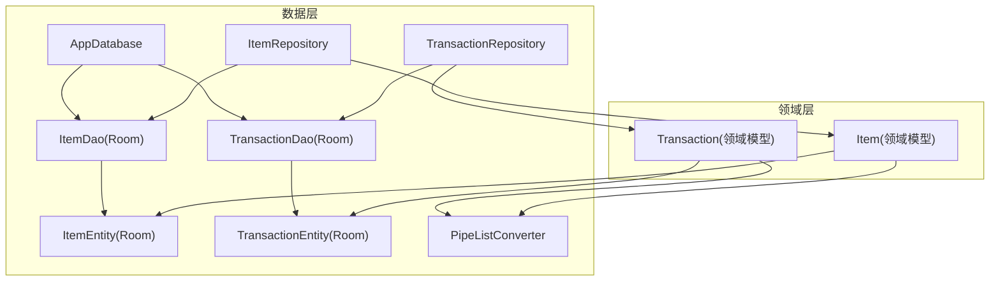
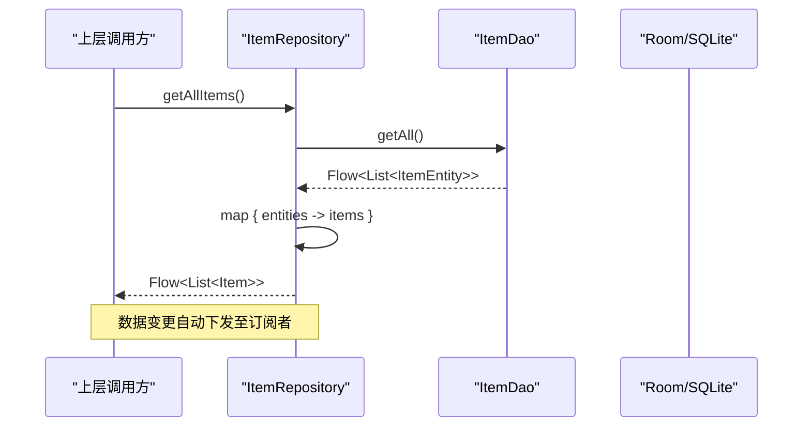
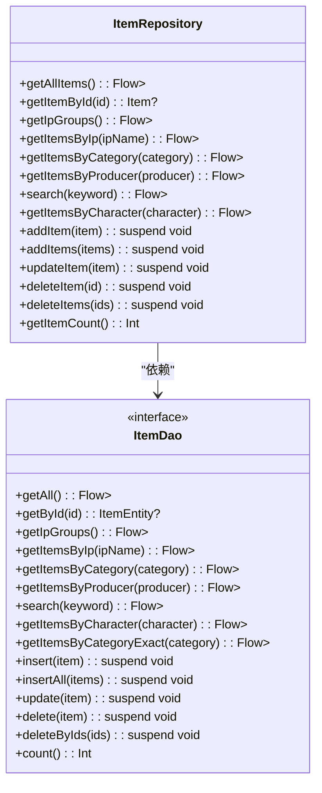
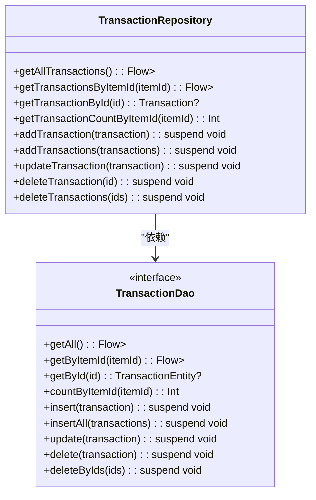
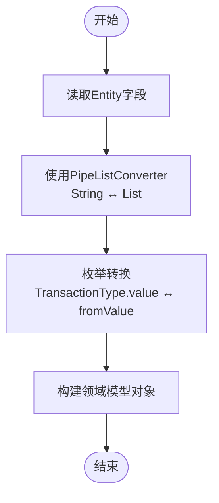
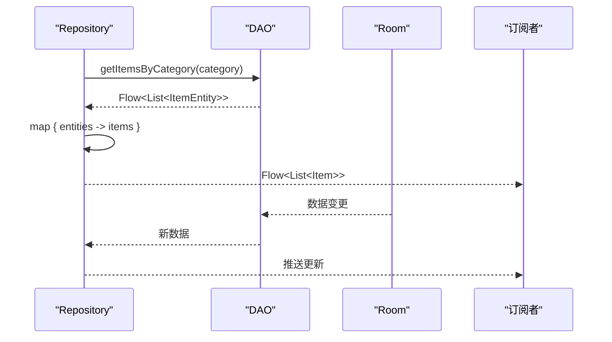
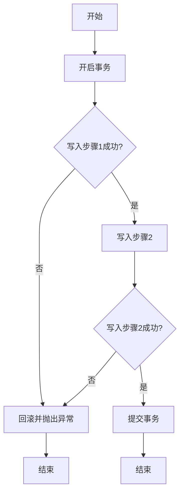
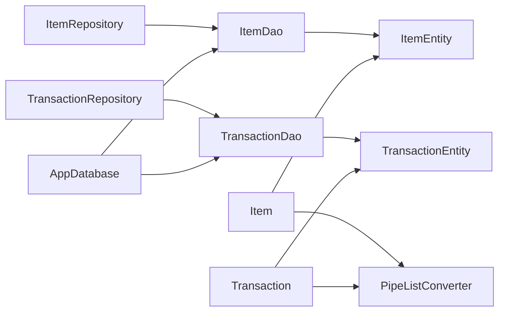

# Repository模式实现

<cite>
**本文引用的文件**
- [ItemRepository.kt](file://GuZiStorage/app/src/main/java/com/guzi/storage/data/repository/ItemRepository.kt)
- [TransactionRepository.kt](file://GuZiStorage/app/src/main/java/com/guzi/storage/data/repository/TransactionRepository.kt)
- [ItemDao.kt](file://GuZiStorage/app/src/main/java/com/guzi/storage/data/local/dao/ItemDao.kt)
- [TransactionDao.kt](file://GuZiStorage/app/src/main/java/com/guzi/storage/data/local/dao/TransactionDao.kt)
- [ItemEntity.kt](file://GuZiStorage/app/src/main/java/com/guzi/storage/data/local/entity/ItemEntity.kt)
- [TransactionEntity.kt](file://GuZiStorage/app/src/main/java/com/guzi/storage/data/local/entity/TransactionEntity.kt)
- [Item.kt](file://GuZiStorage/app/src/main/java/com/guzi/storage/domain/model/Item.kt)
- [Transaction.kt](file://GuZiStorage/app/src/main/java/com/guzi/storage/domain/model/Transaction.kt)
- [PipeListConverter.kt](file://GuZiStorage/app/src/main/java/com/guzi/storage/data/local/PipeListConverter.kt)
- [AppDatabase.kt](file://GuZiStorage/app/src/main/java/com/guzi/storage/data/local/AppDatabase.kt)
</cite>

## 目录
1. [简介](#简介)
2. [项目结构](#项目结构)
3. [核心组件](#核心组件)
4. [架构总览](#架构总览)
5. [详细组件分析](#详细组件分析)
6. [依赖关系分析](#依赖关系分析)
7. [性能与事务优化](#性能与事务优化)
8. [故障排查指南](#故障排查指南)
9. [结论](#结论)

## 简介
本文件围绕谷子收纳应用的数据访问层，系统化阐述Repository模式的实现。重点覆盖：
- ItemRepository与TransactionRepository的职责边界与设计原则
- CRUD操作的封装、数据转换逻辑与响应式数据流处理
- Entity到Domain Model的双向转换（Item.fromEntity/toEntity、Transaction.fromEntity/toEntity）
- Flow在数据访问层的应用（map操作符、实时监听）
- 多DAO协作的协调方式、异步处理与错误处理策略
- 批量操作的性能优化技巧与事务管理最佳实践

## 项目结构
仓库采用分层组织：domain模型位于领域层，data层包含Room实体、DAO与Repository；数据库由AppDatabase统一声明。

图表来源
- [ItemRepository.kt:1-80](file://GuZiStorage/app/src/main/java/com/guzi/storage/data/repository/ItemRepository.kt#L1-L80)
- [TransactionRepository.kt:1-63](file://GuZiStorage/app/src/main/java/com/guzi/storage/data/repository/TransactionRepository.kt#L1-L63)
- [ItemDao.kt:1-90](file://GuZiStorage/app/src/main/java/com/guzi/storage/data/local/dao/ItemDao.kt#L1-L90)
- [TransactionDao.kt:1-49](file://GuZiStorage/app/src/main/java/com/guzi/storage/data/local/dao/TransactionDao.kt#L1-L49)
- [ItemEntity.kt:1-89](file://GuZiStorage/app/src/main/java/com/guzi/storage/data/local/entity/ItemEntity.kt#L1-L89)
- [TransactionEntity.kt:1-65](file://GuZiStorage/app/src/main/java/com/guzi/storage/data/local/entity/TransactionEntity.kt#L1-L65)
- [Item.kt:1-106](file://GuZiStorage/app/src/main/java/com/guzi/storage/domain/model/Item.kt#L1-L106)
- [Transaction.kt:1-68](file://GuZiStorage/app/src/main/java/com/guzi/storage/domain/model/Transaction.kt#L1-L68)
- [PipeListConverter.kt:1-26](file://GuZiStorage/app/src/main/java/com/guzi/storage/data/local/PipeListConverter.kt#L1-L26)
- [AppDatabase.kt:1-34](file://GuZiStorage/app/src/main/java/com/guzi/storage/data/local/AppDatabase.kt#L1-L34)

章节来源
- [AppDatabase.kt:1-34](file://GuZiStorage/app/src/main/java/com/guzi/storage/data/local/AppDatabase.kt#L1-L34)

## 核心组件
- ItemRepository：封装物品CRUD，暴露Flow<List<Item>>等响应式接口，负责ItemEntity↔Item双向转换。
- TransactionRepository：封装交易记录CRUD，暴露Flow<List<Transaction>>等响应式接口，负责TransactionEntity↔Transaction双向转换。
- DAO层：ItemDao与TransactionDao定义Room查询与写入方法，返回Flow或suspend函数结果。
- 领域模型：Item与Transaction提供toEntity/fromEntity转换，使用PipeListConverter处理多选字段。
- 转换器：PipeListConverter将List<String>与管道符分隔字符串互转。

章节来源
- [ItemRepository.kt:1-80](file://GuZiStorage/app/src/main/java/com/guzi/storage/data/repository/ItemRepository.kt#L1-L80)
- [TransactionRepository.kt:1-63](file://GuZiStorage/app/src/main/java/com/guzi/storage/data/repository/TransactionRepository.kt#L1-L63)
- [ItemDao.kt:1-90](file://GuZiStorage/app/src/main/java/com/guzi/storage/data/local/dao/ItemDao.kt#L1-L90)
- [TransactionDao.kt:1-49](file://GuZiStorage/app/src/main/java/com/guzi/storage/data/local/dao/TransactionDao.kt#L1-L49)
- [Item.kt:1-106](file://GuZiStorage/app/src/main/java/com/guzi/storage/domain/model/Item.kt#L1-L106)
- [Transaction.kt:1-68](file://GuZiStorage/app/src/main/java/com/guzi/storage/domain/model/Transaction.kt#L1-L68)
- [PipeListConverter.kt:1-26](file://GuZiStorage/app/src/main/java/com/guzi/storage/data/local/PipeListConverter.kt#L1-L26)

## 架构总览
Repository作为数据访问门面，屏蔽底层Room细节，向上层提供领域模型与响应式数据流。

图表来源
- [ItemRepository.kt:23-24](file://GuZiStorage/app/src/main/java/com/guzi/storage/data/repository/ItemRepository.kt#L23-L24)
- [ItemDao.kt:20-21](file://GuZiStorage/app/src/main/java/com/guzi/storage/data/local/dao/ItemDao.kt#L20-L21)

## 详细组件分析

### ItemRepository职责与实现要点
- 查询类方法均返回Flow<List<Item>>，通过map将ItemEntity列表转换为Item列表，确保对外只暴露领域模型。
- 单条查询返回Item?，内部进行null安全转换。
- 写入方法为suspend函数，负责填充时间戳并执行insert/update/delete等操作。
- 支持按IP、分类、生产者、角色、关键词等多维度筛选，以及分组统计。

图表来源
- [ItemRepository.kt:1-80](file://GuZiStorage/app/src/main/java/com/guzi/storage/data/repository/ItemRepository.kt#L1-L80)
- [ItemDao.kt:1-90](file://GuZiStorage/app/src/main/java/com/guzi/storage/data/local/dao/ItemDao.kt#L1-L90)

章节来源
- [ItemRepository.kt:21-79](file://GuZiStorage/app/src/main/java/com/guzi/storage/data/repository/ItemRepository.kt#L21-L79)
- [ItemDao.kt:18-89](file://GuZiStorage/app/src/main/java/com/guzi/storage/data/local/dao/ItemDao.kt#L18-L89)

### TransactionRepository职责与实现要点
- 查询类方法返回Flow<List<Transaction>>，同样通过map完成Entity→Domain转换。
- 提供按itemId查询与计数能力，便于统计某物品的交易次数。
- 写入方法与ItemRepository一致，遵循统一的填充时间戳与转换策略。

图表来源
- [TransactionRepository.kt:1-63](file://GuZiStorage/app/src/main/java/com/guzi/storage/data/repository/TransactionRepository.kt#L1-L63)
- [TransactionDao.kt:1-49](file://GuZiStorage/app/src/main/java/com/guzi/storage/data/local/dao/TransactionDao.kt#L1-L49)

章节来源
- [TransactionRepository.kt:18-62](file://GuZiStorage/app/src/main/java/com/guzi/storage/data/repository/TransactionRepository.kt#L18-L62)
- [TransactionDao.kt:18-48](file://GuZiStorage/app/src/main/java/com/guzi/storage/data/local/dao/TransactionDao.kt#L18-L48)

### Entity到Domain Model的双向转换
- Item.toEntity()/fromEntity()：
  - toEntity：将领域模型的List<String>多选字段通过PipeListConverter转为管道符分隔字符串，并映射所有基础字段。
  - fromEntity：从ItemEntity读取字段，使用PipeListConverter将字符串还原为List<String>。
- Transaction.toEntity()/fromEntity()：
  - toEntity：将imagePaths等列表字段转换为字符串，并将枚举类型TransactionType转为value存储。
  - fromEntity：将type字符串解析回TransactionType，其余字段直接映射。

图表来源
- [Item.kt:50-104](file://GuZiStorage/app/src/main/java/com/guzi/storage/domain/model/Item.kt#L50-L104)
- [Transaction.kt:23-53](file://GuZiStorage/app/src/main/java/com/guzi/storage/domain/model/Transaction.kt#L23-L53)
- [PipeListConverter.kt:9-25](file://GuZiStorage/app/src/main/java/com/guzi/storage/data/local/PipeListConverter.kt#L9-L25)

章节来源
- [Item.kt:36-104](file://GuZiStorage/app/src/main/java/com/guzi/storage/domain/model/Item.kt#L36-L104)
- [Transaction.kt:23-67](file://GuZiStorage/app/src/main/java/com/guzi/storage/domain/model/Transaction.kt#L23-L67)
- [PipeListConverter.kt:1-26](file://GuZiStorage/app/src/main/java/com/guzi/storage/data/local/PipeListConverter.kt#L1-L26)

### Flow响应式编程在数据访问层的应用
- 查询方法返回Flow<List<T>>，在Repository层通过map操作符对数据进行转换，保证上游仅感知领域模型。
- Room的@Query返回Flow时，底层数据库变更会自动触发新值发射，无需手动刷新。
- 典型流程：DAO返回Flow<List<Entity>> → Repository.map转换为Flow<List<Model>> → 上层订阅并实时更新UI。

图表来源
- [ItemRepository.kt:35-36](file://GuZiStorage/app/src/main/java/com/guzi/storage/data/repository/ItemRepository.kt#L35-L36)
- [ItemDao.kt:40-41](file://GuZiStorage/app/src/main/java/com/guzi/storage/data/local/dao/ItemDao.kt#L40-L41)

章节来源
- [ItemRepository.kt:23-45](file://GuZiStorage/app/src/main/java/com/guzi/storage/data/repository/ItemRepository.kt#L23-L45)
- [TransactionRepository.kt:20-24](file://GuZiStorage/app/src/main/java/com/guzi/storage/data/repository/TransactionRepository.kt#L20-L24)

### 多DAO协作与事务管理
当前两个Repository各自独立操作各自的DAO，未在同一事务中跨表写操作。若需要“插入物品+创建初始交易记录”这类原子性操作，建议：
- 在Repository层引入协程作用域与事务API，将多个DAO写入包裹在一个事务中。
- 使用Room的事务注解或显式开启事务，确保要么全部成功，要么全部回滚。
- 对于批量写入，优先使用insertAll以减少事务开销。

[此图为概念流程图，不直接映射具体源码]

### 错误处理策略
- 当前代码未显式捕获异常，建议在Repository层增加try/catch，将底层异常转换为业务友好的异常类型或Result包装。
- 对Flow的错误传播，可使用catch操作符收集错误并降级为默认数据或空列表，避免UI崩溃。
- 对单条查询返回null的情况，应在上层做空值处理与提示。

章节来源
- [ItemRepository.kt:49-76](file://GuZiStorage/app/src/main/java/com/guzi/storage/data/repository/ItemRepository.kt#L49-L76)
- [TransactionRepository.kt:34-61](file://GuZiStorage/app/src/main/java/com/guzi/storage/data/repository/TransactionRepository.kt#L34-L61)

## 依赖关系分析
- Repository依赖DAO，DAO依赖Entity；领域模型依赖Entity与转换器。
- AppDatabase集中声明实体与DAO获取方法，便于依赖注入。

图表来源
- [ItemRepository.kt:1-80](file://GuZiStorage/app/src/main/java/com/guzi/storage/data/repository/ItemRepository.kt#L1-L80)
- [TransactionRepository.kt:1-63](file://GuZiStorage/app/src/main/java/com/guzi/storage/data/repository/TransactionRepository.kt#L1-L63)
- [ItemDao.kt:1-90](file://GuZiStorage/app/src/main/java/com/guzi/storage/data/local/dao/ItemDao.kt#L1-L90)
- [TransactionDao.kt:1-49](file://GuZiStorage/app/src/main/java/com/guzi/storage/data/local/dao/TransactionDao.kt#L1-L49)
- [Item.kt:1-106](file://GuZiStorage/app/src/main/java/com/guzi/storage/domain/model/Item.kt#L1-L106)
- [Transaction.kt:1-68](file://GuZiStorage/app/src/main/java/com/guzi/storage/domain/model/Transaction.kt#L1-L68)
- [PipeListConverter.kt:1-26](file://GuZiStorage/app/src/main/java/com/guzi/storage/data/local/PipeListConverter.kt#L1-L26)
- [AppDatabase.kt:1-34](file://GuZiStorage/app/src/main/java/com/guzi/storage/data/local/AppDatabase.kt#L1-L34)

章节来源
- [AppDatabase.kt:20-33](file://GuZiStorage/app/src/main/java/com/guzi/storage/data/local/AppDatabase.kt#L20-L33)

## 性能与事务优化
- 批量写入：
  - 使用insertAll减少多次插入的开销，适合导入场景。
  - 在Repository层对大批量数据分批提交，避免单次事务过大导致内存压力。
- 索引与查询：
  - ItemEntity对ip_name、status、category建立索引；TransactionEntity对item_id建立索引，提升筛选与关联查询性能。
  - 模糊搜索尽量限定范围，必要时结合排序字段updated_at控制结果集大小。
- 响应式流：
  - 仅在需要的地方订阅Flow，避免重复订阅造成多余计算。
  - 在UI层使用distinctUntilChanged或debounce减少频繁更新带来的渲染压力。
- 事务管理：
  - 跨表写入应置于同一事务，确保一致性。
  - 长事务应避免，尽量缩短事务范围，降低锁竞争。

章节来源
- [ItemEntity.kt:16-22](file://GuZiStorage/app/src/main/java/com/guzi/storage/data/local/entity/ItemEntity.kt#L16-L22)
- [TransactionEntity.kt:14-26](file://GuZiStorage/app/src/main/java/com/guzi/storage/data/local/entity/TransactionEntity.kt#L14-L26)
- [ItemRepository.kt:56-61](file://GuZiStorage/app/src/main/java/com/guzi/storage/data/repository/ItemRepository.kt#L56-L61)
- [TransactionRepository.kt:41-46](file://GuZiStorage/app/src/main/java/com/guzi/storage/data/repository/TransactionRepository.kt#L41-L46)

## 故障排查指南
- 数据未更新：
  - 检查是否订阅了正确的Flow，确认DAO返回的是Flow而非一次性结果。
  - 确认Repository层是否正确使用map进行转换，避免中间层吞掉数据。
- 多选字段为空：
  - 检查PipeListConverter的toList/fromList逻辑，确认空字符串与空列表的边界条件。
- 事务不一致：
  - 若出现部分写入成功，需确认是否在Repository层开启了事务，并在异常路径正确回滚。
- 性能问题：
  - 观察是否存在大量模糊匹配导致的慢查询，考虑增加索引或限制搜索范围。
  - 批量导入时确认使用了insertAll，并合理分批次提交。

章节来源
- [PipeListConverter.kt:17-24](file://GuZiStorage/app/src/main/java/com/guzi/storage/data/local/PipeListConverter.kt#L17-L24)
- [ItemRepository.kt:23-45](file://GuZiStorage/app/src/main/java/com/guzi/storage/data/repository/ItemRepository.kt#L23-L45)
- [TransactionRepository.kt:20-24](file://GuZiStorage/app/src/main/java/com/guzi/storage/data/repository/TransactionRepository.kt#L20-L24)

## 结论
该项目的Repository模式实现了清晰的分层与职责分离：
- Repository专注于领域模型与数据源的桥接，屏蔽Room细节。
- 通过Flow与map操作符，构建了实时、可组合的数据流。
- Entity与Domain Model的双向转换集中在领域模型内，配合PipeListConverter处理复杂字段。
- 后续可在Repository层引入事务与错误处理增强，进一步提升一致性与健壮性。