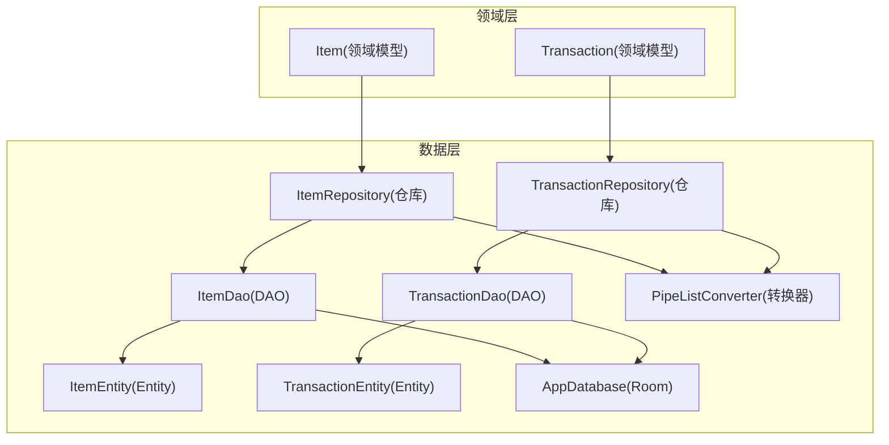
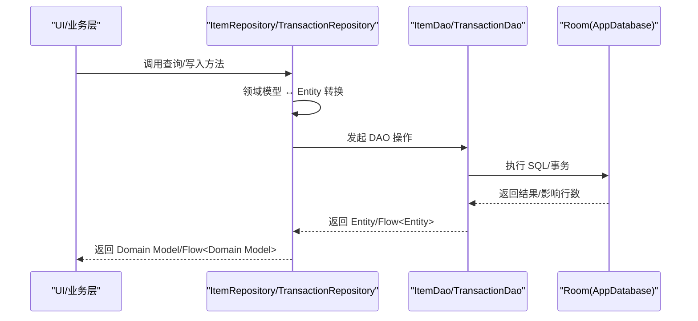
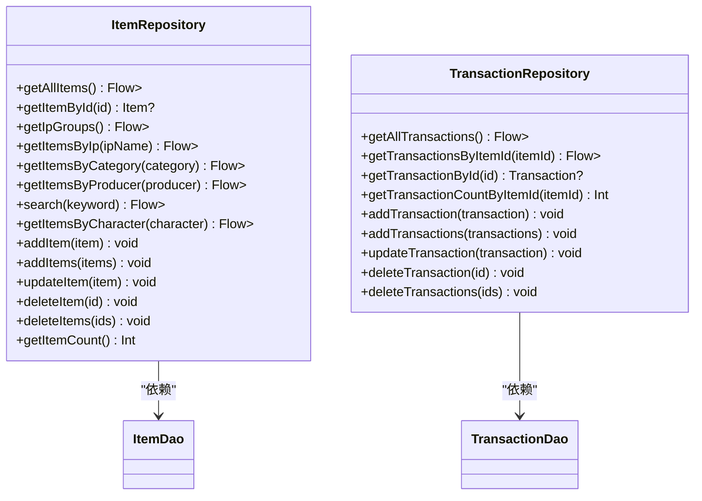
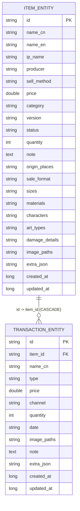
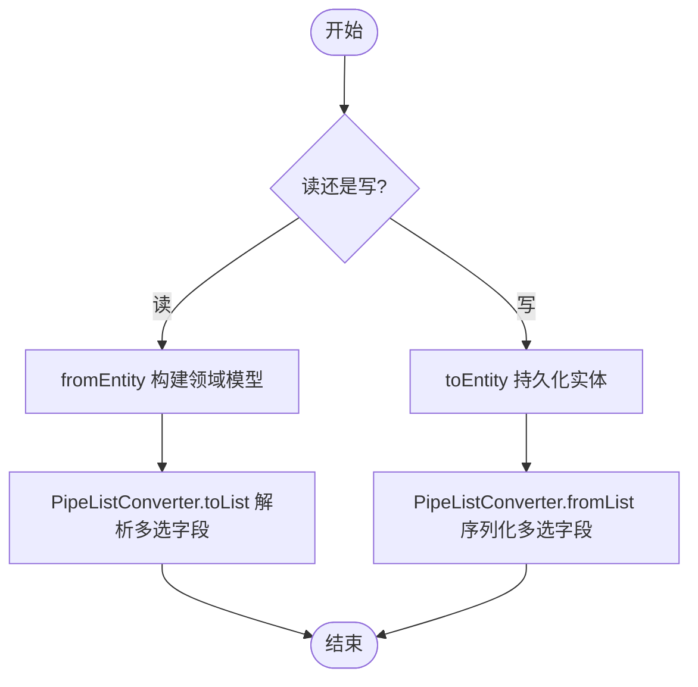
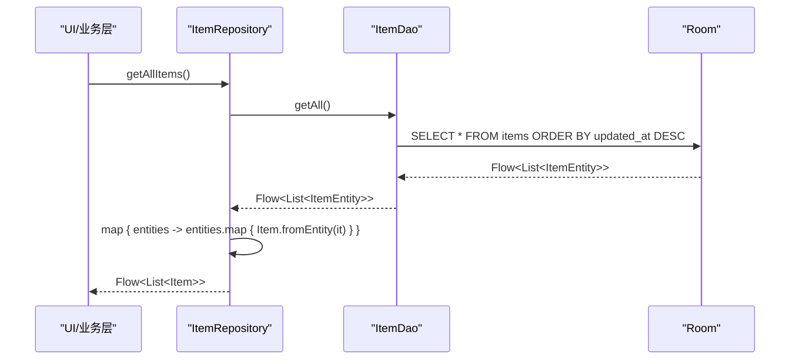
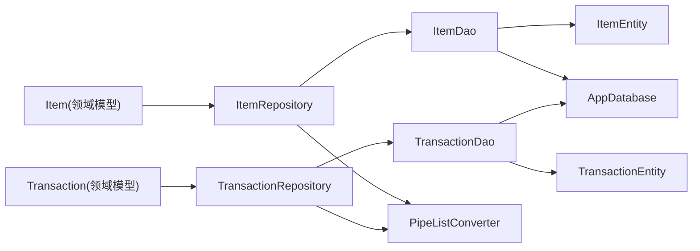

# 数据层架构

<cite>
**本文引用的文件**   
- [AppDatabase.kt](file://GuZiStorage/app/src/main/java/com/guzi/storage/data/local/AppDatabase.kt)
- [ItemDao.kt](file://GuZiStorage/app/src/main/java/com/guzi/storage/data/local/dao/ItemDao.kt)
- [TransactionDao.kt](file://GuZiStorage/app/src/main/java/com/guzi/storage/data/local/dao/TransactionDao.kt)
- [ItemEntity.kt](file://GuZiStorage/app/src/main/java/com/guzi/storage/data/local/entity/ItemEntity.kt)
- [TransactionEntity.kt](file://GuZiStorage/app/src/main/java/com/guzi/storage/data/local/entity/TransactionEntity.kt)
- [PipeListConverter.kt](file://GuZiStorage/app/src/main/java/com/guzi/storage/data/local/PipeListConverter.kt)
- [ItemRepository.kt](file://GuZiStorage/app/src/main/java/com/guzi/storage/data/repository/ItemRepository.kt)
- [TransactionRepository.kt](file://GuZiStorage/app/src/main/java/com/guzi/storage/data/repository/TransactionRepository.kt)
- [Item.kt](file://GuZiStorage/app/src/main/java/com/guzi/storage/domain/model/Item.kt)
- [Transaction.kt](file://GuZiStorage/app/src/main/java/com/guzi/storage/domain/model/Transaction.kt)
</cite>

## 目录
1. [简介](#简介)
2. [项目结构](#项目结构)
3. [核心组件](#核心组件)
4. [架构总览](#架构总览)
5. [详细组件分析](#详细组件分析)
6. [依赖关系分析](#依赖关系分析)
7. [性能与缓存策略](#性能与缓存策略)
8. [故障排查指南](#故障排查指南)
9. [结论](#结论)
10. [附录](#附录)

## 简介
本文件面向谷子收纳应用的数据层，系统性阐述 Repository 模式、DAO 接口设计、Room 数据库配置与实体映射、领域模型与持久化实体的双向转换、异步与响应式数据处理、错误处理机制以及数据缓存与性能优化策略。目标是帮助开发者快速理解并高效扩展数据访问能力，确保数据一致性与可维护性。

## 项目结构
数据层按“领域模型 → 仓库（Repository）→ 数据访问对象（DAO）→ Room 实体（Entity）”分层组织：
- 领域模型：业务语义清晰的数据结构，位于 domain.model 包
- 仓库：封装 CRUD 与复杂查询，负责领域模型与 Entity 的转换，暴露 Flow 或协程 API
- DAO：基于 Room 的抽象接口，定义 SQL 查询与写入操作
- Entity：Room 表映射，定义列、索引、外键等持久化细节
- AppDatabase：Room 数据库入口，注册实体与 DAO

图表来源
- [AppDatabase.kt:1-34](file://GuZiStorage/app/src/main/java/com/guzi/storage/data/local/AppDatabase.kt#L1-L34)
- [ItemDao.kt:1-90](file://GuZiStorage/app/src/main/java/com/guzi/storage/data/local/dao/ItemDao.kt#L1-L90)
- [TransactionDao.kt:1-49](file://GuZiStorage/app/src/main/java/com/guzi/storage/data/local/dao/TransactionDao.kt#L1-L49)
- [ItemEntity.kt:1-89](file://GuZiStorage/app/src/main/java/com/guzi/storage/data/local/entity/ItemEntity.kt#L1-L89)
- [TransactionEntity.kt:1-65](file://GuZiStorage/app/src/main/java/com/guzi/storage/data/local/entity/TransactionEntity.kt#L1-L65)
- [PipeListConverter.kt:1-26](file://GuZiStorage/app/src/main/java/com/guzi/storage/data/local/PipeListConverter.kt#L1-L26)
- [ItemRepository.kt:1-80](file://GuZiStorage/app/src/main/java/com/guzi/storage/data/repository/ItemRepository.kt#L1-L80)
- [TransactionRepository.kt:1-63](file://GuZiStorage/app/src/main/java/com/guzi/storage/data/repository/TransactionRepository.kt#L1-L63)
- [Item.kt:1-106](file://GuZiStorage/app/src/main/java/com/guzi/storage/domain/model/Item.kt#L1-L106)
- [Transaction.kt:1-68](file://GuZiStorage/app/src/main/java/com/guzi/storage/domain/model/Transaction.kt#L1-L68)

章节来源
- [AppDatabase.kt:1-34](file://GuZiStorage/app/src/main/java/com/guzi/storage/data/local/AppDatabase.kt#L1-L34)
- [ItemDao.kt:1-90](file://GuZiStorage/app/src/main/java/com/guzi/storage/data/local/dao/ItemDao.kt#L1-L90)
- [TransactionDao.kt:1-49](file://GuZiStorage/app/src/main/java/com/guzi/storage/data/local/dao/TransactionDao.kt#L1-L49)
- [ItemEntity.kt:1-89](file://GuZiStorage/app/src/main/java/com/guzi/storage/data/local/entity/ItemEntity.kt#L1-L89)
- [TransactionEntity.kt:1-65](file://GuZiStorage/app/src/main/java/com/guzi/storage/data/local/entity/TransactionEntity.kt#L1-L65)
- [PipeListConverter.kt:1-26](file://GuZiStorage/app/src/main/java/com/guzi/storage/data/local/PipeListConverter.kt#L1-L26)
- [ItemRepository.kt:1-80](file://GuZiStorage/app/src/main/java/com/guzi/storage/data/repository/ItemRepository.kt#L1-L80)
- [TransactionRepository.kt:1-63](file://GuZiStorage/app/src/main/java/com/guzi/storage/data/repository/TransactionRepository.kt#L1-L63)
- [Item.kt:1-106](file://GuZiStorage/app/src/main/java/com/guzi/storage/domain/model/Item.kt#L1-L106)
- [Transaction.kt:1-68](file://GuZiStorage/app/src/main/java/com/guzi/storage/domain/model/Transaction.kt#L1-L68)

## 核心组件
- 领域模型
  - Item：描述物品属性、展示名计算逻辑，并提供 toEntity/fromEntity 转换
  - Transaction：描述交易记录，包含类型枚举及转换逻辑
- 仓库
  - ItemRepository：封装物品的读写、分组统计、筛选与搜索；统一时间戳填充；对外暴露 Flow<List<Item>> 与 suspend 函数
  - TransactionRepository：封装交易的读写与计数；统一时间戳填充；对外暴露 Flow<List<Transaction>> 与 suspend 函数
- DAO
  - ItemDao：提供 items 表的查询、插入、更新、删除与聚合统计；返回 Flow 以支持响应式更新
  - TransactionDao：提供 transactions 表的查询、插入、更新、删除与计数；返回 Flow 以支持响应式更新
- 实体与转换
  - ItemEntity / TransactionEntity：Room 表映射，定义主键、索引、外键、列名
  - PipeListConverter：将 List<String> 与管道符分隔字符串互转，用于多选字段存储

章节来源
- [Item.kt:1-106](file://GuZiStorage/app/src/main/java/com/guzi/storage/domain/model/Item.kt#L1-L106)
- [Transaction.kt:1-68](file://GuZiStorage/app/src/main/java/com/guzi/storage/domain/model/Transaction.kt#L1-L68)
- [ItemRepository.kt:1-80](file://GuZiStorage/app/src/main/java/com/guzi/storage/data/repository/ItemRepository.kt#L1-L80)
- [TransactionRepository.kt:1-63](file://GuZiStorage/app/src/main/java/com/guzi/storage/data/repository/TransactionRepository.kt#L1-L63)
- [ItemDao.kt:1-90](file://GuZiStorage/app/src/main/java/com/guzi/storage/data/local/dao/ItemDao.kt#L1-L90)
- [TransactionDao.kt:1-49](file://GuZiStorage/app/src/main/java/com/guzi/storage/data/local/dao/TransactionDao.kt#L1-L49)
- [ItemEntity.kt:1-89](file://GuZiStorage/app/src/main/java/com/guzi/storage/data/local/entity/ItemEntity.kt#L1-L89)
- [TransactionEntity.kt:1-65](file://GuZiStorage/app/src/main/java/com/guzi/storage/data/local/entity/TransactionEntity.kt#L1-L65)
- [PipeListConverter.kt:1-26](file://GuZiStorage/app/src/main/java/com/guzi/storage/data/local/PipeListConverter.kt#L1-L26)

## 架构总览
数据流从 UI/业务层进入 Repository，Repository 调用 DAO 完成对 Room 的读写，并通过 Flow 将变化推送给上层。领域模型与 Entity 在 Repository 与模型类中完成双向转换，保证业务层不感知持久化细节。

图表来源
- [ItemRepository.kt:1-80](file://GuZiStorage/app/src/main/java/com/guzi/storage/data/repository/ItemRepository.kt#L1-L80)
- [TransactionRepository.kt:1-63](file://GuZiStorage/app/src/main/java/com/guzi/storage/data/repository/TransactionRepository.kt#L1-L63)
- [ItemDao.kt:1-90](file://GuZiStorage/app/src/main/java/com/guzi/storage/data/local/dao/ItemDao.kt#L1-L90)
- [TransactionDao.kt:1-49](file://GuZiStorage/app/src/main/java/com/guzi/storage/data/local/dao/TransactionDao.kt#L1-L49)
- [AppDatabase.kt:1-34](file://GuZiStorage/app/src/main/java/com/guzi/storage/data/local/AppDatabase.kt#L1-L34)

## 详细组件分析

### Repository 模式与职责分离
- ItemRepository
  - 职责：物品数据的增删改查、分组统计、多条件筛选与关键词搜索；统一填充 createdAt/updatedAt；对外暴露 Flow<List<Item>> 与 suspend 函数
  - 关键流程：读取时通过 map 将 Entity 列表转换为 Domain Model；写入前将 Domain Model 转为 Entity 并注入时间戳
- TransactionRepository
  - 职责：交易记录的增删改查与按物品维度计数；统一时间戳填充；对外暴露 Flow<List<Transaction>> 与 suspend 函数
  - 关键流程：与 ItemRepository 类似，但针对交易域模型进行转换

图表来源
- [ItemRepository.kt:1-80](file://GuZiStorage/app/src/main/java/com/guzi/storage/data/repository/ItemRepository.kt#L1-L80)
- [TransactionRepository.kt:1-63](file://GuZiStorage/app/src/main/java/com/guzi/storage/data/repository/TransactionRepository.kt#L1-L63)
- [ItemDao.kt:1-90](file://GuZiStorage/app/src/main/java/com/guzi/storage/data/local/dao/ItemDao.kt#L1-L90)
- [TransactionDao.kt:1-49](file://GuZiStorage/app/src/main/java/com/guzi/storage/data/local/dao/TransactionDao.kt#L1-L49)

章节来源
- [ItemRepository.kt:1-80](file://GuZiStorage/app/src/main/java/com/guzi/storage/data/repository/ItemRepository.kt#L1-L80)
- [TransactionRepository.kt:1-63](file://GuZiStorage/app/src/main/java/com/guzi/storage/data/repository/TransactionRepository.kt#L1-L63)

### DAO 接口设计原则
- 单一职责：每个 DAO 对应一个实体表，仅暴露该表的访问方法
- 明确返回值类型
  - 读操作优先使用 Flow<List<T>> 实现响应式更新；单条查询使用 suspend 函数
  - 写操作使用 suspend 函数，避免阻塞主线程
- 查询参数与排序
  - 常用筛选字段（如 ip_name、category、status、item_id）建立索引以提升查询性能
  - 默认排序采用更新时间倒序，便于最新数据优先展示
- 复杂查询
  - 分组统计：IP 分组数量统计
  - 模糊匹配：关键词搜索（中文名/IP名/英文名）、角色筛选（characters 列模糊匹配）
  - 精确筛选：按分类、生产者、IP 名称筛选
- 批量操作
  - insertAll、deleteByIds 提升批量写入与删除效率

章节来源
- [ItemDao.kt:1-90](file://GuZiStorage/app/src/main/java/com/guzi/storage/data/local/dao/ItemDao.kt#L1-L90)
- [TransactionDao.kt:1-49](file://GuZiStorage/app/src/main/java/com/guzi/storage/data/local/dao/TransactionDao.kt#L1-L49)

### Room 数据库配置与实体关系
- AppDatabase
  - 声明 entities 列表，注册所有实体
  - 设置 version 与 exportSchema，便于后续迁移与 Schema 导出
  - 提供 itemDao()/transactionDao()/presetOptionDao() 获取 DAO 实例
- 实体与索引
  - ItemEntity：为 ip_name、status、category 建立索引，加速常见筛选
  - TransactionEntity：通过外键关联 ItemEntity.id，onDelete=CASCADE，并在 item_id 上建索引
- 列映射
  - 使用 @ColumnInfo(name=...) 指定列名，保持可读性与兼容性

图表来源
- [AppDatabase.kt:1-34](file://GuZiStorage/app/src/main/java/com/guzi/storage/data/local/AppDatabase.kt#L1-L34)
- [ItemEntity.kt:1-89](file://GuZiStorage/app/src/main/java/com/guzi/storage/data/local/entity/ItemEntity.kt#L1-L89)
- [TransactionEntity.kt:1-65](file://GuZiStorage/app/src/main/java/com/guzi/storage/data/local/entity/TransactionEntity.kt#L1-L65)

章节来源
- [AppDatabase.kt:1-34](file://GuZiStorage/app/src/main/java/com/guzi/storage/data/local/AppDatabase.kt#L1-L34)
- [ItemEntity.kt:1-89](file://GuZiStorage/app/src/main/java/com/guzi/storage/data/local/entity/ItemEntity.kt#L1-L89)
- [TransactionEntity.kt:1-65](file://GuZiStorage/app/src/main/java/com/guzi/storage/data/local/entity/TransactionEntity.kt#L1-L65)

### 数据转换逻辑（Domain Model ↔ Entity）
- 转换位置
  - 领域模型内部提供 toEntity()/fromEntity() 静态方法，集中处理字段映射
  - 仓库层在调用 DAO 前后进行转换，确保业务层只接触领域模型
- 多选字段处理
  - 使用 PipeListConverter 将 List<String> 与管道符分隔字符串互转，简化存储与检索
- 时间戳管理
  - 新增/更新时由仓库统一注入 createdAt/updatedAt，保证一致性

图表来源
- [Item.kt:1-106](file://GuZiStorage/app/src/main/java/com/guzi/storage/domain/model/Item.kt#L1-L106)
- [Transaction.kt:1-68](file://GuZiStorage/app/src/main/java/com/guzi/storage/domain/model/Transaction.kt#L1-L68)
- [PipeListConverter.kt:1-26](file://GuZiStorage/app/src/main/java/com/guzi/storage/data/local/PipeListConverter.kt#L1-L26)

章节来源
- [Item.kt:1-106](file://GuZiStorage/app/src/main/java/com/guzi/storage/domain/model/Item.kt#L1-L106)
- [Transaction.kt:1-68](file://GuZiStorage/app/src/main/java/com/guzi/storage/domain/model/Transaction.kt#L1-L68)
- [PipeListConverter.kt:1-26](file://GuZiStorage/app/src/main/java/com/guzi/storage/data/local/PipeListConverter.kt#L1-L26)

### 异步操作与响应式数据流
- 响应式查询
  - DAO 返回 Flow<List<T>>，当底层数据变更时自动推送新结果
  - Repository 通过 map 将 Flow<List<Entity>> 转换为 Flow<List<Domain Model>>
- 协程写入
  - 写入方法使用 suspend 函数，避免阻塞主线程
- 典型调用序列（以物品为例）

图表来源
- [ItemRepository.kt:1-80](file://GuZiStorage/app/src/main/java/com/guzi/storage/data/repository/ItemRepository.kt#L1-L80)
- [ItemDao.kt:1-90](file://GuZiStorage/app/src/main/java/com/guzi/storage/data/local/dao/ItemDao.kt#L1-L90)

章节来源
- [ItemRepository.kt:1-80](file://GuZiStorage/app/src/main/java/com/guzi/storage/data/repository/ItemRepository.kt#L1-L80)
- [ItemDao.kt:1-90](file://GuZiStorage/app/src/main/java/com/guzi/storage/data/local/dao/ItemDao.kt#L1-L90)

### 错误处理机制
- 当前实现未显式抛出异常，建议在以下位置增强健壮性：
  - DAO 层：对空结果、非法输入进行校验，必要时抛出明确的异常类型
  - Repository 层：捕获 DAO 异常并转换为业务异常，向上层提供统一的错误信息
  - 上层消费 Flow 时，使用 catch 处理错误事件，避免崩溃
- 建议的错误类型
  - 数据不存在：NotFound
  - 数据冲突：Conflict（例如唯一约束冲突）
  - 系统错误：DatabaseError（IO、锁等待等）

[本节为通用指导，不直接分析具体文件]

## 依赖关系分析
- 组件耦合
  - Repository 仅依赖 DAO 接口，符合依赖倒置原则
  - DAO 依赖 Room 注解与 Entity，屏蔽 SQL 细节
  - 领域模型与 Entity 通过转换工具解耦
- 外部依赖
  - Room 提供数据库访问与 Flow 集成
  - Kotlin Coroutines 提供协程与 Flow 支持

图表来源
- [ItemRepository.kt:1-80](file://GuZiStorage/app/src/main/java/com/guzi/storage/data/repository/ItemRepository.kt#L1-L80)
- [TransactionRepository.kt:1-63](file://GuZiStorage/app/src/main/java/com/guzi/storage/data/repository/TransactionRepository.kt#L1-L63)
- [ItemDao.kt:1-90](file://GuZiStorage/app/src/main/java/com/guzi/storage/data/local/dao/ItemDao.kt#L1-L90)
- [TransactionDao.kt:1-49](file://GuZiStorage/app/src/main/java/com/guzi/storage/data/local/dao/TransactionDao.kt#L1-L49)
- [ItemEntity.kt:1-89](file://GuZiStorage/app/src/main/java/com/guzi/storage/data/local/entity/ItemEntity.kt#L1-L89)
- [TransactionEntity.kt:1-65](file://GuZiStorage/app/src/main/java/com/guzi/storage/data/local/entity/TransactionEntity.kt#L1-L65)
- [PipeListConverter.kt:1-26](file://GuZiStorage/app/src/main/java/com/guzi/storage/data/local/PipeListConverter.kt#L1-L26)
- [AppDatabase.kt:1-34](file://GuZiStorage/app/src/main/java/com/guzi/storage/data/local/AppDatabase.kt#L1-L34)

章节来源
- [ItemRepository.kt:1-80](file://GuZiStorage/app/src/main/java/com/guzi/storage/data/repository/ItemRepository.kt#L1-L80)
- [TransactionRepository.kt:1-63](file://GuZiStorage/app/src/main/java/com/guzi/storage/data/repository/TransactionRepository.kt#L1-L63)
- [ItemDao.kt:1-90](file://GuZiStorage/app/src/main/java/com/guzi/storage/data/local/dao/ItemDao.kt#L1-L90)
- [TransactionDao.kt:1-49](file://GuZiStorage/app/src/main/java/com/guzi/storage/data/local/dao/TransactionDao.kt#L1-L49)
- [ItemEntity.kt:1-89](file://GuZiStorage/app/src/main/java/com/guzi/storage/data/local/entity/ItemEntity.kt#L1-L89)
- [TransactionEntity.kt:1-65](file://GuZiStorage/app/src/main/java/com/guzi/storage/data/local/entity/TransactionEntity.kt#L1-L65)
- [PipeListConverter.kt:1-26](file://GuZiStorage/app/src/main/java/com/guzi/storage/data/local/PipeListConverter.kt#L1-L26)
- [AppDatabase.kt:1-34](file://GuZiStorage/app/src/main/java/com/guzi/storage/data/local/AppDatabase.kt#L1-L34)

## 性能与缓存策略
- 索引优化
  - 为高频筛选字段建立索引：ip_name、status、category、item_id
- 查询优化
  - 使用 Flow 减少重复查询，利用数据库变更自动推送
  - 复杂筛选尽量下推到 SQL（如 LIKE、GROUP BY），减少内存处理
- 批量操作
  - 使用 insertAll/deleteByIds 降低 I/O 次数
- 时间戳与排序
  - 统一 updatedAt 倒序，利于分页与最新优先展示
- 缓存策略建议
  - 短期热点数据可在 Repository 层引入内存缓存（如 LruCache），注意与 Flow 的一致性
  - 跨进程共享数据可使用 Room 的 invalidate 或 ContentProvider 通知
- 事务与一致性
  - 涉及多表写入时使用 Room 事务，保证原子性
  - 外键 CASCADE 已定义，删除物品时级联清理交易记录

[本节为通用指导，不直接分析具体文件]

## 故障排查指南
- 常见问题定位
  - 查询结果为空：检查 DAO 查询条件与索引是否覆盖筛选字段
  - 搜索结果不准确：确认 LIKE 拼接与字符集编码
  - 写入失败：检查 onConflict 策略与唯一约束
  - 数据不同步：确认 Flow 订阅是否在合适生命周期内取消
- 日志与断点
  - 在 Repository 转换前后添加日志，观察 Entity 与 Domain Model 差异
  - 在 DAO 层打印 SQL 语句，验证生成的查询是否符合预期
- 恢复与回滚
  - 批量写入失败时，确保事务回滚，避免部分成功导致数据不一致

[本节为通用指导，不直接分析具体文件]

## 结论
本数据层采用清晰的 Repository + DAO + Room 分层架构，结合 Flow 与协程实现响应式与异步数据访问。领域模型与 Entity 的双向转换集中在模型与仓库层，保证了业务层的简洁与一致性。通过合理的索引与批量操作，提升了查询与写入性能。未来可在错误处理、缓存与事务方面进一步增强，以满足更复杂的业务需求。

[本节为总结性内容，不直接分析具体文件]

## 附录
- 代码片段路径参考
  - 仓库协调多个 DAO 操作的示例路径：
    - [ItemRepository.kt:1-80](file://GuZiStorage/app/src/main/java/com/guzi/storage/data/repository/ItemRepository.kt#L1-L80)
    - [TransactionRepository.kt:1-63](file://GuZiStorage/app/src/main/java/com/guzi/storage/data/repository/TransactionRepository.kt#L1-L63)
  - DAO 复杂查询示例路径：
    - [ItemDao.kt:20-68](file://GuZiStorage/app/src/main/java/com/guzi/storage/data/local/dao/ItemDao.kt#L20-L68)
    - [TransactionDao.kt:19-31](file://GuZiStorage/app/src/main/java/com/guzi/storage/data/local/dao/TransactionDao.kt#L19-L31)
  - 实体与转换示例路径：
    - [ItemEntity.kt:16-88](file://GuZiStorage/app/src/main/java/com/guzi/storage/data/local/entity/ItemEntity.kt#L16-L88)
    - [TransactionEntity.kt:14-64](file://GuZiStorage/app/src/main/java/com/guzi/storage/data/local/entity/TransactionEntity.kt#L14-L64)
    - [PipeListConverter.kt:9-25](file://GuZiStorage/app/src/main/java/com/guzi/storage/data/local/PipeListConverter.kt#L9-L25)
  - 领域模型转换示例路径：
    - [Item.kt:50-104](file://GuZiStorage/app/src/main/java/com/guzi/storage/domain/model/Item.kt#L50-L104)
    - [Transaction.kt:23-53](file://GuZiStorage/app/src/main/java/com/guzi/storage/domain/model/Transaction.kt#L23-L53)

[本节为参考路径汇总，不直接分析具体文件]