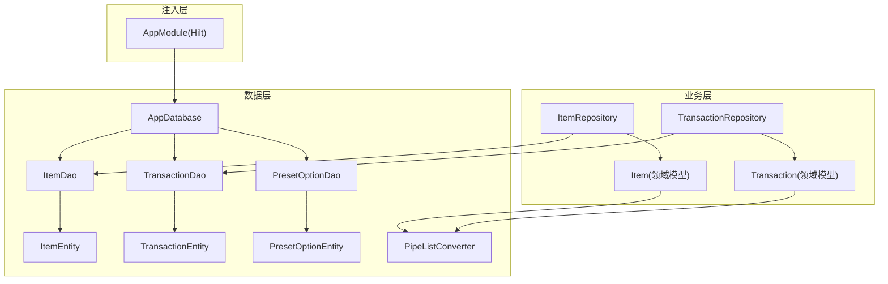
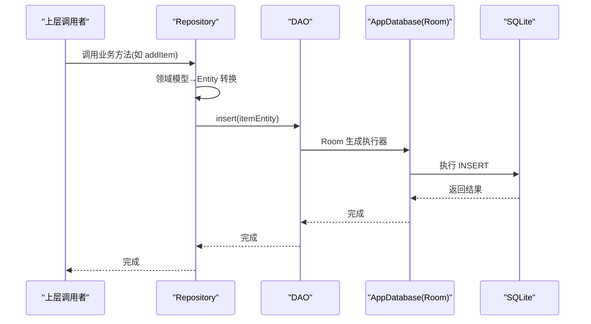
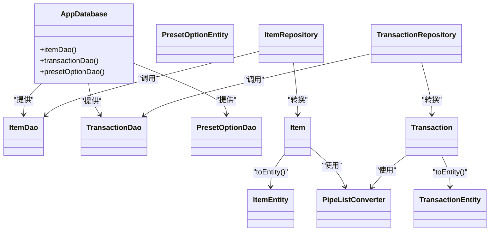
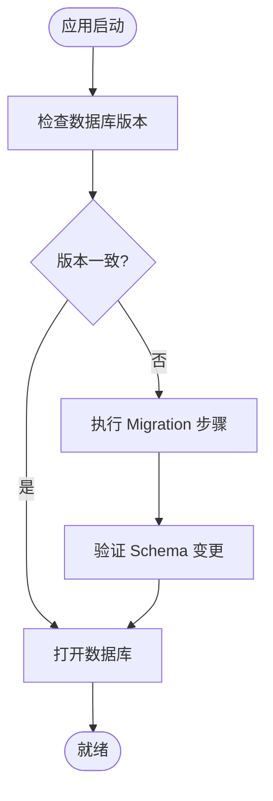

# 数据库配置与管理

<cite>
**本文引用的文件**
- [AppDatabase.kt](file://GuZiStorage/app/src/main/java/com/guzi/storage/data/local/AppDatabase.kt)
- [ItemEntity.kt](file://GuZiStorage/app/src/main/java/com/guzi/storage/data/local/entity/ItemEntity.kt)
- [TransactionEntity.kt](file://GuZiStorage/app/src/main/java/com/guzi/storage/data/local/entity/TransactionEntity.kt)
- [PresetOptionEntity.kt](file://GuZiStorage/app/src/main/java/com/guzi/storage/data/local/entity/PresetOptionEntity.kt)
- [PipeListConverter.kt](file://GuZiStorage/app/src/main/java/com/guzi/storage/data/local/PipeListConverter.kt)
- [ItemDao.kt](file://GuZiStorage/app/src/main/java/com/guzi/storage/data/local/dao/ItemDao.kt)
- [TransactionDao.kt](file://GuZiStorage/app/src/main/java/com/guzi/storage/data/local/dao/TransactionDao.kt)
- [PresetOptionDao.kt](file://GuZiStorage/app/src/main/java/com/guzi/storage/data/local/dao/PresetOptionDao.kt)
- [AppModule.kt](file://GuZiStorage/app/src/main/java/com/guzi/storage/di/AppModule.kt)
- [ItemRepository.kt](file://GuZiStorage/app/src/main/java/com/guzi/storage/data/repository/ItemRepository.kt)
- [TransactionRepository.kt](file://GuZiStorage/app/src/main/java/com/guzi/storage/data/repository/TransactionRepository.kt)
- [Item.kt](file://GuZiStorage/app/src/main/java/com/guzi/storage/domain/model/Item.kt)
- [Transaction.kt](file://GuZiStorage/app/src/main/java/com/guzi/storage/domain/model/Transaction.kt)
</cite>

## 目录
1. [简介](#简介)
2. [项目结构](#项目结构)
3. [核心组件](#核心组件)
4. [架构总览](#架构总览)
5. [详细组件分析](#详细组件分析)
6. [依赖关系分析](#依赖关系分析)
7. [性能与并发](#性能与并发)
8. [故障排查指南](#故障排查指南)
9. [结论](#结论)
10. [附录：迁移策略与示例](#附录：迁移策略与示例)

## 简介
本文件面向“谷子收纳应用”的本地数据层，系统性说明基于 Room 的数据库配置、实体设计、DAO 访问、依赖注入与仓库封装，并给出迁移策略、事务与并发控制建议。文档聚焦以下目标：
- AppDatabase 的配置与使用（@Database 注解、实体注册、版本管理）
- Entity 设计与约束（ItemEntity、TransactionEntity、PresetOptionEntity）
- 实体关系映射（外键、索引、类型转换器）
- 迁移策略与兼容性处理
- 连接池、事务与并发访问控制的最佳实践

## 项目结构
数据层采用分层组织：
- 数据库定义与实体：data/local 下的 AppDatabase、entity/*
- DAO 接口：data/local/dao/*
- 依赖注入：di/AppModule.kt
- 仓库封装：data/repository/*
- 领域模型：domain/model/*

图表来源
- [AppDatabase.kt:1-34](file://GuZiStorage/app/src/main/java/com/guzi/storage/data/local/AppDatabase.kt#L1-L34)
- [ItemEntity.kt:1-89](file://GuZiStorage/app/src/main/java/com/guzi/storage/data/local/entity/ItemEntity.kt#L1-L89)
- [TransactionEntity.kt:1-65](file://GuZiStorage/app/src/main/java/com/guzi/storage/data/local/entity/TransactionEntity.kt#L1-L65)
- [PresetOptionEntity.kt:1-37](file://GuZiStorage/app/src/main/java/com/guzi/storage/data/local/entity/PresetOptionEntity.kt#L1-L37)
- [PipeListConverter.kt:1-26](file://GuZiStorage/app/src/main/java/com/guzi/storage/data/local/PipeListConverter.kt#L1-L26)
- [ItemDao.kt:1-90](file://GuZiStorage/app/src/main/java/com/guzi/storage/data/local/dao/ItemDao.kt#L1-L90)
- [TransactionDao.kt:1-49](file://GuZiStorage/app/src/main/java/com/guzi/storage/data/local/dao/TransactionDao.kt#L1-L49)
- [PresetOptionDao.kt:1-42](file://GuZiStorage/app/src/main/java/com/guzi/storage/data/local/dao/PresetOptionDao.kt#L1-L42)
- [AppModule.kt:1-50](file://GuZiStorage/app/src/main/java/com/guzi/storage/di/AppModule.kt#L1-L50)
- [ItemRepository.kt:1-80](file://GuZiStorage/app/src/main/java/com/guzi/storage/data/repository/ItemRepository.kt#L1-L80)
- [TransactionRepository.kt:1-63](file://GuZiStorage/app/src/main/java/com/guzi/storage/data/repository/TransactionRepository.kt#L1-L63)
- [Item.kt:1-106](file://GuZiStorage/app/src/main/java/com/guzi/storage/domain/model/Item.kt#L1-L106)
- [Transaction.kt:1-68](file://GuZiStorage/app/src/main/java/com/guzi/storage/domain/model/Transaction.kt#L1-L68)

章节来源
- [AppDatabase.kt:1-34](file://GuZiStorage/app/src/main/java/com/guzi/storage/data/local/AppDatabase.kt#L1-L34)
- [AppModule.kt:1-50](file://GuZiStorage/app/src/main/java/com/guzi/storage/di/AppModule.kt#L1-L50)

## 核心组件
- AppDatabase：Room 数据库入口，声明实体集合、版本号与导出 Schema；提供 DAO 获取方法。
- Entity：ItemEntity、TransactionEntity、PresetOptionEntity 分别对应物品、交易记录、预设选项。
- DAO：ItemDao、TransactionDao、PresetOptionDao 暴露 SQL 查询与写入操作，返回 Flow 或 suspend 函数。
- Repository：ItemRepository、TransactionRepository 负责领域模型与 Entity 的转换，统一对外 API。
- 类型转换器：PipeListConverter 用于 List<String> 与管道符分隔字符串之间的互转。
- 依赖注入：AppModule 通过 Hilt 提供单例数据库与 DAO。

章节来源
- [AppDatabase.kt:12-33](file://GuZiStorage/app/src/main/java/com/guzi/storage/data/local/AppDatabase.kt#L12-L33)
- [ItemEntity.kt:16-88](file://GuZiStorage/app/src/main/java/com/guzi/storage/data/local/entity/ItemEntity.kt#L16-L88)
- [TransactionEntity.kt:14-64](file://GuZiStorage/app/src/main/java/com/guzi/storage/data/local/entity/TransactionEntity.kt#L14-L64)
- [PresetOptionEntity.kt:15-36](file://GuZiStorage/app/src/main/java/com/guzi/storage/data/local/entity/PresetOptionEntity.kt#L15-L36)
- [ItemDao.kt:15-89](file://GuZiStorage/app/src/main/java/com/guzi/storage/data/local/dao/ItemDao.kt#L15-L89)
- [TransactionDao.kt:15-48](file://GuZiStorage/app/src/main/java/com/guzi/storage/data/local/dao/TransactionDao.kt#L15-L48)
- [PresetOptionDao.kt:14-41](file://GuZiStorage/app/src/main/java/com/guzi/storage/data/local/dao/PresetOptionDao.kt#L14-L41)
- [ItemRepository.kt:16-79](file://GuZiStorage/app/src/main/java/com/guzi/storage/data/repository/ItemRepository.kt#L16-L79)
- [TransactionRepository.kt:13-62](file://GuZiStorage/app/src/main/java/com/guzi/storage/data/repository/TransactionRepository.kt#L13-L62)
- [PipeListConverter.kt:9-25](file://GuZiStorage/app/src/main/java/com/guzi/storage/data/local/PipeListConverter.kt#L9-L25)
- [AppModule.kt:23-33](file://GuZiStorage/app/src/main/java/com/guzi/storage/di/AppModule.kt#L23-L33)

## 架构总览
从调用方到数据库的完整链路如下：UI/上层 → Repository → DAO → Room → SQLite。依赖注入在应用启动时创建单例数据库实例，DAO 由数据库提供。

图表来源
- [ItemRepository.kt:49-54](file://GuZiStorage/app/src/main/java/com/guzi/storage/data/repository/ItemRepository.kt#L49-L54)
- [ItemDao.kt:72-73](file://GuZiStorage/app/src/main/java/com/guzi/storage/data/local/dao/ItemDao.kt#L72-L73)
- [AppDatabase.kt:29-32](file://GuZiStorage/app/src/main/java/com/guzi/storage/data/local/AppDatabase.kt#L29-L32)

## 详细组件分析

### AppDatabase 配置与使用
- @Database 注解设置
  - entities：注册 ItemEntity、TransactionEntity、PresetOptionEntity
  - version：当前为 1
  - exportSchema：true，便于后续迁移校验
- 抽象方法：itemDao()、transactionDao()、presetOptionDao()
- 构建与注入
  - 通过 Room.databaseBuilder 创建单例数据库
  - 文件名 guzi_storage.db
  - 当前迁移策略：fallbackToDestructiveMigration()（破坏性迁移）

章节来源
- [AppDatabase.kt:20-32](file://GuZiStorage/app/src/main/java/com/guzi/storage/data/local/AppDatabase.kt#L20-L32)
- [AppModule.kt:25-33](file://GuZiStorage/app/src/main/java/com/guzi/storage/di/AppModule.kt#L25-L33)

### 实体类设计与约束

#### ItemEntity（物品表）
- 表名：items
- 主键：id（String）
- 基础字段：nameCn、nameEn、ipName、producer、sellMethod、price、category、version、status、quantity、note
- 多选字段（以管道符分隔存储）：originPlaces、saleFormat、sizes、materials、characters、artTypes、damageDetails、imagePaths
- 扩展字段：extraJson（预留 JSON 扩展）
- 时间戳：createdAt、updatedAt
- 索引优化：对 ip_name、status、category 建立索引，提升筛选与分组查询性能

章节来源
- [ItemEntity.kt:16-88](file://GuZiStorage/app/src/main/java/com/guzi/storage/data/local/entity/ItemEntity.kt#L16-L88)

#### TransactionEntity（交易记录表）
- 表名：transactions
- 主键：id（String）
- 关联字段：itemId（外键指向 items.id），onDelete=CASCADE
- 字段：nameCn、type、price、channel、quantity、date、imagePaths、note、extraJson、createdAt、updatedAt
- 索引优化：对 item_id 建立索引，加速按物品查询交易记录

章节来源
- [TransactionEntity.kt:14-64](file://GuZiStorage/app/src/main/java/com/guzi/storage/data/local/entity/TransactionEntity.kt#L14-L64)

#### PresetOptionEntity（预设选项表）
- 表名：preset_options
- 主键：id（自增 Long）
- 字段：attributeName、optionValue、sortOrder
- 唯一约束：对 attributeName + optionValue 建立联合唯一索引，防止同一属性下重复选项值
- 排序：按 sortOrder 与 optionValue 排序展示

章节来源
- [PresetOptionEntity.kt:15-36](file://GuZiStorage/app/src/main/java/com/guzi/storage/data/local/entity/PresetOptionEntity.kt#L15-L36)

### 实体关系映射与类型转换

#### 外键与级联删除
- TransactionEntity 通过 ForeignKey 关联 ItemEntity，删除物品时级联删除其交易记录，保证引用完整性。

章节来源
- [TransactionEntity.kt:16-23](file://GuZiStorage/app/src/main/java/com/guzi/storage/data/local/entity/TransactionEntity.kt#L16-L23)

#### 索引优化
- ItemEntity：对 ip_name、status、category 建索引，支持按 IP、状态、分类的高效筛选与分组统计。
- TransactionEntity：对 item_id 建索引，支持按物品快速检索交易历史。
- PresetOptionEntity：对 attributeName+optionValue 建唯一索引，保障数据一致性。

章节来源
- [ItemEntity.kt:18-22](file://GuZiStorage/app/src/main/java/com/guzi/storage/data/local/entity/ItemEntity.kt#L18-L22)
- [TransactionEntity.kt:24-26](file://GuZiStorage/app/src/main/java/com/guzi/storage/data/local/entity/TransactionEntity.kt#L24-L26)
- [PresetOptionEntity.kt:17-22](file://GuZiStorage/app/src/main/java/com/guzi/storage/data/local/entity/PresetOptionEntity.kt#L17-L22)

#### 自定义类型转换器（管道符分隔列表）
- PipeListConverter：实现 List<String> 与 "|" 分隔字符串的双向转换
- 使用场景：ItemEntity 的多选字段、Transaction.imagePaths 等
- 注意：当前未通过 @TypeConverter 注册到 Room，建议在 AppDatabase 中声明并使用，或在领域模型层进行显式转换

章节来源
- [PipeListConverter.kt:9-25](file://GuZiStorage/app/src/main/java/com/guzi/storage/data/local/PipeListConverter.kt#L9-L25)
- [Item.kt:50-74](file://GuZiStorage/app/src/main/java/com/guzi/storage/domain/model/Item.kt#L50-L74)
- [Transaction.kt:23-36](file://GuZiStorage/app/src/main/java/com/guzi/storage/domain/model/Transaction.kt#L23-L36)

### DAO 与查询模式
- ItemDao：提供全量、分组、筛选、模糊搜索、角色筛选、计数等操作，多数返回 Flow<List<T>> 以支持响应式更新。
- TransactionDao：提供全量、按物品 ID 查询、计数、CRUD 操作。
- PresetOptionDao：提供按属性查询、去重属性名列表、插入忽略冲突、删除指定属性与值。

章节来源
- [ItemDao.kt:19-89](file://GuZiStorage/app/src/main/java/com/guzi/storage/data/local/dao/ItemDao.kt#L19-L89)
- [TransactionDao.kt:19-48](file://GuZiStorage/app/src/main/java/com/guzi/storage/data/local/dao/TransactionDao.kt#L19-L48)
- [PresetOptionDao.kt:18-41](file://GuZiStorage/app/src/main/java/com/guzi/storage/data/local/dao/PresetOptionDao.kt#L18-L41)

### Repository 与领域模型转换
- ItemRepository：封装 Item 的 CRUD，统一将领域模型与 Entity 相互转换，并在新增/更新时维护 createdAt/updatedAt。
- TransactionRepository：封装 Transaction 的 CRUD，同样负责模型转换与时间戳维护。
- 领域模型：Item 与 Transaction 使用 List<String> 表示多选字段，并通过 PipeListConverter 与 Entity 的字符串格式互转。

章节来源
- [ItemRepository.kt:23-79](file://GuZiStorage/app/src/main/java/com/guzi/storage/data/repository/ItemRepository.kt#L23-L79)
- [TransactionRepository.kt:20-62](file://GuZiStorage/app/src/main/java/com/guzi/storage/data/repository/TransactionRepository.kt#L20-L62)
- [Item.kt:50-103](file://GuZiStorage/app/src/main/java/com/guzi/storage/domain/model/Item.kt#L50-L103)
- [Transaction.kt:23-53](file://GuZiStorage/app/src/main/java/com/guzi/storage/domain/model/Transaction.kt#L23-L53)

### 依赖注入与数据库生命周期
- AppModule 提供单例 AppDatabase，文件名 guzi_storage.db
- 当前迁移策略为 fallbackToDestructiveMigration()，升级时将重建数据库（数据丢失）
- DAO 由数据库实例直接提供，避免额外耦合

章节来源
- [AppModule.kt:25-33](file://GuZiStorage/app/src/main/java/com/guzi/storage/di/AppModule.kt#L25-L33)

## 依赖关系分析
- 模块内依赖方向清晰：DI → Database → DAO → Entity；Repository 位于 DAO 之上，负责模型转换。
- 无循环依赖迹象。
- 外部依赖：Room、Hilt、Kotlin Coroutines Flow。

图表来源
- [AppDatabase.kt:29-32](file://GuZiStorage/app/src/main/java/com/guzi/storage/data/local/AppDatabase.kt#L29-L32)
- [ItemRepository.kt:16-79](file://GuZiStorage/app/src/main/java/com/guzi/storage/data/repository/ItemRepository.kt#L16-L79)
- [TransactionRepository.kt:13-62](file://GuZiStorage/app/src/main/java/com/guzi/storage/data/repository/TransactionRepository.kt#L13-L62)
- [Item.kt:50-103](file://GuZiStorage/app/src/main/java/com/guzi/storage/domain/model/Item.kt#L50-L103)
- [Transaction.kt:23-53](file://GuZiStorage/app/src/main/java/com/guzi/storage/domain/model/Transaction.kt#L23-L53)

## 性能与并发
- 索引策略
  - 高频筛选列已建索引：items.ip_name、items.status、items.category、transactions.item_id
  - 预设选项联合唯一索引避免重复且支持有序读取
- 查询模式
  - 大量查询返回 Flow，利于 UI 实时刷新
  - 模糊匹配使用 LIKE，注意大数据量时的性能影响
- 并发与事务
  - Room 内部线程安全，但复杂多表操作建议使用事务确保一致性
  - 批量写入优先使用 insertAll 减少往返开销
- 连接池
  - Room 默认使用 SQLite 连接池，无需手动配置
  - 如需调整最大连接数或 WAL 模式，可在数据库构建阶段配置（见附录）

章节来源
- [ItemDao.kt:49-56](file://GuZiStorage/app/src/main/java/com/guzi/storage/data/local/dao/ItemDao.kt#L49-L56)
- [TransactionDao.kt:23-24](file://GuZiStorage/app/src/main/java/com/guzi/storage/data/local/dao/TransactionDao.kt#L23-L24)
- [PresetOptionDao.kt:19-26](file://GuZiStorage/app/src/main/java/com/guzi/storage/data/local/dao/PresetOptionDao.kt#L19-L26)

## 故障排查指南
- 迁移失败或数据丢失
  - 当前使用破坏性迁移，升级会清空数据。若需保留数据，应实现具体 Migration 并替换 fallbackToDestructiveMigration()
- 外键约束异常
  - 检查 TransactionEntity 的 item_id 是否指向存在的 ItemEntity.id
- 唯一约束冲突
  - PresetOptionEntity 的 attribute_name + option_value 唯一，插入前需去重或捕获冲突
- 模糊查询性能问题
  - 对大表使用 LIKE 可能导致全表扫描，考虑引入全文索引或分词方案
- 类型转换不一致
  - 若未在 Room 注册 @TypeConverter，需在 AppDatabase 中声明或使用领域模型显式转换

章节来源
- [AppModule.kt:31](file://GuZiStorage/app/src/main/java/com/guzi/storage/di/AppModule.kt#L31)
- [TransactionEntity.kt:16-23](file://GuZiStorage/app/src/main/java/com/guzi/storage/data/local/entity/TransactionEntity.kt#L16-L23)
- [PresetOptionEntity.kt:17-22](file://GuZiStorage/app/src/main/java/com/guzi/storage/data/local/entity/PresetOptionEntity.kt#L17-L22)
- [ItemDao.kt:49-56](file://GuZiStorage/app/src/main/java/com/guzi/storage/data/local/dao/ItemDao.kt#L49-L56)

## 结论
本项目数据层结构清晰，遵循 Room 最佳实践：明确的实体定义、合理的索引与外键约束、DAO 暴露响应式查询、Repository 负责模型转换与边界逻辑。当前迁移策略为破坏性迁移，适合开发期；生产环境应完善迁移脚本与 Schema 导出校验。建议在 AppDatabase 中注册类型转换器，进一步提升数据持久化的一致性与可维护性。

## 附录：迁移策略与示例

### 迁移策略概览
- 当前策略：fallbackToDestructiveMigration()，适用于开发期或允许数据重置的场景
- 推荐策略：实现具体的 Migration，逐步演进 Schema，结合 exportSchema=true 进行编译期校验

[此图为概念流程，不直接映射具体源码]

### 迁移示例（代码片段路径）
- 添加新表或列：参考迁移步骤实现，确保向后兼容
- 修改列类型：先添加新列，迁移数据，再删除旧列
- 删除列：先标记废弃，再在后续版本移除

章节来源
- [AppDatabase.kt:26-27](file://GuZiStorage/app/src/main/java/com/guzi/storage/data/local/AppDatabase.kt#L26-L27)
- [AppModule.kt:31](file://GuZiStorage/app/src/main/java/com/guzi/storage/di/AppModule.kt#L31)

### 连接池与事务管理建议
- 连接池
  - Room 默认启用 SQLite 连接池，无需额外配置
  - 可按需开启 WAL 模式以提升并发读性能（在数据库构建阶段配置）
- 事务管理
  - 多表写操作使用 Room 的事务注解或 DAO 中的事务方法
  - 批量写入优先使用 insertAll，减少事务边界次数

章节来源
- [AppModule.kt:25-33](file://GuZiStorage/app/src/main/java/com/guzi/storage/di/AppModule.kt#L25-L33)