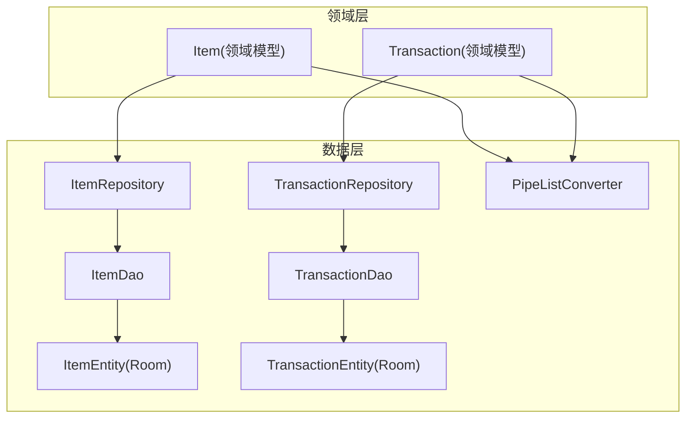
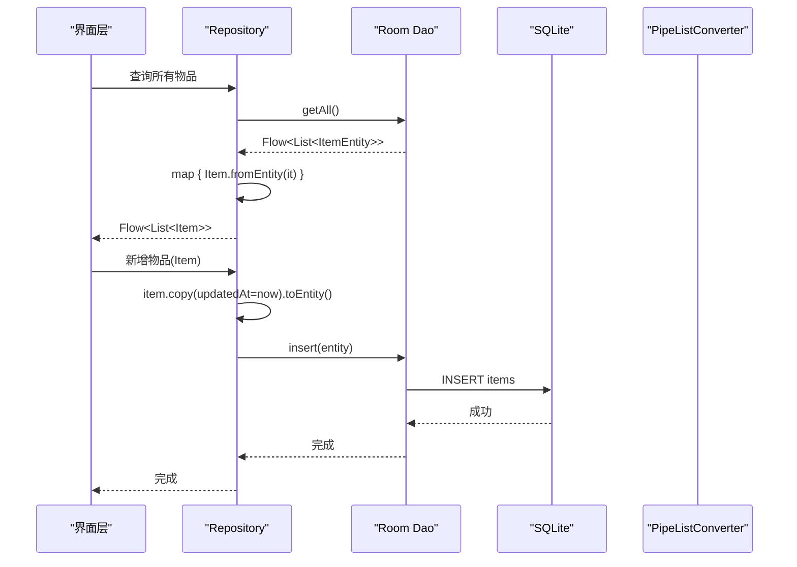
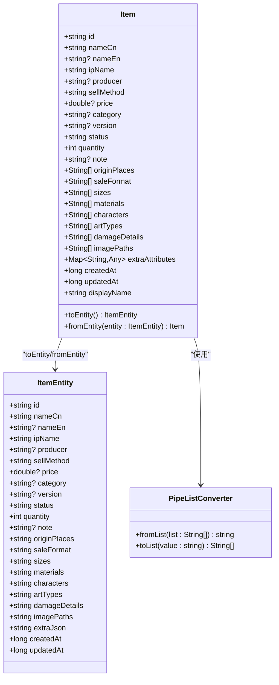
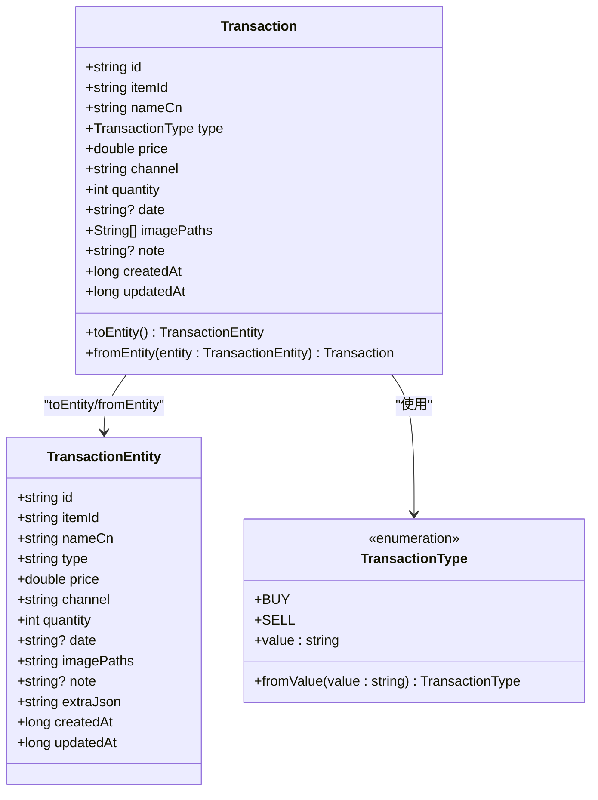
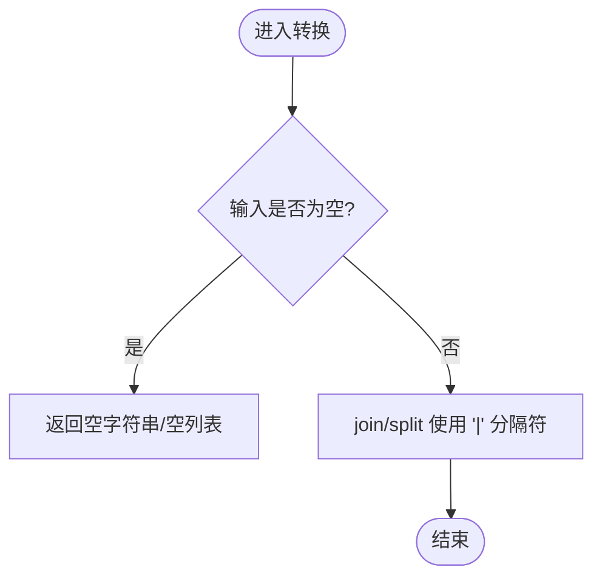
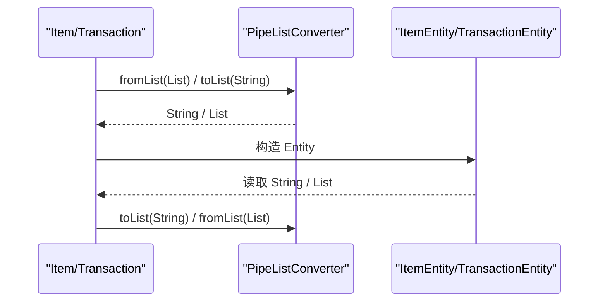
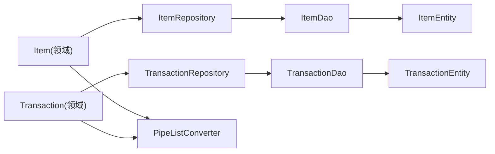

# 领域层设计

<cite>
**本文引用的文件**   
- [Item.kt](file://GuZiStorage/app/src/main/java/com/guzi/storage/domain/model/Item.kt)
- [Transaction.kt](file://GuZiStorage/app/src/main/java/com/guzi/storage/domain/model/Transaction.kt)
- [ItemEntity.kt](file://GuZiStorage/app/src/main/java/com/guzi/storage/data/local/entity/ItemEntity.kt)
- [TransactionEntity.kt](file://GuZiStorage/app/src/main/java/com/guzi/storage/data/local/entity/TransactionEntity.kt)
- [PipeListConverter.kt](file://GuZiStorage/app/src/main/java/com/guzi/storage/data/local/PipeListConverter.kt)
- [ItemDao.kt](file://GuZiStorage/app/src/main/java/com/guzi/storage/data/local/dao/ItemDao.kt)
- [TransactionDao.kt](file://GuZiStorage/app/src/main/java/com/guzi/storage/data/local/dao/TransactionDao.kt)
- [ItemRepository.kt](file://GuZiStorage/app/src/main/java/com/guzi/storage/data/repository/ItemRepository.kt)
- [TransactionRepository.kt](file://GuZiStorage/app/src/main/java/com/guzi/storage/data/repository/TransactionRepository.kt)
- [基础prd.md](file://基础prd.md)
</cite>

## 目录
1. [引言](#引言)
2. [项目结构](#项目结构)
3. [核心组件](#核心组件)
4. [架构总览](#架构总览)
5. [详细组件分析](#详细组件分析)
6. [依赖关系分析](#依赖关系分析)
7. [性能考量](#性能考量)
8. [故障排查指南](#故障排查指南)
9. [结论](#结论)
10. [附录](#附录)

## 引言
本文件聚焦谷子收纳应用的领域层设计，围绕业务模型 Item 与 Transaction 的结构、职责边界、数据验证规则、计算属性实现，以及领域模型与持久化实体之间的转换机制展开。文档同时解释多值字段（List<String>）的处理方式与 PipeListConverter 的使用，并提供扩展方法与计算属性的设计模式建议，确保业务逻辑清晰、可测试且易于演进。

## 项目结构
仓库采用分层组织：domain 层定义纯业务模型；data 层包含 Room Entity、DAO、Repository 及类型转换器；UI 层负责展示与交互。领域模型不依赖 Android 或数据库细节，仅通过 Repository 暴露的 Flow 接口消费数据。

图表来源
- [Item.kt:1-106](file://GuZiStorage/app/src/main/java/com/guzi/storage/domain/model/Item.kt#L1-L106)
- [Transaction.kt:1-68](file://GuZiStorage/app/src/main/java/com/guzi/storage/domain/model/Transaction.kt#L1-L68)
- [ItemRepository.kt:1-80](file://GuZiStorage/app/src/main/java/com/guzi/storage/data/repository/ItemRepository.kt#L1-L80)
- [TransactionRepository.kt:1-63](file://GuZiStorage/app/src/main/java/com/guzi/storage/data/repository/TransactionRepository.kt#L1-L63)
- [ItemDao.kt:1-90](file://GuZiStorage/app/src/main/java/com/guzi/storage/data/local/dao/ItemDao.kt#L1-L90)
- [TransactionDao.kt:1-49](file://GuZiStorage/app/src/main/java/com/guzi/storage/data/local/dao/TransactionDao.kt#L1-L49)
- [ItemEntity.kt:1-89](file://GuZiStorage/app/src/main/java/com/guzi/storage/data/local/entity/ItemEntity.kt#L1-L89)
- [TransactionEntity.kt:1-65](file://GuZiStorage/app/src/main/java/com/guzi/storage/data/local/entity/TransactionEntity.kt#L1-L65)
- [PipeListConverter.kt:1-26](file://GuZiStorage/app/src/main/java/com/guzi/storage/data/local/PipeListConverter.kt#L1-L26)

章节来源
- [基础prd.md:32-92](file://基础prd.md#L32-L92)

## 核心组件
- Item 领域模型：承载物品业务语义，提供显示名称等计算属性，封装 toEntity()/fromEntity() 转换逻辑，统一使用 PipeListConverter 处理多值字段。
- Transaction 领域模型：记录购入/卖出明细，关联 Item，同样提供双向转换与枚举解析。
- PipeListConverter：将 List<String> 与管道符分隔字符串互转，屏蔽存储格式细节。
- Repository：在数据访问层与领域模型之间做映射，对外暴露 Flow<List<DomainModel>> 响应式接口。

章节来源
- [Item.kt:1-106](file://GuZiStorage/app/src/main/java/com/guzi/storage/domain/model/Item.kt#L1-L106)
- [Transaction.kt:1-68](file://GuZiStorage/app/src/main/java/com/guzi/storage/domain/model/Transaction.kt#L1-L68)
- [PipeListConverter.kt:1-26](file://GuZiStorage/app/src/main/java/com/guzi/storage/data/local/PipeListConverter.kt#L1-L26)
- [ItemRepository.kt:1-80](file://GuZiStorage/app/src/main/java/com/guzi/storage/data/repository/ItemRepository.kt#L1-L80)
- [TransactionRepository.kt:1-63](file://GuZiStorage/app/src/main/java/com/guzi/storage/data/repository/TransactionRepository.kt#L1-L63)

## 架构总览
领域层保持纯净，不包含任何 Android 或数据库依赖。数据持久化由 Room 完成，Repository 负责 Entity 与 Domain Model 的双向转换，并向上游暴露 Flow 流式数据。

图表来源
- [ItemRepository.kt:23-54](file://GuZiStorage/app/src/main/java/com/guzi/storage/data/repository/ItemRepository.kt#L23-L54)
- [ItemDao.kt:20-76](file://GuZiStorage/app/src/main/java/com/guzi/storage/data/local/dao/ItemDao.kt#L20-L76)
- [Item.kt:50-74](file://GuZiStorage/app/src/main/java/com/guzi/storage/domain/model/Item.kt#L50-L74)
- [PipeListConverter.kt:17-24](file://GuZiStorage/app/src/main/java/com/guzi/storage/data/local/PipeListConverter.kt#L17-L24)

## 详细组件分析

### Item 领域模型
- 职责边界
  - 表达物品的业务概念与不变式（如状态与显示名称的关系）。
  - 提供计算属性 displayName，根据 status 与 damageDetails 动态生成展示文本。
  - 封装与 ItemEntity 的双向转换，统一调用 PipeListConverter 处理多值字段。
- 数据验证规则
  - 必填项：id、nameCn、ipName、sellMethod。
  - 可选项：nameEn、producer、price、category、version、note、各 List 字段。
  - 默认值：status="无伤"，quantity=1，createdAt/updatedAt 由上层写入时设置。
- 计算属性
  - displayName：当 status 为“无伤”时返回 nameCn；否则拼接 nameCn 与 damageDetails 列表，以中文逗号连接并加括号。
- 多值字段处理
  - originPlaces、saleFormat、sizes、materials、characters、artTypes、damageDetails、imagePaths 均为 List<String>。
  - 通过 PipeListConverter.fromList/toList 与 Entity 的管道符分隔字符串互转。
- 与 Entity 的转换
  - toEntity()：将 List 转为管道符分隔字符串，extraJson 固定为空对象字符串，时间戳透传。
  - fromEntity(entity)：从 Entity 读取管道符分隔字符串，转为 List，忽略 extraJson。

图表来源
- [Item.kt:11-104](file://GuZiStorage/app/src/main/java/com/guzi/storage/domain/model/Item.kt#L11-L104)
- [ItemEntity.kt:24-88](file://GuZiStorage/app/src/main/java/com/guzi/storage/data/local/entity/ItemEntity.kt#L24-L88)
- [PipeListConverter.kt:9-25](file://GuZiStorage/app/src/main/java/com/guzi/storage/data/local/PipeListConverter.kt#L9-L25)

章节来源
- [Item.kt:36-45](file://GuZiStorage/app/src/main/java/com/guzi/storage/domain/model/Item.kt#L36-L45)
- [Item.kt:50-74](file://GuZiStorage/app/src/main/java/com/guzi/storage/domain/model/Item.kt#L50-L74)
- [Item.kt:80-103](file://GuZiStorage/app/src/main/java/com/guzi/storage/domain/model/Item.kt#L80-L103)
- [ItemEntity.kt:16-88](file://GuZiStorage/app/src/main/java/com/guzi/storage/data/local/entity/ItemEntity.kt#L16-L88)
- [PipeListConverter.kt:17-24](file://GuZiStorage/app/src/main/java/com/guzi/storage/data/local/PipeListConverter.kt#L17-L24)

### Transaction 领域模型
- 职责边界
  - 表达一次购入或卖出的交易事实，冗余保存 nameCn 便于历史展示。
  - 通过 type 枚举区分交易方向，支持从字符串反序列化为枚举。
- 数据验证规则
  - 必填项：id、itemId、nameCn、type、price、channel。
  - 可选项：quantity、date、imagePaths、note。
  - 默认值：quantity=1，createdAt/updatedAt 由上层写入时设置。
- 与 Entity 的转换
  - toEntity()：将 TransactionType 转为 value 字符串，imagePaths 经 PipeListConverter 转换。
  - fromEntity(entity)：从字符串恢复 TransactionType，imagePaths 经 PipeListConverter 转换。

图表来源
- [Transaction.kt:9-53](file://GuZiStorage/app/src/main/java/com/guzi/storage/domain/model/Transaction.kt#L9-L53)
- [TransactionEntity.kt:28-64](file://GuZiStorage/app/src/main/java/com/guzi/storage/data/local/entity/TransactionEntity.kt#L28-L64)
- [Transaction.kt:59-67](file://GuZiStorage/app/src/main/java/com/guzi/storage/domain/model/Transaction.kt#L59-L67)

章节来源
- [Transaction.kt:23-36](file://GuZiStorage/app/src/main/java/com/guzi/storage/domain/model/Transaction.kt#L23-L36)
- [Transaction.kt:39-52](file://GuZiStorage/app/src/main/java/com/guzi/storage/domain/model/Transaction.kt#L39-L52)
- [TransactionEntity.kt:14-64](file://GuZiStorage/app/src/main/java/com/guzi/storage/data/local/entity/TransactionEntity.kt#L14-L64)

### 多值字段与 PipeListConverter 使用
- 存储策略
  - 多选字段在数据库中统一以管道符 "|" 分隔的字符串形式存储。
- 转换规则
  - fromList：空列表 → 空字符串；非空列表 → joinToString("|")。
  - toList：空字符串 → 空列表；非空字符串 → split("|")。
- 使用位置
  - Item 与 Transaction 的多值字段（如 originPlaces、saleFormat、imagePaths 等）均通过该工具类进行转换。

图表来源
- [PipeListConverter.kt:17-24](file://GuZiStorage/app/src/main/java/com/guzi/storage/data/local/PipeListConverter.kt#L17-L24)

章节来源
- [PipeListConverter.kt:1-26](file://GuZiStorage/app/src/main/java/com/guzi/storage/data/local/PipeListConverter.kt#L1-L26)
- [Item.kt:63-70](file://GuZiStorage/app/src/main/java/com/guzi/storage/domain/model/Item.kt#L63-L70)
- [Transaction.kt:32](file://GuZiStorage/app/src/main/java/com/guzi/storage/domain/model/Transaction.kt#L32)

### 领域模型与 Entity 的转换机制
- toEntity() 原则
  - 领域模型作为输入，输出对应 Entity。
  - 多值字段一律通过 PipeListConverter 转换。
  - 时间戳与额外 JSON 字段按约定填充（例如 extraJson 初始为空对象字符串）。
- fromEntity(entity) 原则
  - 从 Entity 读取原始数据，还原为领域模型。
  - 多值字段通过 PipeListConverter 解析。
  - 枚举字段通过 fromValue 方法安全反序列化。

图表来源
- [Item.kt:50-74](file://GuZiStorage/app/src/main/java/com/guzi/storage/domain/model/Item.kt#L50-L74)
- [Transaction.kt:23-36](file://GuZiStorage/app/src/main/java/com/guzi/storage/domain/model/Transaction.kt#L23-L36)
- [PipeListConverter.kt:17-24](file://GuZiStorage/app/src/main/java/com/guzi/storage/data/local/PipeListConverter.kt#L17-L24)

章节来源
- [Item.kt:50-74](file://GuZiStorage/app/src/main/java/com/guzi/storage/domain/model/Item.kt#L50-L74)
- [Transaction.kt:23-36](file://GuZiStorage/app/src/main/java/com/guzi/storage/domain/model/Transaction.kt#L23-L36)

### 使用示例（基于现有代码路径）
- 新增物品
  - 构建 Item 领域模型后，调用仓库 addItem(item)，内部会设置时间戳并转换为 ItemEntity 插入数据库。
  - 参考路径：[ItemRepository.kt:49-54](file://GuZiStorage/app/src/main/java/com/guzi/storage/data/repository/ItemRepository.kt#L49-L54)
- 查询物品列表
  - 订阅 getAllItems() 返回的 Flow<List<Item>>，自动完成 Entity→Domain 转换。
  - 参考路径：[ItemRepository.kt:23-24](file://GuZiStorage/app/src/main/java/com/guzi/storage/data/repository/ItemRepository.kt#L23-L24)
- 新增交易记录
  - 构建 Transaction 领域模型后，调用 addTransaction(transaction)。
  - 参考路径：[TransactionRepository.kt:34-39](file://GuZiStorage/app/src/main/java/com/guzi/storage/data/repository/TransactionRepository.kt#L34-L39)
- 按 IP 分组查询
  - 使用 getItemsByIp(ipName) 获取对应分组下的物品列表。
  - 参考路径：[ItemRepository.kt:32-33](file://GuZiStorage/app/src/main/java/com/guzi/storage/data/repository/ItemRepository.kt#L32-L33)

章节来源
- [ItemRepository.kt:23-54](file://GuZiStorage/app/src/main/java/com/guzi/storage/data/repository/ItemRepository.kt#L23-L54)
- [TransactionRepository.kt:34-39](file://GuZiStorage/app/src/main/java/com/guzi/storage/data/repository/TransactionRepository.kt#L34-L39)

### 扩展方法与计算属性设计模式
- 计算属性
  - Item.displayName：根据 status 与 damageDetails 动态生成展示文本，避免在 UI 层重复拼装。
- 扩展方法建议
  - 在 Item 中增加 isUnbroken()、isDamaged() 等布尔计算属性，提升可读性与复用性。
  - 在 Transaction 中增加 totalAmount(quantity*price) 等方法，用于统计与报表。
- 设计原则
  - 计算属性应为幂等、无副作用、只读。
  - 复杂业务规则尽量下沉到领域模型，保证单一职责与可测试性。

章节来源
- [Item.kt:40-45](file://GuZiStorage/app/src/main/java/com/guzi/storage/domain/model/Item.kt#L40-L45)

## 依赖关系分析
- 耦合与内聚
  - 领域模型与数据层解耦，仅通过 Repository 暴露的 Flow 接口交互。
  - 多值字段转换集中在 PipeListConverter，降低重复代码与出错概率。
- 外部依赖
  - Room 注解与索引定义在 Entity 层，不影响领域模型。
  - Hilt 注入在 Repository 层，领域模型不受影响。

图表来源
- [ItemRepository.kt:1-80](file://GuZiStorage/app/src/main/java/com/guzi/storage/data/repository/ItemRepository.kt#L1-L80)
- [TransactionRepository.kt:1-63](file://GuZiStorage/app/src/main/java/com/guzi/storage/data/repository/TransactionRepository.kt#L1-L63)
- [ItemDao.kt:1-90](file://GuZiStorage/app/src/main/java/com/guzi/storage/data/local/dao/ItemDao.kt#L1-L90)
- [TransactionDao.kt:1-49](file://GuZiStorage/app/src/main/java/com/guzi/storage/data/local/dao/TransactionDao.kt#L1-L49)
- [ItemEntity.kt:1-89](file://GuZiStorage/app/src/main/java/com/guzi/storage/data/local/entity/ItemEntity.kt#L1-L89)
- [TransactionEntity.kt:1-65](file://GuZiStorage/app/src/main/java/com/guzi/storage/data/local/entity/TransactionEntity.kt#L1-L65)
- [PipeListConverter.kt:1-26](file://GuZiStorage/app/src/main/java/com/guzi/storage/data/local/PipeListConverter.kt#L1-L26)

章节来源
- [ItemRepository.kt:1-80](file://GuZiStorage/app/src/main/java/com/guzi/storage/data/repository/ItemRepository.kt#L1-L80)
- [TransactionRepository.kt:1-63](file://GuZiStorage/app/src/main/java/com/guzi/storage/data/repository/TransactionRepository.kt#L1-L63)

## 性能考量
- 列表与搜索
  - 使用 Flow 响应式更新，减少不必要的重建与拷贝。
  - 数据库层对常用查询字段建立索引（如 ip_name、status、category），提升检索性能。
- 多值字段
  - 管道符分隔字符串在 SQL LIKE 模糊匹配下可用，但需注意性能与正确性（见故障排查）。
- 批量操作
  - Repository 提供 insertAll 与 deleteByIds，适合批量导入与清理场景。

章节来源
- [ItemDao.kt:18-68](file://GuZiStorage/app/src/main/java/com/guzi/storage/data/local/dao/ItemDao.kt#L18-L68)
- [ItemRepository.kt:56-61](file://GuZiStorage/app/src/main/java/com/guzi/storage/data/repository/ItemRepository.kt#L56-L61)

## 故障排查指南
- 多值字段查询误匹配
  - 现象：characters LIKE '%A%' 可能匹配到包含“A”的其他选项（如“AB”）。
  - 原因：管道符分隔字符串未加边界匹配。
  - 建议：在 DAO 层使用更精确的模式，如 LIKE '%|A|%' 或前后补分隔符后再匹配。
- 空字符串与空列表不一致
  - 现象：空字符串被解析为非空列表或反之。
  - 原因：PipeListConverter.toList 对空白判断需严格。
  - 建议：确保 toList 对空串与空白串返回空列表，fromList 对空列表返回空串。
- 级联删除行为
  - 现象：删除 Item 后 Transaction 是否同步删除。
  - 原因：TransactionEntity 定义了外键与 CASCADE。
  - 建议：确认数据库迁移脚本保留外键约束。

章节来源
- [ItemDao.kt:61](file://GuZiStorage/app/src/main/java/com/guzi/storage/data/local/dao/ItemDao.kt#L61)
- [PipeListConverter.kt:23-24](file://GuZiStorage/app/src/main/java/com/guzi/storage/data/local/PipeListConverter.kt#L23-L24)
- [TransactionEntity.kt:16-22](file://GuZiStorage/app/src/main/java/com/guzi/storage/data/local/entity/TransactionEntity.kt#L16-L22)

## 结论
本领域层设计以 Item 与 Transaction 为核心，明确职责边界与数据转换规则，借助 PipeListConverter 统一处理多值字段，并通过 Repository 暴露响应式接口，使领域模型保持纯净与可测试。计算属性与扩展方法进一步提升了业务表达力与维护性。后续可在领域模型中继续沉淀业务规则，保持高内聚低耦合。

## 附录
- 产品需求要点
  - 物品与交易实体的字段定义、状态规则与数量管理。
  - 预设选项与自动添加规则。
  - 数据结构可维护性设计与版本迁移策略。

章节来源
- [基础prd.md:40-92](file://基础prd.md#L40-L92)
- [基础prd.md:102-122](file://基础prd.md#L102-L122)