# 数据流设计

<cite>
**本文引用的文件**   
- [AppDatabase.kt](file://GuZiStorage/app/src/main/java/com/guzi/storage/data/local/AppDatabase.kt)
- [ItemDao.kt](file://GuZiStorage/app/src/main/java/com/guzi/storage/data/local/dao/ItemDao.kt)
- [TransactionDao.kt](file://GuZiStorage/app/src/main/java/com/guzi/storage/data/local/dao/TransactionDao.kt)
- [ItemRepository.kt](file://GuZiStorage/app/src/main/java/com/guzi/storage/data/repository/ItemRepository.kt)
- [TransactionRepository.kt](file://GuZiStorage/app/src/main/java/com/guzi/storage/data/repository/TransactionRepository.kt)
- [ItemEntity.kt](file://GuZiStorage/app/src/main/java/com/guzi/storage/data/local/entity/ItemEntity.kt)
- [TransactionEntity.kt](file://GuZiStorage/app/src/main/java/com/guzi/storage/data/local/entity/TransactionEntity.kt)
- [PipeListConverter.kt](file://GuZiStorage/app/src/main/java/com/guzi/storage/data/local/PipeListConverter.kt)
- [Item.kt](file://GuZiStorage/app/src/main/java/com/guzi/storage/domain/model/Item.kt)
- [Transaction.kt](file://GuZiStorage/app/src/main/java/com/guzi/storage/domain/model/Transaction.kt)
- [MainActivity.kt](file://GuZiStorage/app/src/main/java/com/guzi/storage/MainActivity.kt)
- [基础prd.md](file://基础prd.md)
</cite>

## 目录
1. [引言](#引言)
2. [项目结构](#项目结构)
3. [核心组件](#核心组件)
4. [架构总览](#架构总览)
5. [详细组件分析](#详细组件分析)
6. [依赖关系分析](#依赖关系分析)
7. [性能考虑](#性能考虑)
8. [故障排查指南](#故障排查指南)
9. [结论](#结论)
10. [附录](#附录)

## 引言
本文件面向“谷子收纳”应用的数据流设计，聚焦于响应式数据流与单向数据流实现。文档将解释从 UI 层到数据库层的完整数据流向，包括用户操作触发、Repository 层处理、DAO 层执行、数据库操作的流程；并说明 Flow 的收集、状态更新与 UI 自动刷新机制。同时提供关键操作的时序图与流程图，以及缓存、批量操作、内存管理等性能优化策略。

## 项目结构
仓库采用分层架构：UI（Compose）→ Repository → DAO → Room 数据库。领域模型位于 domain 包，数据实体位于 data.local.entity，转换工具位于 data.local。

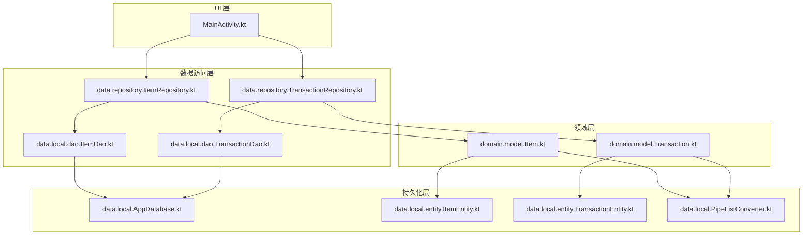

图表来源
- [AppDatabase.kt:1-34](file://GuZiStorage/app/src/main/java/com/guzi/storage/data/local/AppDatabase.kt#L1-L34)
- [ItemDao.kt:1-90](file://GuZiStorage/app/src/main/java/com/guzi/storage/data/local/dao/ItemDao.kt#L1-L90)
- [TransactionDao.kt:1-49](file://GuZiStorage/app/src/main/java/com/guzi/storage/data/local/dao/TransactionDao.kt#L1-L49)
- [ItemRepository.kt:1-80](file://GuZiStorage/app/src/main/java/com/guzi/storage/data/repository/ItemRepository.kt#L1-L80)
- [TransactionRepository.kt:1-63](file://GuZiStorage/app/src/main/java/com/guzi/storage/data/repository/TransactionRepository.kt#L1-L63)
- [ItemEntity.kt:1-89](file://GuZiStorage/app/src/main/java/com/guzi/storage/data/local/entity/ItemEntity.kt#L1-L89)
- [TransactionEntity.kt:1-65](file://GuZiStorage/app/src/main/java/com/guzi/storage/data/local/entity/TransactionEntity.kt#L1-L65)
- [PipeListConverter.kt:1-26](file://GuZiStorage/app/src/main/java/com/guzi/storage/data/local/PipeListConverter.kt#L1-L26)
- [Item.kt:1-106](file://GuZiStorage/app/src/main/java/com/guzi/storage/domain/model/Item.kt#L1-L106)
- [Transaction.kt:1-68](file://GuZiStorage/app/src/main/java/com/guzi/storage/domain/model/Transaction.kt#L1-L68)
- [MainActivity.kt:1-55](file://GuZiStorage/app/src/main/java/com/guzi/storage/MainActivity.kt#L1-L55)

章节来源
- [AppDatabase.kt:1-34](file://GuZiStorage/app/src/main/java/com/guzi/storage/data/local/AppDatabase.kt#L1-L34)
- [ItemDao.kt:1-90](file://GuZiStorage/app/src/main/java/com/guzi/storage/data/local/dao/ItemDao.kt#L1-L90)
- [TransactionDao.kt:1-49](file://GuZiStorage/app/src/main/java/com/guzi/storage/data/local/dao/TransactionDao.kt#L1-L49)
- [ItemRepository.kt:1-80](file://GuZiStorage/app/src/main/java/com/guzi/storage/data/repository/ItemRepository.kt#L1-L80)
- [TransactionRepository.kt:1-63](file://GuZiStorage/app/src/main/java/com/guzi/storage/data/repository/TransactionRepository.kt#L1-L63)
- [ItemEntity.kt:1-89](file://GuZiStorage/app/src/main/java/com/guzi/storage/data/local/entity/ItemEntity.kt#L1-L89)
- [TransactionEntity.kt:1-65](file://GuZiStorage/app/src/main/java/com/guzi/storage/data/local/entity/TransactionEntity.kt#L1-L65)
- [PipeListConverter.kt:1-26](file://GuZiStorage/app/src/main/java/com/guzi/storage/data/local/PipeListConverter.kt#L1-L26)
- [Item.kt:1-106](file://GuZiStorage/app/src/main/java/com/guzi/storage/domain/model/Item.kt#L1-L106)
- [Transaction.kt:1-68](file://GuZiStorage/app/src/main/java/com/guzi/storage/domain/model/Transaction.kt#L1-L68)
- [MainActivity.kt:1-55](file://GuZiStorage/app/src/main/java/com/guzi/storage/MainActivity.kt#L1-L55)

## 核心组件
- 数据库定义与 DAO
  - AppDatabase 声明了 items、transactions、preset_options 三张表及对应 DAO 获取方法。
  - ItemDao 与 TransactionDao 暴露了基于 Flow 的查询接口与 suspend 写入接口，支持分组、筛选、搜索等。
- 仓库层
  - ItemRepository 与 TransactionRepository 封装 CRUD，负责 Entity ↔ Domain Model 转换，对外暴露 Flow<List<Domain>> 响应式数据流。
- 领域模型
  - Item 与 Transaction 为业务层数据结构，包含显示名称计算、Entity 互转逻辑。
- 数据转换器
  - PipeListConverter 用于多选字段在 List<String> 与管道符分隔字符串之间的转换。

章节来源
- [AppDatabase.kt:12-33](file://GuZiStorage/app/src/main/java/com/guzi/storage/data/local/AppDatabase.kt#L12-L33)
- [ItemDao.kt:15-89](file://GuZiStorage/app/src/main/java/com/guzi/storage/data/local/dao/ItemDao.kt#L15-L89)
- [TransactionDao.kt:15-48](file://GuZiStorage/app/src/main/java/com/guzi/storage/data/local/dao/TransactionDao.kt#L15-L48)
- [ItemRepository.kt:11-79](file://GuZiStorage/app/src/main/java/com/guzi/storage/data/repository/ItemRepository.kt#L11-L79)
- [TransactionRepository.kt:11-62](file://GuZiStorage/app/src/main/java/com/guzi/storage/data/repository/TransactionRepository.kt#L11-L62)
- [Item.kt:11-104](file://GuZiStorage/app/src/main/java/com/guzi/storage/domain/model/Item.kt#L11-L104)
- [Transaction.kt:9-67](file://GuZiStorage/app/src/main/java/com/guzi/storage/domain/model/Transaction.kt#L9-L67)
- [PipeListConverter.kt:9-25](file://GuZiStorage/app/src/main/java/com/guzi/storage/data/local/PipeListConverter.kt#L9-L25)

## 架构总览
系统遵循单向数据流：UI 发起动作 → Repository 执行业务与转换 → DAO 调用 Room → 数据库变更通过 Flow 回推 → UI 订阅并自动重组。

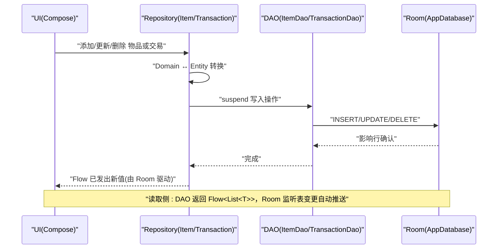

图表来源
- [ItemRepository.kt:23-45](file://GuZiStorage/app/src/main/java/com/guzi/storage/data/repository/ItemRepository.kt#L23-L45)
- [TransactionRepository.kt:20-30](file://GuZiStorage/app/src/main/java/com/guzi/storage/data/repository/TransactionRepository.kt#L20-L30)
- [ItemDao.kt:20-56](file://GuZiStorage/app/src/main/java/com/guzi/storage/data/local/dao/ItemDao.kt#L20-L56)
- [TransactionDao.kt:20-30](file://GuZiStorage/app/src/main/java/com/guzi/storage/data/local/dao/TransactionDao.kt#L20-L30)
- [AppDatabase.kt:20-33](file://GuZiStorage/app/src/main/java/com/guzi/storage/data/local/AppDatabase.kt#L20-L33)

## 详细组件分析

### 数据模型与转换
- Item 与 Transaction 提供 toEntity/fromEntity 转换，并在转换中调用 PipeListConverter 处理多选字段。
- Item 的 displayName 根据 status 与 damageDetails 动态生成展示文本。

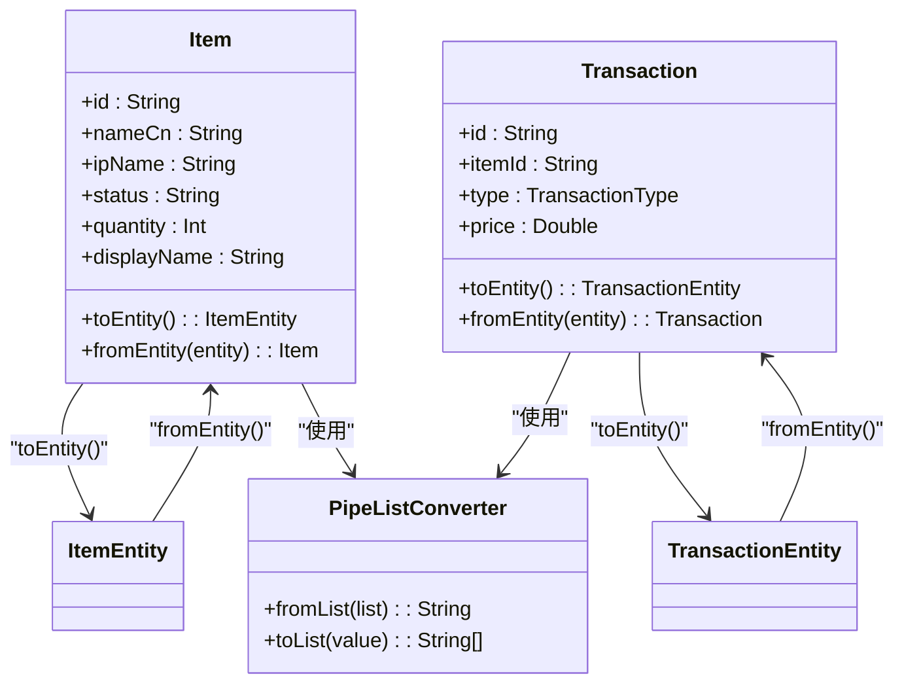

图表来源
- [Item.kt:11-104](file://GuZiStorage/app/src/main/java/com/guzi/storage/domain/model/Item.kt#L11-L104)
- [Transaction.kt:9-67](file://GuZiStorage/app/src/main/java/com/guzi/storage/domain/model/Transaction.kt#L9-L67)
- [ItemEntity.kt:16-88](file://GuZiStorage/app/src/main/java/com/guzi/storage/data/local/entity/ItemEntity.kt#L16-L88)
- [TransactionEntity.kt:14-64](file://GuZiStorage/app/src/main/java/com/guzi/storage/data/local/entity/TransactionEntity.kt#L14-L64)
- [PipeListConverter.kt:9-25](file://GuZiStorage/app/src/main/java/com/guzi/storage/data/local/PipeListConverter.kt#L9-L25)

章节来源
- [Item.kt:11-104](file://GuZiStorage/app/src/main/java/com/guzi/storage/domain/model/Item.kt#L11-L104)
- [Transaction.kt:9-67](file://GuZiStorage/app/src/main/java/com/guzi/storage/domain/model/Transaction.kt#L9-L67)
- [PipeListConverter.kt:9-25](file://GuZiStorage/app/src/main/java/com/guzi/storage/data/local/PipeListConverter.kt#L9-L25)

### 仓库层数据流与转换
- 查询侧：Repository 调用 DAO 的 Flow 接口，并通过 map 将 Entity 列表映射为 Domain 列表，形成稳定的响应式数据流。
- 写入侧：Repository 接收 Domain 对象，转换为 Entity 后调用 DAO 的 suspend 写入方法；写入完成后，Room 自动触发相关 Flow 发射新值。

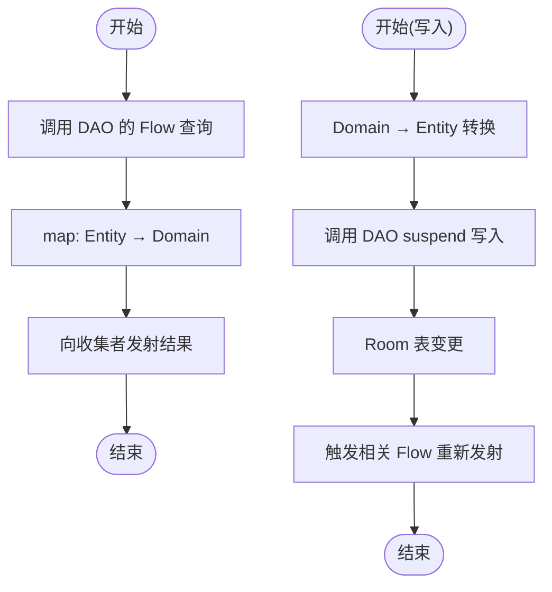

图表来源
- [ItemRepository.kt:23-45](file://GuZiStorage/app/src/main/java/com/guzi/storage/data/repository/ItemRepository.kt#L23-L45)
- [TransactionRepository.kt:20-30](file://GuZiStorage/app/src/main/java/com/guzi/storage/data/repository/TransactionRepository.kt#L20-L30)
- [ItemDao.kt:20-56](file://GuZiStorage/app/src/main/java/com/guzi/storage/data/local/dao/ItemDao.kt#L20-L56)
- [TransactionDao.kt:20-30](file://GuZiStorage/app/src/main/java/com/guzi/storage/data/local/dao/TransactionDao.kt#L20-L30)

章节来源
- [ItemRepository.kt:23-45](file://GuZiStorage/app/src/main/java/com/guzi/storage/data/repository/ItemRepository.kt#L23-L45)
- [TransactionRepository.kt:20-30](file://GuZiStorage/app/src/main/java/com/guzi/storage/data/repository/TransactionRepository.kt#L20-L30)

### 数据库与索引
- AppDatabase 定义了 entities 与版本信息，并提供 DAO 实例。
- ItemEntity 对 ip_name、status、category 建立索引以加速分组与筛选。
- TransactionEntity 对 item_id 建立索引，并设置外键级联删除，保证引用完整性。

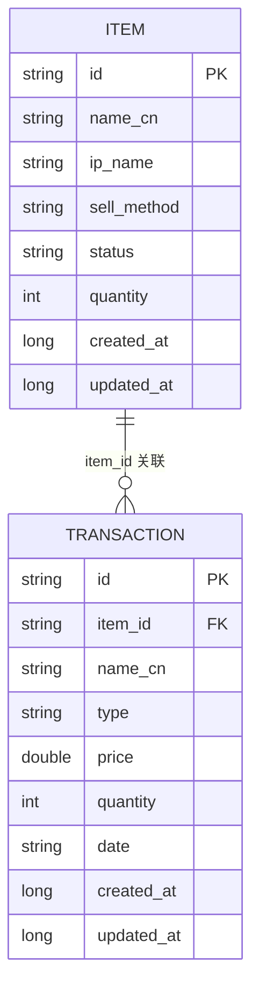

图表来源
- [AppDatabase.kt:20-33](file://GuZiStorage/app/src/main/java/com/guzi/storage/data/local/AppDatabase.kt#L20-L33)
- [ItemEntity.kt:16-88](file://GuZiStorage/app/src/main/java/com/guzi/storage/data/local/entity/ItemEntity.kt#L16-L88)
- [TransactionEntity.kt:14-64](file://GuZiStorage/app/src/main/java/com/guzi/storage/data/local/entity/TransactionEntity.kt#L14-L64)

章节来源
- [AppDatabase.kt:20-33](file://GuZiStorage/app/src/main/java/com/guzi/storage/data/local/AppDatabase.kt#L20-L33)
- [ItemEntity.kt:16-88](file://GuZiStorage/app/src/main/java/com/guzi/storage/data/local/entity/ItemEntity.kt#L16-L88)
- [TransactionEntity.kt:14-64](file://GuZiStorage/app/src/main/java/com/guzi/storage/data/local/entity/TransactionEntity.kt#L14-L64)

### 典型操作流程：添加物品
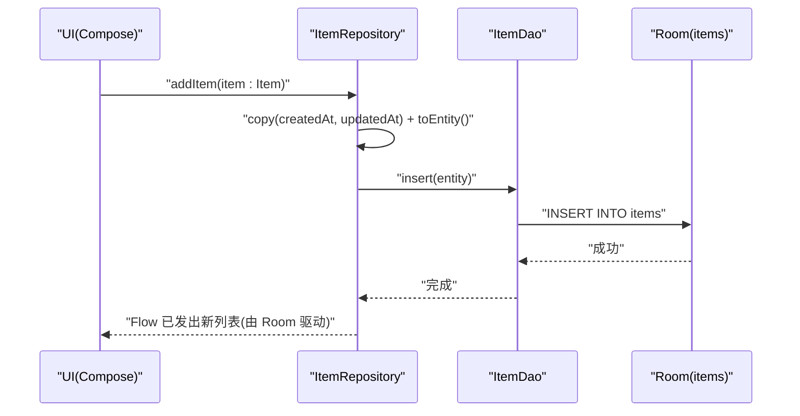

图表来源
- [ItemRepository.kt:49-54](file://GuZiStorage/app/src/main/java/com/guzi/storage/data/repository/ItemRepository.kt#L49-L54)
- [ItemDao.kt:72-76](file://GuZiStorage/app/src/main/java/com/guzi/storage/data/local/dao/ItemDao.kt#L72-L76)
- [Item.kt:50-74](file://GuZiStorage/app/src/main/java/com/guzi/storage/domain/model/Item.kt#L50-L74)

章节来源
- [ItemRepository.kt:49-54](file://GuZiStorage/app/src/main/java/com/guzi/storage/data/repository/ItemRepository.kt#L49-L54)
- [ItemDao.kt:72-76](file://GuZiStorage/app/src/main/java/com/guzi/storage/data/local/dao/ItemDao.kt#L72-L76)
- [Item.kt:50-74](file://GuZiStorage/app/src/main/java/com/guzi/storage/domain/model/Item.kt#L50-L74)

### 典型操作流程：按 IP 分组与筛选
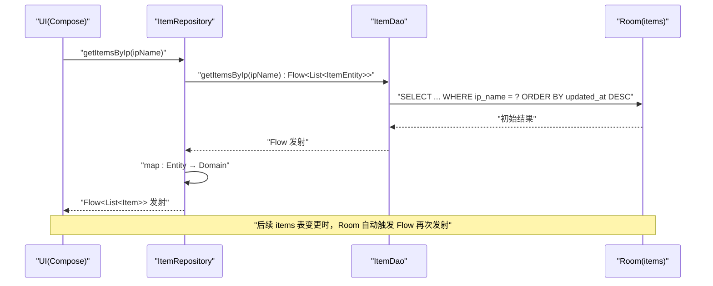

图表来源
- [ItemRepository.kt:32-33](file://GuZiStorage/app/src/main/java/com/guzi/storage/data/repository/ItemRepository.kt#L32-L33)
- [ItemDao.kt:37-38](file://GuZiStorage/app/src/main/java/com/guzi/storage/data/local/dao/ItemDao.kt#L37-L38)

章节来源
- [ItemRepository.kt:32-33](file://GuZiStorage/app/src/main/java/com/guzi/storage/data/repository/ItemRepository.kt#L32-L33)
- [ItemDao.kt:37-38](file://GuZiStorage/app/src/main/java/com/guzi/storage/data/local/dao/ItemDao.kt#L37-L38)

### 典型操作流程：搜索
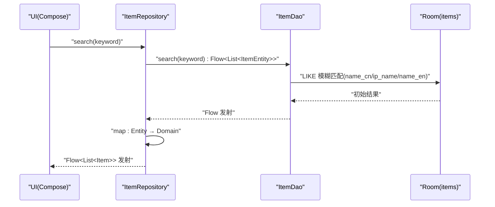

图表来源
- [ItemRepository.kt:41-42](file://GuZiStorage/app/src/main/java/com/guzi/storage/data/repository/ItemRepository.kt#L41-L42)
- [ItemDao.kt:49-56](file://GuZiStorage/app/src/main/java/com/guzi/storage/data/local/dao/ItemDao.kt#L49-L56)

章节来源
- [ItemRepository.kt:41-42](file://GuZiStorage/app/src/main/java/com/guzi/storage/data/repository/ItemRepository.kt#L41-L42)
- [ItemDao.kt:49-56](file://GuZiStorage/app/src/main/java/com/guzi/storage/data/local/dao/ItemDao.kt#L49-L56)

### 典型操作流程：删除物品（级联删除）
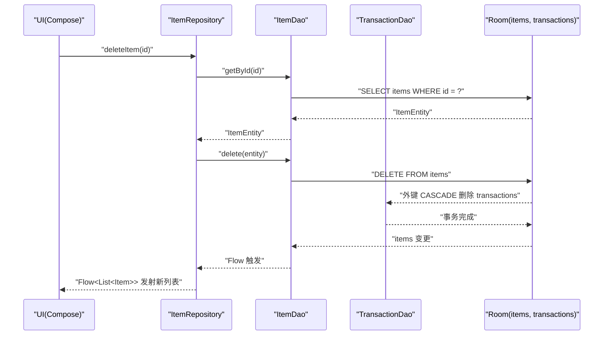

图表来源
- [ItemRepository.kt:69-72](file://GuZiStorage/app/src/main/java/com/guzi/storage/data/repository/ItemRepository.kt#L69-L72)
- [ItemDao.kt:81-82](file://GuZiStorage/app/src/main/java/com/guzi/storage/data/local/dao/ItemDao.kt#L81-L82)
- [TransactionEntity.kt:16-22](file://GuZiStorage/app/src/main/java/com/guzi/storage/data/local/entity/TransactionEntity.kt#L16-L22)

章节来源
- [ItemRepository.kt:69-72](file://GuZiStorage/app/src/main/java/com/guzi/storage/data/repository/ItemRepository.kt#L69-L72)
- [ItemDao.kt:81-82](file://GuZiStorage/app/src/main/java/com/guzi/storage/data/local/dao/ItemDao.kt#L81-L82)
- [TransactionEntity.kt:16-22](file://GuZiStorage/app/src/main/java/com/guzi/storage/data/local/entity/TransactionEntity.kt#L16-L22)

### 典型操作流程：批量导入（CSV/Excel）
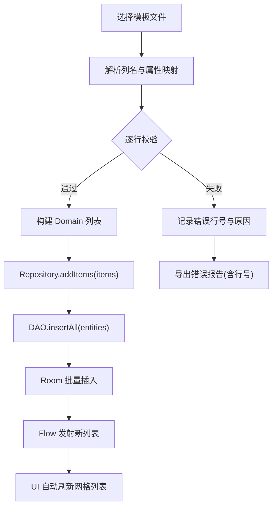

图表来源
- [ItemRepository.kt:56-61](file://GuZiStorage/app/src/main/java/com/guzi/storage/data/repository/ItemRepository.kt#L56-L61)
- [ItemDao.kt:75-76](file://GuZiStorage/app/src/main/java/com/guzi/storage/data/local/dao/ItemDao.kt#L75-L76)
- [基础prd.md:153-163](file://基础prd.md#L153-L163)

章节来源
- [ItemRepository.kt:56-61](file://GuZiStorage/app/src/main/java/com/guzi/storage/data/repository/ItemRepository.kt#L56-L61)
- [ItemDao.kt:75-76](file://GuZiStorage/app/src/main/java/com/guzi/storage/data/local/dao/ItemDao.kt#L75-L76)
- [基础prd.md:153-163](file://基础prd.md#L153-L163)

## 依赖关系分析
- 低耦合：UI 仅依赖 Repository；Repository 仅依赖 DAO；DAO 仅依赖 Room。
- 高内聚：每个 Repository 专注单一实体的读写与转换。
- 外部依赖：Room 作为唯一持久化后端；Kotlin Coroutines Flow 提供响应式能力。

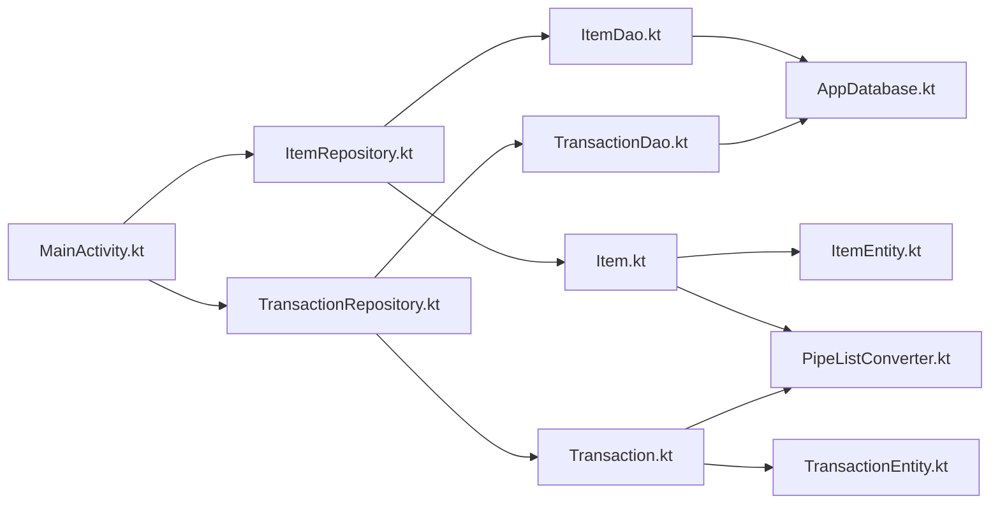

图表来源
- [MainActivity.kt:1-55](file://GuZiStorage/app/src/main/java/com/guzi/storage/MainActivity.kt#L1-L55)
- [ItemRepository.kt:1-80](file://GuZiStorage/app/src/main/java/com/guzi/storage/data/repository/ItemRepository.kt#L1-L80)
- [TransactionRepository.kt:1-63](file://GuZiStorage/app/src/main/java/com/guzi/storage/data/repository/TransactionRepository.kt#L1-L63)
- [ItemDao.kt:1-90](file://GuZiStorage/app/src/main/java/com/guzi/storage/data/local/dao/ItemDao.kt#L1-L90)
- [TransactionDao.kt:1-49](file://GuZiStorage/app/src/main/java/com/guzi/storage/data/local/dao/TransactionDao.kt#L1-L49)
- [AppDatabase.kt:1-34](file://GuZiStorage/app/src/main/java/com/guzi/storage/data/local/AppDatabase.kt#L1-L34)
- [Item.kt:1-106](file://GuZiStorage/app/src/main/java/com/guzi/storage/domain/model/Item.kt#L1-L106)
- [Transaction.kt:1-68](file://GuZiStorage/app/src/main/java/com/guzi/storage/domain/model/Transaction.kt#L1-L68)
- [ItemEntity.kt:1-89](file://GuZiStorage/app/src/main/java/com/guzi/storage/data/local/entity/ItemEntity.kt#L1-L89)
- [TransactionEntity.kt:1-65](file://GuZiStorage/app/src/main/java/com/guzi/storage/data/local/entity/TransactionEntity.kt#L1-L65)
- [PipeListConverter.kt:1-26](file://GuZiStorage/app/src/main/java/com/guzi/storage/data/local/PipeListConverter.kt#L1-L26)

章节来源
- [MainActivity.kt:1-55](file://GuZiStorage/app/src/main/java/com/guzi/storage/MainActivity.kt#L1-L55)
- [ItemRepository.kt:1-80](file://GuZiStorage/app/src/main/java/com/guzi/storage/data/repository/ItemRepository.kt#L1-L80)
- [TransactionRepository.kt:1-63](file://GuZiStorage/app/src/main/java/com/guzi/storage/data/repository/TransactionRepository.kt#L1-L63)
- [ItemDao.kt:1-90](file://GuZiStorage/app/src/main/java/com/guzi/storage/data/local/dao/ItemDao.kt#L1-L90)
- [TransactionDao.kt:1-49](file://GuZiStorage/app/src/main/java/com/guzi/storage/data/local/dao/TransactionDao.kt#L1-L49)
- [AppDatabase.kt:1-34](file://GuZiStorage/app/src/main/java/com/guzi/storage/data/local/AppDatabase.kt#L1-L34)
- [Item.kt:1-106](file://GuZiStorage/app/src/main/java/com/guzi/storage/domain/model/Item.kt#L1-L106)
- [Transaction.kt:1-68](file://GuZiStorage/app/src/main/java/com/guzi/storage/domain/model/Transaction.kt#L1-L68)
- [ItemEntity.kt:1-89](file://GuZiStorage/app/src/main/java/com/guzi/storage/data/local/entity/ItemEntity.kt#L1-L89)
- [TransactionEntity.kt:1-65](file://GuZiStorage/app/src/main/java/com/guzi/storage/data/local/entity/TransactionEntity.kt#L1-L65)
- [PipeListConverter.kt:1-26](file://GuZiStorage/app/src/main/java/com/guzi/storage/data/local/PipeListConverter.kt#L1-L26)

## 性能考虑
- 响应式与增量更新
  - DAO 的 Flow 查询由 Room 驱动，仅在相关表发生写操作时重新发射结果，避免全量轮询。
- 索引优化
  - 对常用过滤字段建立索引：ip_name、status、category、item_id，提升分组、筛选与关联查询性能。
- 批量操作
  - 使用 insertAll/deleteByIds 减少事务开销，适合批量导入与批量删除场景。
- 内存管理
  - 列表数据尽量按需加载；图片路径存储为字符串，避免在内存中持有大对象；必要时在 UI 层进行懒加载与缩略图渲染。
- 排序与分页
  - 当前查询使用 ORDER BY updated_at DESC；当数据规模增长至万级时，建议引入分页（Paging3）以减少首屏加载与滚动卡顿。
- 计算与转换
  - Repository 的 map 转换轻量且无副作用；复杂计算可下沉至 ViewModel 或 Compose State 层，避免重复计算。

[本节为通用性能指导，不直接分析具体文件]

## 故障排查指南
- 数据未刷新
  - 检查是否订阅了正确的 Flow 查询（如 getItemsByIp、search），确保参数与 DAO 查询一致。
  - 确认写入操作是否成功执行（日志或断点），Room 会在写成功后触发 Flow 发射。
- 搜索无结果
  - 核对 LIKE 条件与字段名（name_cn、ip_name、name_en），确认关键词大小写与空格。
- 删除后交易记录残留
  - 检查外键约束与级联删除配置是否正确；确认删除的是 ItemEntity 而非仅 ID。
- 批量导入报错
  - 依据 PRD 要求，导入应跳过错误行并输出带行号的报告；检查列名映射与必填项校验逻辑。

章节来源
- [ItemDao.kt:49-56](file://GuZiStorage/app/src/main/java/com/guzi/storage/data/local/dao/ItemDao.kt#L49-L56)
- [TransactionEntity.kt:16-22](file://GuZiStorage/app/src/main/java/com/guzi/storage/data/local/entity/TransactionEntity.kt#L16-L22)
- [基础prd.md:153-163](file://基础prd.md#L153-L163)

## 结论
本设计通过 Room + Kotlin Flow 构建了稳定高效的响应式数据流：DAO 暴露 Flow 查询，Repository 负责领域模型转换，UI 订阅 Flow 实现自动刷新。配合合理的索引与批量操作，系统在可读性与性能之间取得平衡。未来可在大数据量场景引入分页与更细粒度的缓存策略，进一步提升体验。

[本节为总结性内容，不直接分析具体文件]

## 附录
- 产品需求参考
  - 数据实体定义、导入导出规则、非功能需求等详见 PRD。

章节来源
- [基础prd.md:32-138](file://基础prd.md#L32-L138)
- [基础prd.md:142-221](file://基础prd.md#L142-L221)