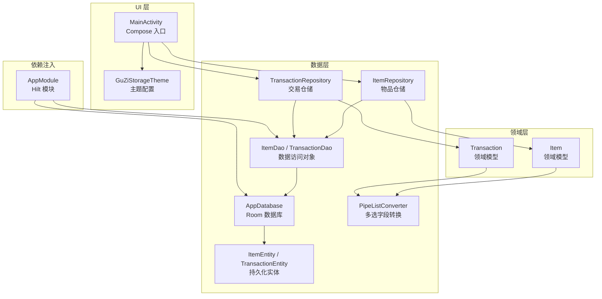
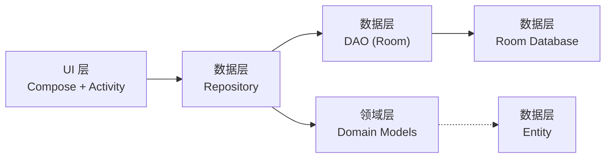
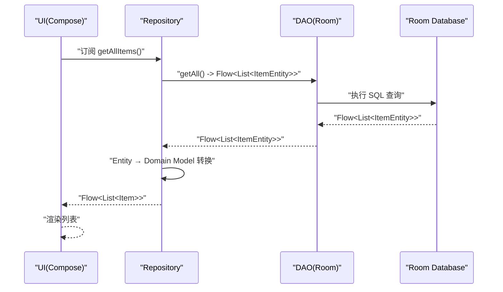
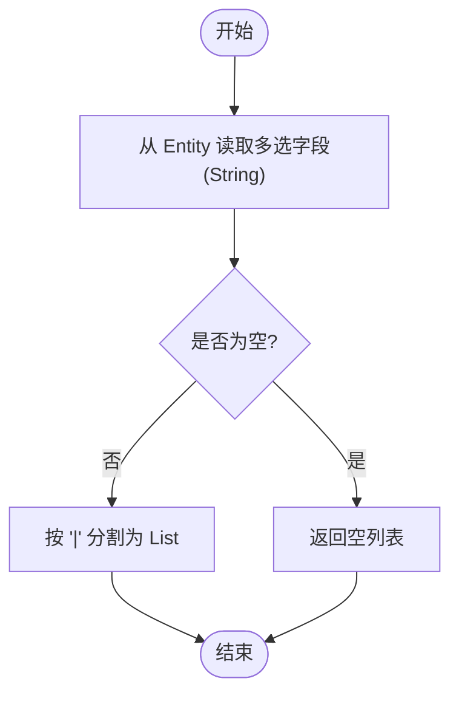
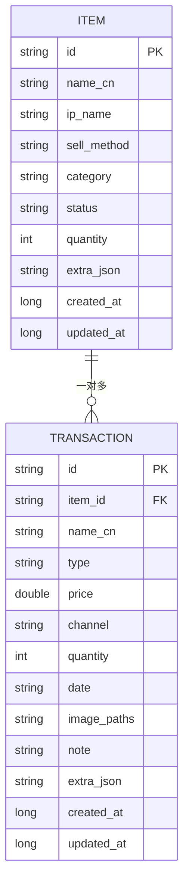
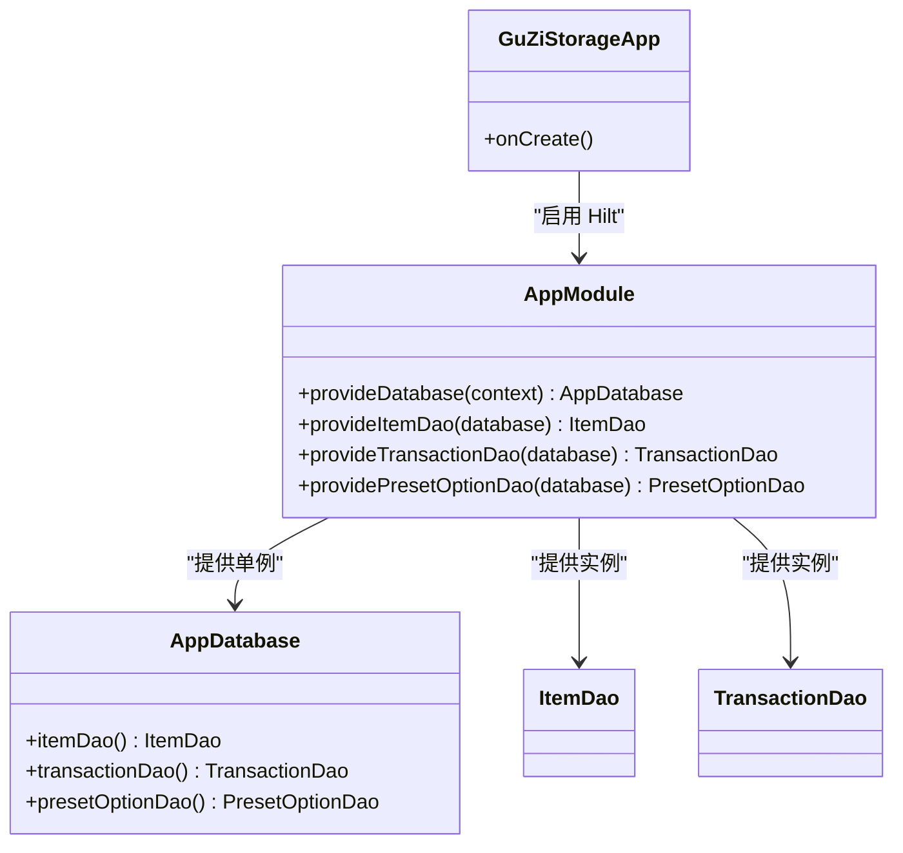
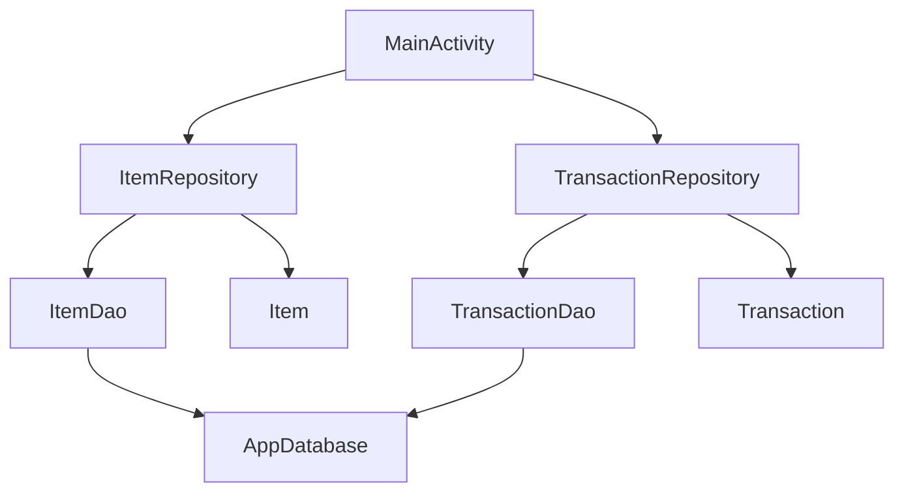

# 整体架构概览

<cite>
**本文引用的文件**   
- [MainActivity.kt](file://GuZiStorage/app/src/main/java/com/guzi/storage/MainActivity.kt)
- [GuZiStorageApp.kt](file://GuZiStorage/app/src/main/java/com/guzi/storage/GuZiStorageApp.kt)
- [AppModule.kt](file://GuZiStorage/app/src/main/java/com/guzi/storage/di/AppModule.kt)
- [AppDatabase.kt](file://GuZiStorage/app/src/main/java/com/guzi/storage/data/local/AppDatabase.kt)
- [ItemDao.kt](file://GuZiStorage/app/src/main/java/com/guzi/storage/data/local/dao/ItemDao.kt)
- [TransactionDao.kt](file://GuZiStorage/app/src/main/java/com/guzi/storage/data/local/dao/TransactionDao.kt)
- [ItemEntity.kt](file://GuZiStorage/app/src/main/java/com/guzi/storage/data/local/entity/ItemEntity.kt)
- [TransactionEntity.kt](file://GuZiStorage/app/src/main/java/com/guzi/storage/data/local/entity/TransactionEntity.kt)
- [PipeListConverter.kt](file://GuZiStorage/app/src/main/java/com/guzi/storage/data/local/PipeListConverter.kt)
- [ItemRepository.kt](file://GuZiStorage/app/src/main/java/com/guzi/storage/data/repository/ItemRepository.kt)
- [TransactionRepository.kt](file://GuZiStorage/app/src/main/java/com/guzi/storage/data/repository/TransactionRepository.kt)
- [Item.kt](file://GuZiStorage/app/src/main/java/com/guzi/storage/domain/model/Item.kt)
- [Transaction.kt](file://GuZiStorage/app/src/main/java/com/guzi/storage/domain/model/Transaction.kt)
- [Theme.kt](file://GuZiStorage/app/src/main/java/com/guzi/storage/ui/theme/Theme.kt)
- [build.gradle.kts](file://GuZiStorage/app/build.gradle.kts)
- [基础prd.md](file://基础prd.md)
</cite>

## 目录
1. [简介](#简介)
2. [项目结构](#项目结构)
3. [核心组件](#核心组件)
4. [架构总览](#架构总览)
5. [详细组件分析](#详细组件分析)
6. [依赖关系分析](#依赖关系分析)
7. [性能与可扩展性](#性能与可扩展性)
8. [故障排查指南](#故障排查指南)
9. [结论](#结论)
10. [附录：技术选型与权衡](#附录技术选型与权衡)

## 简介
本文件为“谷子收纳”应用的整体架构概览，面向初学者与有经验的开发者。文档基于仓库现有代码，系统阐述 Clean Architecture 分层设计（UI 层、领域层、数据层）与 MVVM 在 Android 中的落地方式，解释 Repository、DAO、Entity 的职责与交互关系，并给出系统架构图、数据流向图以及关键流程时序图。同时说明 Jetpack Compose、Room、Hilt 等现代 Android 技术选型的理由与权衡。

## 项目结构
当前工程采用按职责分层的目录组织方式：
- UI 层：Compose 主题与入口 Activity
- 领域层：业务模型 Item、Transaction
- 数据层：Room 数据库、DAO、Entity、Repository
- 依赖注入：Hilt 模块提供数据库与 DAO 实例

图表来源
- [MainActivity.kt:1-55](file://GuZiStorage/app/src/main/java/com/guzi/storage/MainActivity.kt#L1-L55)
- [Theme.kt:1-51](file://GuZiStorage/app/src/main/java/com/guzi/storage/ui/theme/Theme.kt#L1-L51)
- [ItemRepository.kt:1-80](file://GuZiStorage/app/src/main/java/com/guzi/storage/data/repository/ItemRepository.kt#L1-L80)
- [TransactionRepository.kt:1-63](file://GuZiStorage/app/src/main/java/com/guzi/storage/data/repository/TransactionRepository.kt#L1-L63)
- [AppDatabase.kt:1-34](file://GuZiStorage/app/src/main/java/com/guzi/storage/data/local/AppDatabase.kt#L1-L34)
- [ItemDao.kt:1-90](file://GuZiStorage/app/src/main/java/com/guzi/storage/data/local/dao/ItemDao.kt#L1-L90)
- [TransactionDao.kt:1-49](file://GuZiStorage/app/src/main/java/com/guzi/storage/data/local/dao/TransactionDao.kt#L1-L49)
- [ItemEntity.kt:1-89](file://GuZiStorage/app/src/main/java/com/guzi/storage/data/local/entity/ItemEntity.kt#L1-L89)
- [TransactionEntity.kt:1-65](file://GuZiStorage/app/src/main/java/com/guzi/storage/data/local/entity/TransactionEntity.kt#L1-L65)
- [PipeListConverter.kt:1-26](file://GuZiStorage/app/src/main/java/com/guzi/storage/data/local/PipeListConverter.kt#L1-L26)
- [AppModule.kt:1-50](file://GuZiStorage/app/src/main/java/com/guzi/storage/di/AppModule.kt#L1-L50)

章节来源
- [MainActivity.kt:1-55](file://GuZiStorage/app/src/main/java/com/guzi/storage/MainActivity.kt#L1-L55)
- [Theme.kt:1-51](file://GuZiStorage/app/src/main/java/com/guzi/storage/ui/theme/Theme.kt#L1-L51)
- [build.gradle.kts:1-97](file://GuZiStorage/app/build.gradle.kts#L1-L97)

## 核心组件
- UI 层
  - MainActivity：应用入口，使用 Compose 构建界面，集成 Hilt 注入能力。
  - GuZiStorageTheme：Material3 主题封装，支持动态色与深色模式。
- 领域层
  - Item、Transaction：领域模型，定义业务语义与展示逻辑（如显示名称），并提供与 Entity 的互转方法。
- 数据层
  - Repository：对外暴露 Flow 响应式接口，负责 Entity ↔ Domain Model 转换与时间戳填充。
  - DAO：Room 注解的数据访问接口，定义 SQL 查询与写入操作。
  - Entity：Room 表映射，定义索引、外键与扩展字段策略。
  - PipeListConverter：将 List<String> 与管道符分隔字符串互转，支撑多选字段存储。
- 依赖注入
  - AppModule：通过 Hilt 提供 AppDatabase 与各 DAO 的单例实例。

章节来源
- [MainActivity.kt:1-55](file://GuZiStorage/app/src/main/java/com/guzi/storage/MainActivity.kt#L1-L55)
- [Theme.kt:1-51](file://GuZiStorage/app/src/main/java/com/guzi/storage/ui/theme/Theme.kt#L1-L51)
- [Item.kt:1-106](file://GuZiStorage/app/src/main/java/com/guzi/storage/domain/model/Item.kt#L1-L106)
- [Transaction.kt:1-68](file://GuZiStorage/app/src/main/java/com/guzi/storage/domain/model/Transaction.kt#L1-L68)
- [ItemRepository.kt:1-80](file://GuZiStorage/app/src/main/java/com/guzi/storage/data/repository/ItemRepository.kt#L1-L80)
- [TransactionRepository.kt:1-63](file://GuZiStorage/app/src/main/java/com/guzi/storage/data/repository/TransactionRepository.kt#L1-L63)
- [ItemDao.kt:1-90](file://GuZiStorage/app/src/main/java/com/guzi/storage/data/local/dao/ItemDao.kt#L1-L90)
- [TransactionDao.kt:1-49](file://GuZiStorage/app/src/main/java/com/guzi/storage/data/local/dao/TransactionDao.kt#L1-L49)
- [ItemEntity.kt:1-89](file://GuZiStorage/app/src/main/java/com/guzi/storage/data/local/entity/ItemEntity.kt#L1-L89)
- [TransactionEntity.kt:1-65](file://GuZiStorage/app/src/main/java/com/guzi/storage/data/local/entity/TransactionEntity.kt#L1-L65)
- [PipeListConverter.kt:1-26](file://GuZiStorage/app/src/main/java/com/guzi/storage/data/local/PipeListConverter.kt#L1-L26)
- [AppModule.kt:1-50](file://GuZiStorage/app/src/main/java/com/guzi/storage/di/AppModule.kt#L1-L50)

## 架构总览
本应用遵循 Clean Architecture 的分层思想：
- UI 层仅负责展示与用户交互，不直接访问数据源。
- 领域层承载业务模型与规则，保持与技术细节解耦。
- 数据层封装本地持久化细节，通过 Repository 向领域层暴露统一接口。
- 依赖方向：UI → 领域/仓储 → 数据层；领域层不依赖数据层实现，但当前实现中领域模型包含与 Entity 的互转方法，便于轻量迁移。

图表来源
- [MainActivity.kt:1-55](file://GuZiStorage/app/src/main/java/com/guzi/storage/MainActivity.kt#L1-L55)
- [ItemRepository.kt:1-80](file://GuZiStorage/app/src/main/java/com/guzi/storage/data/repository/ItemRepository.kt#L1-L80)
- [TransactionRepository.kt:1-63](file://GuZiStorage/app/src/main/java/com/guzi/storage/data/repository/TransactionRepository.kt#L1-L63)
- [ItemDao.kt:1-90](file://GuZiStorage/app/src/main/java/com/guzi/storage/data/local/dao/ItemDao.kt#L1-L90)
- [TransactionDao.kt:1-49](file://GuZiStorage/app/src/main/java/com/guzi/storage/data/local/dao/TransactionDao.kt#L1-L49)
- [AppDatabase.kt:1-34](file://GuZiStorage/app/src/main/java/com/guzi/storage/data/local/AppDatabase.kt#L1-L34)
- [Item.kt:1-106](file://GuZiStorage/app/src/main/java/com/guzi/storage/domain/model/Item.kt#L1-L106)
- [Transaction.kt:1-68](file://GuZiStorage/app/src/main/java/com/guzi/storage/domain/model/Transaction.kt#L1-L68)
- [ItemEntity.kt:1-89](file://GuZiStorage/app/src/main/java/com/guzi/storage/data/local/entity/ItemEntity.kt#L1-L89)
- [TransactionEntity.kt:1-65](file://GuZiStorage/app/src/main/java/com/guzi/storage/data/local/entity/TransactionEntity.kt#L1-L65)

## 详细组件分析

### 数据流与 MVVM 落地
- 数据流
  - Repository 通过 DAO 读取 Room 数据，返回 Flow<List<...>>，并在 Repository 层完成 Entity → Domain Model 的转换。
  - UI 层订阅 Flow，实现响应式更新。
- MVVM 角色
  - View：Compose 组件（当前以 MainActivity 内联 Composable 为例）。
  - ViewModel：当前未引入 ViewModel 类，后续可在 UI 与 Repository 之间加入 ViewModel 以管理状态与生命周期。
  - Model：领域模型 Item、Transaction。

图表来源
- [ItemRepository.kt:23-24](file://GuZiStorage/app/src/main/java/com/guzi/storage/data/repository/ItemRepository.kt#L23-L24)
- [ItemDao.kt:20-21](file://GuZiStorage/app/src/main/java/com/guzi/storage/data/local/dao/ItemDao.kt#L20-L21)
- [AppDatabase.kt:29-32](file://GuZiStorage/app/src/main/java/com/guzi/storage/data/local/AppDatabase.kt#L29-L32)
- [Item.kt:80-104](file://GuZiStorage/app/src/main/java/com/guzi/storage/domain/model/Item.kt#L80-L104)

章节来源
- [ItemRepository.kt:1-80](file://GuZiStorage/app/src/main/java/com/guzi/storage/data/repository/ItemRepository.kt#L1-L80)
- [ItemDao.kt:1-90](file://GuZiStorage/app/src/main/java/com/guzi/storage/data/local/dao/ItemDao.kt#L1-L90)
- [Item.kt:1-106](file://GuZiStorage/app/src/main/java/com/guzi/storage/domain/model/Item.kt#L1-L106)

### 领域模型与实体映射
- 多值字段存储策略
  - Entity 中以管道符分隔的字符串存储多选字段。
  - 领域模型以 List<String> 表示，通过 PipeListConverter 进行互转。
- 显示名称计算
  - Item.displayName 根据 status 与 damageDetails 组合生成展示文本。

图表来源
- [PipeListConverter.kt:9-25](file://GuZiStorage/app/src/main/java/com/guzi/storage/data/local/PipeListConverter.kt#L9-L25)
- [Item.kt:50-74](file://GuZiStorage/app/src/main/java/com/guzi/storage/domain/model/Item.kt#L50-L74)
- [Item.kt:40-45](file://GuZiStorage/app/src/main/java/com/guzi/storage/domain/model/Item.kt#L40-L45)

章节来源
- [PipeListConverter.kt:1-26](file://GuZiStorage/app/src/main/java/com/guzi/storage/data/local/PipeListConverter.kt#L1-L26)
- [Item.kt:1-106](file://GuZiStorage/app/src/main/java/com/guzi/storage/domain/model/Item.kt#L1-L106)

### 数据库与关系
- 表与索引
  - items：对 ip_name、status、category 建立索引以提升分组与筛选性能。
  - transactions：对 item_id 建立索引，并通过外键级联删除保证引用完整性。
- 版本与迁移
  - AppDatabase 设置 version=1，导出 schema，便于后续迁移。

图表来源
- [ItemEntity.kt:16-27](file://GuZiStorage/app/src/main/java/com/guzi/storage/data/local/entity/ItemEntity.kt#L16-L27)
- [TransactionEntity.kt:14-27](file://GuZiStorage/app/src/main/java/com/guzi/storage/data/local/entity/TransactionEntity.kt#L14-L27)
- [AppDatabase.kt:20-33](file://GuZiStorage/app/src/main/java/com/guzi/storage/data/local/AppDatabase.kt#L20-L33)

章节来源
- [ItemEntity.kt:1-89](file://GuZiStorage/app/src/main/java/com/guzi/storage/data/local/entity/ItemEntity.kt#L1-L89)
- [TransactionEntity.kt:1-65](file://GuZiStorage/app/src/main/java/com/guzi/storage/data/local/entity/TransactionEntity.kt#L1-L65)
- [AppDatabase.kt:1-34](file://GuZiStorage/app/src/main/java/com/guzi/storage/data/local/AppDatabase.kt#L1-L34)

### 依赖注入与初始化
- Hilt 初始化
  - GuZiStorageApp 标注 @HiltAndroidApp，启动时初始化 Hilt。
  - AppModule 提供 AppDatabase 单例与各 DAO 实例。
- 作用域
  - AppDatabase 使用 @Singleton，确保全局唯一。

图表来源
- [GuZiStorageApp.kt:9-10](file://GuZiStorage/app/src/main/java/com/guzi/storage/GuZiStorageApp.kt#L9-L10)
- [AppModule.kt:23-48](file://GuZiStorage/app/src/main/java/com/guzi/storage/di/AppModule.kt#L23-L48)
- [AppDatabase.kt:29-32](file://GuZiStorage/app/src/main/java/com/guzi/storage/data/local/AppDatabase.kt#L29-L32)

章节来源
- [GuZiStorageApp.kt:1-11](file://GuZiStorage/app/src/main/java/com/guzi/storage/GuZiStorageApp.kt#L1-L11)
- [AppModule.kt:1-50](file://GuZiStorage/app/src/main/java/com/guzi/storage/di/AppModule.kt#L1-L50)

## 依赖关系分析
- 组件耦合
  - Repository 强依赖 DAO，弱依赖领域模型（用于转换）。
  - DAO 仅依赖 Room 注解与 Entity。
  - UI 层目前直接调用 Repository，尚未引入 ViewModel，存在一定耦合度。
- 外部依赖
  - Room、Hilt、Compose、Coroutines、Material3。

图表来源
- [MainActivity.kt:1-55](file://GuZiStorage/app/src/main/java/com/guzi/storage/MainActivity.kt#L1-L55)
- [ItemRepository.kt:1-80](file://GuZiStorage/app/src/main/java/com/guzi/storage/data/repository/ItemRepository.kt#L1-L80)
- [TransactionRepository.kt:1-63](file://GuZiStorage/app/src/main/java/com/guzi/storage/data/repository/TransactionRepository.kt#L1-L63)
- [ItemDao.kt:1-90](file://GuZiStorage/app/src/main/java/com/guzi/storage/data/local/dao/ItemDao.kt#L1-L90)
- [TransactionDao.kt:1-49](file://GuZiStorage/app/src/main/java/com/guzi/storage/data/local/dao/TransactionDao.kt#L1-L49)
- [AppDatabase.kt:1-34](file://GuZiStorage/app/src/main/java/com/guzi/storage/data/local/AppDatabase.kt#L1-L34)
- [Item.kt:1-106](file://GuZiStorage/app/src/main/java/com/guzi/storage/domain/model/Item.kt#L1-L106)
- [Transaction.kt:1-68](file://GuZiStorage/app/src/main/java/com/guzi/storage/domain/model/Transaction.kt#L1-L68)

章节来源
- [build.gradle.kts:48-92](file://GuZiStorage/app/build.gradle.kts#L48-L92)

## 性能与可扩展性
- 查询性能
  - 针对常用筛选字段（ip_name、status、category、item_id）建立索引，提升分组与关联查询效率。
- 响应式更新
  - 使用 Flow 实现数据变更自动推送，避免手动刷新。
- 批量操作
  - Repository 提供批量插入接口，减少往返次数。
- 可扩展性
  - 预留 extraJson 字段与 PipeListConverter 机制，便于新增属性与多选选项。
- 建议
  - 引入 ViewModel 管理 UI 状态与错误处理。
  - 对复杂搜索条件考虑分页或游标优化。
  - 图片路径与缩略图加载需配合异步与缓存策略。

[本节为通用指导，无需列出具体文件来源]

## 故障排查指南
- 数据库迁移
  - 若升级版本导致崩溃，检查 AppDatabase 的版本号与迁移脚本是否完备。
- 外键约束
  - 删除物品时应触发级联删除交易记录，确认外键与 onDelete=CASCADE 配置正确。
- 多选字段解析
  - 若多选字段为空或格式异常，检查 PipeListConverter 的分割逻辑与输入数据。
- 依赖注入
  - 若 DAO 或数据库无法注入，确认 Hilt 模块与作用域是否正确配置。

章节来源
- [AppDatabase.kt:20-33](file://GuZiStorage/app/src/main/java/com/guzi/storage/data/local/AppDatabase.kt#L20-L33)
- [TransactionEntity.kt:14-27](file://GuZiStorage/app/src/main/java/com/guzi/storage/data/local/entity/TransactionEntity.kt#L14-L27)
- [PipeListConverter.kt:9-25](file://GuZiStorage/app/src/main/java/com/guzi/storage/data/local/PipeListConverter.kt#L9-L25)
- [AppModule.kt:23-48](file://GuZiStorage/app/src/main/java/com/guzi/storage/di/AppModule.kt#L23-L48)

## 结论
该应用以 Clean Architecture 为核心思想，结合 Room 与 Hilt 构建了清晰的数据访问与依赖注入体系。当前阶段已具备响应式数据流与稳定的本地存储能力。下一步建议引入 ViewModel 完善 MVVM 闭环，增强状态管理与错误处理，并逐步完善 UI 页面与导航。

[本节为总结性内容，无需列出具体文件来源]

## 附录：技术选型与权衡
- Jetpack Compose
  - 优势：声明式 UI、热重载、与 Kotlin 深度集成，适合快速迭代与现代化体验。
  - 权衡：学习曲线较陡，需配合状态提升与副作用管理。
- Room
  - 优势：类型安全、编译期校验、与 Coroutines/Flow 良好集成，简化 SQLite 使用。
  - 权衡：复杂查询仍需手写 SQL，迁移需谨慎规划。
- Hilt
  - 优势：基于 Dagger 的 Android DI 方案，模块化、可测试性强。
  - 权衡：初始配置成本较高，需理解作用域与模块组织。
- Coroutines + Flow
  - 优势：异步编程简洁、响应式数据流天然契合 UI 更新。
  - 权衡：需规范协程作用域与背压策略，避免内存泄漏。
- Material3
  - 优势：符合现代设计规范，支持动态色与深色模式。
  - 权衡：定制样式需注意兼容性。

章节来源
- [build.gradle.kts:48-92](file://GuZiStorage/app/build.gradle.kts#L48-L92)
- [基础prd.md:1-249](file://基础prd.md#L1-L249)