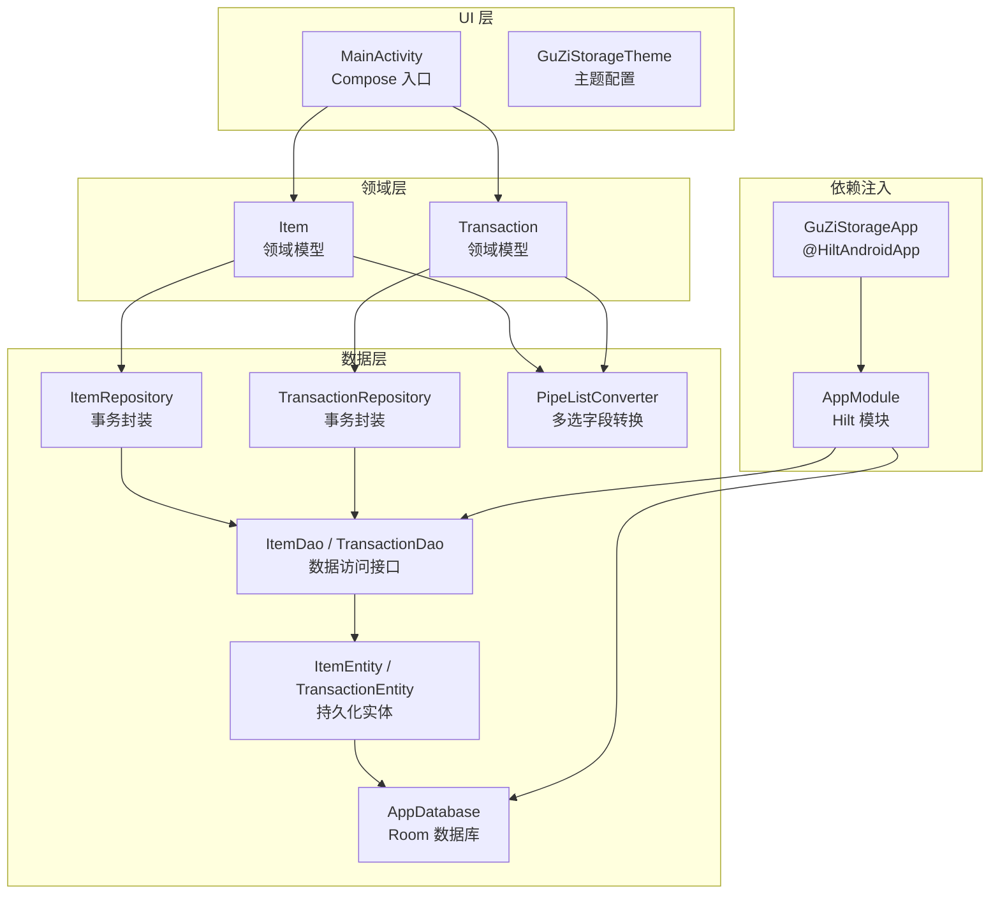
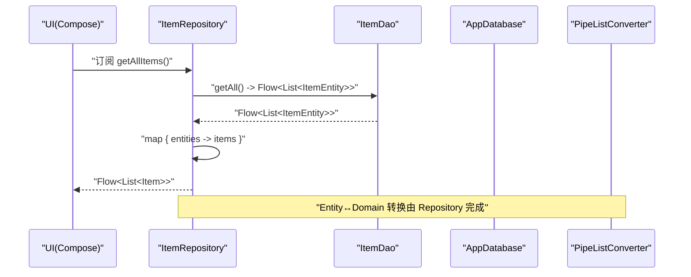
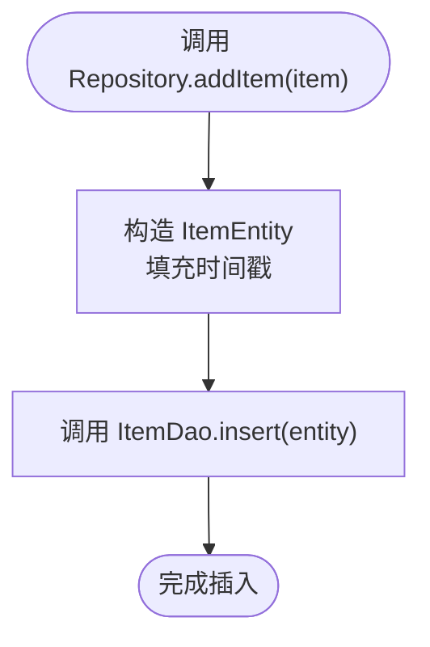
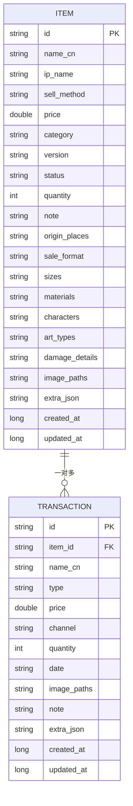
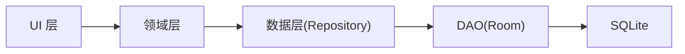

# 架构设计

<cite>
**本文引用的文件**   
- [GuZiStorageApp.kt](file://GuZiStorage/app/src/main/java/com/guzi/storage/GuZiStorageApp.kt)
- [MainActivity.kt](file://GuZiStorage/app/src/main/java/com/guzi/storage/MainActivity.kt)
- [AppModule.kt](file://GuZiStorage/app/src/main/java/com/guzi/storage/di/AppModule.kt)
- [AppDatabase.kt](file://GuZiStorage/app/src/main/java/com/guzi/storage/data/local/AppDatabase.kt)
- [ItemDao.kt](file://GuZiStorage/app/src/main/java/com/guzi/storage/data/local/dao/ItemDao.kt)
- [TransactionDao.kt](file://GuZiStorage/app/src/main/java/com/guzi/storage/data/local/dao/TransactionDao.kt)
- [ItemEntity.kt](file://GuZiStorage/app/src/main/java/com/guzi/storage/data/local/entity/ItemEntity.kt)
- [TransactionEntity.kt](file://GuZiStorage/app/src/main/java/com/guzi/storage/data/local/entity/TransactionEntity.kt)
- [PipeListConverter.kt](file://GuZiStorage/app/src/main/java/com/guzi/storage/data/local/PipeListConverter.kt)
- [ItemRepository.kt](file://GuZiStorage/app/src/main/java/com/guzi/storage/data/repository/ItemRepository.kt)
- [TransactionRepository.kt](file://GuZiStorage/app/src/main/java/com/guzi/storage/data/repository/TransactionRepository.kt)
- [Item.kt](file://GuZiStorage/app/src/main/java/com/guzi/storage/domain/model/Item.kt)
- [Transaction.kt](file://GuZiStorage/app/src/main/java/com/guzi/storage/domain/model/Transaction.kt)
- [Theme.kt](file://GuZiStorage/app/src/main/java/com/guzi/storage/ui/theme/Theme.kt)
- [build.gradle.kts](file://GuZiStorage/app/build.gradle.kts)
</cite>

## 目录
1. [简介](#简介)
2. [项目结构](#项目结构)
3. [核心组件](#核心组件)
4. [架构总览](#架构总览)
5. [详细组件分析](#详细组件分析)
6. [依赖关系分析](#依赖关系分析)
7. [性能与可扩展性](#性能与可扩展性)
8. [故障排查指南](#故障排查指南)
9. [结论](#结论)
10. [附录](#附录)

## 简介
本文件为“谷子收纳”应用的架构设计文档，围绕 Clean Architecture 分层理念、MVVM 模式落地、Repository 数据访问抽象以及 Hilt 依赖注入进行系统化说明。应用采用纯本地存储（Room + SQLite），通过 Compose UI 构建界面，使用 Flow 实现响应式数据流，确保可测试性与可维护性。

## 项目结构
项目按 Clean Architecture 的分层组织：
- UI 层：Compose 主题与入口 Activity
- 领域层：业务模型 Item、Transaction
- 数据层：Room 数据库、DAO、实体、仓库（Repository）
- 依赖注入：Hilt 模块提供数据库与 DAO 实例



图表来源
- [MainActivity.kt:1-55](file://GuZiStorage/app/src/main/java/com/guzi/storage/MainActivity.kt#L1-L55)
- [Theme.kt:1-51](file://GuZiStorage/app/src/main/java/com/guzi/storage/ui/theme/Theme.kt#L1-L51)
- [Item.kt:1-106](file://GuZiStorage/app/src/main/java/com/guzi/storage/domain/model/Item.kt#L1-L106)
- [Transaction.kt:1-68](file://GuZiStorage/app/src/main/java/com/guzi/storage/domain/model/Transaction.kt#L1-L68)
- [ItemRepository.kt:1-80](file://GuZiStorage/app/src/main/java/com/guzi/storage/data/repository/ItemRepository.kt#L1-L80)
- [TransactionRepository.kt:1-63](file://GuZiStorage/app/src/main/java/com/guzi/storage/data/repository/TransactionRepository.kt#L1-L63)
- [ItemDao.kt:1-90](file://GuZiStorage/app/src/main/java/com/guzi/storage/data/local/dao/ItemDao.kt#L1-L90)
- [TransactionDao.kt:1-49](file://GuZiStorage/app/src/main/java/com/guzi/storage/data/local/dao/TransactionDao.kt#L1-L49)
- [ItemEntity.kt:1-89](file://GuZiStorage/app/src/main/java/com/guzi/storage/data/local/entity/ItemEntity.kt#L1-L89)
- [TransactionEntity.kt:1-65](file://GuZiStorage/app/src/main/java/com/guzi/storage/data/local/entity/TransactionEntity.kt#L1-L65)
- [AppDatabase.kt:1-34](file://GuZiStorage/app/src/main/java/com/guzi/storage/data/local/AppDatabase.kt#L1-L34)
- [PipeListConverter.kt:1-26](file://GuZiStorage/app/src/main/java/com/guzi/storage/data/local/PipeListConverter.kt#L1-L26)
- [AppModule.kt:1-50](file://GuZiStorage/app/src/main/java/com/guzi/storage/di/AppModule.kt#L1-L50)
- [GuZiStorageApp.kt:1-11](file://GuZiStorage/app/src/main/java/com/guzi/storage/GuZiStorageApp.kt#L1-L11)

章节来源
- [MainActivity.kt:1-55](file://GuZiStorage/app/src/main/java/com/guzi/storage/MainActivity.kt#L1-L55)
- [Theme.kt:1-51](file://GuZiStorage/app/src/main/java/com/guzi/storage/ui/theme/Theme.kt#L1-L51)
- [AppModule.kt:1-50](file://GuZiStorage/app/src/main/java/com/guzi/storage/di/AppModule.kt#L1-L50)
- [AppDatabase.kt:1-34](file://GuZiStorage/app/src/main/java/com/guzi/storage/data/local/AppDatabase.kt#L1-L34)
- [ItemDao.kt:1-90](file://GuZiStorage/app/src/main/java/com/guzi/storage/data/local/dao/ItemDao.kt#L1-L90)
- [TransactionDao.kt:1-49](file://GuZiStorage/app/src/main/java/com/guzi/storage/data/local/dao/TransactionDao.kt#L1-L49)
- [ItemEntity.kt:1-89](file://GuZiStorage/app/src/main/java/com/guzi/storage/data/local/entity/ItemEntity.kt#L1-L89)
- [TransactionEntity.kt:1-65](file://GuZiStorage/app/src/main/java/com/guzi/storage/data/local/entity/TransactionEntity.kt#L1-L65)
- [PipeListConverter.kt:1-26](file://GuZiStorage/app/src/main/java/com/guzi/storage/data/local/PipeListConverter.kt#L1-L26)
- [ItemRepository.kt:1-80](file://GuZiStorage/app/src/main/java/com/guzi/storage/data/repository/ItemRepository.kt#L1-L80)
- [TransactionRepository.kt:1-63](file://GuZiStorage/app/src/main/java/com/guzi/storage/data/repository/TransactionRepository.kt#L1-L63)
- [Item.kt:1-106](file://GuZiStorage/app/src/main/java/com/guzi/storage/domain/model/Item.kt#L1-L106)
- [Transaction.kt:1-68](file://GuZiStorage/app/src/main/java/com/guzi/storage/domain/model/Transaction.kt#L1-L68)
- [GuZiStorageApp.kt:1-11](file://GuZiStorage/app/src/main/java/com/guzi/storage/GuZiStorageApp.kt#L1-L11)

## 核心组件
- 应用与依赖注入
  - 应用入口 GuZiStorageApp 启用 Hilt；MainActivity 作为 Compose 入口并支持 @AndroidEntryPoint。
  - AppModule 提供 AppDatabase 及所有 DAO 的 Singleton 实例，供上层注入。
- 领域模型
  - Item、Transaction 定义业务数据结构，包含显示名称计算、类型枚举等。
  - 与 Entity 之间通过 toEntity/fromEntity 互转，多选字段经 PipeListConverter 转换。
- 数据访问
  - Repository 封装 CRUD 与查询，统一暴露 Flow<List<T>> 响应式数据流，并在写入时自动填充时间戳。
  - DAO 基于 Room 注解定义 SQL 查询与变更操作，返回 Flow 以支持实时监听。
  - Entity 定义表结构、索引与外键约束，支持级联删除。
- UI 层
  - Compose 主题 GuZiStorageTheme 提供明暗色与动态配色能力。
  - MainActivity 初始化 Edge-to-Edge 并设置 Scaffold 根布局。

章节来源
- [GuZiStorageApp.kt:1-11](file://GuZiStorage/app/src/main/java/com/guzi/storage/GuZiStorageApp.kt#L1-L11)
- [MainActivity.kt:1-55](file://GuZiStorage/app/src/main/java/com/guzi/storage/MainActivity.kt#L1-L55)
- [AppModule.kt:1-50](file://GuZiStorage/app/src/main/java/com/guzi/storage/di/AppModule.kt#L1-L50)
- [Item.kt:1-106](file://GuZiStorage/app/src/main/java/com/guzi/storage/domain/model/Item.kt#L1-L106)
- [Transaction.kt:1-68](file://GuZiStorage/app/src/main/java/com/guzi/storage/domain/model/Transaction.kt#L1-L68)
- [ItemRepository.kt:1-80](file://GuZiStorage/app/src/main/java/com/guzi/storage/data/repository/ItemRepository.kt#L1-L80)
- [TransactionRepository.kt:1-63](file://GuZiStorage/app/src/main/java/com/guzi/storage/data/repository/TransactionRepository.kt#L1-L63)
- [ItemDao.kt:1-90](file://GuZiStorage/app/src/main/java/com/guzi/storage/data/local/dao/ItemDao.kt#L1-L90)
- [TransactionDao.kt:1-49](file://GuZiStorage/app/src/main/java/com/guzi/storage/data/local/dao/TransactionDao.kt#L1-L49)
- [ItemEntity.kt:1-89](file://GuZiStorage/app/src/main/java/com/guzi/storage/data/local/entity/ItemEntity.kt#L1-L89)
- [TransactionEntity.kt:1-65](file://GuZiStorage/app/src/main/java/com/guzi/storage/data/local/entity/TransactionEntity.kt#L1-L65)
- [PipeListConverter.kt:1-26](file://GuZiStorage/app/src/main/java/com/guzi/storage/data/local/PipeListConverter.kt#L1-L26)
- [Theme.kt:1-51](file://GuZiStorage/app/src/main/java/com/guzi/storage/ui/theme/Theme.kt#L1-L51)

## 架构总览
Clean Architecture 分层与 MVVM 结合：
- UI 层（Activity/Composable）仅负责展示与用户交互，不直接访问数据源。
- 领域层（Model）承载业务规则与展示逻辑（如 displayName）。
- 数据层（Repository + DAO + Room）屏蔽存储细节，对外暴露稳定接口与 Flow。
- 依赖注入（Hilt）贯穿各层，降低耦合度，提升可测试性。



图表来源
- [ItemRepository.kt:1-80](file://GuZiStorage/app/src/main/java/com/guzi/storage/data/repository/ItemRepository.kt#L1-L80)
- [ItemDao.kt:1-90](file://GuZiStorage/app/src/main/java/com/guzi/storage/data/local/dao/ItemDao.kt#L1-L90)
- [AppDatabase.kt:1-34](file://GuZiStorage/app/src/main/java/com/guzi/storage/data/local/AppDatabase.kt#L1-L34)
- [PipeListConverter.kt:1-26](file://GuZiStorage/app/src/main/java/com/guzi/storage/data/local/PipeListConverter.kt#L1-L26)

## 详细组件分析

### 依赖注入（Hilt）
- 应用级初始化：GuZiStorageApp 标注 @HiltAndroidApp，启动 Hilt 编译期生成代码。
- 模块声明：AppModule 在 SingletonComponent 中提供 AppDatabase 与各 DAO 实例，便于全局复用。
- 注入点：MainActivity 使用 @AndroidEntryPoint，后续可在 ViewModel 或 Composable 中注入 Repository。

```mermaid
classDiagram
class GuZiStorageApp {
"+@HiltAndroidApp"
}
class AppModule {
"+provideDatabase(context) : AppDatabase"
"+provideItemDao(database) : ItemDao"
"+provideTransactionDao(database) : TransactionDao"
"+providePresetOptionDao(database) : PresetOptionDao"
}
class AppDatabase {
"+itemDao() : ItemDao"
"+transactionDao() : TransactionDao"
"+presetOptionDao() : PresetOptionDao"
}
class MainActivity {
"+@AndroidEntryPoint"
}
GuZiStorageApp --> AppModule : "启用"
AppModule --> AppDatabase : "提供"
AppModule --> ItemDao : "提供"
AppModule --> TransactionDao : "提供"
MainActivity --> AppModule : "依赖注入"
```

图表来源
- [GuZiStorageApp.kt:1-11](file://GuZiStorage/app/src/main/java/com/guzi/storage/GuZiStorageApp.kt#L1-L11)
- [AppModule.kt:1-50](file://GuZiStorage/app/src/main/java/com/guzi/storage/di/AppModule.kt#L1-L50)
- [AppDatabase.kt:1-34](file://GuZiStorage/app/src/main/java/com/guzi/storage/data/local/AppDatabase.kt#L1-L34)
- [MainActivity.kt:1-55](file://GuZiStorage/app/src/main/java/com/guzi/storage/MainActivity.kt#L1-L55)

章节来源
- [GuZiStorageApp.kt:1-11](file://GuZiStorage/app/src/main/java/com/guzi/storage/GuZiStorageApp.kt#L1-L11)
- [AppModule.kt:1-50](file://GuZiStorage/app/src/main/java/com/guzi/storage/di/AppModule.kt#L1-L50)
- [MainActivity.kt:1-55](file://GuZiStorage/app/src/main/java/com/guzi/storage/MainActivity.kt#L1-L55)

### 数据层：Repository 与 DAO
- Repository 职责
  - 封装 Entity ↔ Domain Model 转换。
  - 统一暴露 Flow<List<T>> 响应式接口，简化 UI 订阅。
  - 写入时自动填充 createdAt/updatedAt 时间戳。
- DAO 职责
  - 基于 Room 注解定义查询与变更操作。
  - 返回 Flow 以支持实时数据更新。
  - 提供分组、筛选与搜索方法，满足列表展示需求。



图表来源
- [ItemRepository.kt:49-54](file://GuZiStorage/app/src/main/java/com/guzi/storage/data/repository/ItemRepository.kt#L49-L54)
- [ItemDao.kt:72-76](file://GuZiStorage/app/src/main/java/com/guzi/storage/data/local/dao/ItemDao.kt#L72-L76)

章节来源
- [ItemRepository.kt:1-80](file://GuZiStorage/app/src/main/java/com/guzi/storage/data/repository/ItemRepository.kt#L1-L80)
- [TransactionRepository.kt:1-63](file://GuZiStorage/app/src/main/java/com/guzi/storage/data/repository/TransactionRepository.kt#L1-L63)
- [ItemDao.kt:1-90](file://GuZiStorage/app/src/main/java/com/guzi/storage/data/local/dao/ItemDao.kt#L1-L90)
- [TransactionDao.kt:1-49](file://GuZiStorage/app/src/main/java/com/guzi/storage/data/local/dao/TransactionDao.kt#L1-L49)

### 领域层：领域模型与转换
- Item
  - 提供 displayName 计算逻辑：无伤显示原名，有伤附加伤情详情。
  - 与 ItemEntity 双向转换，多选字段经 PipeListConverter 处理。
- Transaction
  - 包含交易类型枚举，提供 fromValue 容错解析。
  - 与 TransactionEntity 双向转换，图片路径等多选字段经 PipeListConverter 处理。

```mermaid
classDiagram
class Item {
"+id : String"
"+nameCn : String"
"+ipName : String"
"+status : String"
"+quantity : Int"
"+displayName : String"
"+toEntity() : ItemEntity"
"+fromEntity(ItemEntity) : Item"
}
class Transaction {
"+id : String"
"+itemId : String"
"+type : TransactionType"
"+price : Double"
"+toEntity() : TransactionEntity"
"+fromEntity(TransactionEntity) : Transaction"
}
class TransactionType {
"+BUY"
"+SELL"
"+fromValue(value) : TransactionType"
}
class PipeListConverter {
"+fromList(list) : String"
"+toList(value) : List<String>"
}
Item --> PipeListConverter : "使用"
Transaction --> PipeListConverter : "使用"
Transaction --> TransactionType : "引用"
```

图表来源
- [Item.kt:1-106](file://GuZiStorage/app/src/main/java/com/guzi/storage/domain/model/Item.kt#L1-L106)
- [Transaction.kt:1-68](file://GuZiStorage/app/src/main/java/com/guzi/storage/domain/model/Transaction.kt#L1-L68)
- [PipeListConverter.kt:1-26](file://GuZiStorage/app/src/main/java/com/guzi/storage/data/local/PipeListConverter.kt#L1-L26)

章节来源
- [Item.kt:1-106](file://GuZiStorage/app/src/main/java/com/guzi/storage/domain/model/Item.kt#L1-L106)
- [Transaction.kt:1-68](file://GuZiStorage/app/src/main/java/com/guzi/storage/domain/model/Transaction.kt#L1-L68)
- [PipeListConverter.kt:1-26](file://GuZiStorage/app/src/main/java/com/guzi/storage/data/local/PipeListConverter.kt#L1-L26)

### 数据层：Room 数据库与实体
- AppDatabase
  - 声明 entities 与版本，导出 schema，提供 DAO 访问器。
- 实体与索引
  - ItemEntity：对 ip_name、status、category 建立索引，优化查询。
  - TransactionEntity：通过外键关联 ItemEntity，onDelete=CASCADE 保证一致性。
- 多选字段存储策略
  - 使用管道符分隔字符串存储多值，配合 PipeListConverter 在领域模型与实体间转换。



图表来源
- [AppDatabase.kt:1-34](file://GuZiStorage/app/src/main/java/com/guzi/storage/data/local/AppDatabase.kt#L1-L34)
- [ItemEntity.kt:1-89](file://GuZiStorage/app/src/main/java/com/guzi/storage/data/local/entity/ItemEntity.kt#L1-L89)
- [TransactionEntity.kt:1-65](file://GuZiStorage/app/src/main/java/com/guzi/storage/data/local/entity/TransactionEntity.kt#L1-L65)

章节来源
- [AppDatabase.kt:1-34](file://GuZiStorage/app/src/main/java/com/guzi/storage/data/local/AppDatabase.kt#L1-L34)
- [ItemEntity.kt:1-89](file://GuZiStorage/app/src/main/java/com/guzi/storage/data/local/entity/ItemEntity.kt#L1-L89)
- [TransactionEntity.kt:1-65](file://GuZiStorage/app/src/main/java/com/guzi/storage/data/local/entity/TransactionEntity.kt#L1-L65)
- [PipeListConverter.kt:1-26](file://GuZiStorage/app/src/main/java/com/guzi/storage/data/local/PipeListConverter.kt#L1-L26)

### UI 层：Compose 主题与入口
- MainActivity
  - 启用 Edge-to-Edge，设置 Scaffold 根布局，加载主题。
- Theme
  - 根据系统深色模式与 Android 版本选择颜色方案，支持动态配色。

章节来源
- [MainActivity.kt:1-55](file://GuZiStorage/app/src/main/java/com/guzi/storage/MainActivity.kt#L1-L55)
- [Theme.kt:1-51](file://GuZiStorage/app/src/main/java/com/guzi/storage/ui/theme/Theme.kt#L1-L51)

## 依赖关系分析
- 单向依赖
  - UI → 领域模型（展示相关）
  - 领域模型 → 数据层（转换与持久化）
  - 数据层 → Room/SQLite（具体存储）
- 解耦与可测试性
  - Repository 屏蔽 DAO 与 Room 细节，便于替换数据源或编写单元测试。
  - Hilt 提供集中化的依赖管理，减少样板代码。



图表来源
- [ItemRepository.kt:1-80](file://GuZiStorage/app/src/main/java/com/guzi/storage/data/repository/ItemRepository.kt#L1-L80)
- [TransactionRepository.kt:1-63](file://GuZiStorage/app/src/main/java/com/guzi/storage/data/repository/TransactionRepository.kt#L1-L63)
- [ItemDao.kt:1-90](file://GuZiStorage/app/src/main/java/com/guzi/storage/data/local/dao/ItemDao.kt#L1-L90)
- [TransactionDao.kt:1-49](file://GuZiStorage/app/src/main/java/com/guzi/storage/data/local/dao/TransactionDao.kt#L1-L49)
- [AppDatabase.kt:1-34](file://GuZiStorage/app/src/main/java/com/guzi/storage/data/local/AppDatabase.kt#L1-L34)

章节来源
- [ItemRepository.kt:1-80](file://GuZiStorage/app/src/main/java/com/guzi/storage/data/repository/ItemRepository.kt#L1-L80)
- [TransactionRepository.kt:1-63](file://GuZiStorage/app/src/main/java/com/guzi/storage/data/repository/TransactionRepository.kt#L1-L63)
- [ItemDao.kt:1-90](file://GuZiStorage/app/src/main/java/com/guzi/storage/data/local/dao/ItemDao.kt#L1-L90)
- [TransactionDao.kt:1-49](file://GuZiStorage/app/src/main/java/com/guzi/storage/data/local/dao/TransactionDao.kt#L1-L49)
- [AppDatabase.kt:1-34](file://GuZiStorage/app/src/main/java/com/guzi/storage/data/local/AppDatabase.kt#L1-L34)

## 性能与可扩展性
- 响应式数据流
  - 使用 Flow 在 DAO 与 Repository 层传递数据，避免轮询，提升 UI 刷新效率。
- 索引与查询
  - 对常用筛选字段（ip_name、status、category、item_id）建立索引，提高查询性能。
- 批量写入
  - Repository 提供批量插入方法，减少数据库往返次数。
- 扩展性
  - 领域模型预留 extraAttributes/extraJson 字段，便于未来新增属性而不破坏现有结构。
  - 多选字段采用 PipeListConverter，兼顾可读性与扩展性。

[本节为通用指导，无需源码引用]

## 故障排查指南
- 数据库迁移
  - AppDatabase 当前版本为 1，若升级需添加 Migration 脚本；当前使用 fallbackToDestructiveMigration 会丢失数据，生产环境应谨慎。
- 外键与级联删除
  - TransactionEntity 通过外键关联 ItemEntity，删除物品将级联删除其交易记录，注意业务确认流程。
- 多选字段格式
  - 确保 PipeListConverter 的分割符一致，避免空字符串与空列表转换异常。
- 依赖注入问题
  - 确认 @HiltAndroidApp 与 @Module/@InstallIn 配置正确；检查 kapt/ksp 插件是否启用。

章节来源
- [AppDatabase.kt:1-34](file://GuZiStorage/app/src/main/java/com/guzi/storage/data/local/AppDatabase.kt#L1-L34)
- [TransactionEntity.kt:1-65](file://GuZiStorage/app/src/main/java/com/guzi/storage/data/local/entity/TransactionEntity.kt#L1-L65)
- [PipeListConverter.kt:1-26](file://GuZiStorage/app/src/main/java/com/guzi/storage/data/local/PipeListConverter.kt#L1-L26)
- [AppModule.kt:1-50](file://GuZiStorage/app/src/main/java/com/guzi/storage/di/AppModule.kt#L1-L50)
- [build.gradle.kts:1-97](file://GuZiStorage/app/build.gradle.kts#L1-L97)

## 结论
本项目以 Clean Architecture 为核心，结合 MVVM 与 Repository 模式，实现了清晰的分层与低耦合的数据访问。Hilt 提供了稳定的依赖注入机制，Room + Flow 保证了数据的一致性与实时性。整体架构具备良好的可测试性与可扩展性，适合持续迭代与功能扩展。

[本节为总结，无需源码引用]

## 附录
- 技术栈概览
  - AndroidX Core、Lifecycle、Compose、Navigation、Room、Hilt、Coil、Coroutines。
- 构建配置要点
  - 启用 Compose、KSP（Room）、KAPT（Hilt），Java/Kotlin 目标版本为 17。

章节来源
- [build.gradle.kts:1-97](file://GuZiStorage/app/build.gradle.kts#L1-L97)