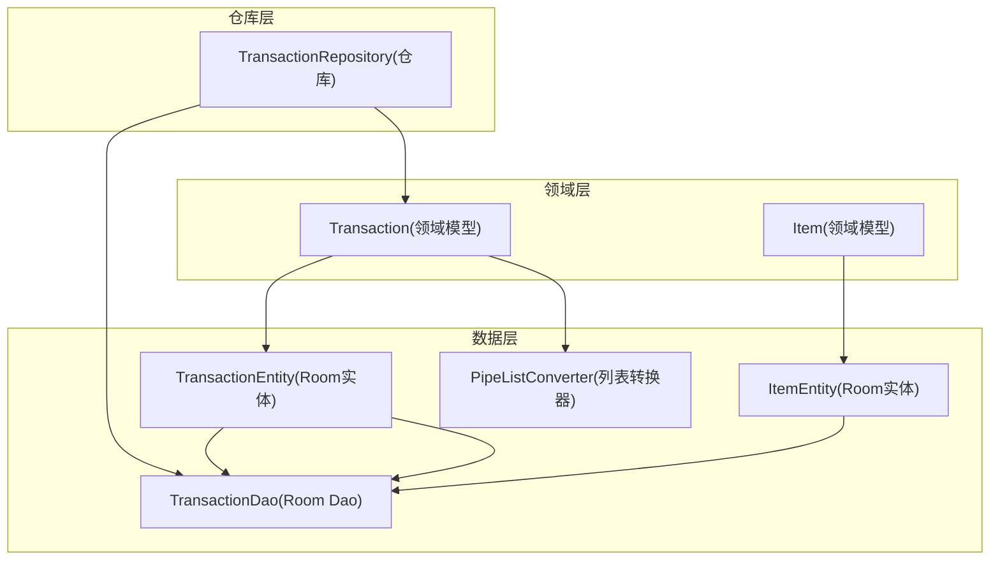
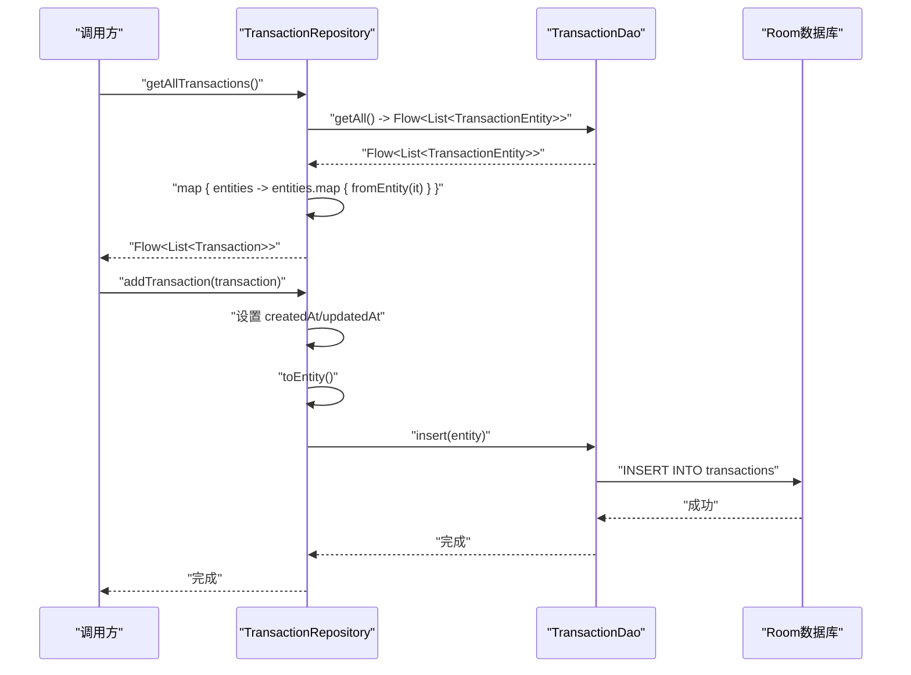
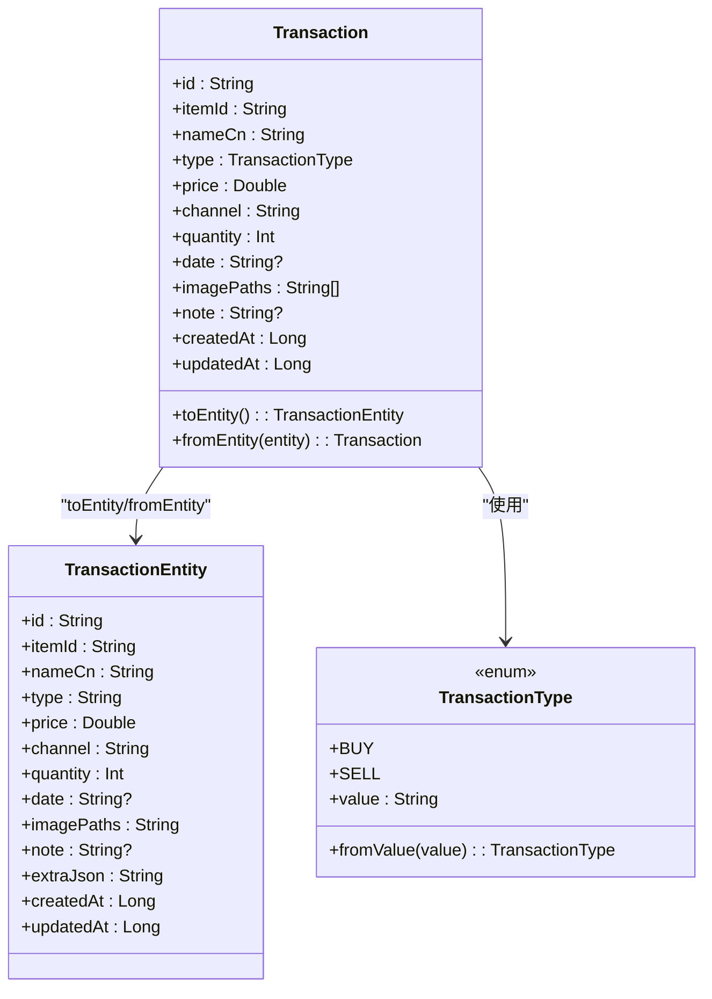
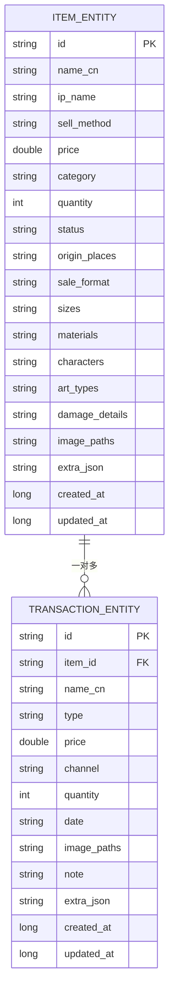
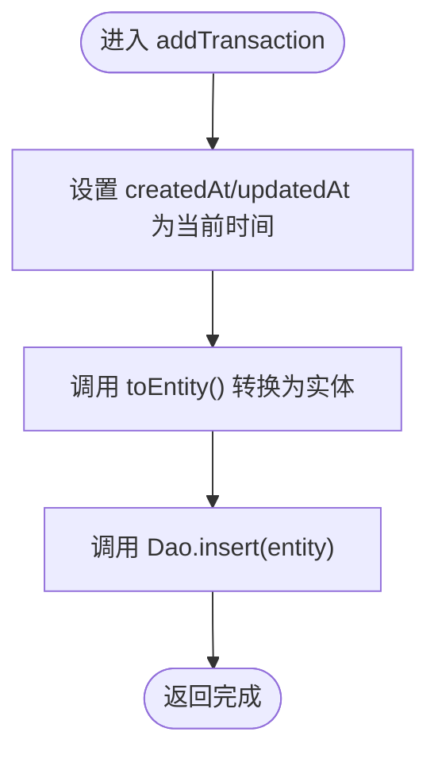
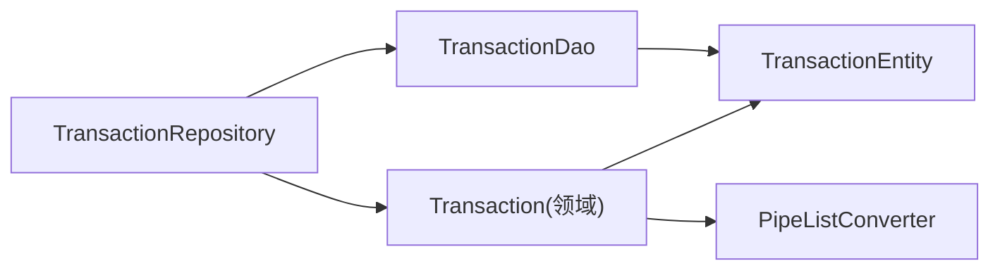

# 交易记录模块

<cite>
**本文引用的文件**   
- [Transaction.kt](file://GuZiStorage/app/src/main/java/com/guzi/storage/domain/model/Transaction.kt)
- [TransactionEntity.kt](file://GuZiStorage/app/src/main/java/com/guzi/storage/data/local/entity/TransactionEntity.kt)
- [TransactionDao.kt](file://GuZiStorage/app/src/main/java/com/guzi/storage/data/local/dao/TransactionDao.kt)
- [TransactionRepository.kt](file://GuZiStorage/app/src/main/java/com/guzi/storage/data/repository/TransactionRepository.kt)
- [Item.kt](file://GuZiStorage/app/src/main/java/com/guzi/storage/domain/model/Item.kt)
- [ItemEntity.kt](file://GuZiStorage/app/src/main/java/com/guzi/storage/data/local/entity/ItemEntity.kt)
- [PipeListConverter.kt](file://GuZiStorage/app/src/main/java/com/guzi/storage/data/local/PipeListConverter.kt)
</cite>

## 目录
1. [简介](#简介)
2. [项目结构](#项目结构)
3. [核心组件](#核心组件)
4. [架构总览](#架构总览)
5. [详细组件分析](#详细组件分析)
6. [依赖关系分析](#依赖关系分析)
7. [性能与一致性](#性能与一致性)
8. [故障排查指南](#故障排查指南)
9. [结论](#结论)
10. [附录：API 与使用示例](#附录api-与使用示例)

## 简介
本技术文档围绕“交易记录模块”展开，聚焦以下目标：
- 领域模型 Transaction 的结构设计，包括购入与卖出记录的字段定义与语义。
- 交易记录的生命周期管理（创建、查询、更新、删除）的实现路径。
- 交易记录与物品实体的关联关系、外键约束与数据一致性保障。
- 交易统计分析能力的实现细节与扩展建议（成本计算、收益统计、时间线展示）。
- TransactionRepository 的使用方法与响应式数据流集成模式。

## 项目结构
交易记录模块采用分层架构：领域层（domain）、数据访问层（local/dao + entity）、仓库层（repository），并通过 Room 持久化到本地数据库。

图表来源
- [Transaction.kt:1-68](file://GuZiStorage/app/src/main/java/com/guzi/storage/domain/model/Transaction.kt#L1-L68)
- [TransactionEntity.kt:1-65](file://GuZiStorage/app/src/main/java/com/guzi/storage/data/local/entity/TransactionEntity.kt#L1-L65)
- [TransactionDao.kt:1-49](file://GuZiStorage/app/src/main/java/com/guzi/storage/data/local/dao/TransactionDao.kt#L1-L49)
- [TransactionRepository.kt:1-63](file://GuZiStorage/app/src/main/java/com/guzi/storage/data/repository/TransactionRepository.kt#L1-L63)
- [Item.kt:1-106](file://GuZiStorage/app/src/main/java/com/guzi/storage/domain/model/Item.kt#L1-L106)
- [ItemEntity.kt:1-89](file://GuZiStorage/app/src/main/java/com/guzi/storage/data/local/entity/ItemEntity.kt#L1-L89)
- [PipeListConverter.kt:1-26](file://GuZiStorage/app/src/main/java/com/guzi/storage/data/local/PipeListConverter.kt#L1-L26)

章节来源
- [Transaction.kt:1-68](file://GuZiStorage/app/src/main/java/com/guzi/storage/domain/model/Transaction.kt#L1-L68)
- [TransactionEntity.kt:1-65](file://GuZiStorage/app/src/main/java/com/guzi/storage/data/local/entity/TransactionEntity.kt#L1-L65)
- [TransactionDao.kt:1-49](file://GuZiStorage/app/src/main/java/com/guzi/storage/data/local/dao/TransactionDao.kt#L1-L49)
- [TransactionRepository.kt:1-63](file://GuZiStorage/app/src/main/java/com/guzi/storage/data/repository/TransactionRepository.kt#L1-L63)
- [Item.kt:1-106](file://GuZiStorage/app/src/main/java/com/guzi/storage/domain/model/Item.kt#L1-L106)
- [ItemEntity.kt:1-89](file://GuZiStorage/app/src/main/java/com/guzi/storage/data/local/entity/ItemEntity.kt#L1-L89)
- [PipeListConverter.kt:1-26](file://GuZiStorage/app/src/main/java/com/guzi/storage/data/local/PipeListConverter.kt#L1-L26)

## 核心组件
- 领域模型 Transaction：描述一次交易的核心信息，包含类型（购入/卖出）、价格、数量、渠道、时间等，并提供与 Entity 的互转方法。
- 数据实体 TransactionEntity：Room 表映射，定义外键、索引、列名及默认值策略。
- 数据访问对象 TransactionDao：封装 SQL 查询与写入操作，支持 Flow 响应式返回。
- 仓库 TransactionRepository：对外暴露业务级 API，统一处理时间戳填充、类型转换与 Flow 映射。
- 辅助工具 PipeListConverter：在 List<String> 与管道符分隔字符串之间进行转换，用于多值字段的持久化。

章节来源
- [Transaction.kt:1-68](file://GuZiStorage/app/src/main/java/com/guzi/storage/domain/model/Transaction.kt#L1-L68)
- [TransactionEntity.kt:1-65](file://GuZiStorage/app/src/main/java/com/guzi/storage/data/local/entity/TransactionEntity.kt#L1-L65)
- [TransactionDao.kt:1-49](file://GuZiStorage/app/src/main/java/com/guzi/storage/data/local/dao/TransactionDao.kt#L1-L49)
- [TransactionRepository.kt:1-63](file://GuZiStorage/app/src/main/java/com/guzi/storage/data/repository/TransactionRepository.kt#L1-L63)
- [PipeListConverter.kt:1-26](file://GuZiStorage/app/src/main/java/com/guzi/storage/data/local/PipeListConverter.kt#L1-L26)

## 架构总览
交易记录模块遵循清晰的层次边界：UI/上层调用 Repository，Repository 通过 Dao 访问 Room 实体，领域模型与实体之间通过转换方法进行解耦。

图表来源
- [TransactionRepository.kt:20-39](file://GuZiStorage/app/src/main/java/com/guzi/storage/data/repository/TransactionRepository.kt#L20-L39)
- [TransactionDao.kt:20-38](file://GuZiStorage/app/src/main/java/com/guzi/storage/data/local/dao/TransactionDao.kt#L20-L38)
- [Transaction.kt:23-53](file://GuZiStorage/app/src/main/java/com/guzi/storage/domain/model/Transaction.kt#L23-L53)

## 详细组件分析

### 领域模型 Transaction 与枚举
- 字段说明
  - id：全局唯一标识
  - itemId：关联物品的 ID
  - nameCn：交易时物品的中文名称快照
  - type：交易类型（购入/卖出）
  - price：单价
  - channel：交易渠道
  - quantity：数量（默认 1）
  - date：可选的时间标记（如 YYYY-MM）
  - imagePaths：图片路径列表（持久化为管道符分隔字符串）
  - note：备注
  - createdAt/updatedAt：创建与更新时间戳
- 类型转换
  - toEntity/fromEntity：负责领域模型与实体之间的双向转换，其中 imagePaths 使用 PipeListConverter 进行序列化/反序列化。
- 交易类型枚举
  - BUY/SELL：以中文文本作为存储值，提供 fromValue 安全解析。

图表来源
- [Transaction.kt:9-67](file://GuZiStorage/app/src/main/java/com/guzi/storage/domain/model/Transaction.kt#L9-L67)
- [TransactionEntity.kt:28-64](file://GuZiStorage/app/src/main/java/com/guzi/storage/data/local/entity/TransactionEntity.kt#L28-L64)

章节来源
- [Transaction.kt:1-68](file://GuZiStorage/app/src/main/java/com/guzi/storage/domain/model/Transaction.kt#L1-L68)

### 数据实体 TransactionEntity 与外键约束
- 表结构与索引
  - 主键：id
  - 外键：item_id 引用 ItemEntity.id，onDelete=CASCADE，保证删除物品时级联删除其交易记录
  - 索引：对 item_id 建立索引，提升按物品查询的性能
- 字段映射
  - 所有字段均通过 @ColumnInfo 指定列名，便于与数据库保持一致
  - extraJson 预留扩展空间
  - createdAt/updatedAt 默认值为当前时间戳

图表来源
- [TransactionEntity.kt:14-27](file://GuZiStorage/app/src/main/java/com/guzi/storage/data/local/entity/TransactionEntity.kt#L14-L27)
- [ItemEntity.kt:16-23](file://GuZiStorage/app/src/main/java/com/guzi/storage/data/local/entity/ItemEntity.kt#L16-L23)

章节来源
- [TransactionEntity.kt:1-65](file://GuZiStorage/app/src/main/java/com/guzi/storage/data/local/entity/TransactionEntity.kt#L1-L65)
- [ItemEntity.kt:1-89](file://GuZiStorage/app/src/main/java/com/guzi/storage/data/local/entity/ItemEntity.kt#L1-L89)

### 数据访问对象 TransactionDao
- 查询接口
  - getAll：按创建时间倒序返回全部交易记录（Flow）
  - getByItemId：按物品 ID 查询交易记录（Flow）
  - getById：按 ID 获取单条记录（suspend）
  - countByItemId：统计某物品的交易次数（suspend）
- 写入接口
  - insert/insertAll：插入或批量插入（冲突策略 REPLACE）
  - update：更新记录
  - delete/deleteByIds：删除单条或多条记录

章节来源
- [TransactionDao.kt:16-48](file://GuZiStorage/app/src/main/java/com/guzi/storage/data/local/dao/TransactionDao.kt#L16-L48)

### 仓库 TransactionRepository
- 响应式查询
  - getAllTransactions/getTransactionsByItemId：将 Dao 返回的 Flow<List<TransactionEntity>> 映射为 Flow<List<Transaction>>，并在映射中完成领域模型转换。
- 同步查询
  - getTransactionById/getTransactionCountByItemId：直接透传 Dao 的 suspend 方法并做必要转换。
- 写入操作
  - addTransaction/addTransactions：在保存前自动填充 createdAt/updatedAt，再转换为实体后写入。
  - updateTransaction：更新时刷新 updatedAt。
  - deleteTransaction/deleteTransactions：支持单条与批量删除。

图表来源
- [TransactionRepository.kt:34-39](file://GuZiStorage/app/src/main/java/com/guzi/storage/data/repository/TransactionRepository.kt#L34-L39)
- [Transaction.kt:23-36](file://GuZiStorage/app/src/main/java/com/guzi/storage/domain/model/Transaction.kt#L23-L36)

章节来源
- [TransactionRepository.kt:1-63](file://GuZiStorage/app/src/main/java/com/guzi/storage/data/repository/TransactionRepository.kt#L1-L63)

### 列表转换器 PipeListConverter
- 作用：在 List<String> 与管道符分隔字符串之间转换，用于持久化多选字段（如 imagePaths）。
- 行为：空列表转为空字符串；空字符串转为空列表。

章节来源
- [PipeListConverter.kt:1-26](file://GuZiStorage/app/src/main/java/com/guzi/storage/data/local/PipeListConverter.kt#L1-L26)

## 依赖关系分析
- 耦合与内聚
  - Repository 仅依赖 Dao 与领域模型，职责清晰，内聚度高。
  - Domain 与 Data 通过 Entity 与 Converter 解耦，避免上层感知存储细节。
- 外部依赖
  - Room（Dao/Entity）、Kotlin Coroutines Flow、依赖注入注解（@Singleton/@Inject）。
- 潜在循环依赖
  - 当前无循环依赖迹象，领域层不反向依赖数据层。

图表来源
- [TransactionRepository.kt:1-63](file://GuZiStorage/app/src/main/java/com/guzi/storage/data/repository/TransactionRepository.kt#L1-L63)
- [TransactionDao.kt:1-49](file://GuZiStorage/app/src/main/java/com/guzi/storage/data/local/dao/TransactionDao.kt#L1-L49)
- [Transaction.kt:1-68](file://GuZiStorage/app/src/main/java/com/guzi/storage/domain/model/Transaction.kt#L1-L68)
- [TransactionEntity.kt:1-65](file://GuZiStorage/app/src/main/java/com/guzi/storage/data/local/entity/TransactionEntity.kt#L1-L65)
- [PipeListConverter.kt:1-26](file://GuZiStorage/app/src/main/java/com/guzi/storage/data/local/PipeListConverter.kt#L1-L26)

章节来源
- [TransactionRepository.kt:1-63](file://GuZiStorage/app/src/main/java/com/guzi/storage/data/repository/TransactionRepository.kt#L1-L63)
- [TransactionDao.kt:1-49](file://GuZiStorage/app/src/main/java/com/guzi/storage/data/local/dao/TransactionDao.kt#L1-L49)
- [Transaction.kt:1-68](file://GuZiStorage/app/src/main/java/com/guzi/storage/domain/model/Transaction.kt#L1-L68)
- [TransactionEntity.kt:1-65](file://GuZiStorage/app/src/main/java/com/guzi/storage/data/local/entity/TransactionEntity.kt#L1-L65)
- [PipeListConverter.kt:1-26](file://GuZiStorage/app/src/main/java/com/guzi/storage/data/local/PipeListConverter.kt#L1-L26)

## 性能与一致性
- 查询性能
  - 对 item_id 建立索引，优化按物品维度查询与统计。
  - 使用 Flow 实现响应式数据流，减少轮询与重复查询。
- 写入性能
  - 批量插入使用 insertAll，降低事务开销。
  - 冲突策略 REPLACE 简化幂等写入场景。
- 一致性保障
  - 外键 CASCADE 确保删除物品时，其交易记录被一致清理。
  - createdAt/updatedAt 由仓库层统一设置，保证时间戳一致性。
- 可扩展性
  - extraJson 字段为未来新增属性预留空间，避免频繁迁移表结构。

[本节为通用性能指导，无需特定文件引用]

## 故障排查指南
- 常见问题
  - 外键约束失败：检查是否先删除父项物品导致子项交易记录未正确级联删除。
  - 数据不一致：确认是否在更新时刷新了 updatedAt。
  - 列表字段异常：检查 imagePaths 的序列化/反序列化是否正确使用 PipeListConverter。
- 定位建议
  - 通过 Flow 订阅观察数据变化，确认 UI 层是否正确接收最新状态。
  - 核对 Dao 的 SQL 语句与索引使用情况，必要时添加 EXPLAIN 分析。

章节来源
- [TransactionEntity.kt:14-27](file://GuZiStorage/app/src/main/java/com/guzi/storage/data/local/entity/TransactionEntity.kt#L14-L27)
- [TransactionRepository.kt:48-52](file://GuZiStorage/app/src/main/java/com/guzi/storage/data/repository/TransactionRepository.kt#L48-L52)
- [PipeListConverter.kt:1-26](file://GuZiStorage/app/src/main/java/com/guzi/storage/data/local/PipeListConverter.kt#L1-L26)

## 结论
交易记录模块以清晰的层次划分与明确的职责边界实现了稳健的交易数据管理能力。领域模型与实体分离、外键约束与索引优化、以及响应式数据流的使用，共同保障了功能正确性与运行效率。后续可在仓库层或独立服务层扩展统计分析能力，以满足更复杂的成本与收益分析需求。

[本节为总结性内容，无需特定文件引用]

## 附录：API 与使用示例

### 生命周期操作概览
- 创建
  - 调用仓库层的 addTransaction/addTransactions，自动填充时间戳并持久化。
- 查询
  - 使用 getAllTransactions/getTransactionsByItemId 获取 Flow 列表；getTransactionById 获取单条记录。
- 更新
  - 调用 updateTransaction，仓库层会刷新 updatedAt。
- 删除
  - 支持单条与批量删除，注意外键级联影响。

章节来源
- [TransactionRepository.kt:20-61](file://GuZiStorage/app/src/main/java/com/guzi/storage/data/repository/TransactionRepository.kt#L20-L61)

### 响应式数据流集成模式
- 订阅 Flow
  - 在 UI 层订阅 getAllTransactions 或 getTransactionsByItemId，自动接收变更。
- 数据转换
  - Repository 内部已完成从 Entity 到领域模型的转换，UI 可直接消费领域模型。

章节来源
- [TransactionRepository.kt:20-24](file://GuZiStorage/app/src/main/java/com/guzi/storage/data/repository/TransactionRepository.kt#L20-L24)

### 交易统计分析（设计与扩展建议）
- 成本计算
  - 基于类型为“购入”的记录，按 price × quantity 汇总得到总成本。
- 收益统计
  - 基于类型为“卖出”的记录，按 price × quantity 汇总得到总收入；结合成本可计算利润。
- 时间线展示
  - 利用 createdAt 或 date 字段排序生成时间线视图。
- 实现位置建议
  - 在仓库层或独立的分析服务中聚合数据，返回结构化统计结果供 UI 展示。

[本节为概念性扩展建议，无需特定文件引用]