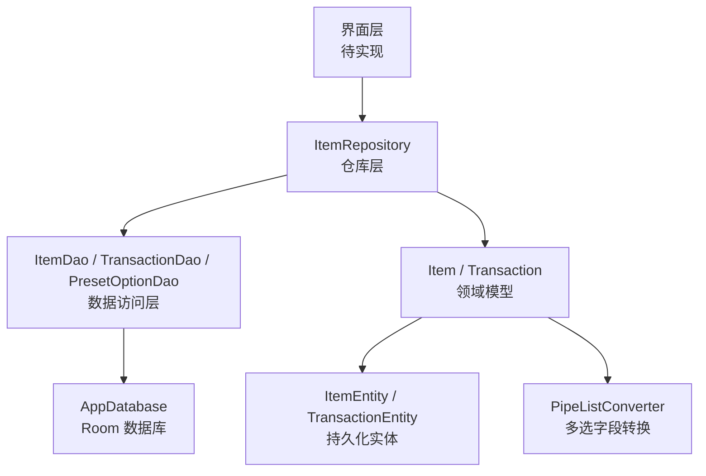
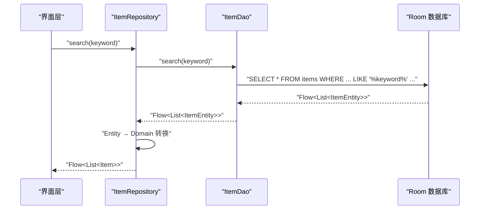
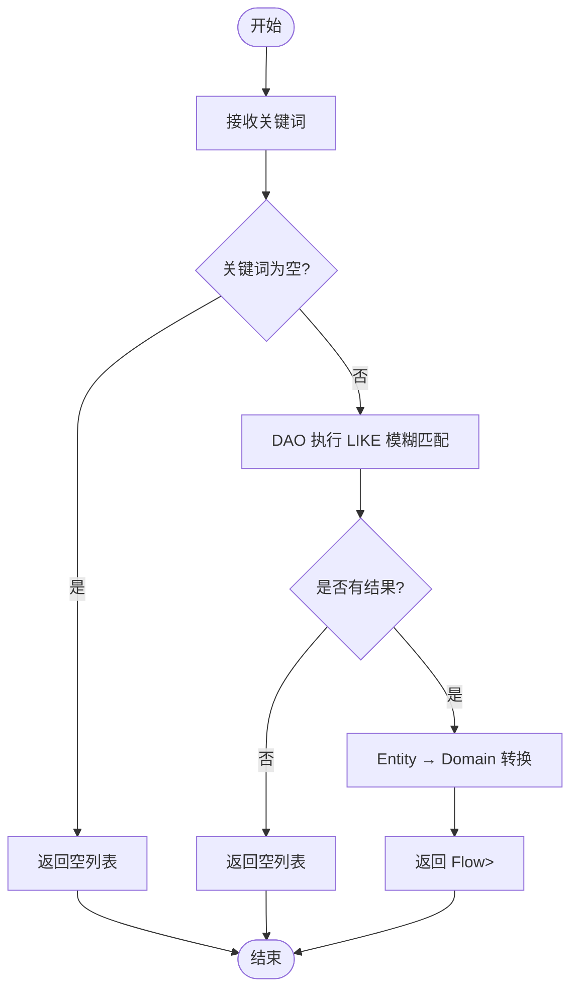
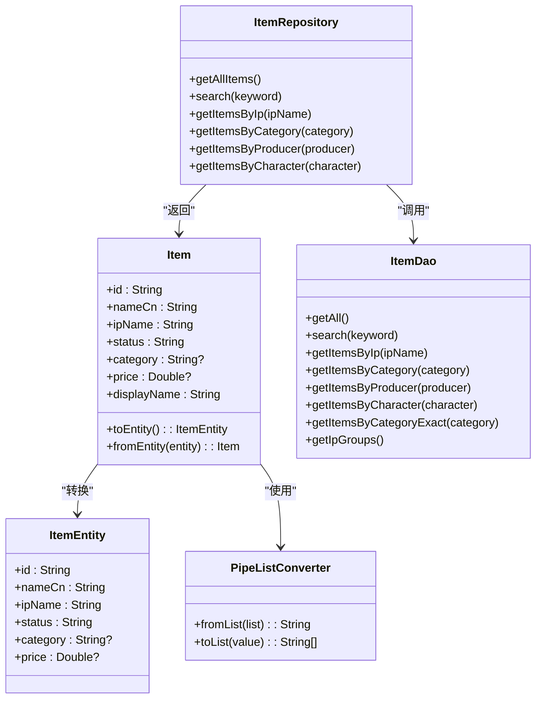

# 搜索与筛选功能

<cite>
**本文引用的文件**   
- [Item.kt](file://GuZiStorage/app/src/main/java/com/guzi/storage/domain/model/Item.kt)
- [ItemEntity.kt](file://GuZiStorage/app/src/main/java/com/guzi/storage/data/local/entity/ItemEntity.kt)
- [ItemDao.kt](file://GuZiStorage/app/src/main/java/com/guzi/storage/data/local/dao/ItemDao.kt)
- [ItemRepository.kt](file://GuZiStorage/app/src/main/java/com/guzi/storage/data/repository/ItemRepository.kt)
- [AppDatabase.kt](file://GuZiStorage/app/src/main/java/com/guzi/storage/data/local/AppDatabase.kt)
- [AppModule.kt](file://GuZiStorage/app/src/main/java/com/guzi/storage/di/AppModule.kt)
- [PipeListConverter.kt](file://GuZiStorage/app/src/main/java/com/guzi/storage/data/local/PipeListConverter.kt)
- [PresetOptionEntity.kt](file://GuZiStorage/app/src/main/java/com/guzi/storage/data/local/entity/PresetOptionEntity.kt)
- [PresetOptionDao.kt](file://GuZiStorage/app/src/main/java/com/guzi/storage/data/local/dao/PresetOptionDao.kt)
- [TransactionDao.kt](file://GuZiStorage/app/src/main/java/com/guzi/storage/data/local/dao/TransactionDao.kt)
- [Transaction.kt](file://GuZiStorage/app/src/main/java/com/guzi/storage/domain/model/Transaction.kt)
- [基础prd.md](file://基础prd.md)
</cite>

## 目录
1. [引言](#引言)
2. [项目结构](#项目结构)
3. [核心组件](#核心组件)
4. [架构总览](#架构总览)
5. [详细组件分析](#详细组件分析)
6. [依赖关系分析](#依赖关系分析)
7. [性能考虑](#性能考虑)
8. [故障排查指南](#故障排查指南)
9. [结论](#结论)
10. [附录](#附录)

## 引言
本文件围绕“搜索与筛选”能力，系统化梳理当前代码库中的实现现状、数据模型与查询路径，并在此基础上提出多维度搜索算法设计、筛选条件构建机制、性能优化方案（索引、缓存、分页）、排序与分组展示、时间线与统计信息生成逻辑，以及响应式实时搜索建议与自动完成的实现模式。文档既覆盖现有代码的精确映射，也给出面向未来的扩展建议，帮助读者快速理解并持续演进该功能。

## 项目结构
与搜索和筛选相关的关键层次：
- 领域模型层：Item、Transaction
- 数据实体层：ItemEntity、TransactionEntity、PresetOptionEntity
- 数据访问层：ItemDao、TransactionDao、PresetOptionDao
- 仓库层：ItemRepository（封装CRUD与Flow）
- 数据库与注入：AppDatabase、AppModule
- 工具类：PipeListConverter（多选字段序列化/反序列化）
- 需求说明：基础prd.md（搜索范围、交互反馈等）

图表来源
- [AppDatabase.kt:1-34](file://GuZiStorage/app/src/main/java/com/guzi/storage/data/local/AppDatabase.kt#L1-L34)
- [AppModule.kt:1-49](file://GuZiStorage/app/src/main/java/com/guzi/storage/di/AppModule.kt#L1-L49)
- [ItemDao.kt:1-90](file://GuZiStorage/app/src/main/java/com/guzi/storage/data/local/dao/ItemDao.kt#L1-L90)
- [ItemRepository.kt:1-80](file://GuZiStorage/app/src/main/java/com/guzi/storage/data/repository/ItemRepository.kt#L1-L80)
- [Item.kt:1-106](file://GuZiStorage/app/src/main/java/com/guzi/storage/domain/model/Item.kt#L1-L106)
- [ItemEntity.kt:1-89](file://GuZiStorage/app/src/main/java/com/guzi/storage/data/local/entity/ItemEntity.kt#L1-L89)
- [PipeListConverter.kt:1-26](file://GuZiStorage/app/src/main/java/com/guzi/storage/data/local/PipeListConverter.kt#L1-L26)

章节来源
- [基础prd.md:181-213](file://基础prd.md#L181-L213)

## 核心组件
- Item 领域模型：承载物品属性与显示名称计算，提供 Entity 互转方法，用于上层业务与UI展示。
- ItemEntity 持久化实体：定义 items 表结构与索引，包含 IP 名、状态、类别等常用检索列的索引。
- ItemDao：定义所有查询与写入接口，包括关键词搜索、按角色筛选、按种类精确匹配、按IP/出品商筛选、IP分组统计等。
- ItemRepository：对外暴露 Flow<List<Item>> 响应式数据流，统一进行 Entity ↔ Domain 转换。
- PipeListConverter：在 List<String> 与管道符分隔字符串之间转换，支撑多选字段的存储与查询。
- PresetOptionDao/Entity：维护预设选项，为自动完成与下拉建议提供数据源。
- AppDatabase/AppModule：Room 数据库与 Hilt 依赖注入配置。

章节来源
- [Item.kt:1-106](file://GuZiStorage/app/src/main/java/com/guzi/storage/domain/model/Item.kt#L1-L106)
- [ItemEntity.kt:1-89](file://GuZiStorage/app/src/main/java/com/guzi/storage/data/local/entity/ItemEntity.kt#L1-L89)
- [ItemDao.kt:1-90](file://GuZiStorage/app/src/main/java/com/guzi/storage/data/local/dao/ItemDao.kt#L1-L90)
- [ItemRepository.kt:1-80](file://GuZiStorage/app/src/main/java/com/guzi/storage/data/repository/ItemRepository.kt#L1-L80)
- [PipeListConverter.kt:1-26](file://GuZiStorage/app/src/main/java/com/guzi/storage/data/local/PipeListConverter.kt#L1-L26)
- [PresetOptionDao.kt:1-41](file://GuZiStorage/app/src/main/java/com/guzi/storage/data/local/dao/PresetOptionDao.kt#L1-L41)
- [PresetOptionEntity.kt:1-36](file://GuZiStorage/app/src/main/java/com/guzi/storage/data/local/entity/PresetOptionEntity.kt#L1-L36)
- [AppDatabase.kt:1-34](file://GuZiStorage/app/src/main/java/com/guzi/storage/data/local/AppDatabase.kt#L1-L34)
- [AppModule.kt:1-49](file://GuZiStorage/app/src/main/java/com/guzi/storage/di/AppModule.kt#L1-L49)

## 架构总览
搜索与筛选的数据流从 UI 发起，经 Repository 调用 DAO，DAO 通过 Room 执行 SQL 查询，结果以 Flow 形式返回至 UI。

图表来源
- [ItemRepository.kt:41-42](file://GuZiStorage/app/src/main/java/com/guzi/storage/data/repository/ItemRepository.kt#L41-L42)
- [ItemDao.kt:49-56](file://GuZiStorage/app/src/main/java/com/guzi/storage/data/local/dao/ItemDao.kt#L49-L56)
- [AppDatabase.kt:20-33](file://GuZiStorage/app/src/main/java/com/guzi/storage/data/local/AppDatabase.kt#L20-L33)

## 详细组件分析

### 多维度搜索算法设计
- 全文搜索（模糊匹配）
  - 实现位置：ItemDao.search
  - 策略：对中文名、IP名、日文名使用 LIKE 模糊匹配，OR 组合多列，ORDER BY updated_at DESC
  - 适用场景：全局搜索、快速定位
- 精确匹配
  - 实现位置：ItemDao.getItemsByCategoryExact
  - 策略：category 等值匹配，适合“种类”等枚举型属性的精准筛选
- 多选字段模糊匹配
  - 实现位置：ItemDao.getItemsByCharacter
  - 策略：characters 列采用管道符分隔存储，LIKE 模糊匹配子串；注意可能命中部分匹配项
- 组合筛选（建议）
  - 现状：DAO 提供单维度查询（按IP、按品类、按出品商、按角色），未提供复合条件查询
  - 建议：在 DAO 层新增组合查询接口，或在 Repository 层合并多个 Flow 后在内存中交集过滤；对于大数据量优先推荐在 DAO 层拼接动态 SQL 或 UNION/JOIN 方式

章节来源
- [ItemDao.kt:37-68](file://GuZiStorage/app/src/main/java/com/guzi/storage/data/local/dao/ItemDao.kt#L37-L68)
- [ItemRepository.kt:32-45](file://GuZiStorage/app/src/main/java/com/guzi/storage/data/repository/ItemRepository.kt#L32-L45)

### 筛选条件的构建机制
- 按 IP 名称筛选：getItemsByIp
- 按类别筛选：getItemsByCategory / getItemsByCategoryExact
- 按状态筛选：可通过新增 DAO 接口 + 利用 status 列索引实现
- 按价格区间筛选：需新增 DAO 接口，基于 price 列范围查询
- 按角色筛选：getItemsByCharacter（多选字段模糊匹配）
- 按出品商筛选：getItemsByProducer
- 组合筛选：建议在 DAO 层增加组合查询方法，或在 Repository 层做内存级交集处理（小数据集可行）

章节来源
- [ItemDao.kt:37-68](file://GuZiStorage/app/src/main/java/com/guzi/storage/data/local/dao/ItemDao.kt#L37-L68)
- [ItemEntity.kt:16-22](file://GuZiStorage/app/src/main/java/com/guzi/storage/data/local/entity/ItemEntity.kt#L16-L22)

### 搜索性能优化方案
- 索引策略
  - 已存在索引：ip_name、status、category
  - 建议补充：name_cn、name_en、producer、price 等高频检索列的索引，以提升 LIKE 与等值查询性能
- 查询缓存
  - 现状：无显式缓存
  - 建议：在 Repository 层引入轻量缓存（如 LruCache 或内存 Map），对相同参数查询结果短期缓存；或使用 Flow 的 shareIn/replay 控制重复订阅开销
- 分页加载
  - 现状：getAll/search 返回全量列表
  - 建议：DAO 层增加 LIMIT/OFFSET 或游标分页接口；UI 侧实现懒加载与滚动加载更多
- 多选字段查询优化
  - 现状：characters 使用 LIKE 模糊匹配，可能无法命中索引
  - 建议：将多选字段拆分为独立关联表（item_id, value），建立联合索引，支持高效 IN/EXISTS 查询

章节来源
- [ItemEntity.kt:16-22](file://GuZiStorage/app/src/main/java/com/guzi/storage/data/local/entity/ItemEntity.kt#L16-L22)
- [ItemDao.kt:20-56](file://GuZiStorage/app/src/main/java/com/guzi/storage/data/local/dao/ItemDao.kt#L20-L56)

### 搜索结果排序与分组展示
- 排序
  - 默认：updated_at DESC（更新倒序）
  - 建议：支持按价格升/降序、数量、创建时间等排序
- 分组
  - 现状：DAO 提供 IP 分组统计（getIpGroups）
  - 建议：扩展分组维度（类别、状态、出品商），并在 UI 层渲染分组卡片

章节来源
- [ItemDao.kt:34-38](file://GuZiStorage/app/src/main/java/com/guzi/storage/data/local/dao/ItemDao.kt#L34-L38)
- [ItemRepository.kt:29-33](file://GuZiStorage/app/src/main/java/com/guzi/storage/data/repository/ItemRepository.kt#L29-L33)

### 时间线视图与统计信息生成逻辑
- 时间线视图
  - 交易记录：TransactionDao.getByItemId 按 created_at DESC 获取
  - 建议：结合 Item.updated_at 与 Transaction.created_at 形成“物品+交易”双时间线
- 统计信息
  - 现状：IP 分组计数（getIpGroups）
  - 建议：新增按类别、状态、渠道等的聚合统计接口，供仪表盘展示

章节来源
- [TransactionDao.kt:23-24](file://GuZiStorage/app/src/main/java/com/guzi/storage/data/local/dao/TransactionDao.kt#L23-L24)
- [ItemDao.kt:34-35](file://GuZiStorage/app/src/main/java/com/guzi/storage/data/local/dao/ItemDao.kt#L34-L35)

### 响应式搜索与自动完成
- 实时搜索
  - 现状：Repository 暴露 search 返回 Flow<List<Item>>，可驱动 UI 实时更新
  - 建议：在 UI 层加入防抖（debounce）减少频繁查询
- 自动完成与建议
  - 数据源：PresetOptionDao.getByAttribute/getOptionValues
  - 建议：根据输入前缀过滤预设选项，提供下拉建议；同时支持用户手动输入新值并写入预设选项表

章节来源
- [ItemRepository.kt:41-42](file://GuZiStorage/app/src/main/java/com/guzi/storage/data/repository/ItemRepository.kt#L41-L42)
- [PresetOptionDao.kt:19-23](file://GuZiStorage/app/src/main/java/com/guzi/storage/data/local/dao/PresetOptionDao.kt#L19-L23)

### 关键流程图（示例：关键词搜索）

图表来源
- [ItemDao.kt:49-56](file://GuZiStorage/app/src/main/java/com/guzi/storage/data/local/dao/ItemDao.kt#L49-L56)
- [ItemRepository.kt:41-42](file://GuZiStorage/app/src/main/java/com/guzi/storage/data/repository/ItemRepository.kt#L41-L42)

## 依赖关系分析

图表来源
- [Item.kt:1-106](file://GuZiStorage/app/src/main/java/com/guzi/storage/domain/model/Item.kt#L1-L106)
- [ItemEntity.kt:1-89](file://GuZiStorage/app/src/main/java/com/guzi/storage/data/local/entity/ItemEntity.kt#L1-L89)
- [ItemDao.kt:1-90](file://GuZiStorage/app/src/main/java/com/guzi/storage/data/local/dao/ItemDao.kt#L1-L90)
- [ItemRepository.kt:1-80](file://GuZiStorage/app/src/main/java/com/guzi/storage/data/repository/ItemRepository.kt#L1-L80)
- [PipeListConverter.kt:1-26](file://GuZiStorage/app/src/main/java/com/guzi/storage/data/local/PipeListConverter.kt#L1-L26)

章节来源
- [Item.kt:1-106](file://GuZiStorage/app/src/main/java/com/guzi/storage/domain/model/Item.kt#L1-L106)
- [ItemRepository.kt:1-80](file://GuZiStorage/app/src/main/java/com/guzi/storage/data/repository/ItemRepository.kt#L1-L80)
- [ItemDao.kt:1-90](file://GuZiStorage/app/src/main/java/com/guzi/storage/data/local/dao/ItemDao.kt#L1-L90)

## 性能考虑
- 索引优化：为 name_cn、name_en、producer、price 等高频检索列添加索引，提升 LIKE 与范围查询效率
- 查询去重与合并：避免在 UI 层重复订阅导致多次查询，使用 shareIn/replay 或单一订阅源
- 分页与懒加载：对全量列表与搜索结果实施分页，降低首屏压力与内存占用
- 多选字段拆分：将 characters、artTypes 等多选字段拆分为独立关联表，提高查询与索引命中率
- 缓存策略：对热点查询（如热门 IP 分组、常用类别）设置短期缓存，减少数据库压力

[本节为通用指导，不直接分析具体文件]

## 故障排查指南
- 搜索无结果
  - 检查关键词是否被正确传入 DAO
  - 确认 LIKE 匹配列是否存在目标文本
  - 验证 Flow 订阅是否生效
- 多选字段匹配不准确
  - characters 使用 LIKE 模糊匹配，可能出现部分匹配；建议改为精确匹配或拆分表
- 性能问题
  - 观察是否缺少必要索引
  - 检查是否存在全表扫描
  - 评估是否需要分页与缓存

章节来源
- [ItemDao.kt:49-62](file://GuZiStorage/app/src/main/java/com/guzi/storage/data/local/dao/ItemDao.kt#L49-L62)
- [ItemRepository.kt:41-45](file://GuZiStorage/app/src/main/java/com/guzi/storage/data/repository/ItemRepository.kt#L41-L45)

## 结论
当前代码库已具备基础的全文搜索、精确匹配与多维度筛选能力，并通过 Flow 提供响应式数据流。为满足更大规模数据与更复杂交互的需求，建议完善索引、引入缓存与分页、重构多选字段查询路径，并扩展组合筛选与统计接口。自动完成与实时建议可基于预设选项表快速落地，进一步提升用户体验。

[本节为总结性内容，不直接分析具体文件]

## 附录
- 需求参考：搜索范围与交互反馈详见 PRD 对应章节
- 数据模型参考：Item 与 Transaction 领域模型及 Entity 定义

章节来源
- [基础prd.md:202-204](file://基础prd.md#L202-L204)
- [Transaction.kt:1-68](file://GuZiStorage/app/src/main/java/com/guzi/storage/domain/model/Transaction.kt#L1-L68)
- [TransactionDao.kt:1-49](file://GuZiStorage/app/src/main/java/com/guzi/storage/data/local/dao/TransactionDao.kt#L1-L49)