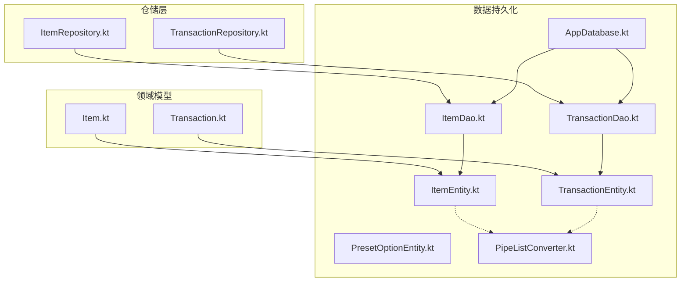
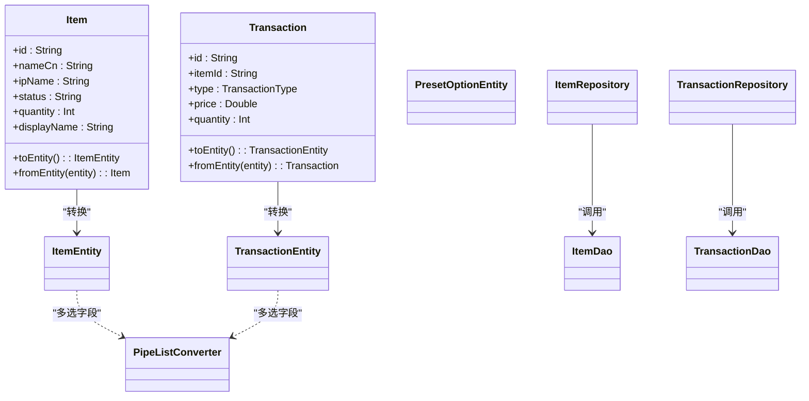
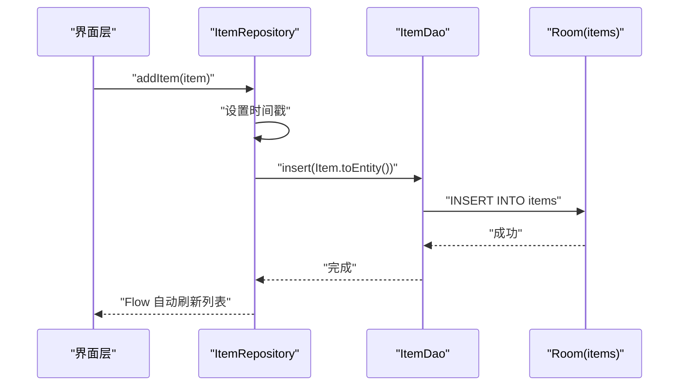
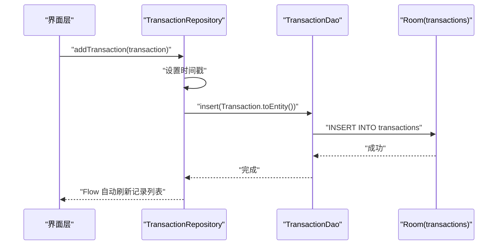
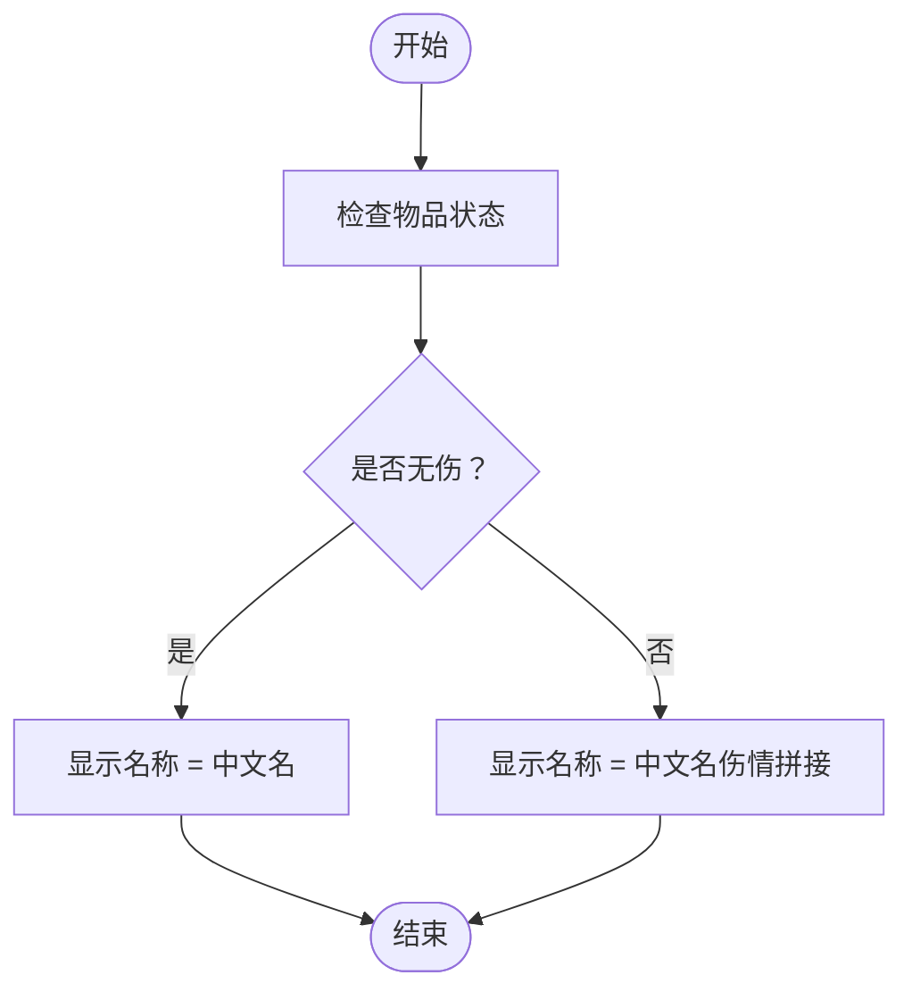
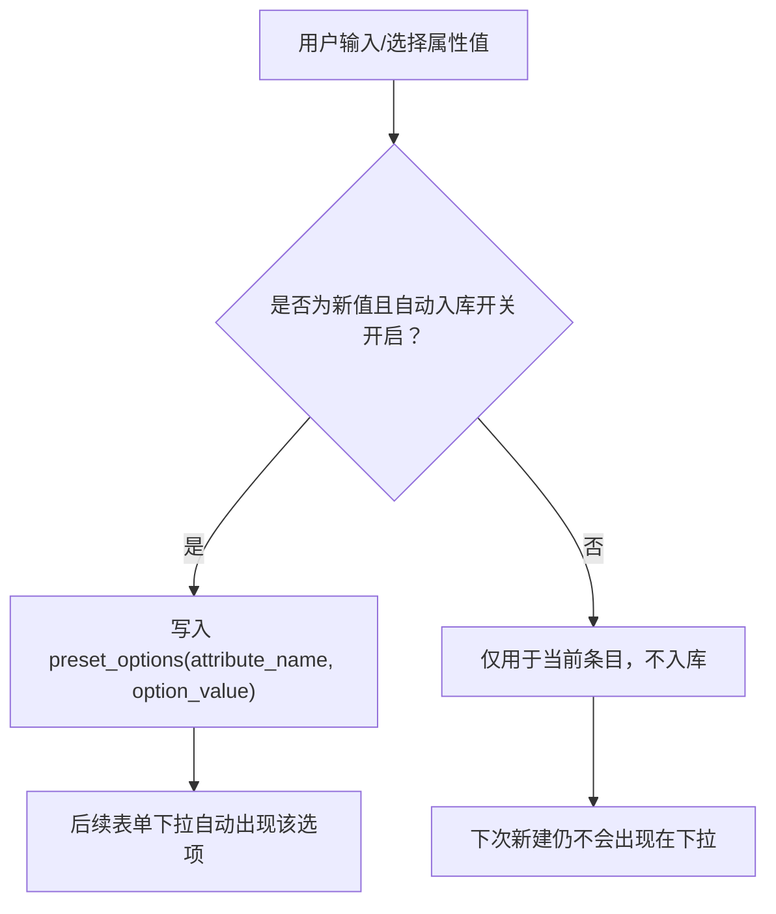
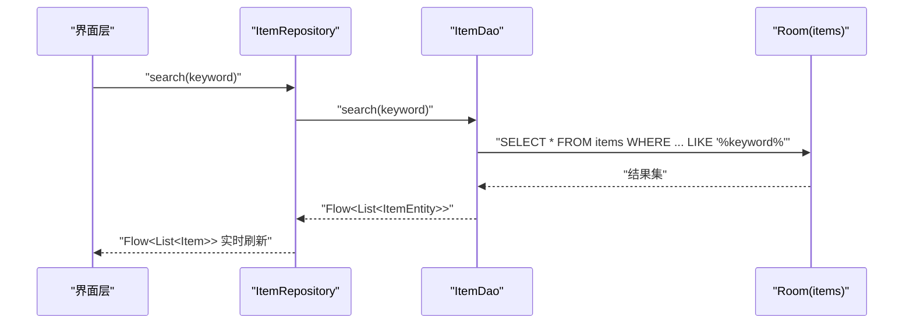
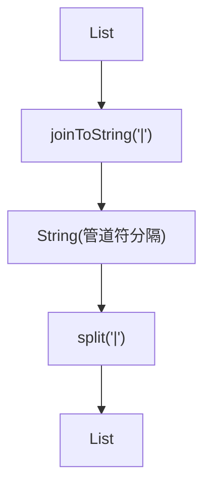
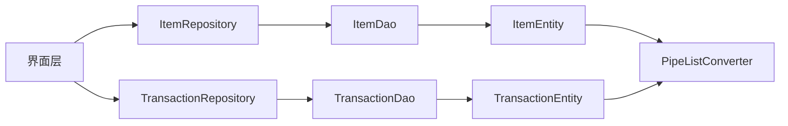

# 核心功能模块

<cite>
**本文引用的文件**
- [Item.kt](file://GuZiStorage/app/src/main/java/com/guzi/storage/domain/model/Item.kt)
- [Transaction.kt](file://GuZiStorage/app/src/main/java/com/guzi/storage/domain/model/Transaction.kt)
- [ItemEntity.kt](file://GuZiStorage/app/src/main/java/com/guzi/storage/data/local/entity/ItemEntity.kt)
- [TransactionEntity.kt](file://GuZiStorage/app/src/main/java/com/guzi/storage/data/local/entity/TransactionEntity.kt)
- [PresetOptionEntity.kt](file://GuZiStorage/app/src/main/java/com/guzi/storage/data/local/entity/PresetOptionEntity.kt)
- [ItemDao.kt](file://GuZiStorage/app/src/main/java/com/guzi/storage/data/local/dao/ItemDao.kt)
- [TransactionDao.kt](file://GuZiStorage/app/src/main/java/com/guzi/storage/data/local/dao/TransactionDao.kt)
- [AppDatabase.kt](file://GuZiStorage/app/src/main/java/com/guzi/storage/data/local/AppDatabase.kt)
- [PipeListConverter.kt](file://GuZiStorage/app/src/main/java/com/guzi/storage/data/local/PipeListConverter.kt)
- [ItemRepository.kt](file://GuZiStorage/app/src/main/java/com/guzi/storage/data/repository/ItemRepository.kt)
- [TransactionRepository.kt](file://GuZiStorage/app/src/main/java/com/guzi/storage/data/repository/TransactionRepository.kt)
- [基础prd.md](file://基础prd.md)
</cite>

## 目录
1. [简介](#简介)
2. [项目结构](#项目结构)
3. [核心组件](#核心组件)
4. [架构总览](#架构总览)
5. [详细组件分析](#详细组件分析)
6. [依赖关系分析](#依赖关系分析)
7. [性能考量](#性能考量)
8. [故障排查指南](#故障排查指南)
9. [结论](#结论)
10. [附录](#附录)

## 简介
本文件面向“谷子收纳应用”的核心功能模块，聚焦以下目标：
- 物品管理模块的增删改查（CRUD）实现与数据流
- 交易记录模块的创建与管理流程
- 状态管理机制（有伤/无伤）与数量堆叠规则
- 预设选项系统的工作原理与动态管理
- 搜索与筛选功能的实现（多维度分组、全局搜索）
- 与其他组件的集成关系与使用模式

## 项目结构
仓库采用分层架构：领域模型层（domain）、数据访问层（data.local.dao + data.local.entity）、仓储层（data.repository），以及数据库定义（Room）。

图表来源
- [AppDatabase.kt:1-34](file://GuZiStorage/app/src/main/java/com/guzi/storage/data/local/AppDatabase.kt#L1-L34)
- [ItemDao.kt:1-90](file://GuZiStorage/app/src/main/java/com/guzi/storage/data/local/dao/ItemDao.kt#L1-L90)
- [TransactionDao.kt:1-49](file://GuZiStorage/app/src/main/java/com/guzi/storage/data/local/dao/TransactionDao.kt#L1-L49)
- [ItemEntity.kt:1-89](file://GuZiStorage/app/src/main/java/com/guzi/storage/data/local/entity/ItemEntity.kt#L1-L89)
- [TransactionEntity.kt:1-65](file://GuZiStorage/app/src/main/java/com/guzi/storage/data/local/entity/TransactionEntity.kt#L1-L65)
- [PresetOptionEntity.kt:1-37](file://GuZiStorage/app/src/main/java/com/guzi/storage/data/local/entity/PresetOptionEntity.kt#L1-L37)
- [PipeListConverter.kt:1-26](file://GuZiStorage/app/src/main/java/com/guzi/storage/data/local/PipeListConverter.kt#L1-L26)
- [ItemRepository.kt:1-80](file://GuZiStorage/app/src/main/java/com/guzi/storage/data/repository/ItemRepository.kt#L1-L80)
- [TransactionRepository.kt:1-63](file://GuZiStorage/app/src/main/java/com/guzi/storage/data/repository/TransactionRepository.kt#L1-L63)
- [Item.kt:1-106](file://GuZiStorage/app/src/main/java/com/guzi/storage/domain/model/Item.kt#L1-L106)
- [Transaction.kt:1-68](file://GuZiStorage/app/src/main/java/com/guzi/storage/domain/model/Transaction.kt#L1-L68)

章节来源
- [基础prd.md:1-249](file://基础prd.md#L1-L249)

## 核心组件
- 领域模型
  - Item：包含显示名称计算、实体转换等逻辑；支持多选字段以 List<String> 表示。
  - Transaction：封装交易类型枚举与实体转换。
- 数据实体
  - ItemEntity：Room 表 items，索引 ip_name、status、category；多选字段以管道符分隔存储。
  - TransactionEntity：Room 表 transactions，外键关联 items，级联删除。
  - PresetOptionEntity：Room 表 preset_options，联合唯一约束保证同一属性下选项不重复。
- DAO 层
  - ItemDao：提供按 IP/类别/出品商/角色筛选、关键词搜索、分组统计、CRUD 操作。
  - TransactionDao：提供按 item_id 查询、计数、CRUD 操作。
- 仓储层
  - ItemRepository：封装 Item 的 CRUD，统一时间戳处理，对外暴露 Flow<List<Item>>。
  - TransactionRepository：封装 Transaction 的 CRUD，对外暴露 Flow<List<Transaction>>。
- 工具类
  - PipeListConverter：在 List<String> 与管道符分隔字符串之间互转。

章节来源
- [Item.kt:1-106](file://GuZiStorage/app/src/main/java/com/guzi/storage/domain/model/Item.kt#L1-L106)
- [Transaction.kt:1-68](file://GuZiStorage/app/src/main/java/com/guzi/storage/domain/model/Transaction.kt#L1-L68)
- [ItemEntity.kt:1-89](file://GuZiStorage/app/src/main/java/com/guzi/storage/data/local/entity/ItemEntity.kt#L1-L89)
- [TransactionEntity.kt:1-65](file://GuZiStorage/app/src/main/java/com/guzi/storage/data/local/entity/TransactionEntity.kt#L1-L65)
- [PresetOptionEntity.kt:1-37](file://GuZiStorage/app/src/main/java/com/guzi/storage/data/local/entity/PresetOptionEntity.kt#L1-L37)
- [ItemDao.kt:1-90](file://GuZiStorage/app/src/main/java/com/guzi/storage/data/local/dao/ItemDao.kt#L1-L90)
- [TransactionDao.kt:1-49](file://GuZiStorage/app/src/main/java/com/guzi/storage/data/local/dao/TransactionDao.kt#L1-L49)
- [ItemRepository.kt:1-80](file://GuZiStorage/app/src/main/java/com/guzi/storage/data/repository/ItemRepository.kt#L1-L80)
- [TransactionRepository.kt:1-63](file://GuZiStorage/app/src/main/java/com/guzi/storage/data/repository/TransactionRepository.kt#L1-L63)
- [PipeListConverter.kt:1-26](file://GuZiStorage/app/src/main/java/com/guzi/storage/data/local/PipeListConverter.kt#L1-L26)

## 架构总览
整体遵循“领域模型 → 仓储 → DAO → Room 实体”的分层设计，通过 Flow 实现响应式数据流，DAO 层负责 SQL 查询与写入，仓储层负责领域模型与实体的转换及事务边界。

图表来源
- [Item.kt:1-106](file://GuZiStorage/app/src/main/java/com/guzi/storage/domain/model/Item.kt#L1-L106)
- [Transaction.kt:1-68](file://GuZiStorage/app/src/main/java/com/guzi/storage/domain/model/Transaction.kt#L1-L68)
- [ItemEntity.kt:1-89](file://GuZiStorage/app/src/main/java/com/guzi/storage/data/local/entity/ItemEntity.kt#L1-L89)
- [TransactionEntity.kt:1-65](file://GuZiStorage/app/src/main/java/com/guzi/storage/data/local/entity/TransactionEntity.kt#L1-L65)
- [PresetOptionEntity.kt:1-37](file://GuZiStorage/app/src/main/java/com/guzi/storage/data/local/entity/PresetOptionEntity.kt#L1-L37)
- [ItemDao.kt:1-90](file://GuZiStorage/app/src/main/java/com/guzi/storage/data/local/dao/ItemDao.kt#L1-L90)
- [TransactionDao.kt:1-49](file://GuZiStorage/app/src/main/java/com/guzi/storage/data/local/dao/TransactionDao.kt#L1-L49)
- [ItemRepository.kt:1-80](file://GuZiStorage/app/src/main/java/com/guzi/storage/data/repository/ItemRepository.kt#L1-L80)
- [TransactionRepository.kt:1-63](file://GuZiStorage/app/src/main/java/com/guzi/storage/data/repository/TransactionRepository.kt#L1-L63)
- [PipeListConverter.kt:1-26](file://GuZiStorage/app/src/main/java/com/guzi/storage/data/local/PipeListConverter.kt#L1-L26)

## 详细组件分析

### 物品管理模块（CRUD）
- 添加物品
  - 仓储层 addItem/addItems 设置 createdAt/updatedAt 并转换为 Entity 后插入。
  - DAO 层 insert/insertAll 使用 REPLACE 策略避免冲突。
- 更新物品
  - 仓储层 updateItem 仅更新 updatedAt，再写入数据库。
- 删除物品
  - 仓储层 deleteItem/deleteItems 先获取实体或批量删除。
  - 由于 transactions 表对 items.id 设置了 CASCADE 删除，删除物品会级联删除其交易记录。
- 查询物品
  - 全量列表 getAll() 返回 Flow<List<Item>>，默认按 updated_at 倒序。
  - 分组统计 getIpGroups() 返回 IP 名与数量，供主列表分组展示。
  - 按维度筛选：getItemsByIp/getItemsByCategory/getItemsByProducer/getItemsByCharacter。
  - 关键词搜索 search(keyword) 模糊匹配 name_cn/ip_name/name_en。

图表来源
- [ItemRepository.kt:49-67](file://GuZiStorage/app/src/main/java/com/guzi/storage/data/repository/ItemRepository.kt#L49-L67)
- [ItemDao.kt:72-76](file://GuZiStorage/app/src/main/java/com/guzi/storage/data/local/dao/ItemDao.kt#L72-L76)
- [ItemEntity.kt:16-23](file://GuZiStorage/app/src/main/java/com/guzi/storage/data/local/entity/ItemEntity.kt#L16-L23)

章节来源
- [ItemRepository.kt:1-80](file://GuZiStorage/app/src/main/java/com/guzi/storage/data/repository/ItemRepository.kt#L1-L80)
- [ItemDao.kt:1-90](file://GuZiStorage/app/src/main/java/com/guzi/storage/data/local/dao/ItemDao.kt#L1-L90)
- [ItemEntity.kt:16-23](file://GuZiStorage/app/src/main/java/com/guzi/storage/data/local/entity/ItemEntity.kt#L16-L23)
- [基础prd.md:166-178](file://基础prd.md#L166-L178)

### 交易记录模块（购入/卖出）
- 创建交易
  - 仓储层 addTransaction 设置时间戳并插入。
  - DAO 层 insert/insertAll 使用 REPLACE 策略。
- 查询交易
  - getAllTransactions()/getTransactionsByItemId() 返回 Flow<List<Transaction>>。
  - countByItemId(itemId) 用于统计某物品的交易条数。
- 删除交易
  - 支持单条与批量删除。

图表来源
- [TransactionRepository.kt:34-46](file://GuZiStorage/app/src/main/java/com/guzi/storage/data/repository/TransactionRepository.kt#L34-L46)
- [TransactionDao.kt:34-38](file://GuZiStorage/app/src/main/java/com/guzi/storage/data/local/dao/TransactionDao.kt#L34-L38)
- [TransactionEntity.kt:14-27](file://GuZiStorage/app/src/main/java/com/guzi/storage/data/local/entity/TransactionEntity.kt#L14-L27)

章节来源
- [TransactionRepository.kt:1-63](file://GuZiStorage/app/src/main/java/com/guzi/storage/data/repository/TransactionRepository.kt#L1-L63)
- [TransactionDao.kt:1-49](file://GuZiStorage/app/src/main/java/com/guzi/storage/data/local/dao/TransactionDao.kt#L1-L49)
- [TransactionEntity.kt:14-27](file://GuZiStorage/app/src/main/java/com/guzi/storage/data/local/entity/TransactionEntity.kt#L14-L27)

### 状态管理与数量堆叠规则
- 状态字段 status 默认“无伤”，当为“有伤”时，display_name 自动附加伤情详情，如“中文名称（内锈，划痕）”。
- 数量堆叠规则：
  - 无伤与有伤不可合并堆叠，即使同名也作为独立条目分别计数。
  - 同一条目 quantity 可累加（例如多次购入相同无伤物品）。
- 该规则由领域模型 Item.displayName 与 PRD 的状态说明共同保障。

图表来源
- [Item.kt:40-45](file://GuZiStorage/app/src/main/java/com/guzi/storage/domain/model/Item.kt#L40-L45)
- [基础prd.md:68-73](file://基础prd.md#L68-L73)

章节来源
- [Item.kt:40-45](file://GuZiStorage/app/src/main/java/com/guzi/storage/domain/model/Item.kt#L40-L45)
- [基础prd.md:68-73](file://基础prd.md#L68-L73)

### 预设选项系统（动态添加与管理）
- 数据结构
  - PresetOptionEntity 表 attribute_name + option_value 联合唯一，确保同一属性下的选项值不重复。
  - sortOrder 可用于排序展示。
- 工作原理
  - 用户从下拉选择已有选项，或手动输入新内容。
  - 若开启“自动将新输入加入选项库”，则在保存时将新值写入 preset_options 表。
  - 关闭后，新输入仅用于当前条目，不入库。
- 管理建议
  - 提供独立的选项管理界面，支持增删改与排序调整。
  - 在新增/编辑表单中，根据 attribute_name 动态加载对应选项列表。

图表来源
- [PresetOptionEntity.kt:15-22](file://GuZiStorage/app/src/main/java/com/guzi/storage/data/local/entity/PresetOptionEntity.kt#L15-L22)
- [基础prd.md:95-98](file://基础prd.md#L95-L98)

章节来源
- [PresetOptionEntity.kt:1-37](file://GuZiStorage/app/src/main/java/com/guzi/storage/data/local/entity/PresetOptionEntity.kt#L1-L37)
- [基础prd.md:95-98](file://基础prd.md#L95-L98)

### 搜索与筛选（多维度分组与全局搜索）
- 分组展示
  - 默认按 IP 名分组：getIpGroups() 返回各 IP 及其数量，getItemsByIp(ipName) 获取分组内物品。
  - 其他分组：按 category、producer、characters 等维度筛选。
- 全局搜索
  - search(keyword) 对 name_cn、ip_name、name_en 进行 LIKE 模糊匹配。
- 组合用法
  - 可在已选分组条件下进一步输入关键词进行二次过滤。

图表来源
- [ItemRepository.kt:41-42](file://GuZiStorage/app/src/main/java/com/guzi/storage/data/repository/ItemRepository.kt#L41-L42)
- [ItemDao.kt:49-56](file://GuZiStorage/app/src/main/java/com/guzi/storage/data/local/dao/ItemDao.kt#L49-L56)

章节来源
- [ItemDao.kt:29-68](file://GuZiStorage/app/src/main/java/com/guzi/storage/data/local/dao/ItemDao.kt#L29-L68)
- [ItemRepository.kt:29-45](file://GuZiStorage/app/src/main/java/com/guzi/storage/data/repository/ItemRepository.kt#L29-L45)

### 多选字段与管道符转换
- 存储策略
  - 多选字段（如 origin_places、sale_format、sizes、materials、characters、art_types、damage_details、image_paths）在 Entity 中以管道符 "|" 分隔的字符串存储。
- 转换工具
  - PipeListConverter.fromList(list) → 字符串
  - PipeListConverter.toList(value) → 列表（空串转为空列表）

图表来源
- [PipeListConverter.kt:9-25](file://GuZiStorage/app/src/main/java/com/guzi/storage/data/local/PipeListConverter.kt#L9-L25)
- [Item.kt:63-70](file://GuZiStorage/app/src/main/java/com/guzi/storage/domain/model/Item.kt#L63-L70)
- [Transaction.kt:32](file://GuZiStorage/app/src/main/java/com/guzi/storage/domain/model/Transaction.kt#L32)

章节来源
- [PipeListConverter.kt:1-26](file://GuZiStorage/app/src/main/java/com/guzi/storage/data/local/PipeListConverter.kt#L1-L26)
- [Item.kt:63-70](file://GuZiStorage/app/src/main/java/com/guzi/storage/domain/model/Item.kt#L63-L70)
- [Transaction.kt:32](file://GuZiStorage/app/src/main/java/com/guzi/storage/domain/model/Transaction.kt#L32)

## 依赖关系分析
- 耦合与内聚
  - Repository 与 DAO 解耦良好，职责清晰：Repository 专注领域模型转换与时间戳处理，DAO 专注 SQL 与 Flow 暴露。
  - 实体与领域模型通过 toEntity/fromEntity 方法保持双向映射，便于扩展。
- 外部依赖
  - Room 数据库：AppDatabase 聚合三个实体与三个 DAO。
  - Coroutines Flow：DAO 返回 Flow，Repository 透传至 UI，实现响应式刷新。
- 潜在循环依赖
  - 未发现循环导入；依赖方向稳定：UI → Repository → DAO → Room。

图表来源
- [AppDatabase.kt:20-33](file://GuZiStorage/app/src/main/java/com/guzi/storage/data/local/AppDatabase.kt#L20-L33)
- [ItemRepository.kt:1-80](file://GuZiStorage/app/src/main/java/com/guzi/storage/data/repository/ItemRepository.kt#L1-L80)
- [TransactionRepository.kt:1-63](file://GuZiStorage/app/src/main/java/com/guzi/storage/data/repository/TransactionRepository.kt#L1-L63)
- [ItemDao.kt:1-90](file://GuZiStorage/app/src/main/java/com/guzi/storage/data/local/dao/ItemDao.kt#L1-L90)
- [TransactionDao.kt:1-49](file://GuZiStorage/app/src/main/java/com/guzi/storage/data/local/dao/TransactionDao.kt#L1-L49)
- [ItemEntity.kt:1-89](file://GuZiStorage/app/src/main/java/com/guzi/storage/data/local/entity/ItemEntity.kt#L1-L89)
- [TransactionEntity.kt:1-65](file://GuZiStorage/app/src/main/java/com/guzi/storage/data/local/entity/TransactionEntity.kt#L1-L65)
- [PipeListConverter.kt:1-26](file://GuZiStorage/app/src/main/java/com/guzi/storage/data/local/PipeListConverter.kt#L1-L26)

章节来源
- [AppDatabase.kt:1-34](file://GuZiStorage/app/src/main/java/com/guzi/storage/data/local/AppDatabase.kt#L1-L34)
- [ItemRepository.kt:1-80](file://GuZiStorage/app/src/main/java/com/guzi/storage/data/repository/ItemRepository.kt#L1-L80)
- [TransactionRepository.kt:1-63](file://GuZiStorage/app/src/main/java/com/guzi/storage/data/repository/TransactionRepository.kt#L1-L63)

## 性能考量
- 索引优化
  - items 表对 ip_name、status、category 建立索引，提升分组与筛选效率。
  - transactions 表对 item_id 建立索引，加速按物品查询交易记录。
- 查询策略
  - 使用 LIKE 模糊搜索时注意前缀通配符的性能影响，建议在大数据量场景考虑全文检索方案或限制搜索范围。
- 响应式刷新
  - 通过 Flow 减少轮询开销，仅在数据变更时触发 UI 更新。
- 批量操作
  - insertAll/deleteByIds 降低频繁 IO 开销，适合导入与批量删除场景。

[本节为通用性能建议，无需具体文件引用]

## 故障排查指南
- 删除物品未删除交易记录
  - 检查 transactions.item_id 外键是否配置 CASCADE 删除。
  - 参考外键与索引定义。
- 多选字段为空导致解析异常
  - 确认 PipeListConverter.toList 对空字符串的处理逻辑。
- 搜索无结果
  - 确认 keyword 是否为空或包含特殊字符；检查 LIKE 条件与字段名。
- 预设选项重复
  - 检查 attribute_name + option_value 的唯一约束是否生效。

章节来源
- [TransactionEntity.kt:16-26](file://GuZiStorage/app/src/main/java/com/guzi/storage/data/local/entity/TransactionEntity.kt#L16-L26)
- [PipeListConverter.kt:23-24](file://GuZiStorage/app/src/main/java/com/guzi/storage/data/local/PipeListConverter.kt#L23-L24)
- [ItemDao.kt:49-56](file://GuZiStorage/app/src/main/java/com/guzi/storage/data/local/dao/ItemDao.kt#L49-L56)
- [PresetOptionEntity.kt:17-22](file://GuZiStorage/app/src/main/java/com/guzi/storage/data/local/entity/PresetOptionEntity.kt#L17-L22)

## 结论
本模块以清晰的层次划分与响应式数据流为核心，实现了物品与交易记录的完整生命周期管理。通过索引优化、Flow 驱动与管道符多选存储策略，兼顾了易用性与可扩展性。未来可在全文检索、选项管理界面与导入导出方面持续增强。

[本节为总结性内容，无需具体文件引用]

## 附录
- 术语
  - 谷子：二次元周边商品
  - 吧唧：徽章
  - 通贩/场贩/应募：常见发售方式
  - 柄图：周边图案/设计
  - qqr：Q 版画风

章节来源
- [基础prd.md:234-243](file://基础prd.md#L234-L243)