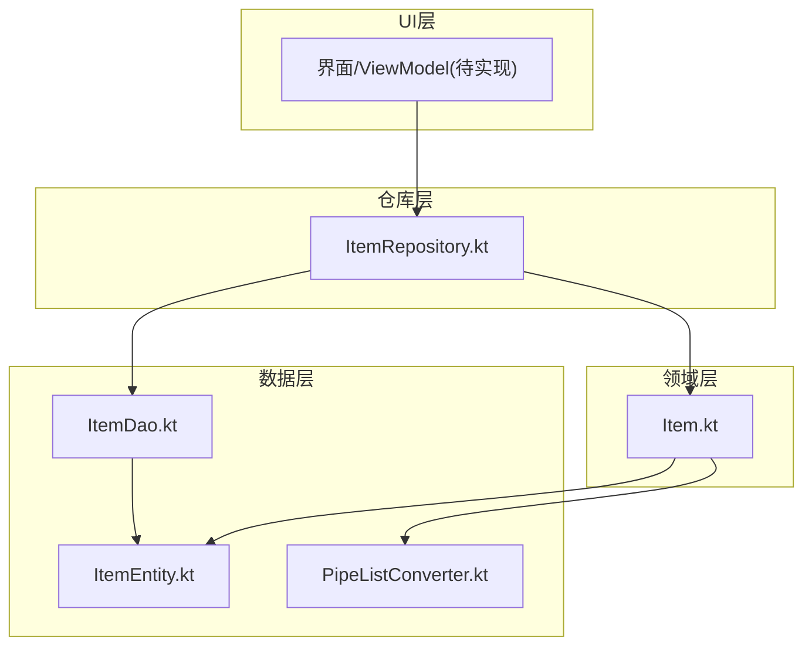
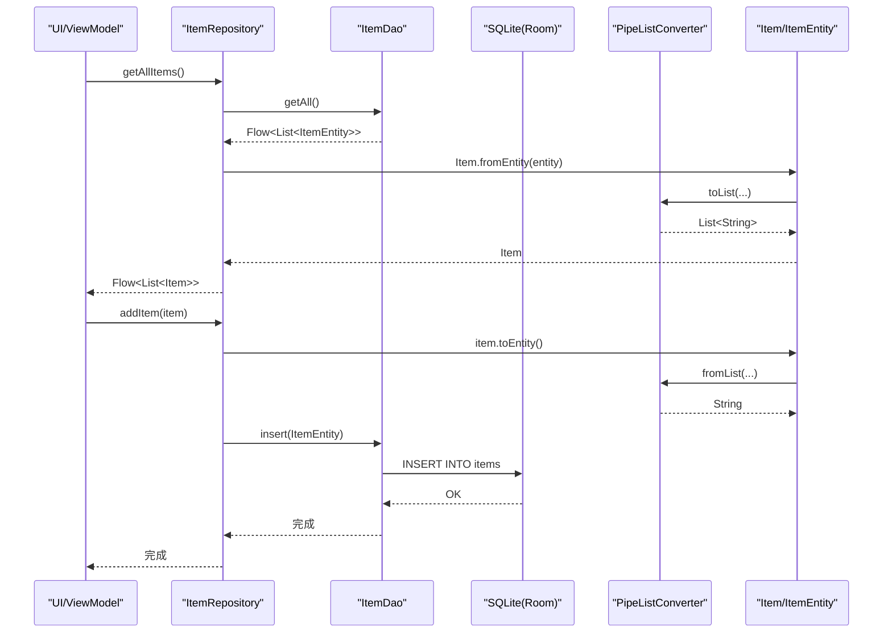
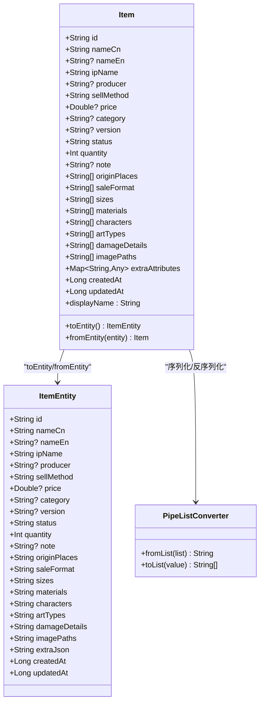
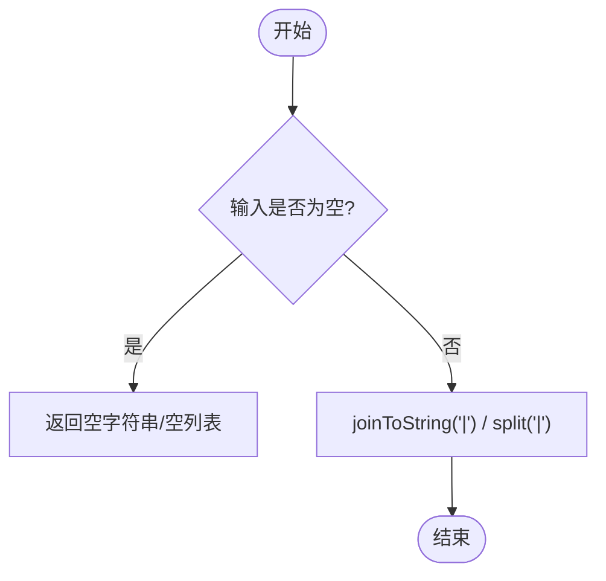
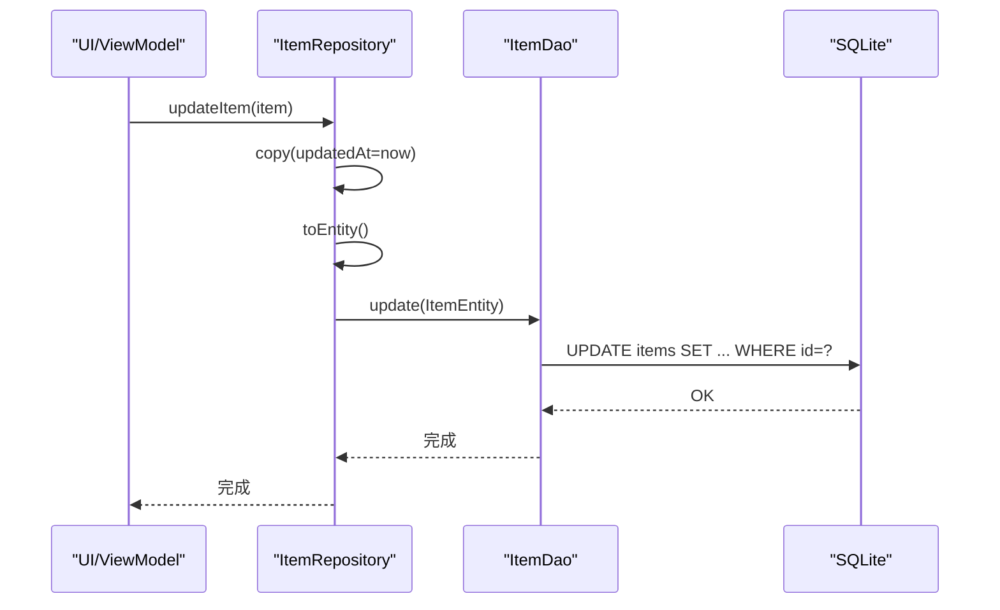
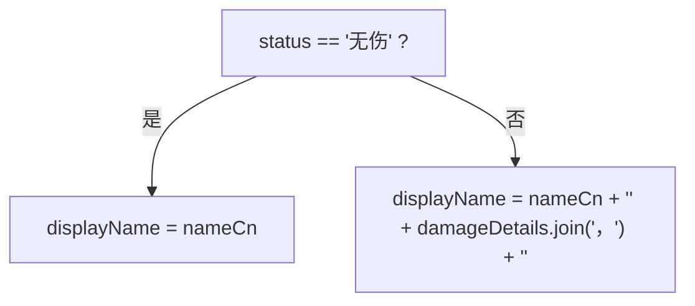
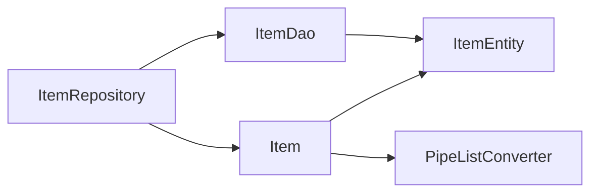

# 物品管理模块

<cite>
**本文引用的文件**   
- [Item.kt](file://GuZiStorage/app/src/main/java/com/guzi/storage/domain/model/Item.kt)
- [ItemEntity.kt](file://GuZiStorage/app/src/main/java/com/guzi/storage/data/local/entity/ItemEntity.kt)
- [PipeListConverter.kt](file://GuZiStorage/app/src/main/java/com/guzi/storage/data/local/PipeListConverter.kt)
- [ItemDao.kt](file://GuZiStorage/app/src/main/java/com/guzi/storage/data/local/dao/ItemDao.kt)
- [ItemRepository.kt](file://GuZiStorage/app/src/main/java/com/guzi/storage/data/repository/ItemRepository.kt)
- [基础prd.md](file://基础prd.md)
</cite>

## 目录
1. [简介](#简介)
2. [项目结构](#项目结构)
3. [核心组件](#核心组件)
4. [架构总览](#架构总览)
5. [详细组件分析](#详细组件分析)
6. [依赖关系分析](#依赖关系分析)
7. [性能考量](#性能考量)
8. [故障排查指南](#故障排查指南)
9. [结论](#结论)
10. [附录](#附录)

## 简介
本技术文档聚焦“物品管理模块”，围绕 Item 领域模型的设计理念、多选字段的列表表示与 PipeListConverter 的转换机制、CRUD 操作实现逻辑、物品状态管理机制（有伤/无伤与 damageDetails 字段）、以及 extraAttributes 的动态属性扩展性进行系统性说明。同时提供基于 ItemRepository 的数据操作示例路径，以及与 UI 层数据绑定的推荐模式。

## 项目结构
该模块采用分层架构：领域模型层（domain.model）定义业务实体；数据访问层（data.local.dao + data.local.entity）通过 Room 持久化；仓库层（data.repository）封装 CRUD 并暴露 Flow 响应式接口；UI 层通过订阅 Flow 完成数据绑定与展示。

图表来源
- [Item.kt:1-106](file://GuZiStorage/app/src/main/java/com/guzi/storage/domain/model/Item.kt#L1-L106)
- [ItemEntity.kt:1-89](file://GuZiStorage/app/src/main/java/com/guzi/storage/data/local/entity/ItemEntity.kt#L1-L89)
- [PipeListConverter.kt:1-26](file://GuZiStorage/app/src/main/java/com/guzi/storage/data/local/PipeListConverter.kt#L1-L26)
- [ItemDao.kt:1-90](file://GuZiStorage/app/src/main/java/com/guzi/storage/data/local/dao/ItemDao.kt#L1-L90)
- [ItemRepository.kt:1-80](file://GuZiStorage/app/src/main/java/com/guzi/storage/data/repository/ItemRepository.kt#L1-L80)

章节来源
- [Item.kt:1-106](file://GuZiStorage/app/src/main/java/com/guzi/storage/domain/model/Item.kt#L1-L106)
- [ItemEntity.kt:1-89](file://GuZiStorage/app/src/main/java/com/guzi/storage/data/local/entity/ItemEntity.kt#L1-L89)
- [PipeListConverter.kt:1-26](file://GuZiStorage/app/src/main/java/com/guzi/storage/data/local/PipeListConverter.kt#L1-L26)
- [ItemDao.kt:1-90](file://GuZiStorage/app/src/main/java/com/guzi/storage/data/local/dao/ItemDao.kt#L1-L90)
- [ItemRepository.kt:1-80](file://GuZiStorage/app/src/main/java/com/guzi/storage/data/repository/ItemRepository.kt#L1-L80)

## 核心组件
- 领域模型 Item：承载业务语义，包含显示名称计算、Entity 互转、状态相关展示逻辑等。
- 存储实体 ItemEntity：Room 表映射，固定列 + 管道符分隔的多选字段 + 预留 JSON 扩展字段。
- 转换器 PipeListConverter：在 List<String> 与 "|" 分隔字符串之间双向转换。
- DAO 层 ItemDao：定义查询与写入 SQL，返回 Flow 以支持响应式更新。
- 仓库层 ItemRepository：封装 CRUD，负责 Entity ↔ Domain 转换，对外暴露 Flow<List<Item>>。

章节来源
- [Item.kt:1-106](file://GuZiStorage/app/src/main/java/com/guzi/storage/domain/model/Item.kt#L1-L106)
- [ItemEntity.kt:1-89](file://GuZiStorage/app/src/main/java/com/guzi/storage/data/local/entity/ItemEntity.kt#L1-L89)
- [PipeListConverter.kt:1-26](file://GuZiStorage/app/src/main/java/com/guzi/storage/data/local/PipeListConverter.kt#L1-L26)
- [ItemDao.kt:1-90](file://GuZiStorage/app/src/main/java/com/guzi/storage/data/local/dao/ItemDao.kt#L1-L90)
- [ItemRepository.kt:1-80](file://GuZiStorage/app/src/main/java/com/guzi/storage/data/repository/ItemRepository.kt#L1-L80)

## 架构总览
下图展示了从 UI 到数据库的完整调用链与数据流向，包括响应式 Flow 的传递与 Entity/Domain 的转换。

图表来源
- [ItemRepository.kt:23-54](file://GuZiStorage/app/src/main/java/com/guzi/storage/data/repository/ItemRepository.kt#L23-L54)
- [ItemDao.kt:20-76](file://GuZiStorage/app/src/main/java/com/guzi/storage/data/local/dao/ItemDao.kt#L20-L76)
- [Item.kt:50-74](file://GuZiStorage/app/src/main/java/com/guzi/storage/domain/model/Item.kt#L50-L74)
- [PipeListConverter.kt:17-24](file://GuZiStorage/app/src/main/java/com/guzi/storage/data/local/PipeListConverter.kt#L17-L24)

## 详细组件分析

### 领域模型 Item 设计
- 多选字段统一使用 List<String> 表示，便于业务层处理与 UI 绑定。
- 显示名称 displayName：当 status 为“无伤”时仅显示中文名；否则拼接 damageDetails 作为后缀，形成“中文名称（伤情详情）”。
- 与 Entity 的双向转换：toEntity/fromEntity 中所有多选字段均通过 PipeListConverter 进行序列化/反序列化。
- 时间戳 createdAt/updatedAt 由仓库层在写入时设置。

图表来源
- [Item.kt:11-104](file://GuZiStorage/app/src/main/java/com/guzi/storage/domain/model/Item.kt#L11-L104)
- [ItemEntity.kt:24-88](file://GuZiStorage/app/src/main/java/com/guzi/storage/data/local/entity/ItemEntity.kt#L24-L88)
- [PipeListConverter.kt:9-25](file://GuZiStorage/app/src/main/java/com/guzi/storage/data/local/PipeListConverter.kt#L9-L25)

章节来源
- [Item.kt:11-104](file://GuZiStorage/app/src/main/java/com/guzi/storage/domain/model/Item.kt#L11-L104)
- [ItemEntity.kt:24-88](file://GuZiStorage/app/src/main/java/com/guzi/storage/data/local/entity/ItemEntity.kt#L24-L88)
- [PipeListConverter.kt:9-25](file://GuZiStorage/app/src/main/java/com/guzi/storage/data/local/PipeListConverter.kt#L9-L25)

### 多选字段与 PipeListConverter 转换机制
- 存储策略：所有多选字段在数据库中均以“|”分隔的字符串形式保存，例如“中|日”。
- 转换规则：
  - fromList：将 List<String> 用“|”连接为空串或具体值；空列表转为空串。
  - toList：对空串返回空列表；非空串按“|”分割为 List<String>。
- 影响范围：Item 的所有多选字段（originPlaces、saleFormat、sizes、materials、characters、artTypes、damageDetails、imagePaths）均使用该转换器。

图表来源
- [PipeListConverter.kt:17-24](file://GuZiStorage/app/src/main/java/com/guzi/storage/data/local/PipeListConverter.kt#L17-L24)

章节来源
- [PipeListConverter.kt:1-26](file://GuZiStorage/app/src/main/java/com/guzi/storage/data/local/PipeListConverter.kt#L1-L26)
- [Item.kt:63-70](file://GuZiStorage/app/src/main/java/com/guzi/storage/domain/model/Item.kt#L63-L70)
- [Item.kt:93-100](file://GuZiStorage/app/src/main/java/com/guzi/storage/domain/model/Item.kt#L93-L100)

### CRUD 操作实现逻辑
- 创建（addItem/addItems）：
  - 仓库层在插入前设置 createdAt/updatedAt 为当前时间，并将 Item 转换为 ItemEntity 后调用 DAO.insert/insertAll。
- 读取（getAll/getById/search/分组查询）：
  - DAO 返回 Flow<List<ItemEntity>>，仓库层将其 map 为 Flow<List<Item>>，并在转换过程中使用 PipeListConverter 解析多选字段。
- 更新（updateItem）：
  - 仓库层复制 Item 并更新 updatedAt，再转换为 Entity 调用 DAO.update。
- 删除（deleteItem/deleteItems）：
  - 单条删除先根据 ID 获取 Entity 再删除；批量删除直接按 IDs 执行 DELETE。

图表来源
- [ItemRepository.kt:63-67](file://GuZiStorage/app/src/main/java/com/guzi/storage/data/repository/ItemRepository.kt#L63-L67)
- [ItemDao.kt:78-79](file://GuZiStorage/app/src/main/java/com/guzi/storage/data/local/dao/ItemDao.kt#L78-L79)

章节来源
- [ItemRepository.kt:49-76](file://GuZiStorage/app/src/main/java/com/guzi/storage/data/repository/ItemRepository.kt#L49-L76)
- [ItemDao.kt:72-85](file://GuZiStorage/app/src/main/java/com/guzi/storage/data/local/dao/ItemDao.kt#L72-L85)

### 物品状态管理机制（有伤/无伤与 damageDetails）
- 默认状态为“无伤”。
- 当 status 不为“无伤”时，displayName 会附加 damageDetails 内容，形成“中文名称（伤情详情）”的展示格式。
- 数量管理：PRD 明确“有伤与无伤不可堆叠，数量独立计算”，因此同一名称不同状态的条目应视为独立记录。
- 筛选与搜索：DAO 提供按 IP、分类、出品商、角色、关键词等多维度查询，便于在 UI 中组合筛选。

图表来源
- [Item.kt:40-45](file://GuZiStorage/app/src/main/java/com/guzi/storage/domain/model/Item.kt#L40-L45)
- [基础prd.md:68-72](file://基础prd.md#L68-L72)

章节来源
- [Item.kt:21-45](file://GuZiStorage/app/src/main/java/com/guzi/storage/domain/model/Item.kt#L21-L45)
- [基础prd.md:68-72](file://基础prd.md#L68-L72)

### 属性扩展性与 extraAttributes
- 领域模型 Item 包含 extraAttributes: Map<String, Any>，用于承载动态扩展属性。
- 存储实体 ItemEntity 提供 extraJson 字段，可用于未来将动态属性序列化为 JSON 存储。
- 当前实现中，toEntity 将 extraAttributes 初始化为 "{}"，表明尚未启用 JSON 序列化；后续可在转换逻辑中增加对 extraAttributes 的序列化/反序列化。
- PRD 建议采用 SQLite JSON 字段或键值对表来支持自由增删自定义属性，确保向前兼容。

章节来源
- [Item.kt:32](file://GuZiStorage/app/src/main/java/com/guzi/storage/domain/model/Item.kt#L32)
- [Item.kt:71](file://GuZiStorage/app/src/main/java/com/guzi/storage/domain/model/Item.kt#L71)
- [ItemEntity.kt:79-80](file://GuZiStorage/app/src/main/java/com/guzi/storage/data/local/entity/ItemEntity.kt#L79-L80)
- [基础prd.md:102-121](file://基础prd.md#L102-L121)

### 代码示例与 UI 数据绑定模式
- 使用 ItemRepository 进行数据操作的示例路径：
  - 获取全部物品列表（Flow）：[ItemRepository.getAllItems:23-24](file://GuZiStorage/app/src/main/java/com/guzi/storage/data/repository/ItemRepository.kt#L23-L24)
  - 按 IP 名获取物品列表（Flow）：[ItemRepository.getItemsByIp:32-33](file://GuZiStorage/app/src/main/java/com/guzi/storage/data/repository/ItemRepository.kt#L32-L33)
  - 新增单个物品：[ItemRepository.addItem:49-54](file://GuZiStorage/app/src/main/java/com/guzi/storage/data/repository/ItemRepository.kt#L49-L54)
  - 批量新增物品：[ItemRepository.addItems:56-61](file://GuZiStorage/app/src/main/java/com/guzi/storage/data/repository/ItemRepository.kt#L56-L61)
  - 更新物品：[ItemRepository.updateItem:63-67](file://GuZiStorage/app/src/main/java/com/guzi/storage/data/repository/ItemRepository.kt#L63-L67)
  - 删除单个物品：[ItemRepository.deleteItem:69-72](file://GuZiStorage/app/src/main/java/com/guzi/storage/data/repository/ItemRepository.kt#L69-L72)
  - 批量删除物品：[ItemRepository.deleteItems:74-76](file://GuZiStorage/app/src/main/java/com/guzi/storage/data/repository/ItemRepository.kt#L74-L76)
  - 统计总数：[ItemRepository.getItemCount:78-79](file://GuZiStorage/app/src/main/java/com/guzi/storage/data/repository/ItemRepository.kt#L78-L79)
- UI 层数据绑定模式（推荐）：
  - 在 ViewModel 中持有 Repository 引用，收集 Flow<List<Item>>，并通过 StateFlow/SharedFlow 暴露给 Compose/UI。
  - 在 UI 中 collectAsStateWithLifecycle 或直接 collect，将结果映射为可观察的状态对象，驱动列表渲染。
  - 对于搜索与筛选，建议在 UI 层维护过滤条件，调用 Repository 对应方法（如 search、getItemsByCategory 等），避免在 UI 中重复计算。

章节来源
- [ItemRepository.kt:23-79](file://GuZiStorage/app/src/main/java/com/guzi/storage/data/repository/ItemRepository.kt#L23-L79)

## 依赖关系分析
- 耦合与内聚：
  - ItemRepository 仅依赖 ItemDao 与领域模型 Item，职责清晰，内聚度高。
  - Item 与 ItemEntity 的转换集中在 Item 内部，降低外部耦合。
  - PipeListConverter 为纯工具类，无状态，易于测试与复用。
- 外部依赖：
  - Room（@Entity/@Dao/@Query）用于持久化。
  - Kotlin Coroutines Flow 用于响应式数据流。
- 潜在循环依赖：
  - 当前结构不存在循环依赖；Repository 不反向依赖 DAO 以外的上层组件。

图表来源
- [ItemRepository.kt:1-80](file://GuZiStorage/app/src/main/java/com/guzi/storage/data/repository/ItemRepository.kt#L1-L80)
- [ItemDao.kt:1-90](file://GuZiStorage/app/src/main/java/com/guzi/storage/data/local/dao/ItemDao.kt#L1-L90)
- [Item.kt:1-106](file://GuZiStorage/app/src/main/java/com/guzi/storage/domain/model/Item.kt#L1-L106)
- [ItemEntity.kt:1-89](file://GuZiStorage/app/src/main/java/com/guzi/storage/data/local/entity/ItemEntity.kt#L1-L89)
- [PipeListConverter.kt:1-26](file://GuZiStorage/app/src/main/java/com/guzi/storage/data/local/PipeListConverter.kt#L1-L26)

章节来源
- [ItemRepository.kt:1-80](file://GuZiStorage/app/src/main/java/com/guzi/storage/data/repository/ItemRepository.kt#L1-L80)
- [ItemDao.kt:1-90](file://GuZiStorage/app/src/main/java/com/guzi/storage/data/local/dao/ItemDao.kt#L1-L90)
- [Item.kt:1-106](file://GuZiStorage/app/src/main/java/com/guzi/storage/domain/model/Item.kt#L1-L106)
- [ItemEntity.kt:1-89](file://GuZiStorage/app/src/main/java/com/guzi/storage/data/local/entity/ItemEntity.kt#L1-L89)
- [PipeListConverter.kt:1-26](file://GuZiStorage/app/src/main/java/com/guzi/storage/data/local/PipeListConverter.kt#L1-L26)

## 性能考量
- 响应式查询：DAO 返回 Flow，避免频繁手动刷新，减少不必要的 IO。
- 索引优化：ItemEntity 对 ip_name、status、category 建立索引，有助于分组与筛选查询性能。
- 多选字段存储：使用“|”分隔字符串，避免多表关联带来的复杂 JOIN；但模糊匹配（如 LIKE '%'||:character||'%'）可能带来全表扫描风险，建议结合应用层缓存或分页加载。
- 批量操作：addItems 与 deleteByIds 可减少往返次数，提升吞吐。
- 大数据量场景：遵循 PRD 的性能目标（10,000+ 条目），建议配合分页、懒加载与按需查询。

章节来源
- [ItemEntity.kt:16-22](file://GuZiStorage/app/src/main/java/com/guzi/storage/data/local/entity/ItemEntity.kt#L16-L22)
- [ItemDao.kt:61-62](file://GuZiStorage/app/src/main/java/com/guzi/storage/data/local/dao/ItemDao.kt#L61-L62)
- [基础prd.md:217-218](file://基础prd.md#L217-L218)

## 故障排查指南
- 多选字段为空导致显示异常：
  - 检查 PipeListConverter.toList 对空串的处理是否返回空列表，确认 UI 层对空集合的展示逻辑。
- 状态与伤情不一致：
  - 校验 status 与 damageDetails 的联动逻辑，确保“无伤”时 damageDetails 为空或不被展示。
- 更新未生效：
  - 确认 updateItem 是否正确设置 updatedAt，且 DAO.update 的主键匹配无误。
- 批量删除失败：
  - 检查传入的 IDs 列表是否为空，以及 DAO.deleteByIds 的 SQL 参数绑定是否正确。

章节来源
- [PipeListConverter.kt:23-24](file://GuZiStorage/app/src/main/java/com/guzi/storage/data/local/PipeListConverter.kt#L23-L24)
- [Item.kt:40-45](file://GuZiStorage/app/src/main/java/com/guzi/storage/domain/model/Item.kt#L40-L45)
- [ItemRepository.kt:63-76](file://GuZiStorage/app/src/main/java/com/guzi/storage/data/repository/ItemRepository.kt#L63-L76)
- [ItemDao.kt:84-85](file://GuZiStorage/app/src/main/java/com/guzi/storage/data/local/dao/ItemDao.kt#L84-L85)

## 结论
物品管理模块通过清晰的领域模型与数据层分离，实现了可扩展、易维护的物品管理能力。多选字段采用统一的管道符分隔存储与转换器，简化了持久化与展示逻辑；状态管理与 damageDetails 的配合满足了“有伤/无伤”的业务需求；extraAttributes 为未来动态属性扩展预留空间。仓库层封装了完整的 CRUD 与响应式数据流，便于 UI 层高效绑定与交互。

## 附录
- 参考产品需求文档中的状态规则与扩展性建议，确保实现与业务一致。

章节来源
- [基础prd.md:68-72](file://基础prd.md#L68-L72)
- [基础prd.md:102-121](file://基础prd.md#L102-L121)