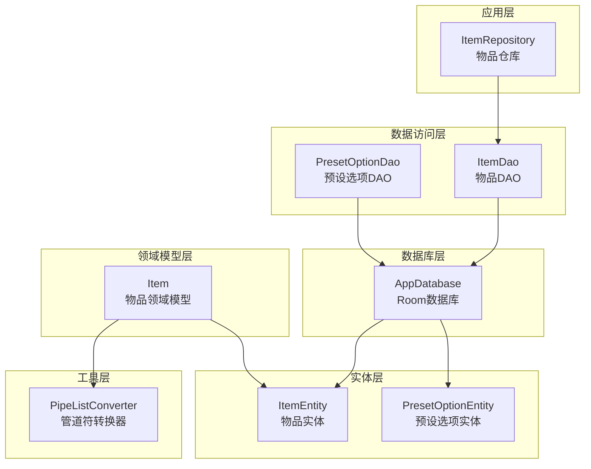
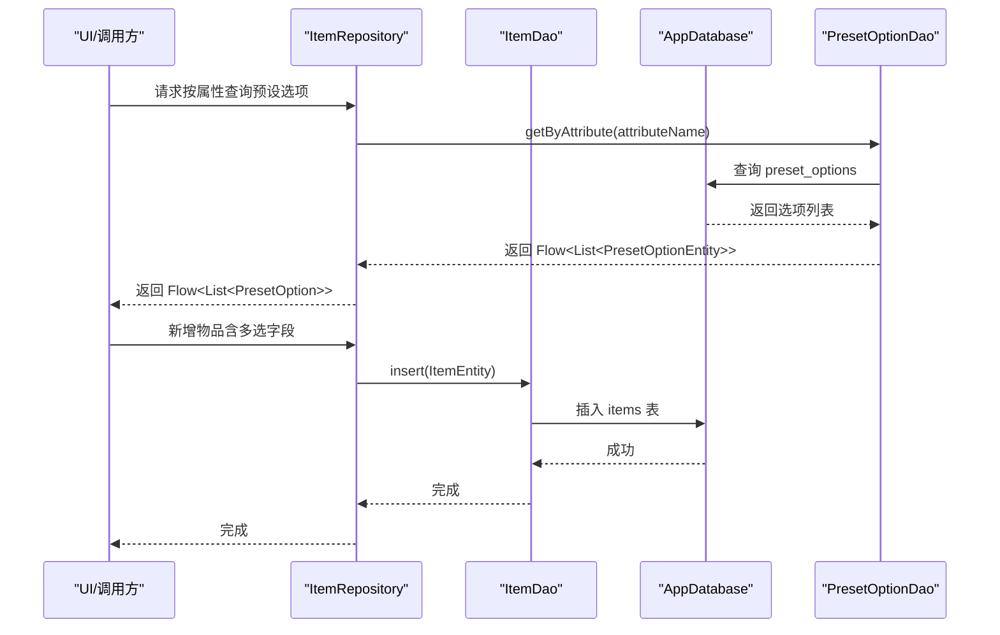
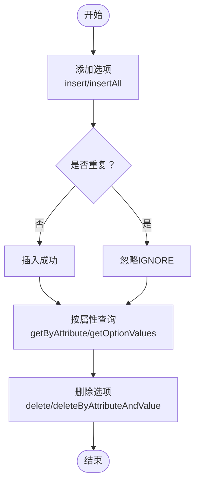
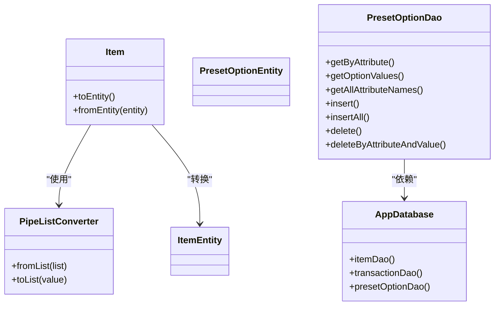

# 预设选项管理

<cite>
**本文引用的文件**
- [PresetOptionEntity.kt](file://GuZiStorage/app/src/main/java/com/guzi/storage/data/local/entity/PresetOptionEntity.kt)
- [PipeListConverter.kt](file://GuZiStorage/app/src/main/java/com/guzi/storage/data/local/PipeListConverter.kt)
- [PresetOptionDao.kt](file://GuZiStorage/app/src/main/java/com/guzi/storage/data/local/dao/PresetOptionDao.kt)
- [AppDatabase.kt](file://GuZiStorage/app/src/main/java/com/guzi/storage/data/local/AppDatabase.kt)
- [ItemEntity.kt](file://GuZiStorage/app/src/main/java/com/guzi/storage/data/local/entity/ItemEntity.kt)
- [Item.kt](file://GuZiStorage/app/src/main/java/com/guzi/storage/domain/model/Item.kt)
- [ItemRepository.kt](file://GuZiStorage/app/src/main/java/com/guzi/storage/data/repository/ItemRepository.kt)
- [基础prd.md](file://基础prd.md)
</cite>

## 目录
1. [简介](#简介)
2. [项目结构](#项目结构)
3. [核心组件](#核心组件)
4. [架构总览](#架构总览)
5. [详细组件分析](#详细组件分析)
6. [依赖关系分析](#依赖关系分析)
7. [性能考量](#性能考量)
8. [故障排查指南](#故障排查指南)
9. [结论](#结论)
10. [附录](#附录)

## 简介
本模块围绕“预设选项管理”展开，目标是通过统一的预设选项表来规范物品管理中的多选字段（如 IP 名称、产地、材质等）取值，确保数据一致性与完整性，并提供动态的增删改查能力。同时，借助管道符分隔的列表转换器，将领域模型中的 List<String> 与数据库中的字符串字段进行稳定互转。

## 项目结构
与预设选项管理相关的核心文件分布如下：
- 实体层：PresetOptionEntity（预设选项）、ItemEntity（物品）
- 数据访问层：PresetOptionDao（预设选项 DAO）
- 数据库层：AppDatabase（Room 数据库，注册实体与 DAO）
- 领域模型层：Item（物品领域模型，包含多选字段与转换逻辑）
- 工具层：PipeListConverter（管道符分隔列表转换）
- 仓库层：ItemRepository（物品仓库，负责对外暴露响应式数据流）

图表来源
- [AppDatabase.kt:20-33](file://GuZiStorage/app/src/main/java/com/guzi/storage/data/local/AppDatabase.kt#L20-L33)
- [PresetOptionDao.kt:14-41](file://GuZiStorage/app/src/main/java/com/guzi/storage/data/local/dao/PresetOptionDao.kt#L14-L41)
- [ItemRepository.kt:16-79](file://GuZiStorage/app/src/main/java/com/guzi/storage/data/repository/ItemRepository.kt#L16-L79)
- [Item.kt:11-105](file://GuZiStorage/app/src/main/java/com/guzi/storage/domain/model/Item.kt#L11-L105)
- [PipeListConverter.kt:9-25](file://GuZiStorage/app/src/main/java/com/guzi/storage/data/local/PipeListConverter.kt#L9-L25)

章节来源
- [AppDatabase.kt:12-33](file://GuZiStorage/app/src/main/java/com/guzi/storage/data/local/AppDatabase.kt#L12-L33)
- [PresetOptionDao.kt:11-41](file://GuZiStorage/app/src/main/java/com/guzi/storage/data/local/dao/PresetOptionDao.kt#L11-L41)
- [ItemRepository.kt:11-79](file://GuZiStorage/app/src/main/java/com/guzi/storage/data/repository/ItemRepository.kt#L11-L79)
- [Item.kt:6-105](file://GuZiStorage/app/src/main/java/com/guzi/storage/domain/model/Item.kt#L6-L105)
- [PipeListConverter.kt:3-25](file://GuZiStorage/app/src/main/java/com/guzi/storage/data/local/PipeListConverter.kt#L3-L25)

## 核心组件
- 预设选项实体（PresetOptionEntity）
  - 设计目的：集中存储各属性的可选值，保证同一属性下选项值的唯一性，支持排序展示。
  - 关键字段：属性名、选项值、排序序号。
  - 约束：联合唯一索引（属性名+选项值），避免重复。
- 预设选项 DAO（PresetOptionDao）
  - 查询：按属性名获取选项列表、仅获取选项值列表、获取全部属性名。
  - 写入：插入单个或批量选项，冲突时忽略；按属性与值删除指定选项。
- 管道符转换器（PipeListConverter）
  - 功能：在 List<String> 与以“|”分隔的字符串之间双向转换。
  - 使用场景：物品实体中的多选字段（如产地、材质、角色等）持久化存储。
- 物品实体（ItemEntity）
  - 存储策略：单值字段独立列，多选字段以“|”分隔字符串存储，预留 extra_json 用于未来扩展。
- 物品领域模型（Item）
  - 业务层使用：多选字段统一为 List<String>，通过转换器与实体互转。
- 数据库（AppDatabase）
  - 注册实体：物品、交易、预设选项。
  - 版本：初始版本，包含预设选项表。

章节来源
- [PresetOptionEntity.kt:7-36](file://GuZiStorage/app/src/main/java/com/guzi/storage/data/local/entity/PresetOptionEntity.kt#L7-L36)
- [PresetOptionDao.kt:17-41](file://GuZiStorage/app/src/main/java/com/guzi/storage/data/local/dao/PresetOptionDao.kt#L17-L41)
- [PipeListConverter.kt:9-25](file://GuZiStorage/app/src/main/java/com/guzi/storage/data/local/PipeListConverter.kt#L9-L25)
- [ItemEntity.kt:8-88](file://GuZiStorage/app/src/main/java/com/guzi/storage/data/local/entity/ItemEntity.kt#L8-L88)
- [Item.kt:6-105](file://GuZiStorage/app/src/main/java/com/guzi/storage/domain/model/Item.kt#L6-L105)
- [AppDatabase.kt:12-33](file://GuZiStorage/app/src/main/java/com/guzi/storage/data/local/AppDatabase.kt#L12-L33)

## 架构总览
预设选项管理贯穿“领域模型—实体—数据库”的全链路，配合转换器实现多选字段的稳定存储与读取。

图表来源
- [ItemRepository.kt:23-42](file://GuZiStorage/app/src/main/java/com/guzi/storage/data/repository/ItemRepository.kt#L23-L42)
- [PresetOptionDao.kt:19-26](file://GuZiStorage/app/src/main/java/com/guzi/storage/data/local/dao/PresetOptionDao.kt#L19-L26)
- [AppDatabase.kt:20-33](file://GuZiStorage/app/src/main/java/com/guzi/storage/data/local/AppDatabase.kt#L20-L33)

## 详细组件分析

### 预设选项实体（PresetOptionEntity）
- 设计要点
  - 表名与索引：表名为“preset_options”，并建立“属性名+选项值”的联合唯一索引，确保同一属性下选项值不重复。
  - 字段含义：attribute_name 表示属性标识（如 ip_name、category 等），option_value 表示具体选项值，sort_order 控制显示顺序。
- 数据结构复杂度
  - 查询：按属性名过滤，时间复杂度 O(n)（受索引影响，实际接近 O(log n)）。
  - 唯一性：联合唯一索引保证插入冲突时忽略，避免重复数据。
- 错误处理与边界
  - 空值处理：通过 IGNORE 冲突策略避免重复插入导致异常。
  - 排序：查询时按 sort_order 与 option_value 排序，保证稳定展示。

章节来源
- [PresetOptionEntity.kt:15-36](file://GuZiStorage/app/src/main/java/com/guzi/storage/data/local/entity/PresetOptionEntity.kt#L15-L36)

### 预设选项 DAO（PresetOptionDao）
- 查询接口
  - 按属性名获取完整选项列表（Flow）：适合 UI 响应式渲染。
  - 获取选项值列表（suspend）：适合快速获取可选项集合。
  - 获取全部属性名：用于构建属性维度的导航或筛选。
- 写入接口
  - 单条与批量插入：使用 IGNORE 冲突策略，避免重复。
  - 按属性与值删除：支持精细化清理。
- 性能与一致性
  - Flow 返回值支持 UI 自动刷新。
  - 冲突策略与唯一索引共同保障数据一致性。

章节来源
- [PresetOptionDao.kt:19-41](file://GuZiStorage/app/src/main/java/com/guzi/storage/data/local/dao/PresetOptionDao.kt#L19-L41)

### 管道符转换器（PipeListConverter）
- 转换原理
  - fromList：将 List<String> 以“|”连接为字符串。
  - toList：将“|”分隔的字符串拆分为 List<String>，空字符串返回空列表。
- 在物品实体中的应用
  - ItemEntity 中多选字段（如 originPlaces、materials、characters 等）均以字符串存储。
  - Item 领域模型在 toEntity/fromEntity 时通过转换器完成互转，保证业务层使用 List<String>，持久层使用字符串。
- 边界与注意事项
  - 分隔符固定为“|”，需避免选项值本身包含“|”字符。
  - 空列表与空字符串的互转保持一致，避免 UI 层出现空值歧义。

章节来源
- [PipeListConverter.kt:9-25](file://GuZiStorage/app/src/main/java/com/guzi/storage/data/local/PipeListConverter.kt#L9-L25)
- [ItemEntity.kt:56-76](file://GuZiStorage/app/src/main/java/com/guzi/storage/data/local/entity/ItemEntity.kt#L56-L76)
- [Item.kt:50-104](file://GuZiStorage/app/src/main/java/com/guzi/storage/domain/model/Item.kt#L50-L104)

### 物品实体与领域模型（ItemEntity、Item）
- 存储策略
  - 单值字段：独立列存储，便于索引与查询。
  - 多选字段：以“|”分隔字符串存储，减少表结构变更成本。
  - 扩展字段：预留 extra_json，用于未来新增属性。
- 领域模型优势
  - 业务层统一使用 List<String>，提升可读性与可维护性。
  - 转换器封装了存储细节，避免业务层感知数据库格式。
- 一致性保障
  - 预设选项表提供标准选项值，建议在录入时优先选择预设值，减少脏数据。
  - 若启用“自动添加新输入到选项库”，可逐步完善预设库，提升后续录入效率。

章节来源
- [ItemEntity.kt:8-88](file://GuZiStorage/app/src/main/java/com/guzi/storage/data/local/entity/ItemEntity.kt#L8-L88)
- [Item.kt:6-105](file://GuZiStorage/app/src/main/java/com/guzi/storage/domain/model/Item.kt#L6-L105)

### 数据库（AppDatabase）
- 角色定位
  - 统一注册实体与 DAO，提供数据库实例。
  - 当前版本包含 items、transactions、preset_options 三张表。
- 迁移与扩展
  - 通过 PRD 提示，后续可通过 Migration 为旧数据补充默认值，确保向前兼容。

章节来源
- [AppDatabase.kt:12-33](file://GuZiStorage/app/src/main/java/com/guzi/storage/data/local/AppDatabase.kt#L12-L33)
- [基础prd.md:102-111](file://基础prd.md#L102-L111)

### 预设选项的动态管理流程
- 添加选项
  - 通过 PresetOptionDao.insert 或 insertAll 插入新选项，冲突时忽略重复值。
- 修改选项
  - 可先删除旧值，再插入新值；或在具备编辑界面时，提供更新排序序号的能力（若后续扩展）。
- 删除选项
  - 支持按属性与值精确删除，或批量删除。
- 查询选项
  - 按属性名获取 Flow 列表，或仅获取选项值列表，满足不同 UI 场景。

图表来源
- [PresetOptionDao.kt:30-40](file://GuZiStorage/app/src/main/java/com/guzi/storage/data/local/dao/PresetOptionDao.kt#L30-L40)
- [PresetOptionDao.kt:19-26](file://GuZiStorage/app/src/main/java/com/guzi/storage/data/local/dao/PresetOptionDao.kt#L19-L26)

章节来源
- [PresetOptionDao.kt:17-41](file://GuZiStorage/app/src/main/java/com/guzi/storage/data/local/dao/PresetOptionDao.kt#L17-L41)

### 预设选项在物品管理中的应用场景
- IP 名称、产地、材质、角色、艺术类型等多选字段
  - 通过预设选项表提供标准化选项，避免拼写差异与大小写不一致。
  - 在 UI 中以下拉列表呈现，提升录入效率与准确性。
- 数据一致性与完整性约束
  - 预设选项唯一索引防止重复值；排序字段保证展示顺序稳定。
  - 物品实体多选字段以“|”存储，结合转换器实现稳定互转。
- 自动添加规则（参考 PRD）
  - 默认开启“自动将新输入内容加入选项库”，减少脏数据；用户可关闭以保留临时输入。
  - 未来可提供独立选项管理界面，支持增删改选项。

章节来源
- [ItemEntity.kt:56-76](file://GuZiStorage/app/src/main/java/com/guzi/storage/data/local/entity/ItemEntity.kt#L56-L76)
- [基础prd.md:95-124](file://基础prd.md#L95-L124)

## 依赖关系分析
- 组件耦合
  - Item 领域模型依赖 PipeListConverter 完成与实体的互转。
  - ItemRepository 依赖 ItemDao，间接使用 AppDatabase。
  - PresetOptionDao 依赖 AppDatabase 访问预设选项表。
- 外部依赖
  - Room 提供实体映射、索引与查询能力。
  - Kotlin Flow 支持响应式数据流。

图表来源
- [Item.kt:50-104](file://GuZiStorage/app/src/main/java/com/guzi/storage/domain/model/Item.kt#L50-L104)
- [PipeListConverter.kt:17-24](file://GuZiStorage/app/src/main/java/com/guzi/storage/data/local/PipeListConverter.kt#L17-L24)
- [PresetOptionDao.kt:19-40](file://GuZiStorage/app/src/main/java/com/guzi/storage/data/local/dao/PresetOptionDao.kt#L19-L40)
- [AppDatabase.kt:29-32](file://GuZiStorage/app/src/main/java/com/guzi/storage/data/local/AppDatabase.kt#L29-L32)

## 性能考量
- 查询性能
  - 预设选项按属性名查询使用索引，建议在 UI 中缓存常用属性的选项列表，减少频繁查询。
  - 对物品实体的多选字段查询，建议尽量使用单值字段索引（如 ip_name、category）以提升检索效率。
- 写入性能
  - 批量插入预设选项时使用 insertAll，减少事务开销。
  - 冲突策略 IGNORE 可避免重复插入引发的异常与回滚。
- 存储与转换
  - 管道符分隔存储简化了表结构，但需注意分隔符安全性；若选项值可能包含“|”，需在入库前做转义或替换。

## 故障排查指南
- 重复选项未生效
  - 检查是否使用 IGNORE 冲突策略；确认 attributeName 与 option_value 的组合是否已在数据库中存在。
- 多选字段显示为空
  - 确认转换器是否正确执行 fromList/toList；检查实体字段是否为空字符串。
- 预设选项排序异常
  - 检查 sortOrder 字段是否正确设置；查询时是否按 sort_order 排序。
- 数据库版本问题
  - 若后续新增属性，需通过 Migration 为旧数据补充默认值，确保向前兼容。

章节来源
- [PresetOptionDao.kt:30-34](file://GuZiStorage/app/src/main/java/com/guzi/storage/data/local/dao/PresetOptionDao.kt#L30-L34)
- [Item.kt:50-104](file://GuZiStorage/app/src/main/java/com/guzi/storage/domain/model/Item.kt#L50-L104)
- [基础prd.md:102-111](file://基础prd.md#L102-L111)

## 结论
预设选项管理通过统一的实体与 DAO，结合管道符转换器，实现了物品多选字段的标准化存储与高效查询。其联合唯一索引与排序字段确保了数据一致性与展示稳定性；配合 PRD 中的自动添加规则与未来选项管理界面，可进一步提升系统的可维护性与用户体验。

## 附录
- 术语
  - 预设选项：预定义的可选值集合，用于规范录入与查询。
  - 管道符分隔：以“|”作为分隔符的字符串表示法，用于多选字段的持久化存储。
- 最佳实践
  - 录入时优先选择预设值，必要时启用“自动添加新输入到选项库”。
  - 对多选字段的 UI 展示与查询，建议基于预设选项表构建下拉与筛选控件。
  - 未来扩展属性时，遵循 PRD 的迁移策略，确保旧数据兼容。