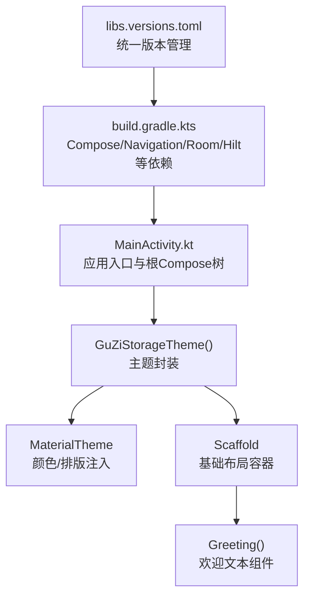
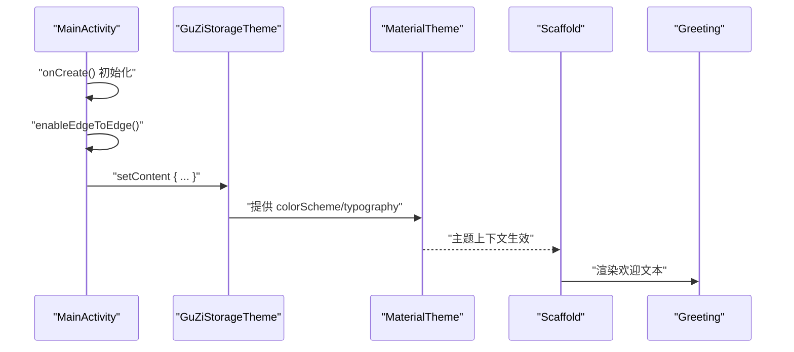
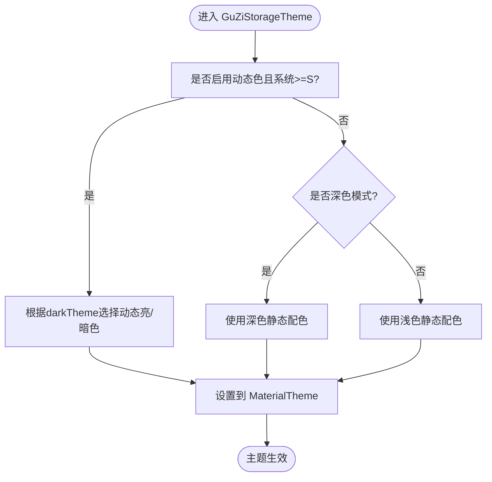
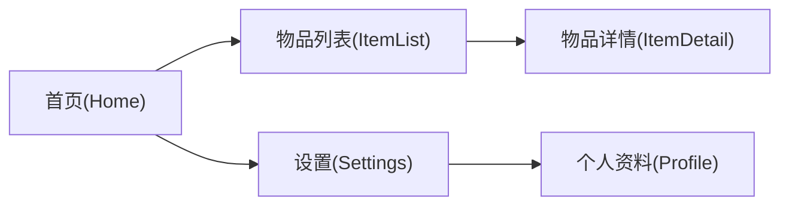
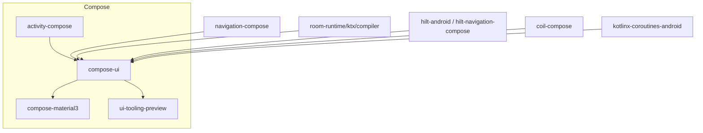

# 用户界面组件

<cite>
**本文引用的文件**   
- [MainActivity.kt](file://GuZiStorage/app/src/main/java/com/guzi/storage/MainActivity.kt)
- [Theme.kt](file://GuZiStorage/app/src/main/java/com/guzi/storage/ui/theme/Theme.kt)
- [Color.kt](file://GuZiStorage/app/src/main/java/com/guzi/storage/ui/theme/Color.kt)
- [GuZiStorageApp.kt](file://GuZiStorage/app/src/main/java/com/guzi/storage/GuZiStorageApp.kt)
- [build.gradle.kts](file://GuZiStorage/app/build.gradle.kts)
- [libs.versions.toml](file://GuZiStorage/gradle/libs.versions.toml)
- [strings.xml](file://GuZiStorage/app/src/main/res/values/strings.xml)
</cite>

## 目录
1. [简介](#简介)
2. [项目结构](#项目结构)
3. [核心组件](#核心组件)
4. [架构总览](#架构总览)
5. [详细组件分析](#详细组件分析)
6. [依赖分析](#依赖分析)
7. [性能考虑](#性能考虑)
8. [故障排查指南](#故障排查指南)
9. [结论](#结论)
10. [附录](#附录)

## 简介
本文件面向“谷子收纳”应用的 UI 层，聚焦于基于 Jetpack Compose 的现代化声明式 UI 开发模式。文档将系统阐述：
- 主题系统与 Material Design 3 的颜色方案与定制方式
- 页面导航架构与路由设计（含当前实现与扩展建议）
- 响应式布局策略与在不同屏幕尺寸下的适配要点
- 可访问性与国际化支持现状与最佳实践
- UI 组件的使用示例与自定义指南，以及与业务逻辑解耦的设计思路

## 项目结构
应用采用分层组织方式，UI 相关代码集中在 MainActivity 与 ui.theme 包中；依赖通过 Gradle 版本目录集中管理。

图表来源
- [MainActivity.kt:1-55](file://GuZiStorage/app/src/main/java/com/guzi/storage/MainActivity.kt#L1-L55)
- [Theme.kt:1-51](file://GuZiStorage/app/src/main/java/com/guzi/storage/ui/theme/Theme.kt#L1-L51)
- [build.gradle.kts:43-92](file://GuZiStorage/app/build.gradle.kts#L43-L92)
- [libs.versions.toml:24-36](file://GuZiStorage/gradle/libs.versions.toml#L24-L36)

章节来源
- [MainActivity.kt:1-55](file://GuZiStorage/app/src/main/java/com/guzi/storage/MainActivity.kt#L1-L55)
- [build.gradle.kts:43-92](file://GuZiStorage/app/build.gradle.kts#L43-L92)
- [libs.versions.toml:24-36](file://GuZiStorage/gradle/libs.versions.toml#L24-L36)

## 核心组件
- 应用入口与根视图
  - Activity 使用 enableEdgeToEdge 开启全面屏沉浸式体验，并通过 setContent 挂载 Compose 根树。
  - 根树以 GuZiStorageTheme 包裹，提供全局主题上下文；内部使用 Scaffold 作为页面骨架，承载内容区域与内边距。
  - 当前展示一个简单欢迎组件 Greeting，用于演示 Typography 与主题字体的使用。

- 主题系统
  - 提供 Light/Dark 两套 ColorScheme，并支持在 Android S 及以上系统启用动态取色。
  - 通过 GuZiStorageTheme 暴露 darkTheme 与 dynamicColor 开关，便于运行时切换或按系统偏好自动选择。
  - 颜色定义集中于 Color.kt，包含主色、辅色、背景、表面、错误等语义化色值。

- 资源与国际化
  - 应用名称通过 strings.xml 提供，便于后续扩展多语言。

章节来源
- [MainActivity.kt:22-36](file://GuZiStorage/app/src/main/java/com/guzi/storage/MainActivity.kt#L22-L36)
- [Theme.kt:31-50](file://GuZiStorage/app/src/main/java/com/guzi/storage/ui/theme/Theme.kt#L31-L50)
- [Color.kt:1-21](file://GuZiStorage/app/src/main/java/com/guzi/storage/ui/theme/Color.kt#L1-L21)
- [strings.xml:1-5](file://GuZiStorage/app/src/main/res/values/strings.xml#L1-L5)

## 架构总览
从 UI 视角看，当前应用遵循“Activity -> Theme -> Scaffold -> 页面组件”的轻量结构。依赖层面已引入 Navigation Compose，但尚未在 UI 层落地多页面路由。

图表来源
- [MainActivity.kt:23-36](file://GuZiStorage/app/src/main/java/com/guzi/storage/MainActivity.kt#L23-L36)
- [Theme.kt:31-50](file://GuZiStorage/app/src/main/java/com/guzi/storage/ui/theme/Theme.kt#L31-L50)

## 详细组件分析

### 主题系统（Material Design 3）
- 颜色体系
  - 深色/浅色两套 ColorScheme，分别定义 primary、secondary、tertiary、background、surface 及对应的 on* 前景色。
  - 应用主色调采用柔和紫色系，契合二次元风格定位。
- 动态取色
  - 在 Android S 及以上，优先使用系统动态色（动态亮/暗），否则回退到静态配色。
- 主题封装
  - GuZiStorageTheme 接收 darkTheme 与 dynamicColor 参数，决定最终使用的 ColorScheme，并交由 MaterialTheme 注入到整个 Compose 树。

图表来源
- [Theme.kt:31-50](file://GuZiStorage/app/src/main/java/com/guzi/storage/ui/theme/Theme.kt#L31-L50)
- [Color.kt:1-21](file://GuZiStorage/app/src/main/java/com/guzi/storage/ui/theme/Color.kt#L1-L21)

章节来源
- [Theme.kt:13-29](file://GuZiStorage/app/src/main/java/com/guzi/storage/ui/theme/Theme.kt#L13-L29)
- [Theme.kt:31-50](file://GuZiStorage/app/src/main/java/com/guzi/storage/ui/theme/Theme.kt#L31-L50)
- [Color.kt:1-21](file://GuZiStorage/app/src/main/java/com/guzi/storage/ui/theme/Color.kt#L1-L21)

### 页面导航与路由设计
- 现状
  - 当前仅有一个单页入口，未实现多页面跳转。
- 依赖准备
  - build.gradle.kts 已引入 navigation-compose 与 hilt-navigation-compose，具备多页面导航能力。
- 推荐设计（概念性说明）
  - 使用 NavHost 管理路由，为每个功能模块定义独立 Route 常量。
  - 结合 Hilt 注入 ViewModel，保持 UI 与状态/业务解耦。
  - 使用 bottom navigation 或 top app bar 进行页面切换，配合 back stack 管理返回行为。

[此图为概念性流程图，不直接映射具体源码，故无图表来源]

章节来源
- [build.gradle.kts:65-66](file://GuZiStorage/app/build.gradle.kts#L65-L66)
- [libs.versions.toml:34-36](file://GuZiStorage/gradle/libs.versions.toml#L34-L36)

### 响应式布局与适配
- 当前实践
  - 使用 Scaffold 的 innerPadding 处理安全区与顶部栏/底部栏占位，确保内容不被遮挡。
  - 使用 fillMaxSize 使根内容填满可用空间。
- 适配建议（概念性说明）
  - 针对平板与大屏，可使用分栏布局（如 Row + 权重分配）或条件渲染不同组件树。
  - 利用 Compose 的自适应 API（如 WindowMetricsCalculator）判断屏幕形态，动态调整布局密度与字号。
  - 避免固定宽高，优先使用 wrapContent、fillMaxWidth/Height 与弹性布局。

章节来源
- [MainActivity.kt:27-33](file://GuZiStorage/app/src/main/java/com/guzi/storage/MainActivity.kt#L27-L33)

### 可访问性与国际化
- 可访问性
  - 建议使用 contentDescription 为图标与图片提供描述；为交互控件设置合适的 role 与焦点顺序。
  - 保证对比度符合 WCAG 标准，必要时提供高对比度主题。
- 国际化
  - 应用名已在 strings.xml 中定义，建议将所有可见文案抽取至字符串资源，并按语言创建对应 values-xx 目录。
  - 在 Compose 中使用 stringResource 获取本地化文本。

章节来源
- [strings.xml:1-5](file://GuZiStorage/app/src/main/res/values/strings.xml#L1-L5)

### UI 组件使用示例与自定义指南
- 使用示例
  - 文本样式：通过 MaterialTheme.typography 获取语义化字体样式，保持一致的视觉层级。
  - 布局容器：Scaffold 作为页面骨架，承载 TopBar、BottomBar、FloatingActionButton 等常用元素。
- 自定义指南
  - 将通用 UI 片段封装为可组合函数，接受 Modifier 与必要参数，保持纯函数式与可测试性。
  - 将颜色、圆角、阴影等视觉规范统一到 theme 与 style 层，避免硬编码。
  - 与业务逻辑解耦：UI 只负责展示与事件回调，状态与副作用由 ViewModel/Repository 承担。

章节来源
- [MainActivity.kt:39-46](file://GuZiStorage/app/src/main/java/com/guzi/storage/MainActivity.kt#L39-L46)

## 依赖分析
- Compose 生态
  - activity-compose、compose-ui、compose-material3、compose-tooling-preview 等均已引入。
- 导航
  - navigation-compose 已加入依赖，为后续多页面导航奠定基础。
- 其他
  - Room、Hilt、Coil、Coroutines 等依赖齐全，利于后续数据持久化、依赖注入、图片加载与异步任务。

图表来源
- [build.gradle.kts:48-92](file://GuZiStorage/app/build.gradle.kts#L48-L92)
- [libs.versions.toml:24-51](file://GuZiStorage/gradle/libs.versions.toml#L24-L51)

章节来源
- [build.gradle.kts:48-92](file://GuZiStorage/app/build.gradle.kts#L48-L92)
- [libs.versions.toml:24-51](file://GuZiStorage/gradle/libs.versions.toml#L24-L51)

## 性能考虑
- 主题与重绘
  - 合理拆分可组合函数，减少不必要的重组；对大列表使用 LazyColumn/LazyRow。
- 图片加载
  - 使用 Coil 时注意缓存策略与占位图，避免主线程阻塞。
- 导航栈
  - 控制页面深度，避免过深的返回栈导致内存压力。
- 预览与调试
  - 充分利用 @Preview 与 Compose Preview 工具，提前发现布局问题。

[本节为通用指导，不直接分析具体文件]

## 故障排查指南
- 主题未生效
  - 确认 GuZiStorageTheme 已包裹整个根树，且 MaterialTheme 正确传入 colorScheme。
- 动态色异常
  - 检查系统版本与动态色开关；低版本应回退到静态配色。
- 导航无法跳转
  - 确认 NavHost 与 Route 配置一致，且目标页面已注册。
- 字符串未显示
  - 确认使用 stringResource 读取资源，并确保对应语言资源存在。

章节来源
- [Theme.kt:31-50](file://GuZiStorage/app/src/main/java/com/guzi/storage/ui/theme/Theme.kt#L31-L50)
- [MainActivity.kt:26-35](file://GuZiStorage/app/src/main/java/com/guzi/storage/MainActivity.kt#L26-L35)
- [strings.xml:1-5](file://GuZiStorage/app/src/main/res/values/strings.xml#L1-L5)

## 结论
当前 UI 层已搭建好基于 Compose 的基础设施：主题系统完善、Scaffold 骨架就绪、依赖完备。下一步建议优先落地多页面导航与组件库建设，逐步将业务逻辑与 UI 解耦，提升可维护性与可扩展性。

## 附录
- 关键路径参考
  - 应用入口与根树：[MainActivity.kt](file://GuZiStorage/app/src/main/java/com/guzi/storage/MainActivity.kt)
  - 主题封装与颜色定义：[Theme.kt](file://GuZiStorage/app/src/main/java/com/guzi/storage/ui/theme/Theme.kt)、[Color.kt](file://GuZiStorage/app/src/main/java/com/guzi/storage/ui/theme/Color.kt)
  - 依赖清单与版本：[build.gradle.kts](file://GuZiStorage/app/build.gradle.kts)、[libs.versions.toml](file://GuZiStorage/gradle/libs.versions.toml)
  - 应用名称资源：[strings.xml](file://GuZiStorage/app/src/main/res/values/strings.xml)