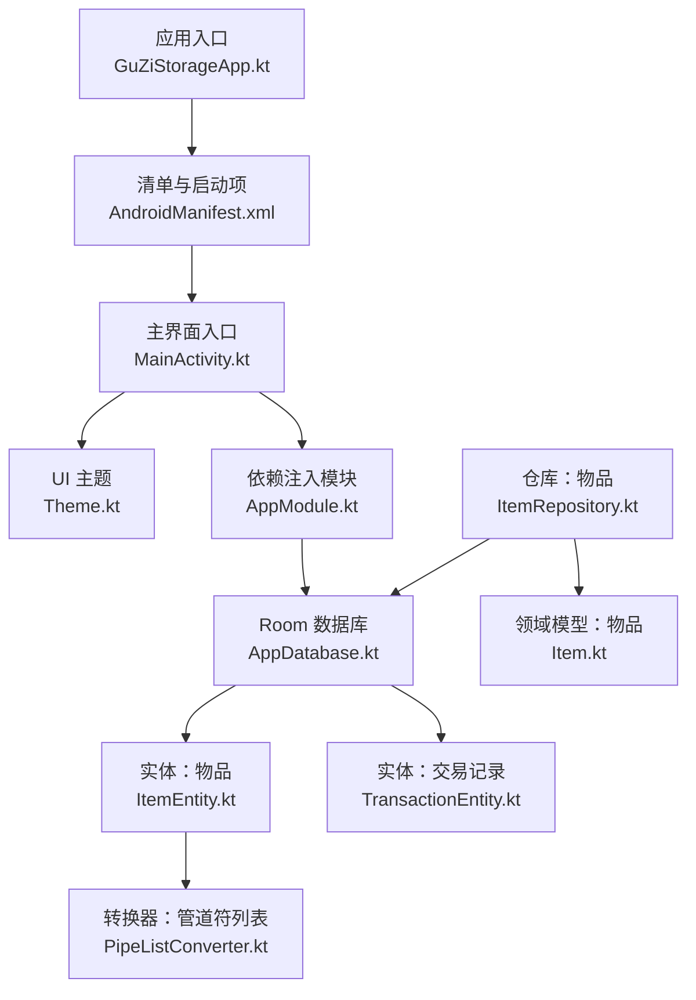
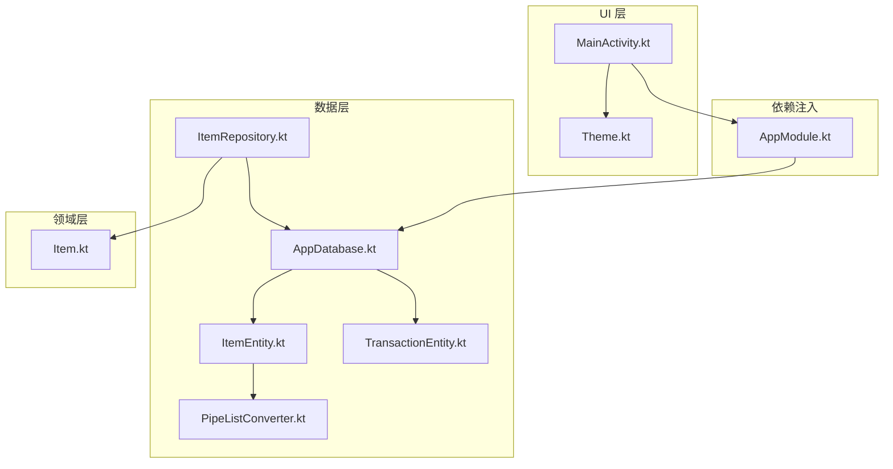
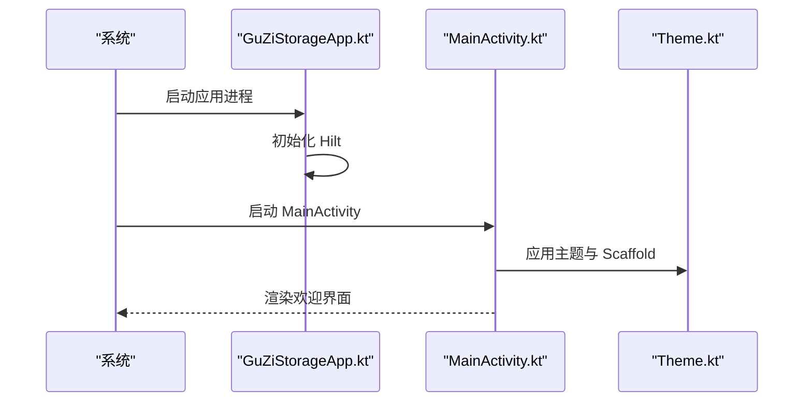
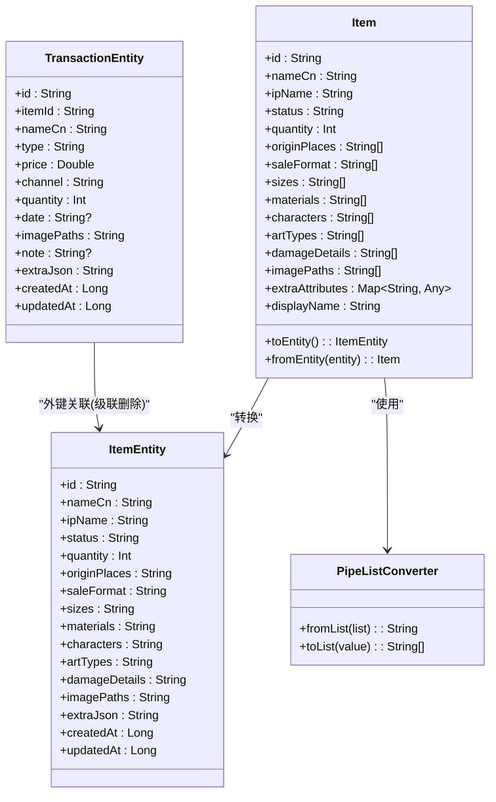
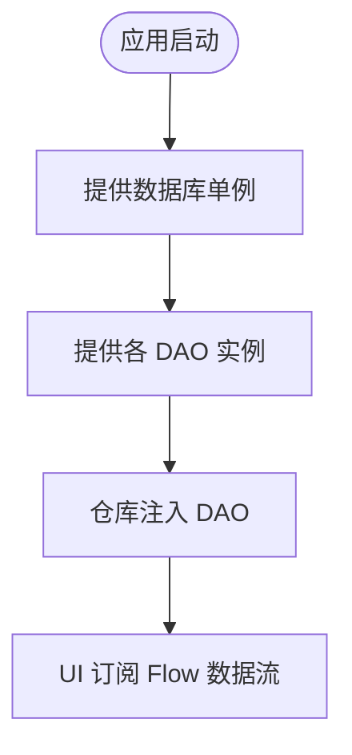
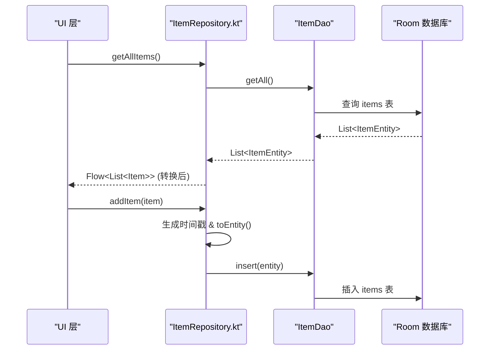
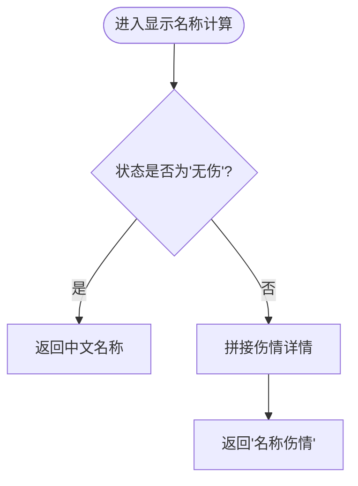
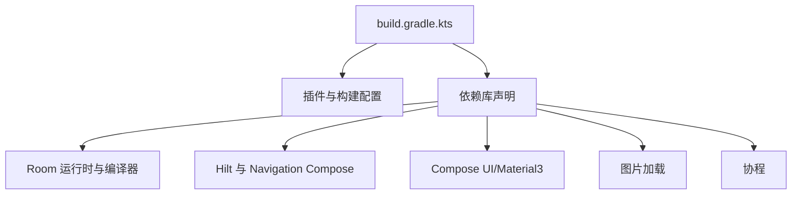

# 项目概述

<cite>
**本文引用的文件**   
- [基础prd.md](file://基础prd.md)
- [GuZiStorageApp.kt](file://GuZiStorage/app/src/main/java/com/guzi/storage/GuZiStorageApp.kt)
- [AndroidManifest.xml](file://GuZiStorage/app/src/main/AndroidManifest.xml)
- [MainActivity.kt](file://GuZiStorage/app/src/main/java/com/guzi/storage/MainActivity.kt)
- [build.gradle.kts](file://GuZiStorage/app/build.gradle.kts)
- [AppModule.kt](file://GuZiStorage/app/src/main/java/com/guzi/storage/di/AppModule.kt)
- [AppDatabase.kt](file://GuZiStorage/app/src/main/java/com/guzi/storage/data/local/AppDatabase.kt)
- [ItemEntity.kt](file://GuZiStorage/app/src/main/java/com/guzi/storage/data/local/entity/ItemEntity.kt)
- [TransactionEntity.kt](file://GuZiStorage/app/src/main/java/com/guzi/storage/data/local/entity/TransactionEntity.kt)
- [PipeListConverter.kt](file://GuZiStorage/app/src/main/java/com/guzi/storage/data/local/PipeListConverter.kt)
- [ItemRepository.kt](file://GuZiStorage/app/src/main/java/com/guzi/storage/data/repository/ItemRepository.kt)
- [Item.kt](file://GuZiStorage/app/src/main/java/com/guzi/storage/domain/model/Item.kt)
- [Theme.kt](file://GuZiStorage/app/src/main/java/com/guzi/storage/ui/theme/Theme.kt)
- [strings.xml](file://GuZiStorage/app/src/main/res/values/strings.xml)
</cite>

## 目录
1. [简介](#简介)
2. [项目结构](#项目结构)
3. [核心组件](#核心组件)
4. [架构总览](#架构总览)
5. [详细组件分析](#详细组件分析)
6. [依赖关系分析](#依赖关系分析)
7. [性能与隐私特性](#性能与隐私特性)
8. [快速开始指南](#快速开始指南)
9. [故障排查](#故障排查)
10. [结论](#结论)

## 简介
谷子收纳是一款面向二次元周边收藏爱好者的本地化物品管理工具。其目标是帮助用户轻松记录“谷子”（动漫/游戏周边）的购入与卖出信息，追踪藏品状态，并在设备本地完成全部数据管理与检索。项目坚持隐私优先、无网络依赖的设计理念，所有数据保存在设备本地，不联网、不上云，保障用户隐私安全。

核心价值主张：
- 轻量易用：聚焦周边收藏的核心场景，减少冗余功能，提升录入与查询效率。
- 隐私优先：纯本地存储，无需服务器与网络权限，避免数据外泄风险。
- 可扩展性：数据结构预留扩展空间，支持后续新增属性与预设选项，降低重构成本。
- 现代化技术栈：采用 Android + Kotlin + Jetpack Compose + Room + Hilt，构建可维护、可测试的现代应用。

适用平台与目标用户：
- 优先开发平台：Android（手机端），后续可考虑 PC 端扩展。
- 目标用户：周边收藏爱好者、“吃谷人”、漫画/手办玩家等。

**章节来源**
- [基础prd.md:1-249](file://基础prd.md#L1-L249)

## 项目结构
仓库采用分层组织方式，按职责划分模块：
- 应用入口与主题：Application、Activity、Compose 主题配置
- 数据层：Room 数据库、实体、DAO、转换器、仓库
- 领域层：领域模型（业务对象）
- UI 层：基于 Jetpack Compose 的界面（当前为占位欢迎页）

图表来源
- [GuZiStorageApp.kt:1-11](file://GuZiStorage/app/src/main/java/com/guzi/storage/GuZiStorageApp.kt#L1-L11)
- [AndroidManifest.xml:1-24](file://GuZiStorage/app/src/main/AndroidManifest.xml#L1-L24)
- [MainActivity.kt:1-55](file://GuZiStorage/app/src/main/java/com/guzi/storage/MainActivity.kt#L1-L55)
- [Theme.kt:1-51](file://GuZiStorage/app/src/main/java/com/guzi/storage/ui/theme/Theme.kt#L1-L51)
- [AppModule.kt:1-50](file://GuZiStorage/app/src/main/java/com/guzi/storage/di/AppModule.kt#L1-L50)
- [AppDatabase.kt:1-34](file://GuZiStorage/app/src/main/java/com/guzi/storage/data/local/AppDatabase.kt#L1-L34)
- [ItemEntity.kt:1-89](file://GuZiStorage/app/src/main/java/com/guzi/storage/data/local/entity/ItemEntity.kt#L1-L89)
- [TransactionEntity.kt:1-65](file://GuZiStorage/app/src/main/java/com/guzi/storage/data/local/entity/TransactionEntity.kt#L1-L65)
- [PipeListConverter.kt:1-26](file://GuZiStorage/app/src/main/java/com/guzi/storage/data/local/PipeListConverter.kt#L1-L26)
- [ItemRepository.kt:1-80](file://GuZiStorage/app/src/main/java/com/guzi/storage/data/repository/ItemRepository.kt#L1-L80)
- [Item.kt:1-106](file://GuZiStorage/app/src/main/java/com/guzi/storage/domain/model/Item.kt#L1-L106)

**章节来源**
- [GuZiStorageApp.kt:1-11](file://GuZiStorage/app/src/main/java/com/guzi/storage/GuZiStorageApp.kt#L1-L11)
- [AndroidManifest.xml:1-24](file://GuZiStorage/app/src/main/AndroidManifest.xml#L1-L24)
- [MainActivity.kt:1-55](file://GuZiStorage/app/src/main/java/com/guzi/storage/MainActivity.kt#L1-L55)
- [Theme.kt:1-51](file://GuZiStorage/app/src/main/java/com/guzi/storage/ui/theme/Theme.kt#L1-L51)
- [AppModule.kt:1-50](file://GuZiStorage/app/src/main/java/com/guzi/storage/di/AppModule.kt#L1-L50)
- [AppDatabase.kt:1-34](file://GuZiStorage/app/src/main/java/com/guzi/storage/data/local/AppDatabase.kt#L1-L34)
- [ItemEntity.kt:1-89](file://GuZiStorage/app/src/main/java/com/guzi/storage/data/local/entity/ItemEntity.kt#L1-L89)
- [TransactionEntity.kt:1-65](file://GuZiStorage/app/src/main/java/com/guzi/storage/data/local/entity/TransactionEntity.kt#L1-L65)
- [PipeListConverter.kt:1-26](file://GuZiStorage/app/src/main/java/com/guzi/storage/data/local/PipeListConverter.kt#L1-L26)
- [ItemRepository.kt:1-80](file://GuZiStorage/app/src/main/java/com/guzi/storage/data/repository/ItemRepository.kt#L1-L80)
- [Item.kt:1-106](file://GuZiStorage/app/src/main/java/com/guzi/storage/domain/model/Item.kt#L1-L106)

## 核心组件
- 应用与入口
  - Application 类用于初始化依赖注入框架（Hilt）。
  - Activity 作为 Compose 应用的宿主，设置主题并承载初始界面。
  - 清单文件声明应用名称、图标、主题及启动 Activity。
- 依赖注入（Hilt）
  - 提供 Room 数据库单例实例与各 DAO 实例，便于在仓库与 UI 层注入使用。
- 数据层（Room）
  - 数据库定义包含三张表：物品、交易记录、预设选项。
  - 实体定义字段、索引与外键约束；交易记录通过外键级联删除关联物品。
  - 转换器将多选字段以管道符分隔字符串与 List<String> 互转。
- 领域层（Domain）
  - 领域模型封装业务语义，如显示名称规则（有伤时附加伤情详情）、Entity 与 Domain 的转换方法。
- 仓库层（Repository）
  - 封装 CRUD 操作，对外暴露 Flow 响应式数据流，负责 Entity ↔ Domain Model 转换。
- UI 主题（Material3）
  - 支持动态颜色与深色模式，统一应用视觉风格。

**章节来源**
- [GuZiStorageApp.kt:1-11](file://GuZiStorage/app/src/main/java/com/guzi/storage/GuZiStorageApp.kt#L1-L11)
- [AndroidManifest.xml:1-24](file://GuZiStorage/app/src/main/AndroidManifest.xml#L1-L24)
- [MainActivity.kt:1-55](file://GuZiStorage/app/src/main/java/com/guzi/storage/MainActivity.kt#L1-L55)
- [AppModule.kt:1-50](file://GuZiStorage/app/src/main/java/com/guzi/storage/di/AppModule.kt#L1-L50)
- [AppDatabase.kt:1-34](file://GuZiStorage/app/src/main/java/com/guzi/storage/data/local/AppDatabase.kt#L1-L34)
- [ItemEntity.kt:1-89](file://GuZiStorage/app/src/main/java/com/guzi/storage/data/local/entity/ItemEntity.kt#L1-L89)
- [TransactionEntity.kt:1-65](file://GuZiStorage/app/src/main/java/com/guzi/storage/data/local/entity/TransactionEntity.kt#L1-L65)
- [PipeListConverter.kt:1-26](file://GuZiStorage/app/src/main/java/com/guzi/storage/data/local/PipeListConverter.kt#L1-L26)
- [ItemRepository.kt:1-80](file://GuZiStorage/app/src/main/java/com/guzi/storage/data/repository/ItemRepository.kt#L1-L80)
- [Item.kt:1-106](file://GuZiStorage/app/src/main/java/com/guzi/storage/domain/model/Item.kt#L1-L106)
- [Theme.kt:1-51](file://GuZiStorage/app/src/main/java/com/guzi/storage/ui/theme/Theme.kt#L1-L51)

## 架构总览
系统采用经典的三层架构（UI → Repository → Data/Room），结合 Hilt 进行依赖注入，保证高内聚低耦合。数据持久化完全本地化，遵循隐私优先原则。

图表来源
- [MainActivity.kt:1-55](file://GuZiStorage/app/src/main/java/com/guzi/storage/MainActivity.kt#L1-L55)
- [Theme.kt:1-51](file://GuZiStorage/app/src/main/java/com/guzi/storage/ui/theme/Theme.kt#L1-L51)
- [AppModule.kt:1-50](file://GuZiStorage/app/src/main/java/com/guzi/storage/di/AppModule.kt#L1-L50)
- [AppDatabase.kt:1-34](file://GuZiStorage/app/src/main/java/com/guzi/storage/data/local/AppDatabase.kt#L1-L34)
- [ItemEntity.kt:1-89](file://GuZiStorage/app/src/main/java/com/guzi/storage/data/local/entity/ItemEntity.kt#L1-L89)
- [TransactionEntity.kt:1-65](file://GuZiStorage/app/src/main/java/com/guzi/storage/data/local/entity/TransactionEntity.kt#L1-L65)
- [PipeListConverter.kt:1-26](file://GuZiStorage/app/src/main/java/com/guzi/storage/data/local/PipeListConverter.kt#L1-L26)
- [ItemRepository.kt:1-80](file://GuZiStorage/app/src/main/java/com/guzi/storage/data/repository/ItemRepository.kt#L1-L80)
- [Item.kt:1-106](file://GuZiStorage/app/src/main/java/com/guzi/storage/domain/model/Item.kt#L1-L106)

## 详细组件分析

### 应用与入口组件
- Application 类启用 Hilt 依赖注入，确保全局可用的数据库与 DAO 实例。
- Activity 作为 Compose 宿主，设置 Edge-to-Edge 与 Material3 主题，渲染初始欢迎界面。
- 清单文件声明应用元信息与启动 Activity，未声明任何网络权限，体现无网络依赖的设计。

图表来源
- [GuZiStorageApp.kt:1-11](file://GuZiStorage/app/src/main/java/com/guzi/storage/GuZiStorageApp.kt#L1-L11)
- [AndroidManifest.xml:1-24](file://GuZiStorage/app/src/main/AndroidManifest.xml#L1-L24)
- [MainActivity.kt:1-55](file://GuZiStorage/app/src/main/java/com/guzi/storage/MainActivity.kt#L1-L55)
- [Theme.kt:1-51](file://GuZiStorage/app/src/main/java/com/guzi/storage/ui/theme/Theme.kt#L1-L51)

**章节来源**
- [GuZiStorageApp.kt:1-11](file://GuZiStorage/app/src/main/java/com/guzi/storage/GuZiStorageApp.kt#L1-L11)
- [AndroidManifest.xml:1-24](file://GuZiStorage/app/src/main/AndroidManifest.xml#L1-L24)
- [MainActivity.kt:1-55](file://GuZiStorage/app/src/main/java/com/guzi/storage/MainActivity.kt#L1-L55)
- [Theme.kt:1-51](file://GuZiStorage/app/src/main/java/com/guzi/storage/ui/theme/Theme.kt#L1-L51)

### 数据层与领域模型
- 数据库与实体
  - 数据库定义包含物品、交易记录、预设选项三张表，导出 Schema 以便迁移。
  - 物品实体包含基础字段、多选字段（管道符分隔）、扩展 JSON 字段与时间戳。
  - 交易记录实体通过外键与物品实体关联，并设置级联删除。
- 转换器
  - 管道符分隔列表转换器实现 String 与 List<String> 的双向转换，简化多选字段的存取。
- 领域模型
  - 领域模型 Item 提供显示名称计算逻辑（有伤时附加伤情详情），并提供 toEntity/fromEntity 转换方法。
- 仓库
  - 仓库封装对 DAO 的调用，返回 Flow 响应式数据流，负责 Entity ↔ Domain Model 转换与批量操作。

图表来源
- [ItemEntity.kt:1-89](file://GuZiStorage/app/src/main/java/com/guzi/storage/data/local/entity/ItemEntity.kt#L1-L89)
- [TransactionEntity.kt:1-65](file://GuZiStorage/app/src/main/java/com/guzi/storage/data/local/entity/TransactionEntity.kt#L1-L65)
- [PipeListConverter.kt:1-26](file://GuZiStorage/app/src/main/java/com/guzi/storage/data/local/PipeListConverter.kt#L1-L26)
- [Item.kt:1-106](file://GuZiStorage/app/src/main/java/com/guzi/storage/domain/model/Item.kt#L1-L106)

**章节来源**
- [AppDatabase.kt:1-34](file://GuZiStorage/app/src/main/java/com/guzi/storage/data/local/AppDatabase.kt#L1-L34)
- [ItemEntity.kt:1-89](file://GuZiStorage/app/src/main/java/com/guzi/storage/data/local/entity/ItemEntity.kt#L1-L89)
- [TransactionEntity.kt:1-65](file://GuZiStorage/app/src/main/java/com/guzi/storage/data/local/entity/TransactionEntity.kt#L1-L65)
- [PipeListConverter.kt:1-26](file://GuZiStorage/app/src/main/java/com/guzi/storage/data/local/PipeListConverter.kt#L1-L26)
- [Item.kt:1-106](file://GuZiStorage/app/src/main/java/com/guzi/storage/domain/model/Item.kt#L1-L106)
- [ItemRepository.kt:1-80](file://GuZiStorage/app/src/main/java/com/guzi/storage/data/repository/ItemRepository.kt#L1-L80)

### 依赖注入与数据库配置
- Hilt 模块提供 Room 数据库单例与 DAO 实例，便于在各层注入使用。
- 数据库命名与迁移策略：使用固定文件名，配置破坏性迁移回退（适合开发阶段）。

图表来源
- [AppModule.kt:1-50](file://GuZiStorage/app/src/main/java/com/guzi/storage/di/AppModule.kt#L1-L50)
- [AppDatabase.kt:1-34](file://GuZiStorage/app/src/main/java/com/guzi/storage/data/local/AppDatabase.kt#L1-L34)
- [ItemRepository.kt:1-80](file://GuZiStorage/app/src/main/java/com/guzi/storage/data/repository/ItemRepository.kt#L1-L80)

**章节来源**
- [AppModule.kt:1-50](file://GuZiStorage/app/src/main/java/com/guzi/storage/di/AppModule.kt#L1-L50)
- [AppDatabase.kt:1-34](file://GuZiStorage/app/src/main/java/com/guzi/storage/data/local/AppDatabase.kt#L1-L34)

### 仓库与响应式数据流
- 仓库提供获取所有物品、按 IP/类别/出品商/角色筛选、搜索、计数等方法，均返回 Flow<List<Item>>。
- 写入操作包括添加单个/批量物品、更新、删除（含批量删除），内部处理时间戳与 Entity 转换。

图表来源
- [ItemRepository.kt:1-80](file://GuZiStorage/app/src/main/java/com/guzi/storage/data/repository/ItemRepository.kt#L1-L80)
- [Item.kt:1-106](file://GuZiStorage/app/src/main/java/com/guzi/storage/domain/model/Item.kt#L1-L106)
- [AppDatabase.kt:1-34](file://GuZiStorage/app/src/main/java/com/guzi/storage/data/local/AppDatabase.kt#L1-L34)

**章节来源**
- [ItemRepository.kt:1-80](file://GuZiStorage/app/src/main/java/com/guzi/storage/data/repository/ItemRepository.kt#L1-L80)
- [Item.kt:1-106](file://GuZiStorage/app/src/main/java/com/guzi/storage/domain/model/Item.kt#L1-L106)

### 显示名称与状态规则
- 显示名称规则：当状态为“无伤”时直接展示中文名称；否则附加伤情详情，形成“名称（伤情）”格式。
- 该规则在领域模型中集中实现，便于 UI 层直接使用。

图表来源
- [Item.kt:1-106](file://GuZiStorage/app/src/main/java/com/guzi/storage/domain/model/Item.kt#L1-L106)

**章节来源**
- [Item.kt:1-106](file://GuZiStorage/app/src/main/java/com/guzi/storage/domain/model/Item.kt#L1-L106)

## 依赖关系分析
- 构建与插件
  - 启用 Android/Kotlin/Compose/Hilt/KSP 等插件，编译选项与 Compose 构建特性已配置。
- 关键依赖
  - AndroidX Core、Lifecycle、Compose BOM、Navigation、Room、Hilt、Coil、Coroutines、测试库。
- 依赖注入
  - Hilt 提供数据库与 DAO 单例，仓库注入 DAO，UI 通过 ViewModel/导航注入仓库（当前为占位界面）。

图表来源
- [build.gradle.kts:1-97](file://GuZiStorage/app/build.gradle.kts#L1-L97)

**章节来源**
- [build.gradle.kts:1-97](file://GuZiStorage/app/build.gradle.kts#L1-L97)

## 性能与隐私特性
- 性能
  - 列表与搜索通过 Flow 响应式数据流驱动，减少不必要的重建与重复查询。
  - 实体索引覆盖常用查询字段（IP、状态、类别），有助于提高检索性能。
- 隐私
  - 应用未声明网络权限，所有数据存储在本地 SQLite，符合隐私优先理念。
  - 可选备份方案：未来可通过本地文件导入/导出实现跨设备同步（非云端）。

[本节为通用指导，不涉及具体代码文件]

## 快速开始指南
- 环境准备
  - 安装 Android Studio，配置 JDK 17（已在构建脚本中指定）。
  - 打开项目根目录，等待 Gradle 同步完成。
- 运行应用
  - 连接设备或启动模拟器，点击运行按钮。
  - 应用启动后会显示欢迎界面（当前为占位文本）。
- 理解入口与主题
  - 应用入口：Application 类启用 Hilt。
  - 主界面：Activity 设置主题与 Scaffold，渲染欢迎页面。
  - 主题：Material3 支持动态颜色与深色模式。
- 数据层概览
  - 数据库：Room 定义三张表（物品、交易记录、预设选项）。
  - 实体：物品与交易记录实体，包含索引与外键约束。
  - 转换器：管道符分隔列表转换器用于多选字段。
  - 仓库：封装 CRUD 与 Flow 数据流，负责 Entity ↔ Domain 转换。
- 术语对照
  - 参考产品需求文档中的术语表，了解“谷子”“吧唧”“通贩”“场贩”等词汇含义。

**章节来源**
- [GuZiStorageApp.kt:1-11](file://GuZiStorage/app/src/main/java/com/guzi/storage/GuZiStorageApp.kt#L1-L11)
- [AndroidManifest.xml:1-24](file://GuZiStorage/app/src/main/AndroidManifest.xml#L1-L24)
- [MainActivity.kt:1-55](file://GuZiStorage/app/src/main/java/com/guzi/storage/MainActivity.kt#L1-L55)
- [Theme.kt:1-51](file://GuZiStorage/app/src/main/java/com/guzi/storage/ui/theme/Theme.kt#L1-L51)
- [AppDatabase.kt:1-34](file://GuZiStorage/app/src/main/java/com/guzi/storage/data/local/AppDatabase.kt#L1-L34)
- [ItemEntity.kt:1-89](file://GuZiStorage/app/src/main/java/com/guzi/storage/data/local/entity/ItemEntity.kt#L1-L89)
- [TransactionEntity.kt:1-65](file://GuZiStorage/app/src/main/java/com/guzi/storage/data/local/entity/TransactionEntity.kt#L1-L65)
- [PipeListConverter.kt:1-26](file://GuZiStorage/app/src/main/java/com/guzi/storage/data/local/PipeListConverter.kt#L1-L26)
- [ItemRepository.kt:1-80](file://GuZiStorage/app/src/main/java/com/guzi/storage/data/repository/ItemRepository.kt#L1-L80)
- [基础prd.md:233-249](file://基础prd.md#L233-L249)

## 故障排查
- 应用无法启动
  - 检查清单文件中 Application 与 Activity 的声明是否正确。
  - 确认 Hilt 注解与模块是否生效。
- 数据库相关错误
  - 若出现版本迁移问题，检查数据库版本号与迁移策略（当前使用破坏性迁移回退）。
  - 确认实体字段与索引是否与查询匹配。
- 多选字段为空或异常
  - 检查管道符分隔转换器是否正确处理空字符串与空列表。
- 依赖注入失败
  - 确认 Hilt 模块提供的单例与 DAO 是否正确注册。
- 主题显示异常
  - 检查 Material3 主题配置与动态颜色开关。

**章节来源**
- [AndroidManifest.xml:1-24](file://GuZiStorage/app/src/main/AndroidManifest.xml#L1-L24)
- [AppModule.kt:1-50](file://GuZiStorage/app/src/main/java/com/guzi/storage/di/AppModule.kt#L1-L50)
- [AppDatabase.kt:1-34](file://GuZiStorage/app/src/main/java/com/guzi/storage/data/local/AppDatabase.kt#L1-L34)
- [PipeListConverter.kt:1-26](file://GuZiStorage/app/src/main/java/com/guzi/storage/data/local/PipeListConverter.kt#L1-L26)
- [Theme.kt:1-51](file://GuZiStorage/app/src/main/java/com/guzi/storage/ui/theme/Theme.kt#L1-L51)

## 结论
谷子收纳以隐私优先为核心，采用现代 Android 技术栈构建，具备清晰的层次结构与良好的可扩展性。当前版本已完成应用入口、主题、数据库与仓库的基础搭建，后续可在 UI 层逐步实现分组展示、详情查看、搜索与批量导入等功能。建议优先完善主列表与详情页的 Compose 界面，并结合仓库提供的 Flow 数据流实现响应式交互。

[本节为总结性内容，不涉及具体代码文件]